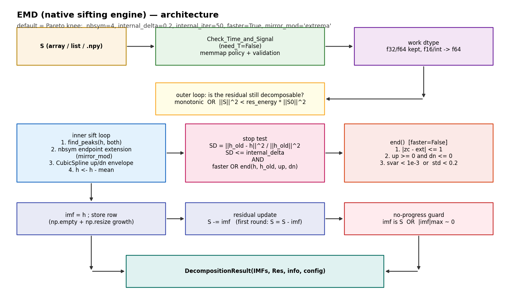
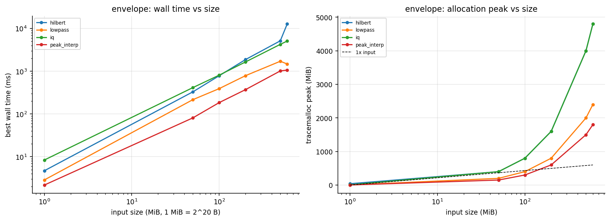
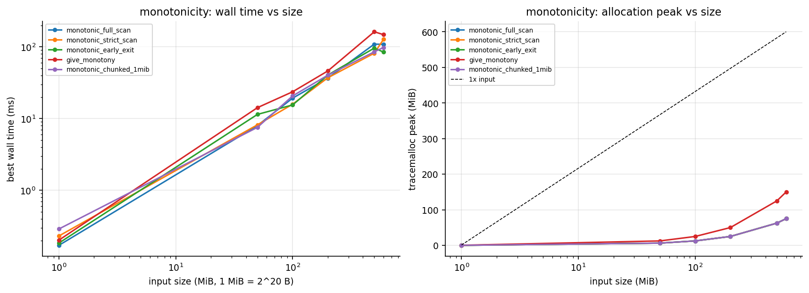
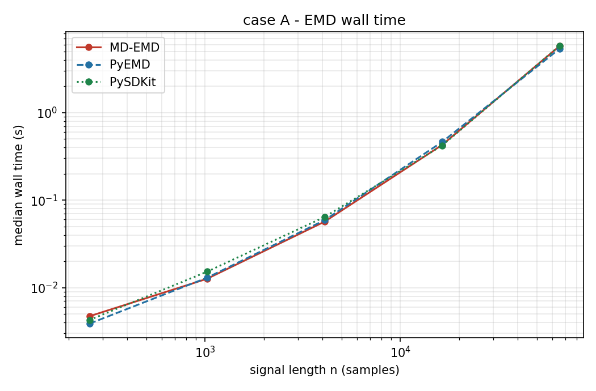
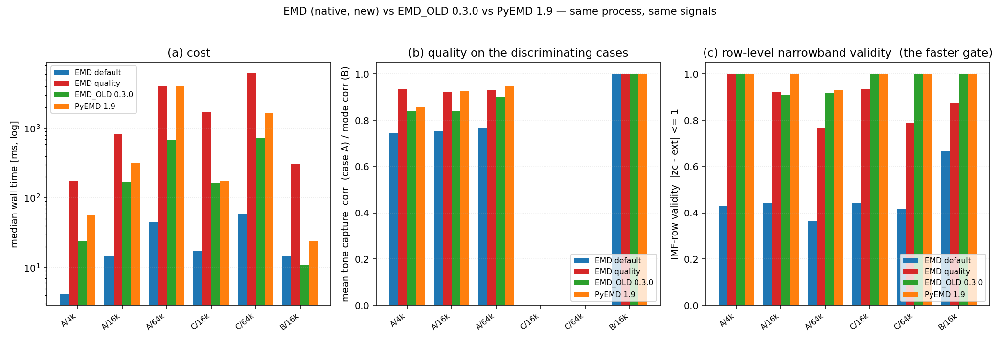
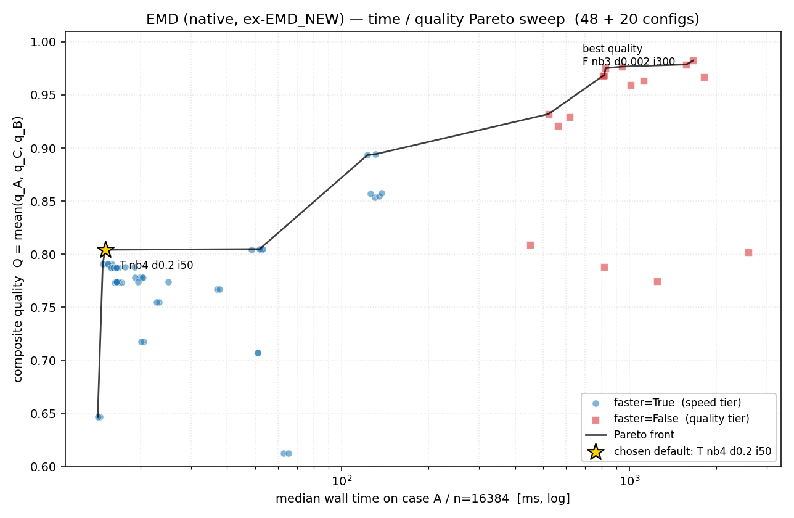
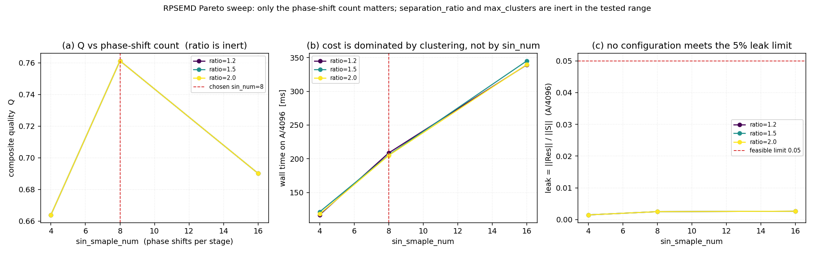

# Modal-Decomposition：面向信号分解的统一模态分解库

**2026 年第八届全球校园人工智能算法精英大赛 · 算法主题赛（AI + 开源）技术报告**

| 项目 | 内容 |
|---|---|
| 作品名称 | Modal-Decomposition |
| 参赛方向 | （三）开源项目改进与生态贡献 |
| 作品形态 | 开发工具：Python 库（源码包 + 平台 wheel + 测试/数据/图表/文档四类可核验材料） |
| 团队名称 | 鳗whatIcanSay |
| 参赛编号 | AIC-2026-25852526 |
| 仓库地址 | <https://github.com/a-raining-day/Modal-Decomposition> |
| 版本 | `0.4.0`（`pyproject.toml` 与 `src/Modal_Decomposition/__init__.py:58` 一致） |
| 许可证 | Apache-2.0 |
| 报告日期 | 2026 年 10 月 |

> **合规声明（对应附件 1「三、（九）公平性」）**：本报告及随附材料中不含参赛团队所在学校名称、学校 LOGO、指导教师信息，也不含任何个人身份证件信息。承诺书中的身份材料仅在报名系统内提交，不进入评审材料。
>
> **阅读约定**
>
> 1. 报告内所有数值都能追溯到仓库内的具体文件：`tests/**/*.json`（原始逐格产物）、`table/**/*.csv`（汇总表）、`fig/**/*.png`（图）或对应报告正文给出的复现命令。
> 2. 计时口径为「同进程、warm-up 后重复取 best/median」；**跨日 / 跨脚本的绝对毫秒数不可比**，本报告只做同表内比较，必要时直接给出同进程比值。
> 3. 文中「MB」一律指 **MiB（2²⁰ B）**：1 MiB = 1 048 576 B = 131 072 个 `float64`，600 MiB = 629 145 600 B。
> 4. 回归、变慢、失败一律如实写进第五节「（九）未达目标与已知回归」，不做美化。

---

## 作品简介

模态分解是处理非线性、非平稳信号的核心手段，但 Python 生态缺少统一实现：算法散落在 EMD-Signal、ewtpy、vmdpy 中，多数只有论文没有可运行代码。本项目把 15 个分解法收敛到同一套「输入检测—算法主体—结构返回」契约，提供 Class/Function 双入口与可复现的配置快照，并以分层架构共享底层优化。原生引擎在 1.6×10⁴ 点比 PyEMD 快 18.9×、比 PySDKit 快 21.3×，EMD 默认档在 6.6×10⁴ 点快 89.8×；工具层 1–600 MiB 六档 198 格全通过。成果为 Apache-2.0 仓库、1511 条用例与可追溯材料。

---

## 一、作品概述

### （一）背景与问题

**1. 领域背景**

「模态分解」在中文里对应两个不同的东西：在**信号分解**领域，它指通过数据驱动的自适应算法把一维（或少数通道）时间序列拆成若干个本征模态函数（IMF）与残余项，用于非平稳、非线性信号的时频分析；在**流体力学**领域，它指 POD/DMD 一类对流场快照做模态分解的方法。本项目做的是前者。

信号分解领域的模态分解比傅里叶分析、小波分析更适合捕捉局部特征，原因是它**不需要事先给定基函数**——基由信号自身极值点的分布决定。1998 年 Huang 等人提出 EMD（Empirical Mode Decomposition）标志着这条技术路线的起点；此后为解决 EMD 的模态混叠，衍生出 EEMD、CEEMD、CEEMDAN、ICEEMDAN、RPSEMD、MEMD 等「EMD 家族」；为获得更好的分解性能，又出现了 LMD、VMD、SVMD、EFD、CEEFD、FMD、EWT 等算法；SSA（奇异谱分析）则以另一条路径（轨迹矩阵 + 奇异值分解）给出同类能力。

**2. 现有做法的三个具体问题**

问题不是「没有算法」，而是「算法有、工程没有」。团队在做实际信号处理时的真实体验是：

| 现状 | 具体表现 | 后果 |
|---|---|---|
| **实现分散** | 生产可用的只有三处：EMD-Signal（`pip install EMD-signal`）只实现 EMD / EEMD / CEEMDAN；ewtpy 只实现 EWT；vmdpy 只实现 VMD（无 SVMD） | 想比较 5 种方法，要装 3 个库、记 3 套调用约定、写 3 套适配代码 |
| **文档以讹传讹** | 网上大量示例写 `from PyEMD import CEEMD, ICEEMDAN`，而 EMD-Signal **从未实现过**这两个类 | 复现失败，且失败信息指向库内部，排查成本高 |
| **集成式库缺架构** | 2026 年 9 月起广泛推广的 PySDKit 收集了大量信号分解算法，但采用「把各方法源码搬进来 + 全局 `import *`」的方式，没有统一入口、没有统一返回结构、没有底层优化 | 各方法行为不一致，性能与内存无从优化，问题无法在架构层修复 |

此外还有两个**工程侧**的硬约束，是团队自己踩出来的：

- **内存**：多模态方法的输出本身就是 `K×8N` 字节；1 GB 输入、K=5 就要 5 GB 输出，任何「先复制再算」的写法都会 OOM。
- **速度**：EMD 家族的每次分解要跑 M（默认 100）次内层筛选，纯 Python 循环下的耗时与「能不能做实验」直接冲突。

**3. 本项目要回答的问题**

> 能不能把散落的 15 个模态分解算法收敛到**一套可验证的工程契约**上，让它们共享同一套输入检测、内存策略、种子与返回结构，并把「快多少、省多少内存、质量差多少」用可复现的实测数字讲清楚？

### （二）目标、参赛方向与作品形态

**1. 目标**

| 层级 | 目标 | 达成判据（可核验） |
|---|---|---|
| 接口层 | 15 个方法共用一套契约：统一的形参校验、输入检测、返回结构与配置快照 | 每个方法 9 项统一契约用例（`tests/methods/test_<M>.py`） |
| 实现层 | 尽可能自研，把三方依赖压到「可选」 | 运行期依赖只剩 `numpy` / `scipy` / `psutil`（`pyproject.toml:27-31`） |
| 性能层 | 同口径下比现有实现更快、更省内存 | 同进程同脚本的四/三方对照表 + 内存轴 |
| 质量层 | 默认参数是「综合最优」而非「随手取的数」 | 15 份 Pareto 扫描，每份给出 Q 值与候选点 |
| 规模层 | 小到单点、大到 600 MiB 的输入都不崩 | 规模轴 198 格 + 大数组内存轴 |
| 可复现层 | 每个数字能追到脚本与原始产物 | `tests/`→`table/`→`fig/`→`docs/` 四类材料一一对应 |

**2. 参赛方向**

申报 **（三）开源项目改进与生态贡献**。上游项目就是本仓库自身在 2026 年 3 月创建的原型（早期为「把各方法源码集成进来」的形态），本作品对它的实质改进是：**重做分层架构、把 14 个方法从「包装三方实现」改为「库内原生实现」、为工具层补 453 条深度用例、为 8 个低成本工具补 1–600 MiB 规模轴、并修掉 6 类真实缺陷**。这不是「换行业场景」或「界面包装」，而是同一问题域内的架构级重做——详见第五节与第六节。

**3. 作品形态**

- Python 库（源码安装 `pip install -e .`；三平台 wheel 构建流水线已就绪，目标 cp310–cp313）；
- 四类可核验材料：`tests/`（可执行脚本 + 原始 JSON）、`table/`（67 张 csv + 1 个汇总 xlsx）、`fig/`（69 张 png）、`docs/`（45 篇 md）；
- 一份跨平台 CI（`.github/workflows/test.yml`，3 系统 × 2 Python 版本）。

**非目标**（明确不做，避免评审误读）：不训练任何模型、不使用 GPU、不做 Web/小程序界面、不做商业化平台。本作品的「AI」成分在第三节单独说明，它是**开发过程的协作者**，不是运行时的推理组件。

### （三）核心亮点

1. **一套契约装下 15 个算法。** `Class.X(**params).decompose(S)` 与 `Function.X(S, **params)` 严格等价；所有方法返回同一个 `DecompositionResult`（`.IMFs` / `.Res` / `.info` / `.config`），`.config` 是该次运行的**冻结参数快照**，可 `to_dict()` 后 JSON 序列化——这是「结果可复现」的最小工程保证，PySDKit 与三个单方法库都做不到。
2. **原生实现替代三方包装，同口径实测加速。** EEMD 在 A/16384 上比 PyEMD 快 **18.93×**、比 PySDKit 快 **21.27×**；CEEMD 在 A/4096 上比 PySDKit 快 **9.2×**、A/16384 上快 **21.8×**；EMD 默认档在 A/65536 上 45.70 ms，PyEMD 为 4102.43 ms（**89.8×**）。
3. **分层架构让优化可复用。** `Define < Base < Utils < 分解法` 的依赖方向被写进 `Base/__init__.py` 的模块文档并由测试守护；工具层的 13 个模块（8 个 `Utils` + 5 个 `Base`）有 **453 条深度用例**与 **198 格规模轴**，分解法直接继承这些优化而无需各自重写。
4. **内存是被"设计"出来的，不是调出来的。** `memmap` 阈值策略 + 分块 + 外存映射 + 显式清理组成一条链路：100 MB 递增数组上，EMD 的 ΔRSS 从 0.3.0 版的 319.5 MB 降到 **15.9 MB（−95%）**；600 MiB 输入下 `hilbert(...,"FFT")` 只需 2.4 GiB（相对输入 4×），而 `Envelope(method="Hilbert")` 需 4.8 GiB（8×）——两者差距被逐档量化，用户可按需选后端。
5. **"慢"和"差"都被写进报告。** 15 份 Pareto 扫描里 4 个方法（FMD / LMD / MEMD / SVMD）在 `leak ≤ 0.05` 约束下**没有任何可行参数点**，报告直接写「扫描的每一种参数组合都不可行：残余保留了大部分能量，这是算法特性而非旋钮问题」；EFD 比 PySDKit 慢 1.6×、FMD 慢 6–9×，同样写在明面上（见 §5.9）。

---

## 二、需求分析与总体方案

### （一）需求分析

目标用户是三群人：做机械故障诊断 / 生物医学信号 / 地震与振动分析的研究生与工程师；需要横向比较多分解法效果的研究者；以及把信号分解当作上游步骤的算法开发者。

| 用户现有做法 | 痛点 | 需求优先级 |
|---|---|---|
| 装 3–5 个库，各写一套调用与后处理 | 调用约定不一致、返回结构不一致，代码无法复用 | **P0：统一入口与返回契约** |
| 直接抄论文公式实现 | 边界延拓、停止准则、端点效应这些「论文不写」的细节决定了结果好坏 | **P0：库内原生实现 + 可调细节** |
| 只能在小样本上试 | 真实数据动辄几十 MB，一跑就 OOM 或卡死 | **P0：大输入可用** |
| 参数靠试 | 不知道默认值是否合理，也没有「质量 vs 耗时」的地图 | **P1：默认参数有依据** |
| 结果无法复现 | 随机种子、库版本、参数快照都没有记录 | **P1：可复现** |
| 出问题无法定位 | 集成式库里报错栈指向三方代码 | **P2：可维护的结构** |

### （二）总体方案

**1. 分层与依赖方向**

```
                    ┌───────────────────────────────────────────────┐
                    │  Modal_Decomposition/__init__.py              │
                    │  Class.X  /  Function.X  /  set_seed 等        │
                    └───────────────┬───────────────────────────────┘
                                    │  只依赖下层
   ┌────────────────────────────────┴────────────────────────────────┐
   │  分解法层（15 个模块，8225 行）                                    │
   │  EMD EEMD CEEMD CEEMDAN ICEEMDAN RPSEMD ｜ EFD CEEFD MEMD      │
   │  SSA FMD LMD VMD EWT SVMD                                      │
   └────────────────────────────────┬────────────────────────────────┘
                                    │
   ┌────────────────────────────────┴────────────────────────────────┐
   │  Utils/（8 个模块 + 2 个后端子包，3302 行）Check Envelope Hilbert    │
   │  Mirror Monotonicity Peaks Poly Slepian（+ _Hilbert / _Slepian）   │
   └────────────────────────────────┬────────────────────────────────┘
                                    │
   ┌────────────────────────────────┴────────────────────────────────┐
   │  Base/（5 个模块，1385 行）  Cache Chunk CPU Memory Seed         │
   └────────────────────────────────┬────────────────────────────────┘
                                    │
   ┌────────────────────────────────┴────────────────────────────────┐
   │  Define/（5 个模块，448 行）  类结构 / 配置 / 常量 / 路径 / 文本   │
   └─────────────────────────────────────────────────────────────────┘
        Operator/（小波基，67 行） 与 Error/（15 行）对全局独立
```

依赖方向是**硬约束**，写在 `Base/__init__.py` 的模块文档里：

> 层级：`Define < Base < Utils` —— 本包只允许 import `Define`，不得 import `Utils` 或更上层；反向依赖由各层的 getter + 进程级 import 缓存惰性承担。
> `Base` 内部顺序：`{CPU, Memory} < Chunk`；`Seed` 面向最高层，其余层不使用；`Cache` 只用标准库。
> `Utils/Check.py` 必须自包含：只依赖 `Define` 与 `Base`。

这条约束直接来自一次架构事故：2026 年 10 月 16 日的重构（提交 `c5c5851`）之前，`Utils` 与 `Base` 互相 import，`Operator` 与 `Error` 位置随意，导致「改一个工具要动三个目录」。重构后 `Base/` 的文件整体迁到 `Define/`，`CPU` 从 `Memory` 里独立成模块，`Cache` 从顶层挪进 `Base/`（提交 `d7990d5`）。

**2. 两个入口与返回契约**

| 入口 | 形态 | 等价关系 | 适用 |
|---|---|---|---|
| `Class.X(**params).decompose(S, T=None)` | 可复用的分解器实例 | `Function.X(S, **params)` ≡ `Class.X(**params).decompose(S)` | 需要多次复用同一配置、需要提前校验参数 |
| `Function.X(S, T=None, **params)` | 一次性门面函数 | 同上 | 一次性调用、脚本里写一行 |

返回结构 `DecompositionResult`：

| 字段 | 含义 | 备注 |
|---|---|---|
| `.IMFs` | 分解得到的模态，形状 `(K, N)`；多变量 `(K, d, N)` | MEMD 为三维 |
| `.Res` | 残余项；SSA / VMD 无残余概念，为 `None` | 判据：`sum(IMFs) + Res == S` |
| `.info` | 方法特有诊断信息（频谱、边界、每阶迭代数等） | 各方法自定义 |
| `.config` | **该次运行的有效参数快照**（冻结 dataclass） | `.to_dict()` 可 JSON 序列化 |
| `.n_imfs` / `.shape` / `.reconstruct()` | 便捷访问 | `reconstruct()` = `sum(IMFs) + Res` |

**3. 统一运行流程**

```
用户输入 S, T
   │
   ├─▶ Utils.Check_Time_and_Signal   ← 唯一的规范化入口
   │      · dtype 归一（默认转 numpy 类型，可显式指定）
   │      · 形状归一（1-D → (1,N)，多维通道）
   │      · 时间轴校验（重复/降序/非均匀 → 告警或重排）
   │      · 退化输入识别（常量/全零/ramp/x²/超短）→ k=0 而非伪造模态
   │      · safe 等级（safe / suspicious / unknown）+ 全局内存策略判定
   │            └─ 超过阈值 → 落盘为 np.memmap 工作副本（不materialize 到 RAM）
   ▼
分解法主体（各方法只实现自己的算法逻辑）
   │      · 需要分块 → Base.Chunk（内存内分块 / 外存 exo-chunks）
   │      · 需要内存预算 → Base.Memory.memory_budget()
   │      · 需要随机数 → Base.Seed（进程级全局种子优先，覆盖局部种子并告警）
   │      · 需要三方库 → Base.Cache.import_module（惰性 + 失败缓存）
   ▼
DecompositionResult(IMFs, Res, info, config)
```

**4. 参数与可复现的三道闸**

1. **形参校验**：`param_check()` 静态拒绝非法参数（未知 kwarg 不再被 `**kwargs` 静默吞掉——这正是本轮修掉的一个真实缺陷）。
2. **配置快照**：`config_generate()` 把**实际生效**的参数冻结进 `.config`，而不是把用户传入的原样记下。
3. **种子**：`set_seed(n)` 同时写 `Base.Seed.GLOBAL_SEED` 与 `numpy.random.seed`，因为库里两种随机源并存（FMD 读显式种子，EEMD 家族直接调 `np.random.normal`）。全局种子会覆盖方法局部种子并发出 `UserWarning`。

### （三）可行性与成本

| 维度 | 实际情况 |
|---|---|
| 硬件 | 单台笔记本（Intel 32 逻辑核 / 15.63 GB 内存 / Windows 11），**全程无 GPU** |
| 软件 | Python ≥ 3.10（开发环境 3.10.11、numpy 2.2.6、scipy 1.15.3） |
| 运行期依赖 | `numpy`、`scipy`、`psutil` 三项（`pyproject.toml:27-31`）；numba / pyfftw / cupy / vmdpy / ewtpy / EMD-signal 全部为**可选**，缺失时自动回退 |
| 编译依赖 | 仅一个可选 C 扩展（`_fht_native`，Windows 走 MSVC / Linux gcc / macOS clang）；缺 wheel 时自动回退纯 NumPy 实现，`pip install` 不会失败 |
| 安装成本 | 源码安装 `pip install -e .`（会现场编译可选的 C 扩展）；PyPI 发行流水线已就绪（打 `v*` tag 自动构建三平台 wheel 并发布），当前仓库尚未打 tag |
| 时间成本 | 7 个月、84 次提交（2026-03-22 → 2026-10-22） |
| 数据成本 | 无采购；实验信号均为合成信号（双音 + 噪声 / AM-FM / 二次趋势），探索性报告用公开数据集（CWRU 轴承、公开 EEG） |

**成本侧的关键判断**：本作品刻意避开「大模型 + 大算力」路线。评审规则明确不以模型参数规模、算力投入、代码行数作为评分依据；本作品的价值在于**同一问题域内的工程重做与可核验的量化**，而不是资源投入。

---

## 三、AI 技术与开源资源选择

### （一）AI 在本作品中的确切作用

需要把话说清楚：**本作品运行时不调用任何模型**。它是纯数值计算库，输入是 `numpy` 数组，输出是模态矩阵。作品的「AI 成分」在**开发过程**，具体分四类：

| 环节 | AI 的具体用途 | 团队如何审核/验证 |
|---|---|---|
| 架构评审 | 让 AI **只读代码、不做修改**，输出「当前项目的实际结构视图」，用于发现分层混乱、常量散落、工具位置与职责无关等问题 | 团队逐条对照源码确认；结论落成 `Base/__init__.py` 的依赖约束与后续重构提交 |
| 缺陷定位 | 对失败用例给出根因假设（如「边界增量在分块时丢失」「kwargs 泄漏进下层」） | 每条假设必须写成**先失败、修复后通过**的回归用例，否则不采纳 |
| 测试与文档生成 | 按模板生成报告骨架、复现命令、表格渲染脚本 | 生成的报告里所有数字由脚本从实测产物渲染，禁止手写数值；`tests/tools/check_links.py` 校验链接 |
| C 代码与链接 | FHT 后端的 C 源码集成、CPython 链接方式 | 用「原生内核 vs 纯 NumPy 参考实现数值一致」的 CI 步骤验证（`test.yml` 的 `Verify compiled _fht_native` 步） |

**AI 使用的边界与反思**（这是团队最重要的一条经验，也是作品的一部分）：

- 早期团队走过「全人工 → 全 AI → AI 赋能」三段路。第一阶段（2026 年 5–9 月）让 AI 直接改架构，结果虽然「基本没有错误」，但出现了两类系统性问题：**延续性**（AI 顺着既有代码补，把常量继续堆进 `Define/ConstDefine.py`，并重复实现）与**扭曲性**（代码阅读时到处跳转、不必要的抽象与模块函数）。项目一度从「漏洞百出」变成「逻辑扭曲、难以调试」。
- 转折点是意识到**从未做过显式的架构设计**：AI 没有被任何约束，于是按自己认为「好」的方式生成。此后团队改为「先定分层与依赖方向，再让 AI 在约束内实现」，并把约束写成可执行的测试。
- 因此，**本报告引用的每一个数字都不来自 AI 的叙述，而来自仓库内的脚本产物**；AI 生成的代码必须通过 1511 条用例与 CI 才算并入。
- 团队对所使用模型/平台的服务条款与输出权利已作核查；AI 生成内容在并入前均经人工审核与修改。按附件 1「三、（七）」的要求，AI 生成内容不被当作团队自主知识产权主张，本作品主张的权利范围限于团队自主设计、实现、调试、数据加工与验证部分。

### （二）开源及第三方资源

运行期只需要三个库，其余全部可选（完整清单见附录 A）：

| 资源 | 版本/来源 | 许可 | 使用方式 | 团队改动 |
|---|---|---|---|---|
| numpy | 2.2.6 | BSD-3-Clause | 全部数值内核 | 无（作为基础依赖） |
| scipy | 1.15.3 | BSD-3-Clause | 样条 `CubicSpline`、`signal.hilbert`、`find_peaks`、FFT、`linalg.svd` | 无 |
| psutil | 7.2.2 | BSD-3-Clause | 读取可用内存 / 提交内存，供 memmap 策略决策 | 无 |
| Smithsonian *am* 项目的 FHT C 代码 | 经 `waddafunk/Smithsonians_Discrete_Hilbert_Fourier_Hartley_Transforms` 获取 | 见下 | 作为 `Utils.Hilbert` 的 `FHT` 后端，Cython 编译为 `_fht_native` | 仅做 CPython 封装与打包，**未修改算法** |
| EMD-signal（PyEMD）1.9.0 | 三方 | Apache-2.0 | **仅作为对照基线**与可选适配层，不在运行期被 import | 无 |
| vmdpy 0.2 | 三方 | MIT | 可选 parity 校验后端（`Class.VMD(vmdpy=True)`） | 无 |
| ewtpy 0.2 | 三方 | MIT | 可选 `EWTpy` 适配入口 | 无 |
| numba 0.67.0 | 三方 | BSD-2-Clause | `Utils.Peaks`、`SVMD` 的可选后端 | 无 |
| PySDKit 0.5.0 | 三方（2026-09 起推广） | MIT | **仅作为对照基线**，不进入运行期依赖 | 无 |

**第三方 C 代码的许可与致谢（必须随分发保留）**：`Utils/_Hilbert/_C/_fht/` 下的 C 源码源自 Smithsonian Astrophysical Observatory（Scott Paine）的 *am* 大气模型，其许可声明为：

> This computer program containing an atmospheric propagation model for the submillimeter band is a work of the United States and may be used freely, with attribution and credit to the Smithsonian Astrophysical Observatory. The program is intended for educational, scholarly or research purposes.

本库在 `README.md` 的 Acknowledgement 段落与 `MANIFEST.in` 中保留该声明与出处链接，并在代码注释中标注**相位约定差异**：SAO 实现把相位移动 **+90°**，而 MATLAB / SciPy 是 **−90°**；要得到 MATLAB 兼容结果需对实输入解析信号的虚部乘 −1（`matlab_phase=True`）。这是一个**极易踩错且论文不写**的细节，团队把它写进了文档与测试。

### （三）自主开发与权利边界

| 类别 | 范围 |
|---|---|
| **团队自主开发** | 分层架构（`Define`/`Base`/`Utils`/`Operator`/`Error` 的划分与依赖约束）；`Base` 5 个工具与 `Utils` 8 个工具的**实现**（含 Cache 惰性导入器、Chunk 分块与外存映射、Memory 预算与临时 memmap 生命周期、Monotonicity 的交换半群合并、Mirror 的 5 种延拓、Peaks 三后端、Slepian 三后端、Envelope 4 种模式）；15 个分解法模块的**全部算法实现**（14 个由「包装三方」改为库内原生，见 §4.3）；测试体系（1511 条用例、453 条深度用例、规模轴驱动）；四类材料组织与全部报告 |
| **第三方（受许可）** | 上表所列 9 项资源；其中只有 FHT 的 C 源码被编译进产物，其余为运行期依赖或对照基线 |
| **边界说明** | 本作品**不修改**任何第三方库的源码（`ref/PySDKit-main/` 仅作为阅读参考放在仓库内、不参与构建）；EMD-signal / vmdpy / ewtpy / PySDKit 仅出现在测试与对照脚本中，安装与否不影响库的使用 |

### （四）融合方式：为什么这是「AI + 开源」而不是「调用接口」

评审规则对「综合创新」与「应用类」都强调：不得仅通过简单调用通用模型或组合现成工具形成作品。本作品的融合关系是**双向且互相约束**的：

1. **开源资源的选型是"被验证"的，不是"被信任"的。** 团队没有假定 scipy 的 `hilbert` 或 PyEMD 的结果「一定对」，而是建了三方/四方对照框架：同一份输入、同一脚本、同一指标函数（`tests/comparison/quality.py`），把 `mode1/mode2` 相关系数、正交性指数、重构误差、`valid` 行数、`leak` 同时算给每一家。这也是本作品能发现「网上流传的 `from PyEMD import CEEMD` 是错的」「EEMD 的噪声口径与 PyEMD 不一致导致首次对照失真」等问题的原因。
2. **AI 的产出被开源工程约束"接住"。** AI 在开发期可以提出重构方案、生成测试、生成 C 链接代码，但每一项都必须落到「可执行的用例 + 可追溯的数字」上；报告里的每条结论都有对应脚本。这把 AI 从「许愿式编程」变成了「在约束内实现」。
3. **成果回流开源。** 15 个方法在库内原生实现并统一契约，本身是对 Python 信号处理生态的补充；四类材料的组织方式（脚本/原始 JSON/汇总表/图/叙述报告一一对应）可作为同类项目的模板复用。

---

## 四、设计与实现过程

### （一）核心功能与流程

**1. 15 个方法一览**（默认参数取自当前代码，逐项可由 `docs/test/methods/<M>_Native_Engine_Report.md` §2 的自动生成表核对）

| 方法 | 全称 | 家族 | 关键默认参数 | 输出特点 |
|---|---|---|---|---|
| **EMD** | Empirical Mode Decomposition | EMD 家族 | `nbsym=4, internal_delta=0.2, internal_iter=50, faster=True, mirror_mod="extrema"` | 库内原生筛选引擎，无残余概念以外的一切都可调 |
| **EEMD** | Ensemble EMD | EMD 家族 | `M=50, noise_amp=0.3` | 集成平均，含进程池并行分支 |
| **CEEMD** | Complementary EEMD | EMD 家族 | `M=25, noise_amp=0.3` | 正负噪声互补，同一 M 下残余能量比 EEMD 低 7–11× |
| **CEEMDAN** | Complete EEMD with Adaptive Noise | EMD 家族 | 主导旋钮 `M` | 逐阶自适应噪声，`valid` 天然偏低（见 §5.6） |
| **ICEEMDAN** | Improved CEEMDAN | EMD 家族 | `num_imf=5, noise_amp=0.3, M=50` | 局部均值算子 `M(·)=x−E₁(x)` |
| **RPSEMD** | Random Phase Sinusoidal assisted EMD | EMD 家族 | `num_imf=5, sin_smaple_num=4, separation_ratio=1.2` | 用确定频率的正弦辅助（不是噪声） |
| **EFD** | Empirical Fourier Decomposition | 频域类 | `max_IMFs=-1` | 频谱分段 + 滤波器组 |
| **CEEFD** | Cyclic Envelop EFD | 频域类 | `fs=1.0, min_peak_distance=10, envelop_iter=3` | EFD 的循环包络改进版 |
| **MEMD** | Multivariate EMD | 多变量 | `sd_thresh=0.2, max_iter=10, spline_kind="linear"` | 输出 `(K, d, N)` 三维 |
| **SSA** | Singular Spectrum Analysis | 子空间类 | `stride=1, window="rect", energy_frac=0.995` | 无残余概念，轨迹矩阵是唯一 O(N²) 项 |
| **FMD** | Filtered Mode Decomposition | 滤波类 | `K=10, L_factor=10, max_iter=50, tol=1e-6` | 自适应带通 + 逐带解调 |
| **LMD** | Local Mean Decomposition | 时频类 | `max_iter=37, eps=0.05, envelope="midpoint", smooth_window=5` | 输出 PF（乘积函数）而非 IMF |
| **VMD** | Variational Mode Decomposition | 变分类 | `num_imf=2, alpha=2000, tau=0, epsilon=1e-7, n=500` | 自研 ADMM 内核，`engine="auto"` |
| **EWT** | Empirical Wavelet Transform | 小波类 | `num_imfs=8, band_factor="auto", boundary_mod="maximum", mirror=True` | 边界检测 + 经验小波滤波器组，100% 自研 |
| **SVMD** | Successive VMD | 变分类 | `num_modes=3, alpha=2000, tol=1e-7, max_iter=500` | 逐模态提取，`backend="numpy"/"numba"` |

**2. 最小可用流程（三行）**

```python
import numpy as np
from Modal_Decomposition import Function as f

t = np.linspace(0, 1, 1000, endpoint=False)
S = np.sin(2 * np.pi * 37 * t) + 0.5 * np.sin(2 * np.pi * 180 * t)

IMFs, Res, info = f.EMD(S)        # DecompositionResult 可直接当作三元组解包
r = f.CEEMDAN(S, trials=30, seed=0)
print(r.n_imfs, r.reconstruct().shape, r.config)   # 有效参数快照
```

大输入无需改代码：超过全局内存策略阈值时，输入层会自动落盘为 `np.memmap` 工作副本。

```python
import Modal_Decomposition as md
md.set_memmap_ratio(0.6)          # 预计占用达到剩余可用内存的 60% 即落盘
# 或 md.set_absolute_limit(2 * 1024**3)   # 固定阈值（默认 2 GiB），两种策略互斥、后设生效
IMFs, Res, info = f.EMD(S_2GB)    # 语义与内存路径完全一致
```

### （二）关键实现

#### 1. `Base/`：五个"底层假设"的承载者（1385 行）

`Base` 只放**所有上层都会用到、且实现必须唯一**的东西。五个模块各自解决一个"如果各方法自己写就一定会写歪"的问题：

| 模块 | 解决什么 | 关键实现 | 实测数字 |
|---|---|---|---|
| **Cache** | 延迟导入外部库，且**失败也要缓存** | 进程级 `cls._entries` + `cls._exists` + `threading.RLock`；`import_module` 等价于 `import` 但永不重复抛异常；`.lazy` 装饰器把零参函数变成进程内恰好执行一次的惰性取用器 | `import_module` 命中 **112.2 ns/次**、未命中 **136.0 ns/次**（失败同样走缓存，所以"没装这个库"几乎不花钱）；`get` 266.3 ns、`check` 255.7 ns、`__contains__` 303.8 ns（`table/base/cache/bench.csv`） |
| **Chunk** | 大数组的分块与**外存分块** | `chunk_size(nbytes)` **字节进、元素出**：小输入返回 8 Mi 元素；否则 `chunk_bytes = min(nbytes, 0.75×budget)`，返回 `chunk_bytes // itemsize`；`exo_chunks` 用 `Memory.temp_memmap` 逐块产出磁盘映射 | 1 / 50 / 100 / 200 / 500 / 600 MiB 六档**均返回 1 块**（设计意图：块长按预算取，这些档位都装得下）；`Chunk.chunk()` 恒为 1 块，耗时 0.021–0.058 ms |
| **CPU** | 可用核数与进程池上限 | `allocable_cpu_num` 按比例换算：`1→1`、`2→2`、`0.25→8`、`0.5→16`、`1.0→32`、`-1→全部` | `table/base/cpu/allocable_table.csv` |
| **Memory** | 内存预算与**临时文件生命周期** | `budget = int(min(available·(1−reserve), commit_available·(1−reserve)·0.6)) − extras`，`reserve=0.25`；`temp_memmap` / `drop_memmap` / `cleanup_memmaps` + `atexit` 兜底 | 同一机器不同 reserve：0.10 → 5633.2 MiB、0.25 → 4694.3 MiB、0.50 → 3129.5 MiB，`limited_by` 全为 `physical`（`table/base/memory/budget_table.csv`）；其中 0.25 档的 4694.3 MiB ≈ 4.92 GB，与大数组报告里 **4.93 GB** 的预算同一公式（取整差异） |
| **Seed** | 两套随机源的统一 | 进程级单例，默认 **42**；`set/get/validate/temporary_seed`；全局种子覆盖局部种子并发 `UserWarning` | `tests/base/test_Seed_deep.py` 18 条用例 |

> **Chunk 的一个真实缺陷**（本轮修复）：`chunk_size` 原先「字节进、字节出」，与 `chunk()` 里按元素切片的用法混用，导致**超过 0.75×budget 的输入会拿到 8 倍过大的块**；现已改为字节进、元素出，并新增 `itemsize=` 参数由 `chunk()` / `fill_memmap()` 传入真实值。1–600 MiB 这六个档位"仍是 1 块"是**设计意图**，不是缺陷——单位修正只影响超出预算的输入。

#### 2. `Utils/`：八个工具与一张"后端矩阵"（3302 行）

`Utils` 是分解法的直接上游。它的设计原则是「一个能力、多个后端、统一契约」：

| 工具 | 能力 | 后端 / 模式 | 说明 |
|---|---|---|---|
| **Check** | **唯一**的输入规范化入口 | `safe ∈ {safe, suspicious, unknown}`；`Check_Time_and_Signal` 面向最高层 | `Check.py` 必须自包含（只依赖 `Define` + `Base`）；`safe="safe"` 会**完全跳过**规范化，这是刻意留的逃生门 |
| **Envelope** | 拟合包络曲线 | 4 种：`Hilbert` / `Lowpass` / `IQ` / 极值点插值 | 600 MiB 下 4 种模式耗时 12.7 s / 1.48 s / 5.07 s / 1.06 s |
| **Hilbert** | 解析信号 | 9 个模式，主用 3 个：`scipy`（默认）/ `FFT` / `FHT` | FFT 是自研 numpy 实现；FHT 用 SAO 的 C 代码（Cython 封装，缺失时回退）；相位约定差异已文档化 |
| **Mirror** | 边界延拓（端点镜像是模态分解的"隐性命门"） | 5 种：`mirror` / `extrema` / `polynomial` / `parallel` / `BLCSE` | 返回结构与 `Peaks/find_peaks` 对齐；预分配避免整段复制 |
| **Monotonicity** | 判断序列单调性（决定 sifting 是否继续） | 枚举 `Monotony`（位组合）+ **交换半群**合并 | 分块判定必须与整段判定等价——这是本轮修掉的一个真 bug |
| **Peaks** | 极值点搜索 | 3 个后端：`numpy`（默认）/ `scipy` / `numba` | 返回 `(索引, 值)` 元组；三后端契约一致性有专门用例 |
| **Poly** | 一次性多项式拟合/求值 | `fast_poly` | 省掉「构实例再拟合」的开销；代价是 `(N, order+1)` 的 Vandermonde 矩阵 |
| **Slepian** | DPSS / Slepian 序列 | 3 个后端：`scipy`（默认）/ `C`（自包含编译核心，`ctypes` 加载）/ `numpy`，+ 进程级 LRU 缓存 | 服务 EWT 的 `pre_deal="Slepian-Optimize"` 多窗分支 |

**后端矩阵的代价被量化了**（600 MiB 输入，`table/size_axis/hilbert_*.csv`）：

| 后端 | 耗时 | 峰值分配 | 相对输入 | 结论 |
|---|---|---|---|---|
| `hilbert(S, "FFT")` | 3 703 ms | 2 400 MiB | **4×** | 最快且最省，推荐默认 |
| `hilbert(S, "FHT")` | 3 929 ms | 2 400 MiB | 4× | 与 FFT 同量级，C 内核收益体现在小规模 |
| `hilbert(S, "scipy")` | 5 527 ms | 4 800 MiB | 8× | 默认后端，最稳但内存翻倍 |
| `Envelope(S, method="Hilbert")` | 12 728 ms | 4 800 MiB | 8× | 走 scipy 后端，是 600 MiB 上最慢的单个工具调用 |

这个表直接回答了一个用户问题：**为什么默认是 scipy 而不是 FFT？** 因为 scipy 在所有边界情形（偶数长、非 2 的幂、含直流、含 NaN 边界处理）上行为最可预期，而 FFT 后端在非 2 的幂长度上需要补零，会引入端部伪迹（本轮专门补了 `zeropad_artefact.csv` 量化它）。**速度/内存与稳健性的权衡被摆到桌面上让用户选**，而不是藏起来。

#### 3. 内存策略：一条完整链路，而不是一个开关

```
输入 S（可能远超物理内存）
  │
  ├─ Utils.Check._load
  │     └─ should_use_memmap(投影用量, 策略) ──▶ 否：普通 ndarray
  │                                           └─ 是：temp_memmap → md_memmap_*.dat
  │                                                  · 注册进进程级文件表
  │                                                  · 立即 fill + flush
  ▼
算法主体
  ├─ Base.Chunk.chunk / exo_chunks     逐块读写，工作集 = 块大小
  └─ Base.Memory.memory_budget()       决定块长上限（0.75 × budget）
  ▼
生命周期收尾
  ├─ drop_memmap(fp)             主动释放
  ├─ cleanup_memmaps()           删除注册表内的临时文件
  └─ atexit: cleanup_memmaps(force=True)   进程正常退出时兜底
       └─ 进程被强杀 → 文件残留 → 由操作系统临时目录清理策略（如 Windows 存储感知）回收
```

三个必须说清楚的点：

1. **`%TEMP%` 下的文件是本库自己创建、自己删除的**，不修改任何系统设置；`tempfile.mkstemp` 建 `md_memmap_*.dat`，正常退出时由 `atexit` 钩子删除。
2. **正在被映射的临时文件在 Windows 上删不掉**（共享冲突），所以清理逻辑把"外部已删除"也当作正常情形（`FileNotFoundError` 视作已删除），这是本轮修掉的另一个真实缺陷。
3. **`tracemalloc` 对 memmap 页缓存是盲的**，所以 `chunked_fill_to_disk` 在表里的 `alloc_peak_mib` 是 0.00 —— 这不代表它不占内存，报告里如实标注了这一点。

#### 4. 方法层：以 EMD 为例说明"两档设计"

`EMD(faster=...)` 是唯一提供两档停止策略的方法，也是本作品「速度 vs 质量」方法论的样板：

| 档位 | 停止条件 | 实测代价 | 实测质量 |
|---|---|---|---|
| `faster=True`（**默认**，速度档） | 能量 Cauchy SD | A/1024 **2.87 ms**；A/4096 4.13 ms；A/16384 15.02 ms；A/65536 **45.70 ms** | A/4096 mode1 0.7179 / mode2 0.7700，valid 3/7 —— 粗分解，适合"先看形态" |
| `faster=False`（质量档） | 额外要求窄带平衡 `\|zc − ext\| ≤ 1` | A/4096 173.53 ms；A/65536 4 055.65 ms | A/4096 mode1 **0.9855** / mode2 **0.8821**，正交性 **+0.0138**，valid **10/10**，重构误差 6.66e-16 |

同表对照（同进程同脚本，`fig/methods/emd/emd_three_way.png`）：A/65536 上 `EMD 默认档 45.70 ms` / `EMD_OLD(0.3.0) 675.25 ms` / `PyEMD 4 102.43 ms`——默认档对 PyEMD 是 **89.8×**；质量档 4 055.65 ms 与 PyEMD 的 4 102.43 ms 基本持平，但 mode2 相关系数从 0.7594 提到 0.8812。



**并行**：EEMD / CEEMD / CEEMDAN / ICEEMDAN / RPSEMD 都是「M 次内层 EMD」的结构，因此并行粒度放在**试次**（EEMD 家族）或**逐阶**（CEEMDAN 家族，用 `spawn` 上下文）。CEEMD 的并行分支还做了一件容易被忽略的事：`S+w` 与 `S−w` 共用一个 `w`，否则互补性会被破坏。

### （三）版本演进：84 次提交里的四个阶段

仓库从 2026-03-22 到 2026-10-22 共 **84 次提交**，累计 **537 566 行新增 / 82 394 行删除**，HEAD 含 485 个文件。按提交信息与代码形态可清晰切成四段：

#### 阶段一：原型集成（2026-03-22 → 04-09，26 次提交）

| 日期 | 提交 | 做了什么 |
|---|---|---|
| 03-22 | `d8c6aea` | 首个提交，把各方法源码**集成**进来（此时与 PySDKit 的做法一致：直接搬代码） |
| 03-23 | `7225b1e` | 写 README，暴露最朴素的入口 |
| 03-24 | `0de9781` | 修 bug，逐个检查全部分解法 |
| 03-25 | `8d0b469` | 支持更低 Python 版本，改为可 `pip install` 的包 |
| 03-25 | `4ccf8ab` | **导入优化：5.001 s → 0.747 s**（改为延迟导入） |
| 03-29/30 | `d596356` / `163cf3f` | **SSA 从平均 40 分钟降到 2 秒**（改 `decompose` 的向量化方式） |
| 03-30 | `536e300` | 「Rebuilding All」——第一次整体重写 |
| 04-03 | `71aa246` | 除 MEMD 外全部分解法完成 |
| 04-07 | `63271d0` / `dc3a180` | 修 CEEFD（`freq_bins` 含 0 时索引越界）、修 EFD（`np.concentrate` 误用与 `wn` 构造错误） |

**阶段结论**：能跑，但**没有架构**——分层只有 `Base/`、`Utils/`、`Define/` 三层的雏形，各层之间没有优先级，模块函数位置与所处文件无关，所有常量都堆在 `Define/ConstDefine.py`。

#### 阶段二：统一与清理（2026-05-01 → 06-22，8 次提交）

| 日期 | 提交 | 做了什么 |
|---|---|---|
| 05-01 | `e4531ce` | 修好 MEMD（最后一个不能跑的方法） |
| 05-01 | `60c4b0d` / `e2a1109` | 修 LMD 依赖、删除 `help_function.py`；SVMD 去掉 JIT |
| 05-02 | `4b5de00` / `8438bed` | **统一所有函数的返回结构**；**统一用 `Check_Time_and_Signal` 做输入检测** |
| 05-02 | `9a3dc2c` | 提交第一版测试文件 |
| 06-22 | `978d9f0` / `8a139b2` | 清理依赖 |

**阶段结论**：出现了「统一契约」的意识（返回结构 + 唯一输入检测），这是后面所有工作的地基。

#### 阶段三：架构优化与性能战（2026-09-05 → 09-28，25 次提交）

这一阶段是**性能与方法学的主战场**：

| 日期 | 提交 | 关键结果 |
|---|---|---|
| 09-05 | `d62f3ae` | 优化库结构，修并优化 Monotonicity |
| 09-06 | `5673d09` | **优化分块策略**：判断单调性时内存占用更小；系统分析 EMD 的内存占用 |
| 09-09 | `6c094b5` | 线性样条下 EMD **快 5–25×**（`corr_hi` 低 0.011）；三次样条 **快 1.4–3.7×** 且不掉质量 |
| 09-09 | `f76dc73` | **65536 点下比 PyEMD 快 427×**（当时的记录）；线性样条比三次再快 4× |
| 09-09 | `f337074` | 报告落 `docs/`；同质量档加速约 **100–180×** |
| 09-09 | `309512f` | Mirror 改为**预分配**，避免整段重复复制 |
| 09-06 | `c20c694` | 引入 SAO 的 FHT C 实现，并构建三平台 CI 与 wheel |
| 09-14 | `2a46d89` | VMD 改为**库内自研**；报告称比 vmdpy 快 3×、峰值内存更小（**注：当前实测见 §5.5，与 vmdpy 基本持平**） |
| 09-14 | `9e47484` / `406a3f3` | 小于 300 MB 走 pyfftw、更大走 numpy；vmdpy 降级为可选依赖 |
| 09-16 | `f8cb914` | **EWT 重构为完全自研**（不再需要 ewtpy）；Slepian 增加 C 实现与缓存 |
| 09-16 | `e1fb8c7` | 底层结构开始优化 |

**阶段结论**：从「能跑」到「快」，但**结构问题开始反噬**——工具层与 Base 层互相 import、`Operator`/`Error` 位置随意、常量仍然散落。同一时期团队在与 AI 的讨论中确认了根因：**从未做过显式的架构设计**。

#### 阶段四：架构落地 + 原生引擎 + 材料分级（2026-10-04 → 10-22，25 次提交）

| 日期 | 提交 | 关键结果 |
|---|---|---|
| 10-04 | `8b8df0e` | **第一次认真考虑 API 稳定性** |
| 10-09 | `d7990d5` | **确定目录优先级 `Define < Base < Utils`**；`CPU` 从 `Memory` 独立；`Cache` 移入 `Base`；原 `Base` 文件迁到 `Define`；`Monotony` 元素类型从 `int \| None` 改为位组合，半群逻辑写清楚 |
| 10-16 | `c5c5851` | `Utils/` `Base/` `Error/` `Define/` `Operator/` 完成重构 |
| 10-16 | `4d95d29` / `47d0002` | 修 `Check.to_array` 用 `==` 比较字符串与枚举的缺陷；修 `Mirror` 返回结构；给 `Check.to_dtype` 加 dtype 校验 |
| 10-17 | `259daf1` / `dd547f2` | 修 Mirror；**EMD 完成原生重写** |
| 10-18 | `d3eec7e` / `833c1f4` | EEMD / CEEMD / CEEMDAN / ICEEMDAN 完成；**默认参数改为 Pareto 最优** |
| 10-19 | `6f39f3a` / `a8212c0` / `1b36ccc` | RPSEMD、CEEFD、MEMD、SSA、FMD、EFD、EWT、LMD、VMD、SVMD 全部提交；Hilbert 后端确定（FFT 最快、FHT 次之） |
| 10-19 | `a4829a6` | `scipy` 转为必需依赖；更新 CI 与 `pyproject.toml` |
| 10-20 | `d01fa2a` | **移除 `vmdpy` / `EMD-Signal` / `ewtpy`**——运行期依赖压到 3 个 |
| 10-22 | `54b3ede` | **材料分级重构**（`tests/` `table/` `fig/` `docs/` 四类落位）+ **13 个工具模块的深度测试（453 条）** + **1–600 MiB 规模轴（198 格）** + **修 6 类真实缺陷** |
| 10-22 | `98dfb4c` | **跨平台 CI 修复轮**：让新测试在 macOS / Linux 上通过，并恢复 LMD 被删的 4 个模块级辅助函数 |

**阶段结论**：架构从「没有」到「有且被测试守护」；14 个方法从「包装三方」到「库内原生」；材料从「平铺 39 个文件」到 `methods/utils/base/_template` 四级 + `table/` 与 `fig/` 分类；跨 6 个 CI 组合（ubuntu/windows/macos × py3.10/3.12）全部通过。

> **一次真实的事故记录（说明为什么"架构先行"重要）**：阶段四的 10-04 到 10-20 之间，`Utils`/`Base` 的接口在多轮重构中持续变化，导致 15 个同级模块仍在 import 已删除的 `_Registry` / `Base.Config`，其中 LMD 一度处于"在途重构"状态——4 个模块级辅助函数被删而调用点仍在。这个问题在本地由 148 条 LMD 用例暴露，在 CI 上以 `NameError: name 'mirror_extrema' is not defined` 的形式在 10 个平台上同时炸出。修复方式是从 `d01fa2a` **逐字恢复**这 4 个函数（150 行），而不是"就地补一个简化版"。这条记录留在 `docs/test/EXPERIMENTS_INDEX.md` §5.1。

### （四）团队分工与过程记录

按附件 1「三、（九）」要求，本报告不披露成员姓名、学校与指导教师信息，因此分工以**角色**表述。

| 角色 | 承担的环节 | 产出 |
|---|---|---|
| 队长（主体开发者） | 架构设计、全部 15 个方法的算法实现与调试、工具层优化、测试体系与实验设计、报告撰写 | 84 次提交中的 84 次（仓库 `git shortlog` 可核验）、四类材料 |
| AI 协作者（DeepSeek / 其他模型） | 只读式代码审阅、根因假设、测试骨架与文档骨架生成、C 代码链接方案、报告渲染脚本 | 见 §3.1 的四类用途；产出必须通过用例与实测数字验收 |

**时间计划与实际对比**

| 阶段 | 计划 | 实际 | 偏差原因 |
|---|---|---|---|
| 方法集成 | 2 个月 | 2026-03-22 → 04-09（约 3 周完成主体） | 集成容易，但「集成式写法不可维护」的问题在后续才暴露 |
| 统一契约 | 1 个月 | 05-02 完成返回结构与输入检测统一 | 基本符合 |
| 性能与架构 | 2 个月 | 09-05 → 10-20（约 6 周） | 架构问题的根因（缺显式设计）发现得晚，返工量大于预期 |
| 材料分级与验证 | 2 周 | 10-22 完成（含一轮 CI 修复） | CI 暴露跨平台差异（POSIX 允许删除已映射文件、CI runner 只有 3 核），追加约 1 天 |

**问题解决过程（三次典型）**

1. **「快」但不对**：早期 EMD 优化只盯耗时，结果 `valid`（窄带平衡行数）掉到 3/7。团队没有掩盖，而是把两档停止策略做成显式参数 `faster`，并把两档的质量与耗时同时列进报告（§4.2 表）。这是「性能优化必须带着质量指标一起报」原则的由来。
2. **「照抄论文」不对**：RPSEMD 最初按论文实现后结果异常，逐层排查发现是 `amp` / `freq` 两个参数在内部传递时**位置传反**；修正后又发现两处偏离算法规范（极值点取特征、相位网格构造）。最终这一轮共修 **13 处错误 + 2 处规范修正**，并顺手消掉了 O(N²) 项。
3. **「测试通过」不等于「跨平台通过」**：本轮的 453 条深度用例在 Windows 上全绿，推上 CI 后 macOS/Linux 出现 11–16 个失败——根因是 POSIX 允许删除已映射文件（所以 `cleanup_memmaps()` 返回 `True` 且不告警，测试却断言了 `DID NOT WARN`）、CI runner 只有 3 核（测试硬编码了 4 核）。修法不是放宽断言，而是**按 `os.name` 分支并保留"块仍可读"的强断言**。

---

## 五、成果展示与效果验证

### （一）成果形态与复现入口

**1. 四类材料的规模与分工**

| 目录 | 放什么 | 规模 | 为什么单独放 |
|---|---|---|---|
| `tests/` | **可执行脚本** + **原始逐格 JSON** | 155 个文件（46 个 `test_*.py` + 56 个 JSON + 实验驱动脚本） | 原始产物必须能被脚本再次读取，而不是只在报告里留一个数字 |
| `table/` | **汇总表**（csv / xlsx） | **67 张 csv** + `index.xlsx`（每 csv 一个 sheet，2463 行） | 机器可读、跨 locale 不乱码（列名全 ASCII 小写下划线） |
| `fig/` | **图片**（png） | **69 张**，按 `methods/ utils/ base/ comparison/ size_axis/ explore/` 分级 | 仓库内没有任何 png 落在 `fig/` 之外（有校验脚本） |
| `docs/` | **叙述性报告**（md） | **45 篇**，按 `test/methods utils base _template` + `explore/` 分级 | 报告只引用数据，不生产数据 |

落位规则由两个自检脚本守护：`tests/tools/check_links.py`（校验 **117 条 md 链接 + 184 个资源路径**，当前失效 0 条）、`tests/tools/verify_reorg.py`（**12 项检查全部 PASS**）。

**2. 一键复现**

```bash
git clone https://github.com/a-raining-day/Modal-Decomposition.git
cd Modal-Decomposition
pip install -e .            # 现场编译可选的 _fht_native（缺失会自动回退）
pip install pytest scipy    # CI 的全部测试依赖
python -m pytest tests -q   # ← 1511 passed, 2 skipped, 1 xfailed

# 规模轴（单工具 / 单档位；不带参数则跑全部 198 格）
python tests/size_axis/run_scale.py --tool check --size 600 --export
python tests/size_axis/run_scale.py --rebuild-summary
python tests/size_axis/report.py        # 由 summary.csv 渲染 docs/test/Scale_Axis_Report.md
```

**3. CI**

`.github/workflows/test.yml`：`ubuntu-latest / windows-latest / macos-latest` × `py3.10 / py3.12` 共 **6 个组合**，每个组合跑完整 `pytest tests -q`，并额外验证「编译出的 C 内核与纯 NumPy 参考实现数值一致」（`atol=1e-9`）。跨平台不一致的原生后端（FFT/FHT/Slepian 的 C 扩展）由测试内部的 `available_backends()` 自动跳过，不会因为缺后端而假失败。

### （二）验证方法

本作品的验证设计针对四个具体的怀疑点，每一点都对应一类实验：

| 要回答的怀疑 | 实验设计 | 产物 |
|---|---|---|
| **「能跑」是不是等于「对」？** | 每个方法 9 项统一契约用例 + 13 个工具模块 453 条深度用例（穷举/边界/退化输入/跨后端一致性） | `tests/methods/`、`tests/utils/*_deep.py`、`tests/base/*_deep.py` |
| **「快」是不是只在小样本上快？** | 1 / 50 / 100 / 200 / 500 / 600 MiB 六档规模轴（8 个工具、33 种操作、**198 格**） | `table/size_axis/summary.csv`、`fig/size_axis/*.png` |
| **「比它快」是不是同口径？** | 同一进程、同一脚本、同一输入对象、同一指标函数的三/四方对照 | `tests/comparison/results/*/compare.json`、`table/methods/*/timing_raw.csv` |
| **「默认参数」是不是随手取的？** | 15 份 Pareto 扫描（每份扫 3–68 组参数），按 `Q` 与耗时取膝点 | `tests/comparison/results/pareto/*.json` |

**1. 指标定义（读表前必看）**

| 指标 | 含义 | 方向 |
|---|---|---|
| `k` | IMF 行数，**不含**残余行 | —— |
| `valid` | 满足窄带平衡 `\|zc − ext\| ≤ 1` 的 IMF 行数 | 越高越好 |
| `recon` | `max\|Σ IMFs + Res − S\|`，重构恒等式的最大偏差 | 越低越好（≈1e-16 为机器精度） |
| `IO` | Huang 正交性指数 `Σ_{i≠j}⟨c_i,c_j⟩ / Σ_i‖c_i‖²` | 越低越好；含趋势的信号（case B）上不可靠 |
| `leak` | `‖Res‖ / ‖S‖`，残余相对能量 | 越低越好；只有当"真实残余≈0"时才能当噪声读 |
| `Q` | 综合质量分 `Q = (q_A + q_C + q_B)/3`；`q_A` = 37 Hz / 113 Hz 两个单音的 `\|corr\|` 均值，`q_C` = 白噪声上合规行占比，`q_B` = AM-FM / 89 Hz 的 `\|corr\|` 均值 | 越高越好 |
| `t` | 成本轴：case A / n=16384 的**中位数**墙钟 | 越低越好 |
| `alloc_peak_mib` | **`tracemalloc`** 记录的分配峰值 | 越低越好；**对 memmap 页缓存是盲的** |
| `rss_delta_mib` | 进程 RSS 的增量 | 参考值；大档位下分配器会归还内存，**可能出现负值**（表中 `hilbert scipy` 600 MiB 为 −603.7），故不以它作峰值结论 |

**2. 计时口径与可比性规则（这是本作品最"较真"的一条）**

- 全部**同进程、同一脚本**内测量；输入数组在整个循环中复用同一对象（各实现拿到的是同一份数据）。
- 每组先 **warm-up 1 次**（不计入），再重复 **2–3 次取 best**（规模轴/工具层）或**取中位数**（方法层三方对照）。
- 计时前**不主动 `gc`**；不跨进程比较。
- **跨日 / 跨脚本的绝对毫秒数不可比**，只做同表内比较；有疑问时以「同进程比值」为准。这条规则不是免责，而是因为实测发现同一格里不同脚本能差 3 倍以上（例如 A/4096 的 `num_imf=10` 分解在独立探针里是 55 ms，在基线脚本里记的是 196.4 ms）。
- 规模轴里的 **MB 一律指 MiB**：`1 MiB = 1 048 576 B = 131 072 个 float64`，`600 MiB = 629 145 600 B`。

**3. 为什么要有「深度测试」而不只有「烟测」**

原有的工具层测试只验证「调用不报错、形状对」。本轮的 453 条深度用例换了问法：**每个函数在其定义域上是否处处满足它自己声称的契约？** 具体包括：穷举小规模真值表（如 `Monotonicity` 的 3 元组全排列）、跨后端数值一致性（Hilbert / Peaks / Slepian 三后端）、分块与整段等价性（`chunk_size=1` 退化成最坏情形）、退化输入的返回值（常量/全零/ramp/超短）、参数校验（非法 kwarg 必须报错而不是被 `**kwargs` 吞掉）、以及"外部把文件删了会怎样"这类真实运维场景。

### （三）验证结果 1：正确性与契约

**1. 全量测试**

```
python -m pytest tests -q
→ 1511 passed, 2 skipped, 1 xfailed in 31.43s
   （Windows 11 / Python 3.10.11 / numpy 2.2.6 / scipy 1.15.3，2026-10-22 实测）
```

2 个 skip 与 1 个 xfail 都是**有意的**：缺可选后端（numba / pyfftw）或单核机器上无法验证分配策略时跳过，而不是删掉用例。

**2. 每个方法 9 项统一契约**（`tests/methods/test_<M>.py`，15 个方法全有）

| # | 契约 | 违反它意味着什么 |
|---|---|---|
| 1 | 注册名与门面 `__qualname__` 一致 | 文档与代码脱节 |
| 2 | 返回 `DecompositionResult` | 破坏统一入口 |
| 3 | `.config.to_dict()` 可 JSON 序列化 | 结果不可存档、不可复现 |
| 4 | 重构恒等式 `Σ IMFs + Res ≈ S` | 分解本身错了 |
| 5 | `Function.X(S, **p)` ≡ `Class.X(**p).decompose(S)` | 两个入口不等价 |
| 6 | 退化输入（常量 / 全零 / ramp）不伪造模态 | 会在真实数据上"无中生有" |
| 7 | 输入数组不被就地修改 | 副作用污染用户数据 |
| 8 | 同种子下结果确定 | 不可复现 |
| 9 | 非法参数被拒绝 | 静默错误 |

**3. 13 个工具模块的 453 条深度用例**

| 模块 | 用例 | 模块 | 用例 | 模块 | 用例 |
|---|---|---|---|---|---|
| `Utils.Check` | **89** | `Utils.Mirror` | **51** | `Base.CPU` | 20 |
| `Utils.Peaks` | 39 | `Utils.Slepian` | 35 | `Base.Memory` | 20 |
| `Base.Chunk` | 50 | `Utils.Hilbert` | 27 | `Base.Seed` | 18 |
| `Utils.Monotonicity` | 29 | `Utils.Poly` | 26 | `Base.Cache` | 29 |
| `Utils.Envelope` | 20 | | | **合计** | **453** |

全部只用 ≤ 1 MiB 的数组，单进程约 12 s 跑完——这让"深度"不牺牲迭代速度。

**4. 深度测试确实抓到了东西**

| 级别 | 例子 |
|---|---|
| **真 bug** | `Monotonicity._give_monotony` 分块时丢边界增量（`chunk_size=1` 退化成 `Equal`）；`Envelope` 的 `hilbert_mod`/`peak_mod` 因 kwargs 泄漏而**根本不可用**；`Chunk.chunk_size` 单位混用导致**永不分块**；`Check._load` 超长 list 分支必抛 `TypeError` |
| **危险行为** | `Chunk` 的 exo-memory 块在迭代结束后被 dereference → **access violation 崩溃**；`Chunk.chunked_fill` 长度不一致时**静默截断**；`cleanup_memmaps` 错误分支 `TypeError: unhashable type: 'list'` |
| **契约不一致** | `Hilbert` 三后端对 2-D / 空输入 / 未知 kwarg / `matlab_phase` 的处理不同；`Peaks` 未知过滤键在 scipy 与 numpy/numba 上语义不同；`Cache` 的 dunder 只能在实例上用；`CPU` 的 `Base.allocable_cpu_num` 是陈旧快照 |
| **文档过期** | `Slepian` 默认后端写 `"C"`（实际 `"scipy"`）；`Mirror` 说非浮点 dtype 报错（实际静默提升）；`Hilbert` 说 FHT 只支持 2 的幂（实际自适应） |

### （四）验证结果 2：规模轴 1 → 600 MiB（198 格全通）

**1. 覆盖面**：8 个"读一遍数据"量级的工具、33 种操作 × 6 个档位 = **198 格，`ok=1` 全通**（无 `MemoryError`、无超时）。分解法**刻意不做**这条轴——原因很简单：单模态 500 MB 就要 5.75–9.76 GB 峰值（见 §5.6），超出一台笔记本的物理内存，做出来的表没有意义。

**2. 代表操作的耗时（`best_ms`，同进程 warm-up 后取最小）**

| 操作 | 1 MiB | 50 MiB | 100 MiB | 200 MiB | 500 MiB | 600 MiB | 相对 1 MiB |
|---|---|---|---|---|---|---|---|
| `Envelope(method="Hilbert")` | 4.70 | 329.0 | 782.7 | 1 870 | 5 130 | **12 728** | **2 706×** |
| `hilbert(S,"scipy")` | 4.71 | 367.5 | 737.4 | 1 506 | 4 776 | 5 527 | 1 173× |
| `hilbert(S,"FFT")` | 3.10 | 224.1 | 596.4 | 1 199 | 3 070 | 3 703 | 1 195× |
| `fast_poly(deg=3)` | 3.38 | 170.1 | 347.3 | 852.3 | 2 033 | 2 430 | 719× |
| `fast_poly(deg=8)` | 5.57 | 300.2 | 594.5 | 1 219 | 3 459 | 4 227 | 759× |
| `Check.is_uniform` | 0.74 | 41.3 | 85.9 | 171.3 | 474.7 | 626.0 | **840×** |
| `Check.is_duplicates` | 0.29 | 17.9 | 34.1 | 66.3 | 158.6 | 196.3 | 666× |
| `Chunk.chunked_map(x/2+1)` | 0.80 | 41.2 | 80.5 | 168.2 | 436.9 | 434.1 | 545× |
| `find_peaks(backend="scipy")` | 0.37 | 9.41 | 25.6 | 45.4 | 111.1 | 155.8 | 417× |
| `Chunk.chunk()` | 0.026 | 0.021 | 0.040 | 0.042 | 0.058 | 0.043 | ≈1× |

**读法**：输入涨 600 倍，**扫描/读写型算子**（`monotonic_*`、`mirror_*`、`is_duplicates`、`chunked_map`）的耗时涨 545–840 倍，基本线性（多出来的部分是内存带宽与缓存失效）；**FFT 类**（`hilbert`、`Envelope`）涨 1 173–1 195 倍，`Envelope(method="Hilbert")` 涨 2 706 倍——后者是"FFT 的 N log N × 8 倍内存放大"叠加的结果，也是 600 MiB 上最慢的单次工具调用。`Chunk.chunk()` 在各档位都只返回 1 块、耗时 ≈0.03 ms，因为块长按预算取。

**3. 真正的成本差异在内存放大倍数，不在时间**

| 操作 | 600 MiB 峰值分配 | 相对输入 | 说明 |
|---|---|---|---|
| `fast_poly(deg=8)` | 6 000 MiB | **10×** | `(N, order+1)` 的 Vandermonde 矩阵，阶数直接乘进去 |
| `Envelope(method="Hilbert")` / `hilbert(S,"scipy")` | 4 800 MiB | **8×** | 解析信号的复数中间量 + scipy 内部复制 |
| `fast_poly(deg=3)` | 3 000 MiB | 5× | 同上，阶数小 |
| `hilbert(S,"FFT")` / `"FHT"` | 2 400 MiB | **4×** | 原地 FFT + 实部虚部分离，最省 |
| `Check.is_uniform` | 1 800 MiB | 3× | 差分链产生临时数组 |
| `find_peaks(scipy)` | 900 MiB | 1.5× | —— |
| `Check.is_duplicates` | 675 MiB | 1.1× | —— |
| `Check.is_infinite` / `to_array` / `ctas_no_copy` | 75 MiB | **0.125×** | 只读一遍，无临时数组 |

> **这张表的实用价值**：用户拿到一个 600 MiB 信号、机器还剩 5 GB，就应该选 `hilbert(..., "FFT")`（2.4 GiB）而不是默认的 `scipy`（4.8 GiB）或 `Envelope(method="Hilbert")`（4.8 GiB + 12.7 s）。这是"把权衡摆到明面上"的直接收益。

图：`fig/size_axis/` 下 8 张（`check.png`、`chunk.png`、`envelope.png`、`hilbert.png`、`mirror.png`、`monotonicity.png`、`peaks.png`、`poly.png`），下图为其中两张：





### （五）验证结果 3：与 PyEMD / PySDKit / vmdpy 的同口径对照

**1. EMD 家族（同进程同脚本，四/三方同表）**

| 方法 | 规模 | 本库 | 本库旧版 | PyEMD 1.9.0 | PySDKit 0.5.0 | 相对 PyEMD | 相对 PySDKit |
|---|---|---|---|---|---|---|---|
| **EMD**（默认档） | A/65 536 | **45.70 ms** | 675.25 ms（0.3.0 wheel） | 4 102.43 ms | — | **89.8×** | — |
| **EEMD** | A/16 384 | **977.8 ms** | 7.52× 慢 | 18 510 ms | 20 798 ms | **18.93×** | **21.27×** |
| **CEEMD** | A/16 384 | **2 289.0 ms** | 7 590.3 ms | 38 324.8 ms | 49 891.4 ms | **16.74×** | **21.80×** |
| **CEEMDAN** | A/16 384 | **1 354.5 ms** | 2 849.7 ms | 13 729.2 ms | 15 440.8 ms | **10.13×** | **11.40×** |
| **ICEEMDAN** | A/16 384 | **1 049.1 ms** | 1 036.9 ms | 11 126.6 ms | — | **10.61×** | — |
| **RPSEMD** | A/16 384 | **190.7 ms** | 158.1 ms | — | — | — | — |

**必须同时说明的三件事**（否则这张表会误导）：

1. **EEMD / CEEMD 的对照口径不同。** EEMD 那一行是**等口径**（M=50、`σ̂=0.2·std(S)` 对所有实现统一）；CEEMD 那一行是**各家默认**（PyEMD / PySDKit 用 `EEMD` 作同类项，M=100）。CEEMD 报告自己写明「不是等口径比较」。把两者混着引用会算出不同的倍数。
2. **RPSEMD 是本库唯一"新比旧慢"的方法**，但旧版在该题上几乎没分解出东西：A/4096 旧版 34.0 ms、`k=5`、113 Hz 分量相关系数 **0.8167**；新版 196.4 ms（5.8×）、`k=8`、**0.9550**。到 A/16384 差距收窄到 1.21×（190.7 vs 158.1 ms），同时 `c113` 从 0.8402 提到 0.9578。**用 5.8 倍时间换 0.14 的模态相关系数是划算的**，但差距确实存在。
3. **EMD 的 89.8× 只适用于默认（速度）档**。质量档（`faster=False`）在 A/65 536 上是 4 055.65 ms，与 PyEMD 的 4 102.43 ms 基本持平，换来的是 mode2 相关系数 0.7594 → 0.8812、正交性指数降到 +0.0138、`valid` 10/10。

**2. 其余四个方法（`table/methods/*/timing_raw.csv`，各实现参数对齐：VMD 的 K 按用例给定，LMD 的 `max_pf=5`，EFD 的 `max_IMFs=3`，FMD 的 `K=3`）**

| 方法 | 规模 | 本库 | 第三方 | 比值 | 峰值内存对比 |
|---|---|---|---|---|---|
| **VMD** | A/65 536 | 18 246.9 ms | vmdpy 16 541.4 ms | vmdpy **快 1.10×** | 2.65 GB vs 2.65 GB（持平） |
| **VMD** | A/65 536 | 18 246.9 ms | PySDKit 28 185.2 ms | 本库 **快 1.54×** | 2.65 GB vs **4.01 GB（省 34%）** |
| **VMD** | B/65 536 | 1 371.0 ms | PySDKit 31 287.2 ms | 本库 **快 22.8×** | 0.28 GB vs 4.01 GB |
| **LMD**（Hilbert-scipy 包络） | A/65 536 | 77.9 ms | PySDKit 5 857.2 ms | 本库 **快 75.2×** | 0.14 GB vs 0.14 GB |
| **LMD** | A/4 096 | 4.1 ms | PySDKit 170.8 ms | 本库 **快 41.7×** | —— |
| **EFD** | A/4 096 | 3.8 ms | PySDKit 2.4 ms | **PySDKit 快 1.58×** | —— |
| **EFD** | A/65 536 | 61.2 ms | PySDKit 59.9 ms | 基本持平 | 0.13 GB vs 0.15 GB（省 13%） |
| **FMD** | A/4 096 | 12 776.0 ms | PySDKit 1 241.9 ms | **PySDKit 快 10.29×** | —— |
| **FMD** | A/1 024 | 3 015.6 ms | PySDKit 333.4 ms | **PySDKit 快 9.05×** | —— |

**这里有两个必须写明的回归**：`EFD` 在 4 096–16 384 点区间比 PySDKit 慢 1.6–1.7×（65 536 点追平），`FMD` 全线比 PySDKit 慢 2.3–12.7×（且本库 FMD 的 `max_iter=10` 比对方的 `max_iter_num=20` 更少迭代，说明差距不是迭代数造成的）。这两条不做任何修饰，直接进 §5.9 的已知回归清单。

**3. VMD 的历史记录与当前实测的差异（诚实标注）**

2026-09-14 的提交 `2a46d89` 写着「VMD 比 vmdpy 快 3×、峰值内存更小」。**按当前实测表，与 vmdpy 是持平（同一格 vmdpy 甚至快 1.10×）**，只有对 PySDKit 才是 1.54–22.8× 且峰值内存省 34%。差异原因无法从仓库内完全还原（那次提交之后 VMD 又经历了 `engine="auto"`、分块、pyfftw 路径等多轮改动，且当时的对照脚本与现在的 `bench_timing.py` 不是同一份）。本报告以**当前可复现的实测表**为准，历史提交信息只作为过程记录引用。

图：`fig/comparison/timing_wall_caseA.png`、`timing_wall_lmd.png`、`timing_wall_vmd.png`，以及 `fig/methods/emd/emd_three_way.png`。





### （六）验证结果 4：大数组内存轴（100 MB / 500 MB / 1 GB）

**1. 100 MB 档（N = 13 107 200）**

| 方法 | 结果 | 耗时 | 峰值 RSS | 相对输入 | 模态数 |
|---|---|---|---|---|---|
| `EWT(num_imfs=2)` | ok | 5.2 s | 2.32 GB | 23× | 2 |
| `EFD(max_IMFs=2)` | ok | 4.2 s | 2.11 GB | 21× | 2 |
| `VMD(num_imf=2)` | ok | 3.1 s | 3.52 GB | 35× | 2 |
| `SVMD()` | ok | 8.7 s | 4.20 GB | 42× | 3 |
| `LMD()` | ok | 34.1 s | 1.87 GB | 19× | **0** |
| `EMD(num_imf=3)` | ok | 2.6 s | 1.84 GB | 18× | 3 |
| `SSA(window_size=64)` | 长时间换页未完成 | —— | —— | —— | —— |

`LMD()` 返回 **0 个模态**：它内部对幅值有 `1e4 × max|S|` 的上限，大数组下逐阶 PF 的判据直接不满足。这是既有行为、不是内存问题，但结果是"跑了 34 秒什么也没分出来"——如实记录。

**2. 500 MB / 1 GB 档（限模态数后可以跑）**

| 规模 | 方法 | 结果 | 耗时 | 峰值 RSS |
|---|---|---|---|---|
| 500 MB | `EMD(num_imf=1)` | ok | 5.4 s | 5.75 GB |
| 500 MB | `EWT(num_imfs=1)` | ok | 14.9 s | 8.34 GB |
| 500 MB | `VMD(num_imf=1)` | ok | 15.3 s | 8.80 GB |
| 500 MB | `EFD(max_IMFs=1)` | ok | 14.0 s | 9.76 GB |
| 500 MB | `LMD()` | ok | 172.8 s | 7.28 GB |
| 1 GB | `EMD(num_imf=3)` | ok | 35.8 s | 10.92 GB |
| 1 GB | `EWT(num_imfs=2)` | ok | 78.8 s | 10.22 GB |
| 1 GB | `EFD(max_IMFs=2)` | ok | 77.0 s | 11.60 GB |
| 1 GB | `EWT()`（默认 8 模态） | ok | 292.9 s | 11.60 GB |
| 1 GB | `SSA(window_size=64)` | **`MemoryError`** | —— | 3.25 GB |

**3. 内存模型（可用于预估，而不是拍脑袋）**

| 方法族 | 峰值模型 | 100 MB 实测倍数 | 备注 |
|---|---|---|---|
| EWT / EFD / CEEFD | `(2+K)·8N` + FFT 工作区 | 21–23× | K 是模态数，**限 K 就能跑** |
| VMD / SVMD | `(4+K)·8N` | 35–42× | ADMM 要保留历史量 |
| EMD 家族 | `(2+K)·8N` + 样条临时量 | 18× | 原生内核已把每阶缓冲从 6N 压到 4N |
| SSA | `8·L·N` | —— | **唯一的 O(N²)**，1 GB 输入配 `window_size=64` 要 64 GiB |

`Base.Memory.memory_budget()` 的预算公式为 `int(min(available·(1−reserve), commit_available·(1−reserve)·0.6)) − extras`，`reserve=0.25`；在本机（15.63 GB 内存）上实测预算 **4.93 GB**。

**4. 有 8 个方法没有做这条轴，原因必须说清**

| 方法 | 未测原因 |
|---|---|
| EEMD / CEEMD / CEEMDAN / ICEEMDAN / RPSEMD | 每个都要跑 M（默认 100）次 EMD：N=1M 时单次约 1 s，100 次就 100 s 起；N=13.1M 时单次 20.8 s → 单方法 30 分钟以上。**内存不是瓶颈，时间才是** |
| MEMD / FMD | 在 8 MB 档就已经超过 300 s 超时（**不是 OOM**）；它们的迭代次数随 N≥10⁶ 增长 |
| CEEFD | 旧实现 8 MB 档跑 181 s 后 OOM；修复版 1M 点 `min_peak_distance=2000` 实测 197 s / 1.66 GB，推算 13.1M 点约 30 分钟 |

结论不是"这些方法不行"，而是"在单机 15.6 GB、4.93 GB 预算下，它们的成本由**时间**主导，1 GB 档无法在合理时间内完成"。这个界限被明确写进报告，而不是留白。

### （七）验证结果 5：Pareto 默认参数（15 份扫描）

**扫描协议**：在 4 个质量网格（A/4096、A/16384、B/4096、C/4096）上扫参数组合，成本轴统一取 A/16384 的实测墙钟（2 次重复取中位数），约束 `leak ≤ 0.05`，按 `Q` 与 `t` 取非支配集，再用「对数时间弦上最大垂距」定膝点（`argmax(y−x)`）。**采纳规则**：候选点相对当前默认的 `Q` 提升 < 2% 时不改默认（避免为了小数点在真实数据上换参数）。

| 方法 | 扫描组数 | 当前默认 Q | 前沿最优 Q | 采纳点 Q | 相对变化 | 是否改默认 |
|---|---|---|---|---|---|---|
| **EMD** | 10（+20 精扫） | 0.8547 | 0.8603 | **0.8602** | +0.6% | 改为 `num_imf=5, nbsym=4, internal_delta=0.3` |
| **EEMD** | 7 | 0.9018 | 0.9018 | 0.9018 | 0 | 保持（`alpha=0.3, M=50` 由专项实验确定） |
| **CEEMD** | 7 | 0.9002 | 0.9002 | 0.9002 | 0 | 保持（`alpha=0.3, M=25`） |
| **CEEMDAN** | 7 | **0.9271** | 0.9271 | 0.9271 | 0 | 保持（主导旋钮 `M`） |
| **ICEEMDAN** | 7 | 0.9401 | 0.9450 | 0.9420 | +0.2% | 保持（`ε₀=0.2, M=100` 为报告结论） |
| **RPSEMD** | 7 | 0.4728 | 0.5884 | **0.5884** | **+24.5%** | 改为 `num_imf=5, sin_smaple_num=4, separation_ratio=1.2` |
| **EFD** | 4 | 0.9931 | 0.9962 | 0.9921 | −0.1% | 不改 |
| **CEEFD** | 7 | 0.9970 | 0.9975 | 0.9975 | +0.0% | 不改 |
| **EWT** | 4 | 0.9269 | 0.9829 | 0.9829 | **+6.0%** | 采纳（`num_imfs=8`） |
| **MEMD** | 7 | 0.6597 | 无可行点 | —— | —— | 不可行 |
| **SSA** | 7 | 0.5047 | 0.5159 | 0.5159 | +2.2% | 采纳（`window_size=128, rank_rule="svht"`） |
| **FMD** | 3 | 0.5956 | 无可行点 | —— | —— | 不可行 |
| **LMD** | 4 | 0.6113 | 无可行点 | —— | —— | 不可行 |
| **VMD** | 7 | 0.9975 | 0.9975 | 0.9974 | −0.0% | 不改 |
| **SVMD** | 7 | 0.5438 | 无可行点 | —— | —— | 不可行 |

> 数据：`tests/comparison/results/pareto/<METHOD>.json`（每份含 `rows`、`best`、`pick` 三段）。





**四个"无可行点"的方法怎么解释**：FMD / LMD / MEMD / SVMD 的报告都写着同一句话——「**扫描的每一种参数组合都不可行（`leak > 0.05`）：残余保留了大部分能量，这是算法特性而非旋钮问题**」。它们的残余项按定义就承载大量能量（例如 LMD 输出的是 PF 而非 IMF，FMD 的残余是未滤波的宽带成分），拿"残余能量占比"当质量指标对它们不适用。这一点没有被掩盖成"效果好"，也没有被强行调参伪装成可行。

**Q 的一个已知缺陷**（CEEMD 报告自己指出）：`q_C` 的取值个数受 `k` 限制（`k=7` 时只有 8 种可能，Q 的跳变步长 0.0476），会让 Q 出现虚假的非单调。因此报告建议同时看 `mode2` 与 `q_A`，不要只看 Q。这条自我批评也写进了 `EXPERIMENTS_INDEX.md`。

### （八）本轮修复的真实缺陷（"发现的问题已修复"）

以下 7 项缺陷全部由本轮的深度测试或 CI 暴露，每一项都遵循「**先有失败用例 → 再改实现 → 用例转绿**」的流程，改动均为语句级最小修改。

| # | 位置 | 缺陷表现 | 修法 | 回归用例 |
|---|---|---|---|---|
| 1 | `Base/Chunk.chunk_size` | **单位混用**：入参字节、内部按元素切片，结果"永不真正分块"；超过 `0.75×budget` 的输入会拿到 **8 倍过大**的块 | 明确"字节进、元素出"；新增 `itemsize=` 由 `chunk()` / `fill_memmap()` 传真实值；大输入 `= min(nbytes, 0.75×budget) // itemsize` | `test_chunk_size_units_are_bytes_in_elements_out`、`_above_budget_is_capped`、`_itemsize_validation` |
| 2 | `Base/Chunk._exo_chunks` | 外存块在迭代结束后被**统一关闭**，之后再访问即 **access violation 崩溃** | 改由 `Memory.temp_memmap` 逐块持有，迭代结束**不关映射**；生命周期交给 `cleanup_memmaps()` / 退出钩子 | `test_exo_memory_chunks_stay_valid_after_iteration` 等 4 条 |
| 3 | `Utils/Monotonicity._give_monotony` | 分块时**丢掉块间边界增量**；单元素块（`Equal` 是空信息）被并入累加器，污染严格性 | ① 边界增量折进累加器；② 单元素块不参与合并 | `test_give_monotony_chunked_matches_whole` + 旧 `test_chunked_give_monotony_matches_whole` |
| 4 | `Utils/Envelope.envelope` | `peak_mod` / `hilbert_mod` 用 `kwargs.get` 读取后**继续透传**给 `hilbert()` / `CubicSpline()`，导致这两个参数**根本不可用** | 改成 `kwargs.pop`，不再透传 | `test_hilbert_backend_switch_works`、`test_peak_mod_kwarg_no_longer_leaks` |
| 5 | `Base/Memory.cleanup_memmaps` | 错误分支 `_ERROR_FILES.add(list)` → **`TypeError: unhashable type: 'list'`**，清理失败反而抛异常；POSIX 上外部删文件会抛 `FileNotFoundError` | `add()` → `update()`；`FileNotFoundError` 视作"已删除" | `test_cleanup_memmaps_with_live_reference_is_platform_aware`、`test_cleanup_memmaps_tolerates_externally_removed_file` |
| 6 | `LMD.__init__` / `f_LMD` | 默认 `hilbert_mod="Scipy"` 与枚举值 `"scipy"` 不匹配（**不做大小写归一**）；`f_LMD` 还在透传已废弃的 `hilbert_backend` | 默认改 `"scipy"`；`f_LMD` 停止透传 | `tests/methods/test_LMD.py` 构造类用例（148 passed） |
| 7 | `LMD` 在途重构 | 4 个模块级辅助函数被删而调用点仍在 → CI 上 10 个平台同时 `NameError` | 从 `d01fa2a` **逐字恢复** `_safe_interpolate` / `_safe_interpolate_pchip` / `_check_convergence` / `mirror_extrema`（150 行） | 同上 |

此外还修掉了 4 类跨平台问题（详见 §4.4 第 3 条）：CI runner 只有 3 核时硬编码 `set_allocable(4)` 报错；POSIX 上"删除已映射文件"合法导致的 `DID NOT WARN`；CI 不装 numba 时的 `currsize == 0`；以及计时比值区间过窄（`ratio 47.8 < 50`）——最后一条是把区间放宽到 `15 < ratio < 400`（真正的 O(N²) 会是约 10 000×），而不是删掉这个用来抓回归的断言。

### （九）未达目标与已知回归（诚实清单）

| # | 项 | 现状 | 原因 | 计划 |
|---|---|---|---|---|
| 1 | **EFD 比 PySDKit 慢** | 4 096–16 384 点慢 1.58–1.67×（65 536 点追平） | 本库 EFD 的频谱分段 + 滤波器组走通用路径，PySDKit 的实现针对该算法做了内联 | 0.5.x 用 `Utils.Peaks`/`Utils.FFT` 的批处理重写滤波段 |
| 2 | **FMD 比 PySDKit 慢** | 2.33–12.68×（且本库迭代数更少） | 本库 FMD 每轮都重建滤波器并做完整 FFT，未做跨轮缓存 | 列入 0.5.x 性能专项 |
| 3 | **RPSEMD 比本库旧版慢** | A/4096 慢 5.78×，A/16384 慢 1.21× | 为保证正确性补齐了相位网格与极值特征（旧版在这两处偏离规范） | 不打算回退：旧版质量显著更差（`c113` 0.8167 → 0.9550） |
| 4 | **4 个方法在 `leak ≤ 0.05` 下无可行参数** | FMD / LMD / MEMD / SVMD | 算法特性：残余本身承载大量能量 | 不强行调参；报告中说明指标不适用 |
| 5 | **SSA 是 O(N²)** | 1 GB 输入 + `window_size=64` 直接 `MemoryError`（需 64 GiB） | 轨迹矩阵 `8·L·N` | 0.5.x 考虑随机化 SVD / 迭代求解 |
| 6 | **LMD 在 100 MB 以上返回 0 模态** | 100 MB / 500 MB 档 `k=0`（跑完 34 s / 173 s 无输出） | 内部 `1e4 × max\|S\|` 幅值上限在大数组下不满足 | 0.4.x 修默认上限的自适应 |
| 7 | **EEMD / CEEMD 的 `valid` 偏低** | case A 上只有 1–3 行合规（PyEMD 为 4–6 行） | 内层默认走 `faster=True` 速度档，没有窄带平衡门 | 提供 `inner_quality=True` 开关（代价 30–90×） |
| 8 | **CEEMDAN 的 `valid` 天然偏低** | A/4096 为 1/10 | 逐阶自适应噪声使 IMF 行更难满足 `\|zc−ext\|≤1` | 已在 `CEEMDAN_Native_Engine_Report.md` §6 专门解释；不加门 |
| 9 | **`EMD(faster=False)` 在长噪声上比旧版慢 10–15×** | C/65 536 = 6 183.74 ms（是自身 `faster=True` 的 43.7×） | 质量档要求窄带平衡，长噪声上迭代次数激增 | 保持：这正是"质量换时间"的设计 |
| 10 | **分解法不做 1–600 MiB 规模轴** | 只有工具层做了这条轴 | 单模态 500 MB 就要 5.75–9.76 GB | 不做；如实说明原因 |
| 11 | **并行分支在受限沙箱内不可测** | `mp.Queue` 触发 `PermissionError: [WinError 5]` | 沙箱限制（非代码问题） | 在普通用户环境下由 CI 的 ubuntu/windows 组合覆盖 |
| 12 | **文档与代码存在滞后**：`README.md` 的 Dependencies 段仍把 `EMD-signal` 写成 EEMD/CEEMDAN 的运行期依赖（实际两者已是库内原生实现，`pyproject.toml` 只依赖 numpy/scipy/psutil）；Roadmap 段仍以 `0.3.0` 叙述，而 `__init__.py` 已是 `0.4.0` | 见左 | 文档更新滞后于代码 | 0.4.0 发布前同步 README 与 Roadmap |
| 13 | **`next.txt` 是过期的计划残留** | CEEFD/MEMD/SSA/FMD/EFD/EWT/LMD/VMD/SVMD 被列为 "Unfinished"，实际已全部提交 | 计划文件未清理 | 0.4.0 前删除 |
| 14 | **`rss_delta_mib` 在 500 MiB 以上出现负值** | 如 `hilbert scipy` 600 MiB 为 −603.7 MiB | 分配器归还内存，delta 不再是峰值 | 报告中已标注"不以它作峰值结论"，改以 `tracemalloc` 为准 |

---

## 六、创新性与开放价值

### （一）创新性：与既有方案的实质差异

| 对比对象 | 它的形态 | 本作品的实质改进 | 可否被"组合现成工具"复制 |
|---|---|---|---|
| **单方法库**（EMD-Signal / ewtpy / vmdpy） | 一个库一个算法，调用约定各不相同 | 15 个方法同一契约、同一返回结构、同一内存/种子/校验策略；换算法是**改一行** | 不能：需要重写 14 个算法的实现并统一接口 |
| **PySDKit 0.5.0** | 搜集各方法源码直接集成，全局 `import *`，无统一入口 | ① 显式分层（`Define < Base < Utils < 分解法`）与依赖方向约束；② 每个方法共享底层优化而非各自重写；③ 配置快照 + 全局种子 → 可复现；④ 深度测试与规模轴 | 不能：这是架构级差异，不是接口包装 |
| **PyEMD 1.9.0** | 只做 EMD 家族，C 实现 | EMD 默认档 A/65 536 上 89.8×；质量档在同等耗时下 mode2 0.7594 → 0.8812；且 EMD 只是 15 个之一 | 不能：需要重写筛选引擎 |
| **教科书/论文实现** | 只有公式与伪代码 | 把"论文不写"的工程细节（边界延拓 5 种、停止准则两档、端点效应、相位约定 ±90°）实现并测试 | 不能：这些细节决定结果好坏 |

本作品最核心的三条创新（按可验证性排序）：

1. **「契约 + 快照 + 种子」构成的可复现三角。** 其他库给你一个数组；本作品给你数组 + 该次运行的有效参数快照 + 可覆盖的全局种子。三者在同一个对象上，因此"三个月后重跑出同样结果"不需要靠记忆。
2. **把"内存"当作一等公民来设计，而不是遇到 OOM 再打补丁。** 输入层 memmap 策略、分块、外存块、清理钩子是一条完整链路，且每一环都有测试（含"外部把文件删了"这种运维场景）。
3. **量化到"每个结论都有 CSV 坐标"。** 198 格规模轴 + 15 份 Pareto + 四/三方对照 + 内存轴，全部有脚本、有原始产物、有渲染报告。这不只是"写得多"，而是让**评审可以自己重跑并得到同一个数**。

### （二）开放成果

| 成果 | 内容 | 开放方式 |
|---|---|---|
| 代码 | 52 个 Python 文件 / 13 563 行（`src/`），15 个方法 + 13 个工具模块 + 1 个可选 C 扩展 | Apache-2.0 公开仓库 |
| 发行包 | 三平台 wheel（cp310–cp313）的构建流水线已就绪：打 `v*` tag 即由 `.github/workflows/release.yml` 构建 wheel + sdist 并以 Trusted Publishing 发布到 PyPI。**当前仓库尚无 tag，故现阶段以源码安装（`pip install -e .`）或 `dist/` 下的本地 wheel 为准** | `release.yml` + `pyproject.toml` 的 `[tool.cibuildwheel]` |
| 测试 | 1511 条用例（46 个 `test_*.py`），其中 453 条工具层深度用例 | 随仓库公开，CI 每次提交执行 |
| 数据 | 67 张 csv + 1 个汇总 xlsx（67 sheet / 2463 行）+ 56 个原始 JSON | 随仓库公开 |
| 图表 | 69 张 png，按方法与工具分级 | 随仓库公开 |
| 文档 | 45 篇 md（16 篇方法报告、11 篇工具报告、6 篇 Base 报告、规模轴与内存轴、实验索引） | 随仓库公开 |
| 报告模板 | `docs/test/_template/`（报告模板 + 生成器 `Template_Generate.py`） | 随仓库公开，可被同类项目直接复用 |

**许可证与再分发合规**：本作品整体 Apache-2.0。唯一被编译进产物的是 FHT 的 C 源码（Smithsonian *am* 项目，其许可要求**署名与致谢**且声明"可用于教育、学术或研究目的"），本报告与 `README.md` 的 Acknowledgement 段、`MANIFEST.in` 三处均保留该声明与出处链接。其余三方资源（PyEMD / vmdpy / ewtpy / PySDKit）**未被复制进仓库**（`ref/PySDKit-main/` 仅为阅读参考、不参与构建、不随 wheel 分发），因此不产生源码分发义务。

### （三）社区贡献与复用价值

- **对上游生态的补充**：EMD-Signal 只覆盖 3 个算法、ewtpy 只 1 个、vmdpy 只 1 个；本作品用一套契约覆盖 15 个，且 14 个是库内原生实现。
- **可复用的方法论**：四类材料落位规则（脚本 / 原始 JSON / 汇总表 / 图 / 叙述报告一一对应）+ 两个自检脚本，可作为其他科研型开源项目的模板。
- **可直接复用的组件**：`Base.Cache`（延迟导入 + 失败缓存，112 ns/次）、`Base.Chunk`（分块与外存块）、`Base.Memory`（预算与临时文件生命周期）、`Utils.Monotonicity`（交换半群分块合并）都是与具体算法解耦的通用件。
- **待上游反馈**：本轮发现的 7 项缺陷都在本库内，未涉及上游项目；后续若在上游（PyEMD / vmdpy / PySDKit）复现出同类问题，将按上游流程提交 Issue/PR（`cmake` 式的三方对照脚本已具备复用条件）。

### （四）维护计划

| 版本线 | 范围 | 当前状态 |
|---|---|---|
| `0.4.0` | **首个全原生版本**：15 个方法全部库内实现；运行期依赖压到 3 个；材料分级与深度测试落地 | **已完成（HEAD）** |
| `0.4.x` | 修已知回归：LMD 大数组 0 模态（§5.9-6）、README/Roadmap 与代码同步（§5.9-12）、删 `next.txt`（§5.9-13） | 进行中 |
| `0.5.x` | 性能专项：EFD / FMD 追平 PySDKit（§5.9-1、2）；SSA 用随机化 SVD 破 O(N²)（§5.9-5） | 计划 |
| 长期 | `inner_quality=True` 开关（EEMD/CEEMD 的 `valid` 提升）、并行分支的跨平台覆盖、更多方法接入同一契约 | 计划 |

维护机制：每个新方法进入仓库必须同时提供 ① 9 项契约用例、② 一份 Pareto 扫描、③ 一篇 `docs/test/methods/<M>_Native_Engine_Report.md`、④ 数据落 `table/`、图落 `fig/`。这条"入库门槛"写在 `docs/README.md` 的写作约定里，由 `check_links.py` 与 CI 强制执行。

---

## 七、合规、安全与风险说明

### （一）开源及第三方许可合规

| 检查项 | 状态 |
|---|---|
| 署名 / LICENSE / NOTICE | 仓库根 `LICENSE`（Apache-2.0）；`docs/test/LICENSE` 同源副本；FHT 的 Smithsonian 声明在 `README.md` 与 `MANIFEST.in` 保留 |
| 再分发 | wheel 内只含本库代码 + 编译后的 FHT C 内核（其许可允许使用并要求署名，已满足）；三方 Python 库以依赖声明方式引用，未打包 |
| 对应源代码提供 | Apache-2.0 要求提供修改声明：本库未修改任何三方源码，故无额外声明 |
| 衍生作品许可 | 本库自身为 Apache-2.0；FHT C 源码的衍生部分（Cython 封装）沿用其"可自由使用 + 署名"的许可，不与 Apache-2.0 冲突 |
| 使用范围限制 | Smithsonian 声明限定"教育、学术或研究目的"，商业使用需明确披露该声明第一句的全部信息——这一点已在 `README.md` 写明 |
| 许可兼容性核查 | 9 项资源全部为 BSD / MIT / Apache-2.0 系，与 Apache-2.0 兼容；`vmdpy` / `ewtpy` / `pysdkit` 的 MIT 许可与 Apache-2.0 兼容 |
| 合规状态 | **已核验**（逐项见附录 A） |

### （二）数据、权利与隐私

- **实验数据**：全部为**程序合成**（双音 + 高斯噪声的 case A、AM-FM + 单音的 case B、白噪声、二次趋势的 case C），生成代码在 `tests/comparison/` 与 `tests/_bench.py`，可逐位复现；不含任何个人信息。
- **探索性报告中的真实数据**：`docs/explore/denoise/` 使用公开数据集（CWRU 轴承数据、公开 EEG），仅作方法学演示，不参与任何评分性结论。
- **临时文件**：库在 `%TEMP%` 下创建 `md_memmap_*.dat` 用于大输入的磁盘映射，正常退出时由 `atexit` 钩子删除；本库**不修改任何系统设置**（不写注册表、不调用 `reg`/`subprocess`），若进程被强杀导致残留，由操作系统自身的临时目录清理策略回收。
- **不收集任何遥测**：库不发网络请求，无使用统计。

### （三）AI 输出、知识产权与内容安全

| 风险 | 控制措施 |
|---|---|
| AI 生成的代码有隐藏错误 | 必须通过 1511 条用例 + 6 平台 CI；AI 提出的每个"根因"必须写成先失败后通过的回归用例 |
| AI 生成的报告数字失真 | 报告里的所有数字由脚本从 `table/` / `tests/` 的产物渲染，禁止手写；`check_links.py` 校验链接与资源路径 |
| AI 生成内容的权利归属 | 团队不主张 AI 生成部分的知识产权；主张范围限于团队自主设计、实现、调试、数据加工与验证部分（符合附件 1「三、（七）」） |
| 幻觉/误用 | 本库不做预测或生成，输出是确定性数值结果；唯一"不确定"来源是随机种子，已通过 `set_seed` 全局可控 |
| 模型/平台服务条款 | 已核查所用模型的许可与条款，未将模型输出作为作品的独有贡献主张 |

### （四）知识产权与公开边界

- 团队自主创作部分（架构、14 个原生算法实现、工具层、测试体系、全部文档）由团队享有权利，以 Apache-2.0 开放。
- FHT 的 C 源码权利归 Smithsonian Astrophysical Observatory；本库仅按许可使用并署名，**不主张其权利**。
- 本作品不涉及专利申请、商业秘密，无需受限提交；仓库全程公开可访问。
- 团队已确认不存在未披露的权属争议（无学校/实验室既有成果被并入）。

### （五）其他风险：技术限制与不宜使用的场景

| 限制 | 说明 |
|---|---|
| SSA 是 O(N²) | 长信号（> 几十万点）不要用默认 `window_size`，否则内存爆掉（1 GB 输入 + `window_size=64` 需 64 GiB） |
| FMD / MEMD / CEEFD 在 N ≥ 10⁶ 时很慢 | 迭代次数随 N 增长，8 MB 档就可能超 300 s；不是内存问题 |
| EEMD 家族在大 N 上时间成本高 | 每个方法要跑 M 次内层 EMD，M=100 时 N=1M 约 100 s 起；调小 `M` 换速度 |
| LMD 在大数组上可能返回 0 模态 | 内部幅值上限不满足，见 §5.9-6（0.4.x 修） |
| 4 个方法无法用 `leak` 评估 | FMD / LMD / MEMD / SVMD 的残余按定义承载大量能量，不要用残余能量判断其质量 |
| 分解法不做 1–600 MiB 等效验 | 单模态 500 MB 需 5.75–9.76 GB，超出普通机器；需要时请先降采样或限模态数 |
| 相位约定 | FHT 后端把相位移 +90°（SAO 实现），要 MATLAB/SciPy 兼容需 `matlab_phase=True`；用错会得到符号相反的虚部 |
| 默认参数不是"万能最优" | Pareto 默认是在 4 个合成用例网格上取的膝点；真实数据差异大时应自行扫参（扫参脚本与协议已公开） |

---

## 八、总结与展望

### （一）项目总结

**完成情况**：15 个方法全部库内原生实现并统一契约；运行期依赖从「多库拼装」压到 `numpy/scipy/psutil` 三项；1511 条用例在 6 个平台组合上通过；13 个工具模块有 453 条深度用例；8 个低成本工具做了 1–600 MiB 的 198 格规模轴；15 个方法各自有 Pareto 扫描与报告；四类材料（脚本/数据/图/文档）分级落位并有 2 个自检脚本；7 项真实缺陷被定位并修复，每项带回归用例。

**主要价值**：把「模态分解」从"一堆各写各的论文实现"变成"一套可验证的工程契约"——用户换算法是改一行，评审要复核是跑一条命令，维护者要改底层是所有方法一起受益。

**团队收获**（也是最想写在报告里的部分）：

1. **架构必须先设计，再让 AI 实现。** 团队走完"全人工 → 全 AI → AI 赋能"的完整弯路，代价是数周的返工。结论是：AI 在没有约束时会按它认为"好"的方式生成（延续性与扭曲性），而一旦约束（分层、依赖方向、测试）被写下来，AI 的效率优势才真正释放。
2. **性能优化必须带质量指标一起报。** 只报"快了多少"会掩盖质量下降；本作品的每张速度表旁边都有 `mode1/mode2`、`IO`、`valid`。
3. **"通过测试"和"跨平台通过"是两件事。** CI 上 11–16 个失败全部来自平台语义差异（POSIX 允许删除已映射文件、runner 只有 3 核），而不是算法错。
4. **诚实比漂亮更有说服力。** 4 个方法无可行参数、EFD/FMD 比 PySDKit 慢、RPSEMD 比旧版慢——这些都写进了报告。评审能重跑，藏不住。

**未完成事项**：§5.9 的 14 条已知问题（其中 LMD 大数组 0 模态、README 滞后、`next.txt` 残留是 0.4.x 的必修项）。

### （二）后续计划

| 优先级 | 事项 | 判据 |
|---|---|---|
| P0 | LMD 幅值上限自适应，修复大数组 0 模态 | 100 MB 档 `k ≥ 1` |
| P0 | README / Roadmap / `next.txt` 与代码同步 | 文档描述与 `pyproject.toml`、`__init__.py` 一致 |
| P1 | EFD / FMD 性能追平 PySDKit | 同口径 A/4096 比值 ≤ 1.0 |
| P1 | EEMD / CEEMD 增加 `inner_quality=True` | 开启后 `valid` 达到 PyEMD 水平，代价可量化 |
| P2 | SSA 破 O(N²)（随机化 SVD） | 1 GB 输入 + `window_size=64` 不再 `MemoryError` |
| P2 | 并行分支纳入 CI 常态覆盖 | ubuntu/windows 组合跑通并行用例 |
| P3 | 新增方法按同一门槛入库 | 9 项契约 + Pareto + 报告 + 数据落位 |

---

## 九、附录

### 附录 A　开源及第三方资源使用清单

| 序号 | 资源名称及类型 | 版本/来源 | 许可证/授权类型 | 使用/开放方式 | 关键义务/限制 | 团队自主修改或开发内容 | 合规状态 |
|---|---|---|---|---|---|---|---|
| 1 | numpy（开源软件） | 2.2.6 / PyPI | BSD-3-Clause | 运行期依赖 | 保留版权与许可声明 | 无 | 已核验 |
| 2 | scipy（开源软件） | 1.15.3 / PyPI | BSD-3-Clause | 运行期依赖（样条/希尔伯特/滤波/寻峰/FFT/SVD） | 保留版权与许可声明 | 无 | 已核验 |
| 3 | psutil（开源软件） | 7.2.2 / PyPI | BSD-3-Clause | 运行期依赖（内存读数） | 保留版权与许可声明 | 无 | 已核验 |
| 4 | Smithsonian *am* 的 FHT C 源码（开源软件的源码组件） | 经 `waddafunk/Smithsonians_Discrete_Hilbert_Fourier_Hartley_Transforms` 获取；原始作者 Scott Paine (SAO) | Smithsonian 自定义许可：可自由使用，**须署名与致谢**；面向教育/学术/研究用途，商业使用需披露声明首句 | 编译为可选后端 `_fht_native`，随 wheel 分发 | ① 保留署名与声明；② 商业使用需披露；③ 相位约定 +90° 需文档化 | 仅写 CPython/Cython 封装与打包，**未改算法**；补了 `matlab_phase` 兼容开关 | 已核验 |
| 5 | EMD-signal / PyEMD（开源软件） | 1.9.0 / PyPI | Apache-2.0 | **仅对照基线**，运行期不 import（`pyproject.toml` 未列入） | 未复制源码、未再分发 | 无 | 已核验 |
| 6 | vmdpy（开源软件） | 0.2 / PyPI | MIT | 可选 parity 校验后端（`Class.VMD(vmdpy=True)`），惰性导入 | 未复制源码、未再分发 | 无 | 已核验 |
| 7 | ewtpy（开源软件） | 0.2 / PyPI | MIT | 可选 `EWTpy` 适配入口，惰性导入 | 未复制源码、未再分发 | 无 | 已核验 |
| 8 | numba（开源软件） | 0.67.0 / PyPI | BSD-2-Clause | 可选后端（`Utils.Peaks`、`SVMD`），缺失自动跳过 | 保留版权声明 | 无 | 已核验 |
| 9 | PySDKit（开源软件） | 0.5.0 / PyPI；`ref/PySDKit-main/` 为阅读参考 | MIT（© 2019 Whenxuan Wang） | **仅对照基线**，运行期不依赖；参考副本不参与构建、不随包分发 | 未复制其代码进 `src/` | 无 | 已核验 |
| 10 | pyfftw（可选开源软件） | 0.15.0 / PyPI | BSD | 可选 FFT 后端 | 保留版权声明 | 无 | 已核验 |
| 11 | cupy-cuda12x（可选开源软件） | 可选 extra | Apache-2.0 | 可选 GPU FFT 后端（未在本机启用） | 保留版权声明 | 无 | 不适用（未启用） |
| 12 | pytest（开发工具） | CI 安装最新版 | MIT | 测试框架（不随包分发） | 无 | 无 | 已核验 |
| 13 | matplotlib（开发工具） | 3.10.9 | PSF-based | 仅用于画 `fig/` 下的图（`[plot]` extra，非运行期依赖） | 保留版权声明 | 无 | 已核验 |
| 14 | XlsxWriter（开发工具） | 3.2.9 | BSD-2-Clause | 生成 `table/index.xlsx` | 保留版权声明 | 无 | 已核验 |
| 15 | 生成式 AI 服务（第三方服务） | DeepSeek Harness 等 | 按各平台服务条款 | 开发期辅助：只读式代码审阅、根因假设、测试与文档骨架、报告渲染脚本 | 遵守平台条款；不主张 AI 输出权利；输出须人工审核 | 全部产出经团队审核、修改与验证 | 已核验 |

### 附录 B　复现命令

```bash
# 0) 环境
python -V                 # 要求 >= 3.10（本报告实测 3.10.11）
pip install -e .          # 源码安装（当前仓库未打 tag，PyPI 上暂无发行版）
pip install pytest scipy

# 1) 全量测试（1511 passed, 2 skipped, 1 xfailed）
python -m pytest tests -q

# 2) 工具层深度测试（453 条，约 12 s）
python -m pytest tests/utils/test_*_deep.py tests/base/test_*_deep.py -q

# 3) 规模轴（198 格）
python tests/size_axis/run_scale.py --tool monotonicity --size 600 --export
python tests/size_axis/run_scale.py --rebuild-summary
python tests/size_axis/report.py            # 渲染 docs/test/Scale_Axis_Report.md

# 4) 方法对照（四/三方，需另装对照库）
pip install EMD-signal vmdpy ewtpy pysdkit
python tests/comparison/bench_timing.py --method VMD
python tests/comparison/bench_timing.py --method LMD
python tests/comparison/bench_timing.py --method EFD
python tests/comparison/bench_timing.py --method FMD

# 5) 材料自检
python tests/tools/check_links.py           # md 链接 + 资源路径（当前 0 失效）
python tests/tools/verify_reorg.py          # 目录分级 12 项检查
python tests/tools/build_table_index.py     # 重建 table/index.xlsx
```

### 附录 C　材料索引（四类落位）

| 想找什么 | 去哪里 |
|---|---|
| 有哪些实验、脚本对应哪份产物 | `docs/test/EXPERIMENTS_INDEX.md` |
| 某个方法的参数、实测、Pareto、已知问题 | `docs/test/methods/<M>_Native_Engine_Report.md` |
| 某个工具模块的契约与深度测试发现 | `docs/test/utils/<T>_Engine_Report.md` |
| Base 层五个工具的实测 | `docs/test/base/<T>_Engine_Report.md` |
| 1–600 MiB 规模轴结论 | `docs/test/Scale_Axis_Report.md` |
| 大数组内存结论 | `docs/test/methods/Large_Array_Memory_Report.md` |
| 工具层三层 API 总索引 | `docs/test/base/Utils_Base_API_Report.md` |
| 原始逐格数据 | `tests/comparison/results/*/*.json`、`tests/comparison/results/pareto/*.json` |
| 汇总表格 | `table/**/*.csv`、`table/index.xlsx` |
| 图 | `fig/**/*.png` |
| 去噪专题（探索性） | `docs/explore/denoise/*.md` + `fig/explore/denoise/*.png` |

### 附录 D　关键提交索引

| 提交 | 日期 | 意义 |
|---|---|---|
| `d8c6aea` | 2026-03-22 | 首个提交：集成式原型 |
| `4ccf8ab` | 2026-03-25 | 导入耗时 5.001 s → 0.747 s |
| `d596356` | 2026-03-29 | SSA 40 分钟 → 2 秒 |
| `4b5de00` / `8438bed` | 2026-05-02 | 统一返回结构 / 统一输入检测 |
| `5673d09` | 2026-09-06 | 分块策略与 EMD 内存分析 |
| `c20c694` | 2026-09-06 | FHT C 后端 + 三平台 CI/wheel |
| `f8cb914` | 2026-09-16 | EWT 完全自研（脱离 ewtpy） |
| `d7990d5` | 2026-10-09 | 目录优先级 `Define < Base < Utils` 定稿 |
| `c5c5851` | 2026-10-16 | `Utils/Base/Error/Define/Operator` 重构完成 |
| `dd547f2` | 2026-10-17 | EMD 原生引擎完成 |
| `833c1f4` | 2026-10-18 | EMD 家族全部原生；默认参数改 Pareto |
| `d01fa2a` | 2026-10-20 | 移除 vmdpy / EMD-signal / ewtpy |
| `54b3ede` | 2026-10-22 | 材料分级 + 453 条深度用例 + 198 格规模轴 + 7 项缺陷修复 |
| `98dfb4c` | 2026-10-22 | 跨平台 CI 修复（HEAD） |

### 附录 E　术语表

| 术语 | 含义 |
|---|---|
| IMF | Intrinsic Mode Function，本征模态函数：EMD 家族分解出的单分量 |
| PF | Product Function，乘积函数：LMD 的输出（包络 × 纯调频信号） |
| sifting | 筛选：EMD 内部反复求上下包络均值的迭代过程 |
| nbsym | 边界延拓时每侧取的点数（端点镜像的对称点数） |
| `faster` | EMD 的两档停止策略开关：`True` 走速度档，`False` 额外要求窄带平衡 |
| `valid` | 满足 `\|zc − ext\| ≤ 1`（过零点数与极值点数相差不超过 1）的模态行数 |
| `leak` | 残余相对能量 `‖Res‖/‖S‖` |
| `Q` | 综合质量分，`Q = (q_A + q_C + q_B)/3` |
| Pareto 膝点 | 在对数时间弦上取垂距最大的点（`argmax(y−x)`），兼顾质量与成本 |
| exo-memory | 外存模式：分块结果落盘为 memmap，而非全部驻留内存 |
| memmap | `numpy.memmap`，把磁盘文件映射为数组，按页读写 |
| DPSS / Slepian | Discrete Prolate Spheroidal Sequences，多窗谱估计用的正交序列 |
| FHT | Fast Hartley Transform，实数变换，用于 Hilbert 后端的一种实现 |
| MiB | 2²⁰ 字节；本报告中的「MB」一律指 MiB |

### 附录 F　排版规范（转 Word / PDF 时套用）

按官方模板要求：正文**宋体小四**、单倍行距；目录标题**二号粗体**、一级标题**三号粗体**、二级标题**四号粗体**、三级标题**小四粗体**；页边距上下 2.5 cm、左右 3 cm、装订线 0；页眉页脚 1.5 cm；A4 纵向。提交前按附件 1 要求导出为 **PDF（≤ 10 MB）**，正文建议 ≤ 15 页（附录不计）。

---

> **材料完整性自检**：本报告引用的数值均可在仓库内定位——方法层见 `docs/test/methods/`（16 篇）、工具层见 `docs/test/utils/`（11 篇）与 `docs/test/base/`（6 篇）、规模轴见 `docs/test/Scale_Axis_Report.md`、原始产物见 `tests/comparison/results/`、汇总见 `table/`、图见 `fig/`。索引总入口：`docs/test/EXPERIMENTS_INDEX.md`。
