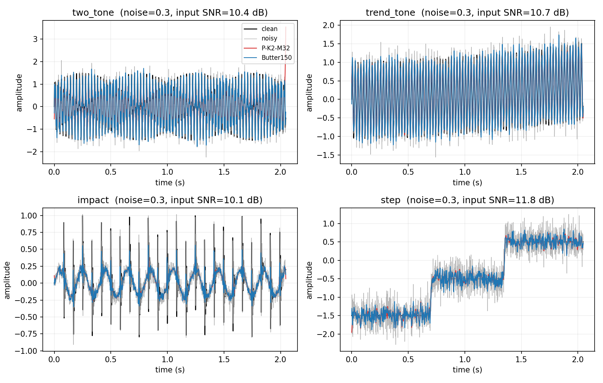
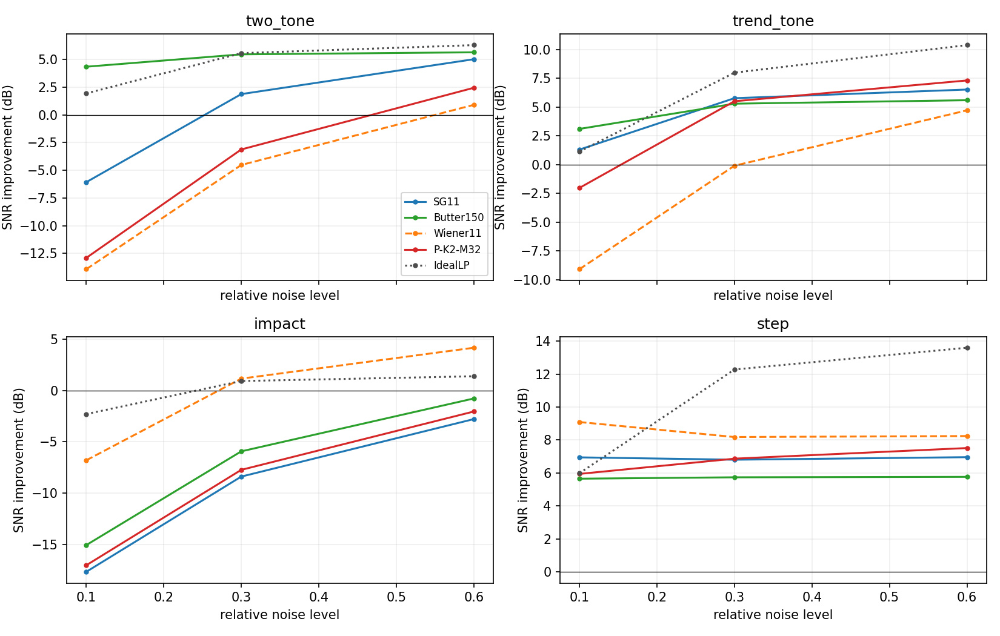
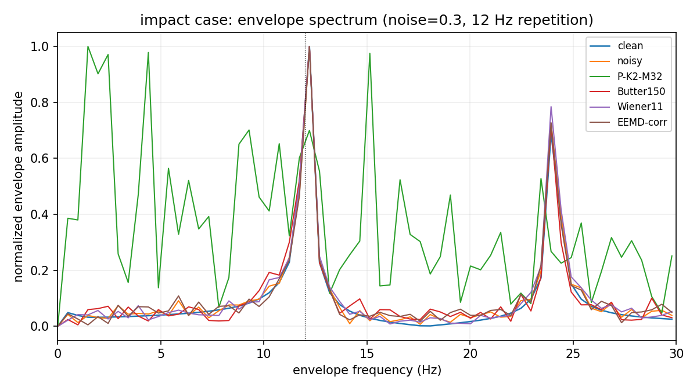
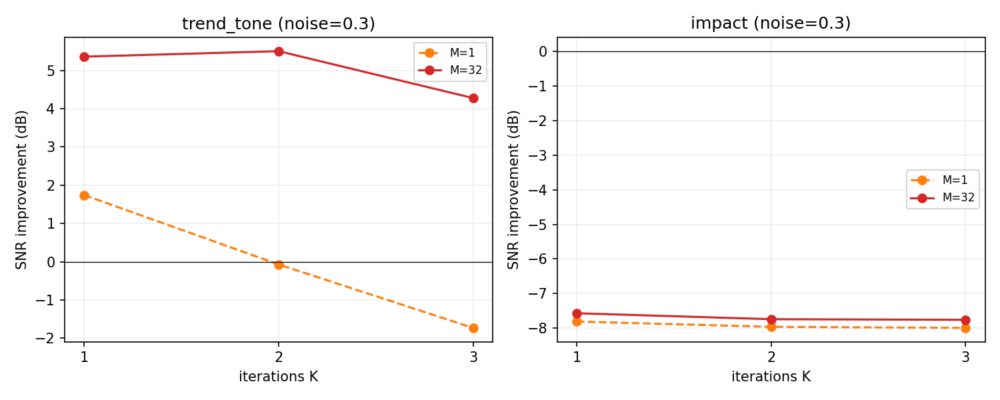

# `NoisyEnvelopeMeanIteration` 去噪性能报告

- 日期：2026-10-17
- 环境：Python 3.10.11 · numpy 2.2.6 · scipy 1.15.3 · matplotlib 3.10.9
- 被测方法：`explore/denoise/envelope_iteration.py` 中的
  `NoisyEnvelopeMeanIteration(S, iterations, noise_amp, M)`
  （原在 `src/Modal_Decomposition/`，因属实验代码已移出包）
- 实验代码：`explore/denoise/`
- 原始结果：`explore/denoise/results/benchmark.json`
- 汇总结果：`explore/denoise/results/{summary.csv,ranking.csv,summary.json}`
- 复现命令：见文末 §9

> **范围说明**：本报告按“通用去噪器”指标（SNR/RMSE）评估，因此低噪声、
> 冲击/包络场景会显得不利。若目标是“高噪声下的主形态提取”，请看专项报告
> [High_Noise_Morphology_Report.md](High_Noise_Morphology_Report.md)；
> 那份报告允许整体幅度缩放，以形状 NRMSE 为主指标，并加入了形态学开闭滤波。

## 1. 结论摘要

这次实验把方法当作“通用去噪器”来检验，而不是只在一两个例子上看波形。结论是：

1. **它不是通用去噪器。** 在所有非纯噪声观测上，最佳配置
   `K=1, M=32, noise_amp=0.2` 的中位相对 RMSE 为 **0.685**（相对 raw），
   中位 SNR 提升 **+3.29 dB**；而简单的 SG(11,3) 和 Butterworth(150 Hz)
   分别是 **0.536 / +5.42 dB** 和 **0.528 / +5.55 dB**，而它们的运行时间
   比 proposed 低约两个数量级。
2. **它的收益依赖“高噪声 + 平滑信号”。** 在低噪声（相对 std 0.1）下，
   `K=2/3` 的 SNR 提升为负（比 raw 更差）；只有在噪声 0.6 时才接近
   SG/Butter 的水平。它是“高噪声下的低通平滑器”，不是“低噪声下保边去噪器”。
3. **对冲击/轴承类信号是灾难性的。** 在 12 Hz 冲击 + 180 Hz 共振的案例中，
   所有推荐配置的 SNR 提升约 **-7.6 dB**；包络谱 12 Hz 峰值 SNR 从 raw 的
   **13.45** 降到 **2.1-3.4**，冲击幅值保留率只有 **0.27-0.38**。
   这与“用包络保留最大特征”的初衷相反。
4. **弱高频特征会被 K 迭代迅速抹掉。** 在 trend+tone 案例中，K=1 保留
   160 Hz 弱分量约 **13.9%**，K=2 只剩 **0.3%**，K=3 只剩 **0.1%**；
   Butterworth 保留 **25.3%**。如果目标是弱特征，K 不应大于 1。
5. **M 次平均是必要的，但只解决随机方差。** M=32 把 K=1 的整体相对 RMSE
   从 1.147（M=1，比 raw 还差）降到 0.685，把 edge max 从 2.11 降到 1.63；
   但它不修复冲击失真、弱特征丢失和端点偏差。
6. **辅助噪声幅度不是“无脑 0.2”。** 在 trend 案例 K=2,M=32 下，
   `noise_amp=0.05/0.1` 的 SNR 提升为 **-9.2/-3.5 dB**，`0.2/0.3/0.5`
   为 **+5.5/+5.9/+5.1 dB**。低辅助噪声会退化成“局部均值归零”，这是原方法
   的已知风险，M 平均不能消除。
7. **纯噪声输入不会得到“干净零输出”。** 它确实把输出 RMS 压到输入的
   0.34-0.58，但端点 max abs 在 K=2/3 为 **2.9-3.4**、K=1 可达 **5.7**
   （raw 为 3.5）；谱平坦度从 raw 的 0.53 降到 0.01-0.06，说明它在噪声上
   “造出了结构”，不是可靠的噪声抑制器。

因此：**该方法可以作为“高噪声、平滑/趋势信号”的实验性平滑器，
但不适合作为通用去噪器，更不适合冲击/包络特征提取。**

## 2. 实验设计

### 2.1 被测方法

`NoisyEnvelopeMeanIteration` 每轮对当前信号加高斯噪声，找极大/极小，
分别做三次样条上下包络，取 `(MAX+MIN)/2`，对 M 次独立实现求平均，
再进入下一轮。实验网格：

| 参数 | 取值 |
|---|---|
| 迭代次数 K | 1, 2, 3 |
| 每轮实现数 M | 1, 32 |
| 辅助噪声幅度 `noise_amp` | 0.2（主网格）；0.05, 0.1, 0.3, 0.5（敏感性） |

被测方法仍然保留了已知的端点外推、极值不足无保护、无镜像延拓等问题；
本次只加了 M 次平均，因此实验测的是“方法当前实现”的性能，而不是理想化版本。

### 2.2 基线与参考

| 名称 | 说明 |
|---|---|
| `raw` | 不处理，作为 0 dB 基准 |
| `MA5` | 5 点滑动平均 |
| `SG11` | Savitzky-Golay，window=11, polyorder=3 |
| `Median5` | 5 点中值滤波 |
| `Butter150` | 4 阶 Butterworth 低通，150 Hz，`filtfilt` 零相位 |
| `Wiener11` | `scipy.signal.wiener`，mysize=11 |
| `IdealLP` | **Oracle**：按 clean 的 99% 能量带宽做零相位理想低通；使用 clean 频谱，只作为上限参考，不是可部署方法 |
| `EEMD-corr` | EEMD（M=10, noise_amp=0.2）后保留与含噪输入相关绝对值 ≥0.2 的 IMF 重构；只在 3 个案例、噪声 0.3 上跑，作为分解类参考 |

基线的参数是固定的代表值，没有按案例逐个调参；因此它们不是“每个案例的最优基线”，
但足以说明方法相对常见滤波器的位置。`IdealLP` 给出了线性低通类方法的上限。

### 2.3 信号案例

所有信号 `fs=1000 Hz`、`n=2048`、`float64`：

| 案例 | 内容 | 考察点 |
|---|---|---|
| `two_tone` | 37 Hz + 0.5×113 Hz | 窄带平稳信号；经典滤波器强项 |
| `trend_tone` | 二次趋势 + 40 Hz 强分量 + 0.12×160 Hz 弱 AM 分量（8 Hz 调制） | 趋势 / 弱特征保留 |
| `am_fm` | 24 Hz AM-FM 分量 + 0.6×89 Hz 单音 | 非平稳信号 |
| `impact` | 12 Hz 周期冲击、180 Hz 共振、指数衰减 8 ms、5 Hz 轴频 | 冲击 / 包络特征（轴承类） |
| `step` | 0.70 s、1.35 s 两个 tanh 平滑阶跃 | 阶跃边沿 / 过冲 |
| `spike_tone` | 20 Hz + 80 Hz 双音，另加 3 个大幅尖峰（+4, -4, +3.5） | 脉冲噪声鲁棒性 |
| `pure_noise` | 纯白噪声（无 clean 信号） | 是否“无中生有” |

普通案例的噪声为 `noise_level × std(clean) × N(0,1)`；`noise_level ∈ {0.1, 0.3, 0.6}`。
`pure_noise` 用单位方差绝对噪声。每个案例/噪声水平做 5 次独立噪声实现；
同一观测下所有方法使用同一含噪数组，随机方法使用固定种子。

### 2.4 指标

通用指标（内部去掉两端 50 点，避免端点伪影污染主体结论）：

- `rmse_int`、`snr_out`、`snr_imp = snr_out - snr_in`、`corr`；
- `edge_max`、`edge_rmse`：首/末 50 点的最大绝对值和 RMSE；
- `hf_ratio`：clean 99% 带宽以上的能量占比；
- `lsd`：对数谱距离。

特征指标：

- trend：`trend_lp_rmse`（2 Hz 低通后与真趋势比较）、`weak_retention`
  （150-170 Hz 能量相对 clean 的保留率）；
- impact：包络谱 12 Hz 峰值 SNR、包络与 clean 包络的相关系数、
  冲击窗口峰值幅值保留率、峭度；
- step：10-90% 边沿宽度、过冲、平台 RMSE；
- spike：尖峰窗口泄漏、干净区 RMSE、最大绝对值；
- pure noise：输出/输入 RMS 比、谱平坦度、最大绝对值。

## 3. 总体结果

**表 1：整体排名**（6 个非纯噪声案例 × 3 个噪声水平 × 5 次 = 90 个观测；
中位数；`rel. RMSE` 为相对 raw 的 `rmse_int` 比，越低越好）

| 方法 | rel. RMSE | SNR imp. (dB) | edge max | 运行时间 (ms) |
|---|---:|---:|---:|---:|
| raw | 1.000 | 0.000 | 1.657 | 0.00 |
| MA5 | 0.549 | 5.205 | 1.428 | 0.03 |
| SG11 | 0.536 | 5.418 | 1.453 | 0.28 |
| Median5 | 0.668 | 3.503 | 1.432 | 0.08 |
| Butter150 | **0.528** | **5.546** | 1.493 | 0.13 |
| Wiener11 | 0.943 | 0.513 | **1.067** | 0.10 |
| IdealLP (oracle) | 0.478 | 6.419 | 1.411 | 0.08 |
| P-K1-M1 | 1.147 | -1.194 | 2.111 | 0.47 |
| **P-K1-M32** | **0.685** | **3.289** | 1.628 | 10.15 |
| P-K2-M1 | 1.264 | -2.032 | 3.526 | 0.76 |
| P-K2-M32 | 0.763 | 2.353 | 1.635 | 19.56 |
| P-K3-M1 | 1.332 | -2.487 | 6.170 | 1.05 |
| P-K3-M32 | 0.851 | 1.400 | 1.640 | 29.35 |

要点：

- **M=1 的配置全部比 raw 差**（rel. RMSE > 1，SNR 为负）；M=32 后才有正收益。
  这直接说明“单次加噪 + 迭代”不能替代集合平均。
- 最佳 proposed `K=1,M=32` 比 raw 少约 **31.5%** 的 RMSE，但比 SG/Butter
  仍差一截；相对 `IdealLP` 的 0.478 差距更大。
- `K` 越大，整体越差：K=3,M=32 只有 +1.40 dB；K 的收益高度依赖案例
  （见 §4、§6），不是单调调参。
- 运行时间：proposed M=32 约 **10-29 ms**；经典滤波器 **0.03-0.28 ms**；
  EEMD 参考约 **43 ms**。

## 4. 分案例结果

**表 2：噪声 0.3 下的 SNR 提升（dB，中位数；负值表示比 raw 差）**

| 案例 | SG11 | Butter150 | Wiener11 | IdealLP | P-K1-M32 | P-K2-M32 | P-K3-M32 |
|---|---:|---:|---:|---:|---:|---:|---:|
| two_tone | 1.87 | **5.46** | -4.52 | 5.57 | 0.03 | -3.12 | -3.96 |
| trend_tone | **5.77** | 5.29 | -0.10 | 7.98 | 5.36 | 5.50 | 4.28 |
| am_fm | 4.87 | **5.93** | -3.81 | 6.89 | 3.22 | -1.11 | -2.55 |
| impact | -8.40 | -5.93 | **1.17** | 0.93 | -7.57 | -7.74 | -7.76 |
| step | 6.80 | 5.74 | 8.18 | 12.28 | 5.85 | 6.87 | **7.35** |
| spike_tone | **6.42** | 5.63 | 0.18 | 7.50 | 3.39 | 4.73 | 3.88 |

解读：

- **`two_tone`：** proposed 最好也只有 +0.03 dB，等于没去噪；Butter 有 +5.46 dB。
  原因是窄带双音不是“局部均值”能保留的结构，K≥2 还会明显破坏它。
- **`trend_tone`：** proposed K=2 达到 +5.50 dB，和 SG/Butter 同级；这是它
  最适合的场景——慢趋势 + 强低频振荡，平滑正好对上。
- **`am_fm`：** K=1 有 +3.22 dB，但 K≥2 转为负值；非平稳调频结构对迭代平滑
  很敏感。
- **`impact`：** 所有 proposed 都约 **-7.6 dB**，比 raw 差一个量级；
  冲击波形被当成“高频噪声”平滑掉了。这是最严重的问题。
- **`step`：** proposed 表现不错，K=3 有 +7.35 dB，接近 Wiener 的 +8.18 dB；
  平滑阶跃正好是它的强项。
- **`spike_tone`：** K=2 有 +4.73 dB，能压一部分尖峰；但仍低于 SG 的 +6.42 dB，
  且尖峰泄漏仍明显（§5.4）。

**图 1：示例波形**（noise=0.3；clean / noisy / P-K2-M32 / Butter150）



**图 2：SNR 提升随噪声水平的变化**



图 2 显示 proposed 的典型形态：K=2/3 在低噪声时低于 0 dB，K=1 也仅约 +0.8 dB
（不含 impact）；高噪声时才追上经典方法，impact 子图始终为负。

**按噪声水平汇总**（5 个非 impact 案例的中位 SNR 提升，dB）：

| 方法 | noise=0.1 | noise=0.3 | noise=0.6 |
|---|---:|---:|---:|
| Butter150 | 5.64 | 5.63 | 5.65 |
| SG11 | 1.30 | 5.77 | 6.50 |
| P-K1-M32 | 0.82 | 3.39 | 5.34 |
| P-K2-M32 | -2.03 | 4.73 | 6.42 |
| P-K3-M32 | -4.30 | 3.88 | 6.06 |

把 impact 也算进去时，P-K1-M32 在 0.1 水平的中位 SNR 提升降到 **-3.72 dB**。
所以“低噪声下不要用”不是个别案例的偶然，而是整体趋势。

## 5. 特征级结果

### 5.1 趋势与弱 160 Hz 分量（trend_tone，noise=0.3）

趋势本身所有方法都恢复得差不多（2 Hz 低通后 `trend_lp_rmse` 均约 0.058），
差异主要在弱高频分量：

| 方法 | trend LP RMSE | weak 160 Hz retention |
|---|---:|---:|
| raw | 0.058 | 1.875（含噪声能量，非“保留”） |
| SG11 | 0.058 | 0.006 |
| Butter150 | 0.058 | **0.253** |
| Wiener11 | 0.058 | 0.039 |
| IdealLP (oracle) | 0.058 | 0.000 |
| P-K1-M32 | 0.058 | **0.139** |
| P-K2-M32 | 0.059 | 0.003 |
| P-K3-M32 | 0.059 | 0.001 |

结论：**K=1 还能保留约 14% 的弱分量；K≥2 基本抹掉。** 如果目标包含弱高频特征，
K 只能取 1，且仍不如 Butterworth。`IdealLP` 因为按 clean 的 99% 带宽截断，
也会把弱分量截掉，这说明“线性低通”本身不保证弱特征；但 proposed 的 K≥2
是额外把它平滑掉。

### 5.2 冲击/包络（impact，noise=0.3）

| 方法 | 包络峰频率 (Hz) | 包络峰 SNR | 包络相关 | 冲击幅值保留 |
|---|---:|---:|---:|---:|
| raw | 11.81 | **13.45** | **0.986** | **0.997** |
| SG11 | 11.81 | 12.63 | 0.638 | 0.377 |
| Butter150 | 11.81 | 11.57 | 0.898 | 0.456 |
| Wiener11 | 11.81 | **15.17** | 0.975 | 0.840 |
| IdealLP (oracle) | 11.81 | 13.45 | 0.986 | 0.926 |
| EEMD-corr | 11.81 | 12.28 | 0.971 | 0.935 |
| P-K1-M32 | 11.81 | 3.39 | 0.362 | 0.377 |
| P-K2-M32 | 11.29 | 2.32 | -0.083 | 0.276 |
| P-K3-M32 | 8.73 | 2.08 | 0.010 | 0.267 |

这是全文最重要的负面结果：proposed 把 12 Hz 冲击包络的峰值 SNR 从 13.45
压到 2-3，K≥2 甚至把包络相关打成 0 附近。**它不能用于冲击/轴承故障的包络分析。**
EEMD-corr 的 RMSE 也不好（见 §7），但包络保留明显更好（12.28 / 0.971），
说明“分解 + 选 IMF”至少没有把冲击完全抹平。

**图 3：impact 包络谱**



### 5.3 阶跃（step，noise=0.3）

| 方法 | 10-90% 边沿宽度 (样本) | 过冲 | 平台 RMSE |
|---|---:|---:|---:|
| raw | 23.5 | 0.542 | 0.248 |
| SG11 | 28.0 | 0.160 | 0.113 |
| Butter150 | 30.5 | 0.162 | 0.128 |
| Wiener11 | 21.5 | 0.186 | 0.095 |
| IdealLP (oracle) | 28.5 | 0.114 | 0.095 |
| P-K1-M32 | 29.0 | 0.161 | 0.126 |
| P-K2-M32 | 29.0 | 0.148 | 0.113 |
| P-K3-M32 | 24.0 | 0.148 | 0.109 |

proposed 能压过冲和平台噪声，K=3 边沿宽度接近 Wiener；但平台 RMSE 仍高于
Wiener/IdealLP。阶跃是它相对擅长的场景，但不是最优。

### 5.4 尖峰（spike_tone，noise=0.3）

| 方法 | 尖峰泄漏 | 干净区 RMSE | max abs |
|---|---:|---:|---:|
| raw | 4.159 | 0.181 | 4.534 |
| SG11 | **0.876** | **0.087** | 1.434 |
| Butter150 | 1.243 | 0.094 | 1.655 |
| Wiener11 | 3.813 | 0.188 | 4.167 |
| IdealLP (oracle) | 0.645 | 0.083 | 1.274 |
| P-K1-M32 | 1.985 | 0.104 | 2.467 |
| P-K2-M32 | 1.099 | 0.116 | 1.591 |
| P-K3-M32 | 0.981 | 0.142 | 1.698 |

K=2/3 能把尖峰泄漏压到约 1.0-1.1，接近 SG 的 0.876；但干净区 RMSE 从
0.104 升到 0.142，说明它用“整体平滑”换尖峰抑制，会连带损伤有用信号。
K=1 尖峰泄漏仍有 1.985，抑制不足。

### 5.5 纯噪声（pure_noise）

| 方法 | 输出/输入 RMS | 谱平坦度 | max abs |
|---|---:|---:|---:|
| raw | 1.000 | 0.528 | 3.516 |
| SG11 | 0.450 | 0.084 | 1.671 |
| Butter150 | 0.518 | 0.017 | 1.872 |
| Wiener11 | 0.389 | 0.326 | 2.233 |
| P-K1-M32 | 0.584 | 0.063 | **5.687** |
| P-K2-M32 | 0.369 | 0.053 | 2.873 |
| P-K3-M32 | 0.338 | 0.010 | 3.416 |

proposed 确实降低了 RMS，但 K=1 的 max abs 达到 5.687（比 raw 大 62%），
来自端点伪影；谱平坦度从 0.528 降到 0.01-0.06，说明输出被强烈染色、
在纯噪声上“编造”了低频结构。作为噪声抑制器，它不如 SG/Butter 干净。

## 6. 参数敏感性

### 6.1 K 与 M

**图 4：K/M 对 trend 与 impact 的影响**



整体表（与表 1 同源）：

| 配置 | rel. RMSE | SNR imp. (dB) | edge max | 时间 (ms) |
|---|---:|---:|---:|---:|
| P-K1-M1 | 1.147 | -1.194 | 2.111 | 0.47 |
| P-K1-M32 | **0.685** | **3.289** | 1.628 | 10.15 |
| P-K2-M1 | 1.264 | -2.032 | 3.526 | 0.76 |
| P-K2-M32 | 0.763 | 2.353 | 1.635 | 19.56 |
| P-K3-M1 | 1.332 | -2.487 | 6.170 | 1.05 |
| P-K3-M32 | 0.851 | 1.400 | 1.640 | 29.35 |

- M 的收益非常明确：同一 K 下 M=32 相对 M=1 大幅降低 RMSE 和 edge max；
  M=1 全部比 raw 差。
- K 没有统一最优：K=1 综合最好，K=2 在 trend/spike 更好，K=3 在 step 更好；
  但 K≥2 会牺牲弱 160 Hz 和 impact。
- 运行时间近似随 K×M 线性增长；M=32,K=3 约 29 ms，是经典滤波器的
  约 100-200 倍。

### 6.2 辅助噪声幅度 `noise_amp`

K=2,M=32，noise=0.3（敏感性网格使用独立观测，绝对值与主表略有差异）：

| `noise_amp` | trend SNR imp. | trend edge max | impact SNR imp. | impact 包络峰 SNR |
|---:|---:|---:|---:|---:|
| 0.05 | -9.20 | 3.882 | -7.86 | 1.95 |
| 0.10 | -3.47 | 2.631 | -7.81 | 2.23 |
| 0.20（主表） | +5.50 | 2.105 | -7.74 | 2.32 |
| 0.30 | +5.86 | 1.495 | -7.73 | 2.21 |
| 0.50 | +5.11 | 1.568 | -7.73 | 2.32 |

结论：

- **trend 上 0.2-0.3 是甜点；0.05/0.1 会灾难性失败**（辅助噪声太小，
  极值稀疏，`(U+L)/2` 退化为局部均值，信号被抹掉）。
- **impact 上任何 `noise_amp` 都救不了**：包络峰 SNR 始终 ~2，SNR 提升 ~-7.7 dB。
  说明问题不在噪声幅度，而在算子本身会平滑冲击。
- 默认 0.2 不是普适安全值；实际使用必须按信号尺度/噪声水平验证。

## 7. 讨论：为什么会出现这些结果

1. **算子是局部均值，不是“保特征”算子。**  
   `(U+L)/2` 对纯正弦趋于 0，对慢趋势趋于趋势本身。它能保留 trend/step 这类
   “局部均值结构”，但会把 40 Hz、160 Hz、180 Hz 共振和冲击当成高频波动平滑掉。
   这与 §5.2 的冲击包络崩溃、§5.1 的弱特征丢失一致。

2. **加噪在这里更像 dither，而不是“平均掉噪声”。**  
   噪声把极值点变密，使上下样条贴着含噪信号走，单步输出近似恒等；M 次平均
   降低随机方差，但不会改变这个非线性偏差。低 `noise_amp` 时 dither 不足，
   算子退回“局部均值归零”，所以 §6.2 出现 -9 dB 的悬崖。

3. **M 平均只解决方差，不解决偏差。**  
   M=32 显著降低 edge max 和 RMSE 的随机部分，但 impact 的包络峰 SNR 仍是 2-3，
   弱特征仍被 K≥2 抹掉。这与“M 次平均能提升去噪性能”是两回事。

4. **端点外推仍然是硬伤。**  
   方法没有镜像延拓，`CubicSpline` 在首/末样本外推；纯噪声 K=1 的 max abs
   达到 5.687，高于 raw 的 3.516；`two_tone` 在噪声 0.3 下 P-K1-M32 的
   edge max 为 2.673，而 raw 为 1.601。M 平均把整体 edge max 从 2.1/3.5/6.2
   降到约 1.63，但没有消除端点偏差；真实信号两端仍需裁剪或延拓。

5. **EEMD-corr 也不是强基线，但方向不同。**  
   在 impact 上 EEMD-corr 的 RMSE 仍差（0.090 vs raw 0.062），但包络峰 SNR
   12.28、包络相关 0.971，明显好于 proposed 的 2-3 / 0.36。说明“分解 + 选 IMF”
   至少能保留冲击包络；proposed 的“迭代局部均值”不能。

## 8. 结论与使用建议

### 8.1 什么时候可以考虑用

- 信号以**慢趋势/阶跃/平滑低频结构**为主；
- 噪声水平较高（相对 std ≥0.3，甚至 0.6），低噪声场景不要用；
- 可以接受端点裁剪，且不需要保留弱高频/冲击包络；
- 参数优先 `K=1, M=32, noise_amp≈0.2-0.3`；如果更看重阶跃/尖峰，
  可试 `K=2-3, M=32`，但要用验证集确认没有牺牲目标特征。

### 8.2 什么时候不要用

- **冲击/轴承/齿轮故障的包络分析**：本实验中最严重的失败；包络峰 SNR 从 13.45
  降到 2-3，冲击幅值只剩 0.27-0.38。
- **低噪声、高 SNR 信号**：K≥2 在 0.1 噪声下中位 SNR 提升为负；
  它会让干净信号变差。
- **弱高频特征**：K≥2 基本抹掉 160 Hz 弱分量；K=1 也只保留约 14%，
  不如 Butterworth 的 25%。
- **需要无端点伪影**：端点 max abs 仍可能显著高于 raw；正式使用前必须
  加镜像延拓/裁剪，或修掉 `CubicSpline` 外推。

### 8.3 与基线的选择建议

- 通用平滑/去噪：优先 **Butterworth / SG**；冲击/包络：优先 **Wiener**
  或带通 + Hilbert 包络；分解类可试 **EEMD/CEEMDAN + IMF 选择**。
- proposed 的相对优势只在 `trend_tone` 和 `step` 这类平滑信号上，
  且需要 M=32 才成立；它的运行时间却是经典滤波器的 ~40-200 倍。
  除非有明确的“高噪声平滑”需求，否则没有理由用它替换 SG/Butter。

## 9. 复现

```powershell
# 主网格 + EEMD 子集 + noise_amp 敏感性
.venv\Scripts\python.exe -B -m explore.denoise.run_benchmark `
    --reps 5 --include-eemd --include-sensitivity

# 汇总
.venv\Scripts\python.exe -B -m explore.denoise.analyze_results --markdown

# 图
.venv\Scripts\python.exe -B -m explore.denoise.make_figures
```

产物：

- 原始记录：`explore/denoise/results/benchmark.json`（1269 条）
- 汇总：`explore/denoise/results/summary.csv`、`ranking.csv`、`summary.json`
- 图：`docs/explore/denoise/figures/*.png`
- 代码说明：`explore/denoise/README.md`

## 10. 局限

- 全部为合成信号，噪声为白高斯 + 确定性尖峰；没有真实轴承/机械数据，
  也没有有色噪声、丢点、饱和等异常。
- 基线使用固定参数，没有逐案例调参；`IdealLP` 是 oracle，不能作为可部署方法。
- 每个案例/噪声水平 5 次重复，报告的是中位数，没有做置信区间/显著性检验。
- 运行时间是单次调用墙钟，不是受控基准；不同机器会变。
- 方法仍保留已知的端点/极值保护缺陷；本次只评估“加 M 次平均”后的现状，
  不代表修复这些问题后的性能。
