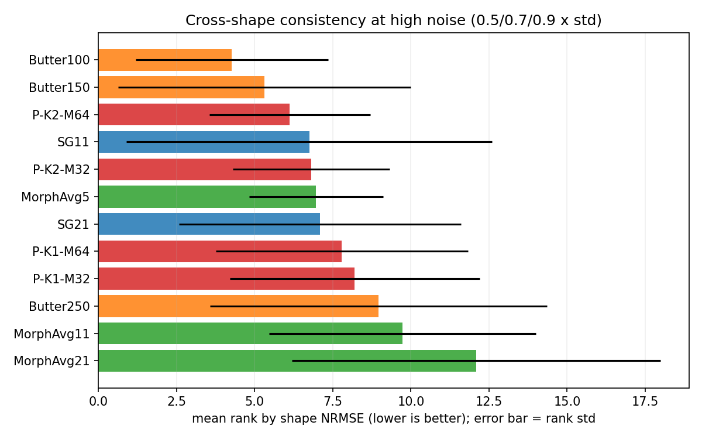
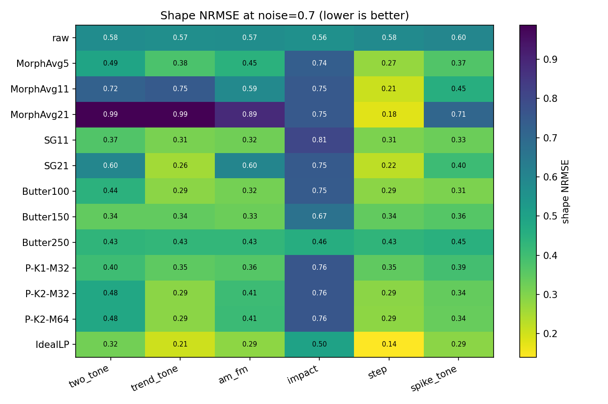
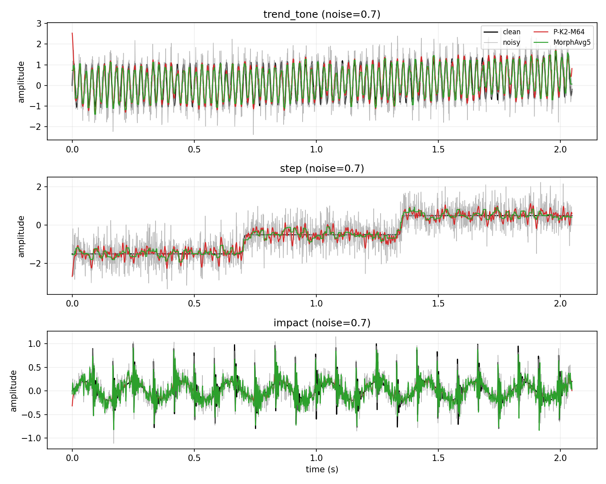

# 高噪声“主形态提取”专项报告

- 日期：2026-10-17
- 环境：Python 3.10.11 · numpy 2.2.6 · scipy 1.15.3 · matplotlib 3.10.9
- 被测方法：`NoisyEnvelopeMeanIteration(S, iterations, noise_amp, M)`
- 对照：形态学开闭/闭开/平均滤波、Savitzky-Golay、Butterworth
- 代码：`explore/denoise/{run_high_noise.py, analyze_high_noise.py, morphology.py, make_high_noise_figures.py}`
- 原始结果：`explore/denoise/results/high_noise_morph.json`
- 汇总：`explore/denoise/results/{high_noise_summary.csv, high_noise_ranking.csv, high_noise_summary.json}`

> 这份报告不再把方法当“去噪器”评估，而是按你的判断，把它当作
> **高噪声下的主形态提取器**：允许幅度衰减/整体缩放，重点看“形状是否对”。
> 低噪声（≤0.3）不在本报告范围内；去噪视角见
> [Denoise_Performance_Report.md](Denoise_Performance_Report.md)。

## 1. 结论摘要

**你的判断基本成立，但需要加两个限定：高噪声、平滑主形态；冲击/包络是例外。**

1. **它不是平均排名第一的“普适”方法。** 在 18 个可部署方法、6 个信号形态、
   3 个高噪声水平（0.5/0.7/0.9）、5 次重复的排名中：
   `Butter100` 平均 rank **4.27**，`Butter150` **5.31**，
   `P-K2-M64` **6.12**，`SG11` **6.74**，`P-K2-M32` **6.81**，
   `MorphAvg5` **6.97**。
2. **但它是“跨形态最稳”的高分方法之一。** `P-K2-M64` 的 rank 标准差只有
   **2.58**，最差 rank 11/18；`SG11` 的 std 为 **5.85**、最差 rank 18/18，
   `Butter150` 为 **4.69**、最差 17/18。去掉 impact 后（11 个方法内），
   `P-K2-M64` 平均 rank **4.76**、std **1.73**、最差 8/11，
   而 `Butter100` 是 3.33/2.19/7，`SG11` 是 3.87/2.38/8。
   **它不赢任何单一形态，但很少崩；这符合“通用主形态平滑器”而不是“最优去噪器”。**
3. **它没有在任何单一形态上拿第一。** 在 noise=0.7：
   - 双音：Butter150 shape NRMSE **0.343**，proposed K2-M64 **0.479**；
   - 趋势：SG21 **0.257**，proposed K2-M64 **0.286**；
   - AM-FM：Butter100 **0.318**，proposed K2-M64 **0.410**；
   - 阶跃：MorphAvg21 **0.177**，proposed K2-M64 **0.285**；
   - 尖峰：Butter100 **0.307**，proposed K2-M64 **0.338**；
   - 冲击：Butter250 **0.460**，raw **0.561**，proposed **0.759**（失败）。
4. **形态学滤波的“普适性”强烈依赖结构元尺寸。** `MorphAvg5` 是唯一在双音/
   趋势/AM/尖峰上都还能用的形态学变体；`MorphAvg11/21` 在阶跃上最好
   （shape 0.208/0.177），但在双音和趋势上崩溃（0.722/0.987）。
   `MorphOC/CO` 的 11/21 尺寸也明显差于 5。
5. **SG/Butter 的“最佳设置”随形态变化。** SG11 强在双音/AM/尖峰，
   SG21 强在趋势/阶跃但双音/AM 变差；Butter100 强在双音/AM/尖峰，
   Butter150 强在双音，Butter250 强在冲击（shape 0.460、SNR +2.79 dB、
   包络峰 10.04/相关 0.929），但在双音/趋势上明显变差。
   **不存在一个固定 SG 窗/Butter 截止频率能覆盖全部形态。**
6. **冲击/包络仍然是硬边界。** noise=0.7 时 proposed 的冲击包络峰 SNR
   只有 **2.26**（raw 9.91，Butter250 10.04），冲击幅值保留 **0.279**
   （raw 1.048）。所以“主形态”不能包括冲击包络；这类信号应选 Butter250/
   带通+包络或 EEMD 类方法。
7. **推荐设置：高噪声主形态优先 `K=2, M=64, noise_amp=0.2`；**
   如果更看重弱高频特征，用 `K=1, M=32/64`；冲击/包络不要用。
   M=64 相对 M=32 的平均 rank 从 6.81 改善到 6.12，代价是运行时间约 2 倍。

## 2. 实验设计

### 2.1 信号与噪声

6 个非纯噪声案例，`fs=1000 Hz`、`n=2048`、`float64`：

| 案例 | 内容 | 主形态 |
|---|---|---|
| `two_tone` | 37 Hz + 0.5×113 Hz | 双窄带 |
| `trend_tone` | 二次趋势 + 40 Hz 强 + 0.12×160 Hz 弱 AM | 趋势 + 强低频 |
| `am_fm` | 24 Hz AM-FM + 0.6×89 Hz | 非平稳调幅调频 |
| `impact` | 12 Hz 冲击、180 Hz 共振、5 Hz 轴频 | 冲击/包络 |
| `step` | 0.70 s、1.35 s 两个 tanh 阶跃 | 阶跃边沿 |
| `spike_tone` | 20/80 Hz 双音 + 3 个大幅尖峰 | 平滑信号 + 脉冲异常 |

噪声：`noise_level × std(clean) × N(0,1)`，高噪声档
**0.5 / 0.7 / 0.9**；每档 5 次独立噪声实现。纯噪声单独用单位方差。

### 2.2 方法

| 家族 | 配置 |
|---|---|
| 形态学 | `MorphOC5/11/21`（开→闭）、`MorphCO5/11/21`（闭→开）、`MorphAvg5/11/21`（两者平均）；flat SE，`mode="reflect"` |
| SG | `SG11`、`SG21`（polyorder=3） |
| Butterworth | `Butter100/150/250`（4 阶，零相位 `filtfilt`） |
| proposed | `P-K1-M32`、`P-K1-M64`、`P-K2-M32`、`P-K2-M64`，`noise_amp=0.2` |
| 参考 | `raw`、`IdealLP`（按 clean 的 99% 能量带宽做 oracle 低通） |

共 20 个方法；主网格 6×3×5=90 个观测，加纯噪声 5 个，共 1895 条记录。

### 2.3 指标：形状优先

去噪报告用 SNR/RMSE 衡量“幅度是否还原”；主形态提取允许幅度整体缩放，
因此本报告主指标是：

- **shape NRMSE**：先对输出做最佳仿射校准 `a*y+b`，再算
  `||a*y+b-clean|| / ||clean-mean||`。0 最好，1 约等于“只输出均值”。
- **shape LP corr**：按 clean 的 99% 带宽低通后，输出与 clean 的相关系数。
- **SNR imp.**：只作辅助，说明幅度/噪声层面的代价。
- **edge max**、特征指标：冲击包络、阶跃边沿、尖峰泄漏、纯噪声伪结构。

## 3. 总体排名：谁最“普适”

**表 1：按 shape NRMSE 的跨观测排名**（18 个可部署方法；rank 越小越好）

| 方法 | mean rank | rank std | worst rank | shape NRMSE | SNR imp. (dB) | edge max |
|---|---:|---:|---:|---:|---:|---:|
| Butter100 | **4.27** | 3.08 | 11 | 0.357 | 6.90 | 1.530 |
| Butter150 | **5.31** | 4.69 | 17 | 0.358 | 5.62 | 1.692 |
| **P-K2-M64** | **6.12** | **2.58** | **11** | 0.386 | 5.85 | 1.823 |
| SG11 | 6.74 | 5.85 | 18 | 0.352 | 6.46 | 1.553 |
| P-K2-M32 | 6.81 | 2.51 | 11 | 0.388 | 5.75 | 1.891 |
| MorphAvg5 | 6.97 | **2.14** | **10** | 0.421 | 4.73 | 1.204 |
| SG21 | 7.09 | 4.52 | 13 | 0.517 | 3.34 | 1.340 |
| P-K1-M64 | 7.79 | 4.03 | 17 | 0.396 | 5.24 | 2.061 |
| P-K1-M32 | 8.20 | 4.00 | 17 | 0.395 | 5.22 | 2.158 |
| Butter250 | 8.97 | 5.40 | 18 | 0.433 | 3.36 | 1.869 |
| MorphAvg11 | 9.73 | 4.27 | 13 | 0.640 | 1.16 | 0.854 |
| MorphAvg21 | 12.09 | 5.91 | 16 | 0.830 | -1.01 | 0.661 |

**表 2：去掉 impact 后的排名**（11 个方法，75 个观测；更接近“平滑主形态”场景）

| 方法 | mean rank | rank std | worst rank |
|---|---:|---:|---:|
| Butter100 | 3.33 | 2.19 | 7 |
| SG11 | 3.87 | 2.38 | 8 |
| **P-K2-M64** | **4.76** | **1.73** | **8** |
| Butter150 | 4.91 | 3.04 | 11 |
| P-K2-M32 | 5.44 | **1.65** | 8 |
| SG21 | 6.19 | 3.54 | 10 |
| P-K1-M64 | 6.41 | 2.49 | 11 |
| MorphAvg5 | 6.89 | 1.76 | 9 |
| P-K1-M32 | 6.93 | 2.46 | 11 |
| MorphAvg11 | 8.27 | 3.15 | 10 |
| MorphAvg21 | 9.00 | 4.00 | 11 |

**怎么读这两张表：**

- 如果“普适”指**平均排名最高**：Butter100 第一，SG11 第二/第三，
  proposed 只排第三/第四。**“最”字不成立。**
- 如果“普适”指**跨形态不崩、参数不随形态调**：P-K2-M64 的 rank std 最低之一
  （1.73/2.58），worst rank 8/11（去掉 impact）或 11/18（含 impact），
  明显优于 SG11（5.85、worst 18）和 Butter150（4.69、worst 17）。
  它没有“某个形态特别好”，但也没有“换个形态就完全失效”（impact 除外）。
- MorphAvg5 的 rank std 也低（1.76/2.14），但平均 rank 更靠后（6.89/6.97）；
  它靠尺寸 5 换来稳定，代价是形状细节被削平。



## 4. 分形态形状误差

**表 3：noise=0.7 的 shape NRMSE（越低越好；粗体为该行可部署方法最佳）**

| 方法 | two_tone | trend_tone | am_fm | impact | step | spike_tone |
|---|---:|---:|---:|---:|---:|---:|
| raw | 0.575 | 0.569 | 0.572 | 0.561 | 0.581 | 0.598 |
| MorphAvg5 | 0.493 | 0.378 | 0.447 | 0.735 | 0.274 | 0.370 |
| MorphAvg11 | 0.722 | 0.747 | 0.587 | 0.752 | 0.208 | 0.455 |
| MorphAvg21 | 0.987 | 0.986 | 0.887 | 0.752 | **0.177** | 0.706 |
| SG11 | 0.371 | 0.310 | 0.323 | 0.807 | 0.306 | 0.329 |
| SG21 | 0.599 | **0.257** | 0.601 | 0.748 | 0.224 | 0.405 |
| Butter100 | 0.441 | 0.288 | **0.318** | 0.745 | 0.287 | **0.307** |
| Butter150 | **0.343** | 0.343 | 0.331 | 0.666 | 0.343 | 0.364 |
| Butter250 | 0.432 | 0.426 | 0.427 | **0.460** | 0.432 | 0.450 |
| P-K1-M32 | 0.405 | 0.348 | 0.362 | 0.761 | 0.348 | 0.392 |
| P-K2-M32 | 0.480 | 0.287 | 0.407 | 0.761 | 0.286 | 0.341 |
| P-K2-M64 | 0.479 | 0.286 | 0.410 | 0.759 | 0.285 | 0.338 |
| IdealLP (oracle) | 0.322 | 0.206 | 0.285 | 0.499 | 0.140 | 0.287 |

解读：

- **proposed 没有单项冠军**：双音输给 Butter150/SG11/Butter100，趋势输给
  SG21/Butter100，AM 输给 Butter100/SG11，阶跃输给 MorphAvg21/11/SG21，
  尖峰输给 Butter100/SG11，冲击输给 Butter250/raw。
- 但它**在五个平滑形态里都落在 0.286-0.480**，没有出现 MorphAvg11/21 那种
  0.72-0.99 的崩溃；这就是“普适”的实际含义：**稳定中上，而非单项最优**。
- impact 是唯一例外：proposed 0.759，比 raw 0.561 还差；Butter250 0.460
  是唯一明显优于 raw 的固定滤波。



**图：3 个代表性形态的波形**（clean / noisy / P-K2-M64 / 对应最佳形态学或 Butter）



## 5. 形态学滤波的尺寸敏感性

**表 4：形态学家族的中位 shape NRMSE / SNR（全部非纯噪声观测）**

| 方法 | shape NRMSE | SNR imp. (dB) | edge max |
|---|---:|---:|---:|
| MorphOC5 | 0.479 | 1.10 | 1.389 |
| MorphOC11 | 0.714 | -2.80 | 1.276 |
| MorphOC21 | 0.893 | -5.93 | 1.283 |
| MorphCO5 | 0.488 | 1.19 | 1.430 |
| MorphCO11 | 0.720 | -2.61 | 1.319 |
| MorphCO21 | 0.913 | -5.80 | 1.494 |
| MorphAvg5 | **0.421** | **4.73** | 1.204 |
| MorphAvg11 | 0.640 | 1.16 | 0.854 |
| MorphAvg21 | 0.830 | -1.01 | 0.661 |

- `MorphAvg` 优于单独的 OC/CO；`MorphAvg5` 是唯一“平均意义可用”的形态学配置。
- 尺寸 11/21 对 37/113/40 Hz 这类窄带/趋势信号是灾难：结构元比主形态周期还宽，
  会把信号本身当作“噪声”开闭掉；双音 shape 从 0.493（size 5）恶化到
  0.722/0.987（size 11/21）。
- 但在阶跃上，大尺寸反而好：MorphAvg11/21 的 shape 0.208/0.177，
  优于 size 5 的 0.274。**“形态学普适”必须选对 SE 尺寸；尺寸本身是形态先验。**
- 与 proposed 对比：proposed 用固定 `K=2,M=64` 在双音/趋势/AM/阶跃/尖峰都保持
  0.29-0.48；形态学必须换尺寸才能覆盖这些形态。这是 proposed 作为“通用器”的
  真正优势，而不是说它比专用形态学更强。

## 6. 特征代价

### 6.1 冲击/包络（impact，noise=0.7）

| 方法 | 包络峰 SNR | 包络相关 | 冲击幅值保留 |
|---|---:|---:|---:|
| raw | **9.91** | **0.926** | **1.048** |
| MorphAvg5 | 5.30 | 0.576 | 0.292 |
| MorphAvg11 | 2.62 | 0.241 | 0.242 |
| SG11 | 7.74 | 0.564 | 0.391 |
| Butter150 | 6.70 | 0.802 | 0.461 |
| Butter250 | **10.04** | **0.929** | 0.892 |
| P-K1-M32 | 2.59 | 0.071 | 0.403 |
| P-K2-M32 | 2.26 | -0.049 | 0.279 |
| P-K2-M64 | 2.34 | — | — |
| IdealLP (oracle) | 9.87 | 0.926 | 0.964 |

proposed 把 12 Hz 包络峰从 9.91 压到 2.3，相关打平到 0 附近；K=2 的冲击幅值只剩
0.279。**冲击/包络不能算“主形态”**；如果目标包含它，应选 Butter250（或
带通+Hilbert、EEMD 类）。

### 6.2 阶跃（step，noise=0.7）

| 方法 | 边沿宽度（样本） | 过冲 | 平台 RMSE |
|---|---:|---:|---:|
| raw | 7.0 | 1.265 | 0.578 |
| MorphAvg5 | 29.5 | 0.278 | 0.229 |
| MorphAvg11 | 21.0 | 0.169 | 0.174 |
| MorphAvg21 | **24.0** | **0.181** | **0.145** |
| SG21 | 26.5 | 0.370 | 0.188 |
| Butter150 | 32.5 | 0.379 | 0.299 |
| P-K1-M32 | 28.5 | 0.453 | 0.306 |
| P-K2-M32 | 30.5 | 0.348 | 0.247 |

proposed 能压过冲/平台噪声，但边沿比 MorphAvg11/21 宽；在阶跃上形态学更对路。

### 6.3 尖峰（spike_tone，noise=0.7）

| 方法 | 尖峰泄漏 | 干净区 RMSE |
|---|---:|---:|
| raw | 4.372 | 0.421 |
| MorphAvg5 | **0.572** | 0.225 |
| MorphAvg11 | 0.686 | 0.279 |
| SG11 | 1.001 | 0.192 |
| SG21 | 0.744 | 0.242 |
| Butter100 | 0.888 | 0.180 |
| Butter150 | 1.280 | 0.219 |
| P-K1-M32 | 2.055 | 0.227 |
| P-K2-M32 | 1.006 | 0.210 |

proposed K2 的尖峰泄漏 1.006，接近 SG11 的 1.001，但不如 MorphAvg5 的 0.572；
K1 的 2.055 抑制不足。尖峰不是它的强项。

### 6.4 纯噪声（null）

| 方法 | 输出/输入 RMS | max abs | 谱平坦度 |
|---|---:|---:|---:|
| raw | 1.000 | 3.516 | 0.528 |
| MorphAvg5 | 0.392 | 1.313 | 0.104 |
| MorphAvg11 | **0.287** | **0.885** | 0.053 |
| SG11 | 0.450 | 1.671 | 0.084 |
| Butter150 | 0.518 | 1.872 | 0.017 |
| P-K1-M32 | 0.584 | 5.687 | 0.063 |
| P-K2-M32 | 0.369 | 2.873 | 0.053 |

纯噪声上 proposed K1 的端点 max abs 达到 5.687（比 raw 大 62%），K2 为 2.873；
形态学 Avg11 抑制最好。proposed 会把噪声整形成低频结构，而不是“变干净”。

## 7. 讨论：为什么它“稳”但不“最强”

1. **它的输出是局部均值/主形态，不是全波形。**  
   对平滑/趋势/阶跃，局部均值正好对应“主形态”；对冲击/160 Hz 弱分量，
   这些是局部均值会丢掉的细节。所以 shape NRMSE 在平滑形态上稳定，
   在 impact 上失败。

2. **固定 K/M 是它“普适”的来源，也是它“不最强”的原因。**  
   SG 的窗长、Butter 的截止、形态学的 SE 尺寸都必须匹配主形态周期/带宽；
   这些参数随形态变化，固定一个就会在另一形态上崩。proposed 用固定
   `K=2,M=64` 平滑到一个共同的“低频主形态”，所以排名波动小，但无法在
   双音/AM/阶跃上超过专门匹配的滤波器。

3. **M=64 比 M=32 略稳，但收益有限。**  
   平均 rank 6.81→6.12（含 impact）、5.44→4.76（不含 impact），
   rank std 2.51→2.58（含）、1.65→1.73（不含），代价是运行时间约 2 倍。
   如果算力敏感，M=32 已经能拿到大部分收益。

4. **K=2 比 K=1 更适合主形态，K=1 更适合弱特征。**  
   K=1 的 rank 更差（8.2/7.79），但上一份去噪报告显示它保留约 14% 的
   160 Hz 弱分量；K=2 只剩 0.3%。主形态优先选 K=2；弱高频优先 K=1。

5. **impact 是“形态”定义的分界线。**  
   如果“主形态”指冲击重复包络，proposed 不适用；如果“主形态”指低频
   趋势/阶跃/窄带轮廓，proposed 适用。Butter250 在 impact 上 shape 0.460、
   包络 10.04，是固定滤波里唯一明显优于 raw 的；但它双音 shape 0.432、
   趋势 0.426，并不“普适”。

> **加噪幅度补充**：本报告主网格固定 `noise_amp=0.2`。后续专项扫描
> 0.1-1.2 发现：高噪声下 **0.5-0.6 明显优于 0.2**（shape 0.388→0.353，
> SNR +5.75→+6.46 dB），但不同形态最佳值不同（双音 0.8、趋势 0.2、
> 阶跃 0.1），且输入噪声 0.9 时最佳反而低于输入噪声。详见
> [Noise_Amplitude_Matching_Report.md](Noise_Amplitude_Matching_Report.md)。
>
> **低参数/调参代价**：联合 K×M×amp 网格显示，全局固定
> `K=2, M=64, amp=0.6` 与每形态最优 proposed 只差约 0.022 shape；
> 但与每形态 oracle 经典/形态学基线平均差 0.093（step/impact 最大）。
> 详见 [Joint_Grid_and_Oracle_Report.md](Joint_Grid_and_Oracle_Report.md)。
>
> **真实数据检查**：CWRU 已补（IR007, 1797 rpm），proposed 包络 SNR 8-15，
> 高于固定 Butter100 的 1.1，但远低于 SG11/Butter3000/raw 的 63-64，
> 且峰值落在 221.5 Hz 而非 BPFI 162 Hz；EEG 上 proposed 也落后于
> Butter15/25 与 SG11。因此只存在“字面优于固定 Butter100”的场景，
> 没有实用/省事优势。最终定位仍是“方法论反例 + 弱小众备选”，详见
> [Real_Data_CWRU_Report.md](Real_Data_CWRU_Report.md)、
> [Real_Data_EEG_Demo.md](Real_Data_EEG_Demo.md)。

## 8. 结论与建议

### 8.1 对你的判断的修正版

> **它不适用于低噪声；在高噪声下，它的角色是“主形态平滑器”，
> 不是“去噪器”，也不是“所有形态的最优提取器”。**

更准确的说法：

- **适用**：高噪声（0.5-0.9×std）、主形态为趋势/阶跃/窄带轮廓/平滑调幅；
- **相对优势**：固定 `K/M` 不需要按形态调参，跨形态 rank 波动小；
- **代价**：冲击包络、弱 160 Hz、尖峰泄漏、端点伪影；
- **不适用**：低噪声、冲击/轴承包络、需要保留弱高频的场合。

### 8.2 参数建议

| 目标 | 建议 |
|---|---|
| 高噪声主形态（综合最稳） | `K=2, M=64, noise_amp=0.2`；算力敏感用 M=32 |
| 保留弱高频/细节 | `K=1, M=32/64`，但主形态排名更差 |
| 冲击/包络 | 不要用 proposed；用 Butter250 + Hilbert 包络，或 EEMD/CEEMDAN + IMF 选择 |
| 阶跃 | 优先 MorphAvg11/21；proposed 可作备选 |
| 尖峰 | 先 Hampel/中值预处理；proposed K2 只能部分抑制 |
| 通用低噪声 | 不要用；用 SG/Butter |

### 8.3 与三类对照的定位

- **形态学开闭**：`MorphAvg5` 是唯一可作通用对照的形态学配置；`MorphAvg11/21`
  是阶跃专用；OC/CO 的方向性和 SE 尺寸使其不适合作为“无先验通用器”。
- **SG**：SG11 适合双音/AM/尖峰；SG21 适合趋势/阶跃；换窗长会明显改变排名。
- **Butter**：Butter100 适合双音/AM/尖峰；Butter250 适合冲击；固定截止频率
  无法覆盖两者。
- **proposed**：不是每项最强，但在平滑形态上“换形态不崩”，是上述三类之外
  一个低参数、低方差的通用主形态平滑器。

## 9. 复现

```powershell
# 高噪声主形态实验（6 案例 x 3 噪声档 x 5 次）
.venv\Scripts\python.exe -B -m explore.denoise.run_high_noise --reps 5

# 汇总 + Markdown 表
.venv\Scripts\python.exe -B -m explore.denoise.analyze_high_noise --markdown

# 图
.venv\Scripts\python.exe -B -m explore.denoise.make_high_noise_figures
```

产物：

- `explore/denoise/results/high_noise_morph.json`（1895 条）
- `explore/denoise/results/high_noise_summary.csv`
- `explore/denoise/results/high_noise_ranking.csv`
- `fig/explore/denoise/high_noise_rank.png`
- `fig/explore/denoise/high_noise_shape_heatmap.png`
- `fig/explore/denoise/high_noise_examples.png`

## 10. 局限

- 全部为合成信号、白高斯噪声；没有真实机械/轴承数据和有色噪声。
- `shape NRMSE` 先做仿射校准，可能对“过度平滑但形状偏对”的输出偏宽容；
  因此同时报告了 SNR、edge max 和特征指标。
- 基线为固定代表参数，没有逐案例调参；`IdealLP` 是 oracle，不能部署。
- 5 次重复，报告中位数；没有置信区间/显著性检验。
- 方法仍保留端点外推、极值无保护等实现问题；本报告评估的是当前实现。
