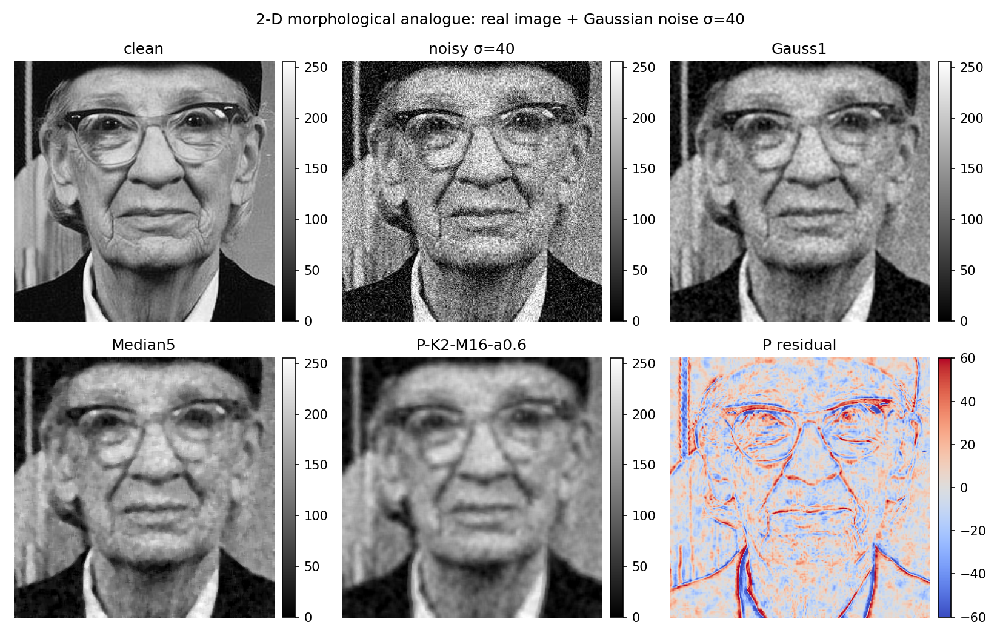
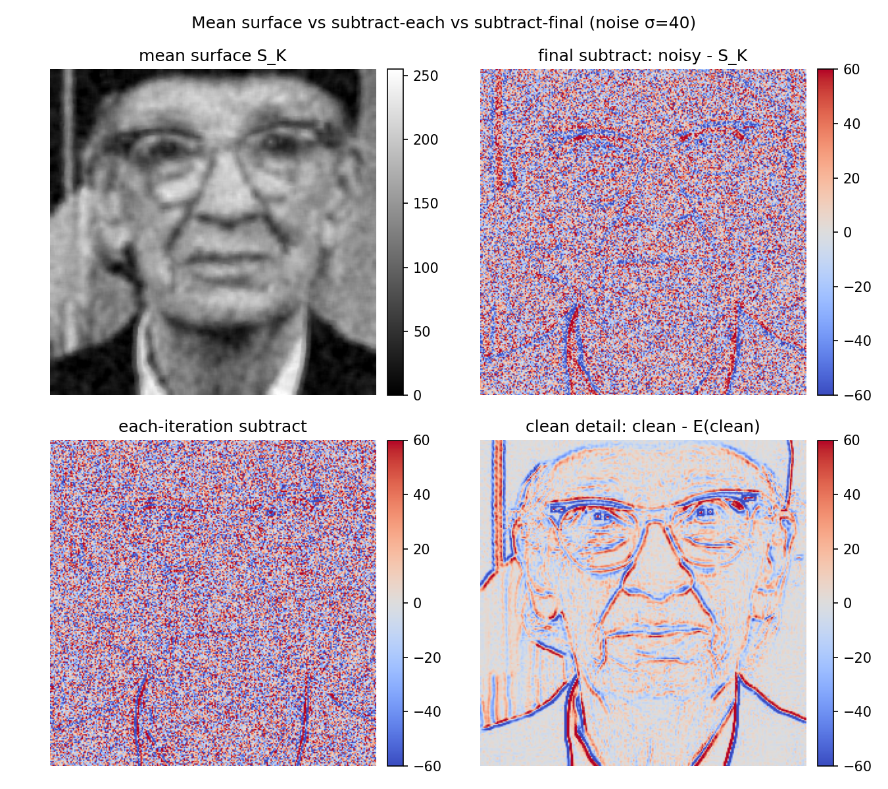

# 2-D 图像扩展示意

- 日期：2026-10-17
- 环境：Python 3.10.11 · numpy 2.2.6 · scipy 1.15.3 · matplotlib 3.10.9
- 代码：`explore/denoise/image_2d/{run_image_demo.py, make_figure.py}`
- 结果：`explore/denoise/results/{image_2d.json, image_2d_summary.csv}`
- 图：`fig/explore/denoise/image_2d_example.png`

> 这是一次**概念验证**，不是完整 2-D 方法。1-D 的上下三次样条包络不能
> 直接“按行列各做一次”就变成图像包络；2-D 包络需要 2-D 极值 + 曲面插值
> （薄板样条/BEMD），是另一个研究问题。本演示采用最直接的形态学类比：
>
> `E(x) = (grey_dilation(x,s) + grey_erosion(x,s)) / 2`
>
> 即 flat SE 下的 **midrange / 局部形态学均值**，再套用同样的
> 加噪 + M 次平均 + K 次迭代。

## 1. 为什么不能直接扩展

1-D 方法的核心是：

```text
找极大/极小 -> 分别做三次样条 -> 上/下包络 -> (U+L)/2
```

到了 2-D：

- 极值不再是“点”，而是局部极大/极小像素；在噪声图像上会非常密；
- 上/下包络不是两条曲线，而是两张曲面；需要薄板样条、RBF、BEMD 等
  2-D 插值，计算量大且边界不稳定；
- `(U+L)/2` 仍然是**局部均值/趋势面**，不是边缘保持算子；
- 2-D 噪声辅助平均同样只降低随机方差，不会消除“均值化”偏差。

因此本演示选择形态学 midrange，而不是硬套 1-D 样条。

## 2. 实验

- 图像：matplotlib 自带真实照片 `grace_hopper.jpg`，灰度，中心 256×256；
- 噪声：高斯 σ=20/40/60（[0,255] 尺度），5 次重复；
- 方法：
  - `Gauss1/2`、`Median3/5`、`Uniform5`
  - `P-K1-M8-a0.5`、`P-K2-M8-a0.5`、`P-K1-M16-a0.6`、`P-K2-M16-a0.6`
    （SE size=5；加噪幅度相对当前图像 std）
- 指标：PSNR、SSIM（Gaussian window 1.5，C1/C2 标准）、梯度幅值相关
  （edge corr）。

## 3. 结果

**表 1：全部噪声档合并的中位指标**

| 方法 | PSNR | SSIM | edge corr |
|---|---:|---:|---:|
| **Gauss1** | **24.751** | **0.6368** | **0.742** |
| Uniform5 | 23.822 | 0.6064 | 0.621 |
| Median5 | 23.806 | 0.5709 | 0.662 |
| Gauss2 | 23.468 | 0.6440 | 0.653 |
| Median3 | 22.702 | 0.5151 | 0.629 |
| P-K2-M16-a0.6 | 22.452 | 0.5851 | 0.591 |
| P-K2-M8-a0.5 | 22.196 | 0.5648 | 0.572 |
| P-K1-M16-a0.6 | 22.074 | 0.5267 | 0.335 |
| P-K1-M8-a0.5 | 21.709 | 0.5026 | 0.292 |
| raw | 16.091 | 0.2695 | 0.352 |

**表 2：按噪声档的 PSNR**

| 方法 | σ=20 | σ=40 | σ=60 |
|---|---:|---:|---:|
| raw | 22.10 | 16.09 | 12.59 |
| Gauss1 | **27.24** | **24.75** | **22.32** |
| Median5 | 25.83 | 23.81 | 21.96 |
| P-K2-M16-a0.6 | 22.77 | 22.45 | 21.66 |
| P-K1-M16-a0.6 | 22.74 | 22.07 | 20.67 |

- 在 σ=20 时，proposed 只比 raw 高 0.7 dB，远低于 Gauss1（27.2）和 Median5（25.8）；
- σ=40/60 时 proposed 仍低于 Gauss1/Median5；σ=60 时 SSIM 略高于 Gauss1
  （0.526 vs 0.511），但 PSNR 和 edge corr 都更差，说明它只是“更平滑”，
  不是“更好地保结构”；
- edge corr 从 Gauss1 的 0.742 降到 proposed 的 0.591，边缘/纹理被抹平；
- K=1 的 edge corr 只有 0.29-0.34，几乎只剩低频背景。



### 3.1 如果“减去均值面”会怎样？

令 `base = E(noisy)`、`detail = noisy - base`，则：

- `base` 是低频主形态/背景；
- `detail = noisy - base` 是**高通细节层**，包含边缘/纹理，也包含噪声；
- `base + detail` 就是原图（恒等），所以“减去均值面”本身不会去噪；
- 只有对 `detail` 做阈值收缩（`base + soft(detail, τ)`）才是一个
  “base + detail shrinkage” 去噪器。

固定 SE=5，阈值 `τ = k·σ`（σ 为真实噪声 std，属于 oracle 信息）：

| 方法 | PSNR | SSIM | edge corr |
|---|---:|---:|---:|
| E-only（只保留均值面） | 20.699 | 0.436 | 0.173 |
| detail-only（只保留细节） | 5.378 | -0.011 | 0.250 |
| E + soft 0.5σ | 18.959 | 0.355 | 0.420 |
| E + soft 1.0σ | 20.870 | 0.431 | 0.472 |
| E + soft 1.5σ | 21.398 | 0.466 | 0.459 |
| E + soft 2.0σ | 21.231 | 0.459 | 0.371 |

按噪声档 PSNR：

| 方法 | σ=20 | σ=40 | σ=60 |
|---|---:|---:|---:|
| E-only | 21.62 | 20.70 | 19.11 |
| detail-only | 5.70 | 5.38 | 4.91 |
| E + soft 1.0σ | **25.02** | 20.87 | 18.03 |
| E + soft 1.5σ | 24.54 | 21.40 | 19.08 |
| E + soft 2.0σ | 23.77 | 21.23 | 19.24 |
| Gauss1（参考） | 27.24 | 24.75 | 22.32 |

结论：

- **`detail-only` 不是去噪结果**：PSNR 只有 5 dB 左右，SSIM ≈ 0；它把背景/低频
  全部减掉，留下的是边缘 + 噪声；
- **`base + soft(detail)`** 在 σ=20 时能到 25.0 dB，高于 raw 的 22.1，
  但仍低于 Gauss1 的 27.2；σ=40/60 时进一步落后；
- 阈值用了真实 σ（oracle），实际使用还要估噪；即使给 oracle 阈值，
  也没有超过简单的 Gauss1；
- 1-D 里 `x - M(x)` 是 EMD 的 IMF/细节，EMD 会继续分解/选择 IMF 再重构；
  **直接把 `x-M(x)` 当输出去噪，等于把低频信号丢掉**。2-D 同理。

### 3.2 每次迭代减 vs 只减最后一次

固定 `K=2, M=16, amp=0.6, SE=5`：

- `P-mean`：原始算法，输出均值面 `S_K`；
- `P-finalsub`：先算 `S_K`，输出 `noisy - S_K`；
- `P-eachsub`：每次迭代 `current = current - E(current+noise)`，输出最终细节。

| 方法 | full PSNR | detail PSNR | SSIM | edge corr |
|---|---:|---:|---:|---:|
| P-mean（均值面） | **22.452** | - | 0.585 | **0.591** |
| P-finalsub（只减最后均值面） | 5.453 | **16.083** | -0.015 | 0.223 |
| P-eachsub（每次迭代减） | 5.290 | 15.358 | -0.003 | 0.198 |
| detail-only（`noisy - E(noisy)`） | 5.378 | - | -0.011 | 0.250 |

按噪声档：

| 方法 | σ=20 full / detail / edge | σ=40 full / detail / edge | σ=60 full / detail / edge |
|---|---|---|---|
| P-mean | 22.77 / - / 0.623 | 22.45 / - / 0.591 | 21.66 / - / 0.534 |
| P-finalsub | 5.74 / **21.49** / 0.519 | 5.45 / 16.08 / 0.223 | 5.03 / 12.71 / 0.117 |
| P-eachsub | 5.59 / 20.53 / 0.447 | 5.29 / 15.36 / 0.198 | 4.83 / 12.09 / 0.104 |

结论：

- **两者都不是去噪结果**：full PSNR 只有 5 dB 左右、SSIM≈0；它们输出的是
  高通细节，不是干净图像；
- **只减最后一次比每次减略好**：detail PSNR 21.5/16.1/12.7 vs
  20.5/15.4/12.1，edge corr 也略高；
- 但即使最好的 final-subtract，detail PSNR 在 σ=40/60 也只有 16/13 dB；
  与均值面 full PSNR 22-23 dB 不在一个任务上；
- 每次迭代减会反复去掉低频，残余噪声占比更高；最后一次减只去掉一次
  平滑后的均值面，所以细节层略干净——但它仍然是**细节层**；
- 若要做“细节增强/边缘提取”，final-subtract 可作为输入；若要“去噪”，
  必须再把细节阈值收缩并加回基底，不能直接把减法结果当输出。



## 4. 解释

- `(dilation+erosion)/2` 是 **midrange**，对局部极值非常敏感；加噪后
  dilation/erosion 会选到噪声的极端值，midrange 被拉偏；
- M 次平均降低随机部分，但 K 次迭代会不断把图像推向“局部均值面”；
- 对图像而言，这个“局部均值面”就是低频背景/光照，纹理和边缘被当作
  高频细节抹掉；它不是 edge-preserving denoiser；
- 边界 reflect 会引入边缘偏移；2-D 结构元尺寸也变成新的形态先验
  （SE 越大，越像大尺度背景估计）。

## 5. 结论

**可以做，但不建议作为图像去噪方法。**

- 如果目标是“图像主形态/背景/光照提取”：形态学开闭、midrange、大尺度
  中值都可以做；本方法只是其中一种，且需要 K/M/amp/SE 参数；
- 如果目标是“图像去噪”：Gauss/Median/Bilateral/NLM/BM3D/小波都更合适；
  proposed 在 PSNR、SSIM、edge corr 上都没有竞争力；
- **“减去均值面”只是得到高通细节，不是去噪**；`detail-only` PSNR≈5 dB。
  若做 `base + soft(detail)`，σ=20 能到 25.0 dB，但仍低于 Gauss1 的 27.2；
  σ=40/60 更低，且阈值用了 oracle σ；
- **每次迭代减 vs 只减最后一次**：两者 full PSNR 都只有 5 dB 左右；
  只减最后一次的 detail PSNR 略好（21.5/16.1/12.7 vs 20.5/15.4/12.1），
  但仍然是细节层，不是去噪结果；
- 真正的 2-D 样条/BEMD 版本理论上更贴近 1-D，但实现复杂、边界/模态混叠
  更严重，预计不会改变“局部均值化”的本质；
- 因此 2-D 扩展的定位与 1-D 一致：**主形态/低频结构提取的实验工具，
  不是去噪器**。

## 6. 复现

```powershell
.venv\Scripts\python.exe -B -m explore.denoise.image_2d.run_image_demo
.venv\Scripts\python.exe -B -m explore.denoise.image_2d.make_figure
```

产物：

- `explore/denoise/results/image_2d.json`
- `explore/denoise/results/image_2d_summary.csv`
- `fig/explore/denoise/image_2d_example.png`

## 7. 局限

- 单张真实照片、灰度、合成高斯噪声；没有彩色/真实相机噪声/压缩伪影；
- 只实现形态学 midrange，不是 2-D 样条/BEMD；
- 5 次重复，中位数；没有做参数网格（SE 只取 5）；
- PSNR/SSIM 对“过度平滑”不完全敏感，因此同时报告 edge corr 和残差图。
