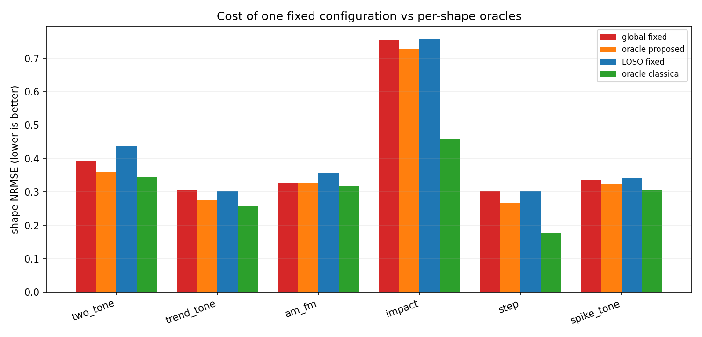
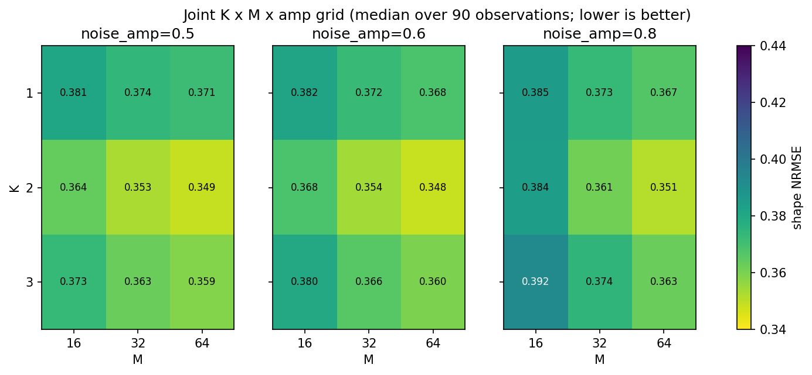
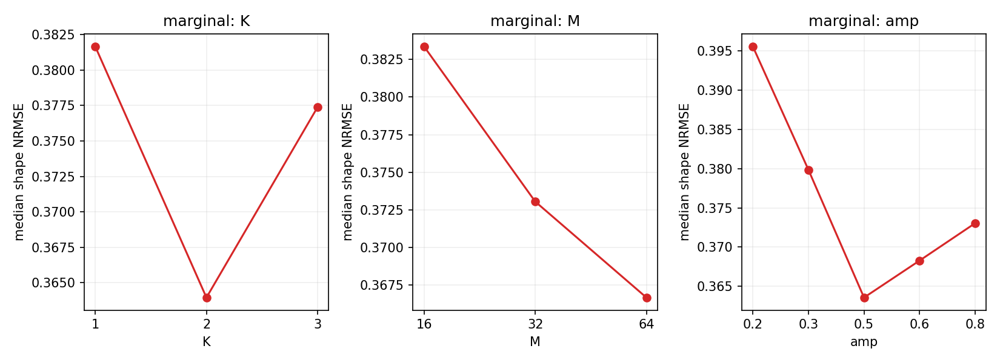
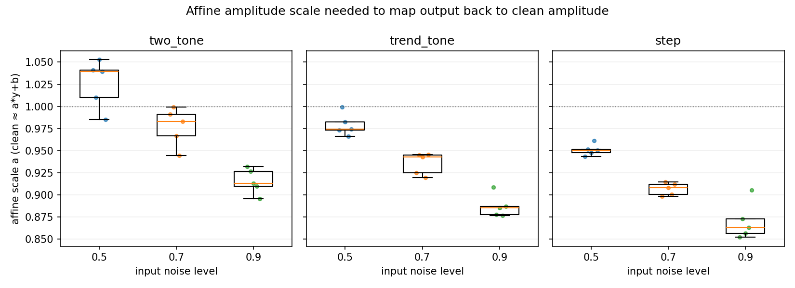

# K×M×amp 联合网格与每形态 Oracle 报告

- 日期：2026-10-17
- 环境：Python 3.10.11 · numpy 2.2.6 · scipy 1.15.3 · matplotlib 3.10.9
- 方法：`NoisyEnvelopeMeanIteration`，高噪声主形态提取口径
- 代码：`explore/denoise/{run_joint_grid.py, analyze_joint_grid.py, make_joint_grid_figures.py}`
- 原始结果：`explore/denoise/results/joint_grid.json`（5400 条）
- 汇总：`explore/denoise/results/{joint_grid_configs.csv, joint_grid_cases.csv, joint_grid_summary.json}`

> 前置报告：[High_Noise_Morphology_Report.md](High_Noise_Morphology_Report.md)、
> [Noise_Amplitude_Matching_Report.md](Noise_Amplitude_Matching_Report.md)。
>
> 目标有两个：
> 1. **判断“低参数”叙事是否成立**：是否一个固定的 `(K,M,noise_amp)` 就能跨形态工作，
>    还是必须每形态调参；
> 2. **量化“省调参的代价”**：用每形态 oracle（proposed 网格内、以及经典/形态学基线内）
>    作为上界，比较固定配置与它的差距。

## 1. 结论

### 1.1 联合网格

- 网格：`K∈{1,2,3}` × `M∈{16,32,64}` × `noise_amp∈{0.2,0.3,0.5,0.6,0.8}`，
  共 **45 个 proposed 配置**；
- 6 形态 × 3 噪声档（0.5/0.7/0.9）× 5 次 = **90 个观测**；
- 对照：15 个固定基线（raw、SG11/21、Butter100/150/250、MorphOC/CO/Avg 5/11/21）；
- 全局最佳：**`P-K2-M64-a0.6`**，shape NRMSE **0.348**（90 观测中位），
  每形态均值 **0.403**，SNR **+6.51 dB**，运行时约 **38.6 ms**；
- 紧随其后：`P-K2-M64-a0.5`（0.349）、`P-K2-M64-a0.8`（0.351）、
  `P-K2-M32-a0.5`（0.353）。

### 1.2 “低参数”叙事：分两层看

**在 proposed 家族内部：基本成立。**

- 每形态 oracle proposed 的平均 shape 为 **0.381**；全局固定配置的每形态均值
  **0.403**，只差 **0.022**（约 5.8%）；
- 每形态最优配置各不相同（K1M64a0.8、K3M32a0.2、K2M64a0.8、K1M64a0.8、
  K3M64a0.2、K3M64a0.5），但换配置的收益很小；
- 45 个配置里有 **13 个**在全局最佳 +5% 以内，3 个在 +1% 以内；
  K=2、M=64、amp=0.5-0.6 是一个较宽的平台。
  **所以“一个固定配置跨形态够用”在 proposed 内部是成立的，调参只买到约 0.02 shape。**

**相对每形态 oracle 经典/形态学基线：不成立，省调参有明确代价。**

- 每形态 oracle 基线（15 个固定方法里按形态选最优）平均 shape **0.310**；
  全局 proposed 的每形态均值 **0.403**，差 **0.093**（约 30%）；
- 代价高度集中在 **step**（0.304 vs MorphAvg21 0.177，差 0.127）和
  **impact**（0.754 vs Butter250 0.460，差 0.295）；
- 去掉 step/impact，剩下四个形态的平均差距只有 **0.034**：
  two_tone 0.049、trend 0.048、AM 0.010、spike 0.028。
- 结论：如果目标是“平滑/窄带主形态”，proposed 不调参的代价较小；
  如果目标是阶跃/冲击这类有明确专用滤波器的形态，省调参的代价很大。

### 1.3 P0：CI、LOSO 与“固定基线”对照

- **top-3 CI 完全重叠**：`P-K2-M64-a0.6` 0.348 [0.304, 0.400]、
  `a0.5` 0.349 [0.303, 0.400]、`a0.8` 0.351 [0.310, 0.401]；
  top-3 在统计上不可区分，“a0.6 最好”只是点估计；
- **LOSO classical**（在其余 5 形态上选一个固定 SG/Butter/Morph，再评估留出形态）
  平均 shape **0.398**；全局 proposed **0.403**，proposed 还差 **0.005**；
  oracle classical（每形态选最优）**0.310**；
- 也就是说：**如果不想按形态调参，固定 Butter100 与 proposed 固定配置精度几乎一样，
  proposed 没有优势；如果愿意按形态调参，经典/形态学 oracle 明显更好。**
  “低参数”只在 proposed 家族内部成立，不能推出“比固定 Butter100 更好”。
- LOSO proposed 平均 **0.416**，比全局 in-sample 的 0.403 差 **0.013**；
  two_tone 上 LOSO 选到 `K3-M64-a0.5`（0.438），不如全局 `K2-M64-a0.6`（0.393）。
  因此实践上不要做激进的 per-shape 搜索，直接用 K2/M64/amp 0.5-0.6 的默认平台。

### 1.4 P2：真实数据检查

- **CWRU 真实轴承数据**（IR007, 1797 rpm, 105_0）已通过 GitHub 镜像下载：
  proposed 的 BPFI 包络 SNR 8-15，固定 Butter100 只有 1.1——字面上赢；
  但 SG11/Butter3000/raw 是 63-64，且 proposed 的峰值在 221.5 Hz 而不是
  BPFI 162 Hz；**没有实用优势**；
- **真实 EEG 样本**（4×800，通道 0，假设 100 Hz）+ 合成白噪声：
  Butter15 总体 shape **0.425**，SG11 **0.468**，proposed **0.534**；
  三个噪声档 proposed 都落后；
- PhysioNet ECG 未做；CWRU 加噪是合成的，不是真实工况噪声；
- 结论：只有一个“字面优于固定 Butter100”的场景，没有找到实用/省事场景。
  最终定位：**方法论反例 + 弱小众备选**。详见
  [Real_Data_CWRU_Report.md](Real_Data_CWRU_Report.md)、
  [Real_Data_EEG_Demo.md](Real_Data_EEG_Demo.md)。
- **可靠性特征失败**：`峰值/M次实现标准差` 也没有识别 221.5 Hz 伪峰；
  伪峰 R 反而更高（14.4/12.9 vs 真峰 8.7/7.3）。详见 §4.4 和
  [Reliability_Feature_Report.md](Reliability_Feature_Report.md)。

## 2. 每形态 Oracle 与固定配置

**表 1：全局 `P-K2-M64-a0.6` vs 每形态 oracle**

| 形态 | 全局 shape | oracle proposed（配置） | oracle P shape | 固定损失 | LOSO shape | oracle 经典/形态学（方法） | oracle C shape | 全局 - oracle C |
|---|---:|---|---:|---:|---:|---|---:|---:|
| two_tone | 0.393 | P-K1-M64-a0.8 | 0.361 | 0.032 | 0.438 | Butter150 | 0.343 | 0.049 |
| trend_tone | 0.304 | P-K3-M32-a0.2 | 0.277 | 0.027 | 0.302 | SG21 | 0.257 | 0.048 |
| am_fm | 0.329 | P-K2-M64-a0.8 | 0.328 | 0.000 | 0.357 | Butter100 | 0.318 | 0.010 |
| impact | 0.754 | P-K1-M64-a0.8 | 0.728 | 0.027 | 0.758 | Butter250 | 0.460 | 0.295 |
| step | 0.304 | P-K3-M64-a0.2 | 0.268 | 0.036 | 0.304 | MorphAvg21 | 0.177 | 0.127 |
| spike_tone | 0.335 | P-K3-M64-a0.5 | 0.324 | 0.012 | 0.340 | Butter100 | 0.307 | 0.028 |

读法：

- **固定损失**（全局 vs oracle proposed）都很小：0.000-0.036；AM 几乎为 0；
- **相对经典 oracle** 的差距：AM 只有 0.010，spike 0.028，two/trend 约 0.05，
  但 step 0.127、impact 0.295；
- 每形态 oracle proposed 的配置差异很大，但性能面很平；这是“低参数”叙事的核心：
  **参数最优值会变，但坏选择不多**。



## 3. 参数平台：K、M、amp 的边际效应

**表 2：配置级中位 shape（45 个配置，按参数取中位）**

| 参数 | 取值 → shape NRMSE |
|---|---|
| K | 1: 0.382；**2: 0.364**；3: 0.377 |
| M | 16: 0.383；32: 0.373；**64: 0.367** |
| amp | 0.2: 0.396；0.3: 0.380；**0.5: 0.364**；0.6: 0.368；0.8: 0.373 |

- **K=2** 最好；K=1 因主形态保留不足，K=3 因过度平滑/端点误差，均略差；
- **M=64** 最好，但 M=32 只差 0.006；M=16 明显差；
- **amp=0.5** 最好，0.6 次之；0.2 最差，0.8 开始回落；
- 平台范围（+5% 内）：13 个配置，`K∈{2,3}`、`M∈{16,32,64}`、`amp∈{0.3,0.5,0.6,0.8}`；
  +1% 内：3 个，`K=2, M=64, amp∈{0.5,0.6,0.8}`。
- 这意味着：**不需要精细调参**；但“低参数”不是“无参数”，K/M/amp 仍有一个宽平台。





## 4. “低参数”叙事怎么表述才准确

比较准确的说法是：

> **在 proposed 家族内部，K×M×amp 的性能面很平；一个固定的
> `K=2, M=64, amp=0.5-0.6` 与每形态最优 proposed 只差约 0.02 shape。
> 因此“低参数/少调参”成立。但它不是“无代价”：与每形态 oracle 经典/形态学
> 滤波器相比，固定 proposed 平均差 0.093 shape，step/impact 上差距最大。
> 所以它适合作为**无形态先验时的通用主形态平滑器**，不适合替代已按形态调好的
> 专用滤波器。**

换句话说：

- **省调参**：是的，一个默认平台就够，调 proposed 只多约 6% 相对 shape；
- **省到比 tuned baseline 更好**：不是；step/impact 上 tuned 形态学/Butter 明显更好；
- **“低参数”≠“无参数”**：仍有 3 个参数，只是平台宽、容错高。

### 4.1 P0：top-3 配置的 95% CI 与 LOSO 经典基线

**Top-3 配置的 bootstrap CI**（按 `(case, noise_level)` 分层的 18 个单元重采样，
5000 次；区间是“中位数”的 95% CI）：

| 配置 | shape（90 观测中位） | bootstrap 中位 | 95% CI |
|---|---:|---:|---|
| P-K2-M64-a0.6 | 0.348 | 0.351 | [0.304, 0.400] |
| P-K2-M64-a0.5 | 0.349 | 0.352 | [0.303, 0.400] |
| P-K2-M64-a0.8 | 0.351 | 0.356 | [0.310, 0.401] |

三个 CI 几乎完全重叠，**top-3 之间没有可区分差异**；“a0.6 最好”只是点估计，
不能当作显著优于 a0.5/a0.8。平台宽、CI 宽，这也解释了为什么调参收益小。

**LOSO 经典基线**（在其余 5 个形态上选一个固定 baseline，评估留出形态；
候选为 SG/Butter/Morph，不含 raw）：

| 形态 | LOSO 选中的 baseline | LOSO shape | oracle 经典 shape | LOSO - oracle |
|---|---|---:|---:|---:|
| two_tone | Butter100 | 0.441 | Butter150 0.343 | 0.098 |
| trend_tone | Butter100 | 0.288 | SG21 0.257 | 0.032 |
| am_fm | Butter100 | 0.318 | Butter100 0.318 | 0.000 |
| impact | Butter100 | 0.745 | Butter250 0.460 | 0.286 |
| step | Butter100 | 0.287 | MorphAvg21 0.177 | 0.110 |
| spike_tone | Butter100 | 0.307 | Butter100 0.307 | 0.000 |

- **LOSO 经典基线平均 shape = 0.398**；oracle 经典 = 0.310；LOSO 代价 **0.088**；
- **全局 proposed 每形态均值 = 0.403**，与 LOSO 经典基线 0.398 基本持平
  （proposed 还差 0.005）；
- 也就是说：
  - 如果你**不想按形态调参**，一个固定 Butter100（LOSO 选出来的）和
    proposed 固定配置几乎一样好，proposed 没有精度优势；
  - 如果你**愿意按形态调参**，经典/形态学 oracle 0.310 明显优于 proposed 0.403；
  - “低参数”只在 proposed 家族内部成立，**不能推出“比固定 Butter100 更好”**。

### 4.2 P1：仿射尺度 `a` 的分布

固定 `P-K2-M64-a0.6`，在 two_tone / trend_tone / step 三个形态、
3 个噪声档 × 5 次上拟合 `clean ≈ a*output+b`：

| 形态 | n | a 中位 | IQR | 5-95% | min-max |
|---|---:|---:|---|---|---|
| two_tone | 15 | 0.983 | [0.929, 1.005] | [0.905, 1.045] | [0.896, 1.053] |
| trend_tone | 15 | 0.943 | [0.898, 0.969] | [0.877, 0.988] | [0.877, 0.999] |
| step | 15 | 0.908 | [0.886, 0.946] | [0.855, 0.955] | [0.852, 0.961] |

按噪声档的 `a` 中位：

| 形态 | noise=0.5 | noise=0.7 | noise=0.9 |
|---|---:|---:|---:|
| two_tone | 1.040 | 0.983 | 0.913 |
| trend_tone | 0.974 | 0.943 | 0.886 |
| step | 0.951 | 0.908 | 0.863 |

- `a` 在 **0.85-1.05** 之间，幅度衰减不严重，但不是 1；噪声越高 `a` 越小
  （输出更保守），0.9 档约 0.86-0.91；
- 截距 `b` 很小：two_tone 中位 0.006（-0.013~0.030），trend 0.009
  （-0.002~0.036），step -0.046（-0.081~-0.011）；
- 如果直接拿输出做阈值：需要乘约 `1/a` 的缩放；`a` 随噪声/形态变化约 ±10%，
  **固定阈值不能无损迁移**，至少要用当前噪声档的 `a` 做校准；
- 好消息是没有出现“幅度塌缩到 0.2”的情况，所以 `a` 校准是简单线性缩放。



### 4.3 P2：真实数据检查（CWRU + EEG）

**CWRU 真实轴承**（IR007, 1797 rpm, 105_0；下采样段 2 s ×5；
2-5 kHz 带通解调，看 BPFI≈162 Hz 包络峰）：

| 方法 | real 包络 SNR | +noise 0.7 | 峰值频率 @real |
|---|---:|---:|---:|
| raw | 63.34 | 34.68 | 161.5 Hz |
| Butter100（固定基线） | 1.11 | 1.12 | 80.0 Hz |
| Butter3000 | 63.51 | 31.02 | 161.5 Hz |
| SG11 | 64.15 | 35.39 | 161.5 Hz |
| P-K2-M64-a0.5 | 8.21 | 7.67 | **221.5 Hz** |
| P-K2-M64-a0.6 | 8.28 | 7.02 | **221.5 Hz** |
| P-K1-M64-a0.5 | 14.71 | 4.36 | **221.5 Hz** |

- proposed 的字面包络 SNR 高于固定 Butter100（8-15 vs 1.1），但远低于
  raw/SG11/Butter3000（63-64）；在 `amp=0.5/0.6` 下峰值在 **221.5 Hz**，
  不是 BPFI 162 Hz；
- **221.5 Hz 是幅度相关伪影**：低/中 amp（0.01/0.05/0.2/0.3）下真 BPFI
  重新占优（SNR ~10），`amp=0.1/0.5` 下伪峰占优；所以“错位”不是固有频率，
  但即使找对 BPFI，SNR 仍远低于 63-64；
- 若把基线换成一个保留 2-5 kHz 共振的固定 Butter3000，proposed 反而落后；
- 所以 CWRU 上只有一个“**基线选错才成立**”的字面优势，没有实用/省事优势。

**真实 EEG**（4×800，通道 0，假设 100 Hz）+ 合成白噪声：

- Butter15 总体 shape 0.425，SG11 0.468，proposed `K2-M64-a0.6` **0.534**；
- 三个噪声档 proposed 都低于 Butter15/25 和 SG11。

**P2 结论：**

- 只找到“proposed > 固定 Butter100”的字面场景（CWRU），没有找到
  “比调好的固定基线更好或更省事”的实用场景；
- PhysioNet ECG 未做；CWRU 的加噪是合成的，不是真实工况噪声；
- 最终定位：**方法论反例 + 弱小众备选**，而不是通用去噪器。详见
  [Real_Data_CWRU_Report.md](Real_Data_CWRU_Report.md)、
  [Real_Data_EEG_Demo.md](Real_Data_EEG_Demo.md)。

### 4.4 可靠性特征：`峰值 / M 次实现标准差`（已验证，不成立）

尝试把 CWRU 的“221.5 Hz 伪峰”转化为“可检测的不可靠性”：

- 对同一配置做 R=20 次独立实现，计算 `R(f)=mean/std`；
- 在真正产生 221.5 Hz 的 `K2-M64-a0.5/a0.6` 上：
  - 伪峰 R = 14.4/12.9，真峰 BPFI R = 8.7/7.3；
  - 伪峰 SNR = 8.0/8.2，真峰 SNR = 5.0/4.9；
  - **R 和 SNR 都在 5/5 段选错**；
  - 绝对 std 也没有显著差异：true 0.144/0.204，spur 0.154/0.199；
- `K2-M16-a0.3` 上 R 正确，但 SNR 也 5/5 正确，可靠性没有增量；
- **低 amp 补充**：`amp=0.01/0.05/0.2/0.3` 时真峰重新占优（SNR ~10），
  `amp=0.1/0.5` 时伪峰占优；221.5 Hz 是幅度相关伪影，不是固有频率；
  但所有 amp 下“SNR 错但 R 对”均为 0，R 仍无增量；
- 合成 impact：R 与 SNR 正确/错误模式完全一致（3/9 对，6/9 错），
  没有“SNR 错但 R 对”的样本。

**结论：`峰值/M次实现标准差` 不能识别这个稳定伪影；它会把错误频率包成
“高置信度”。低 amp 能让真峰回来，但那时 SNR 已经够用，R 仍无增量。**
详见 [Reliability_Feature_Report.md](Reliability_Feature_Report.md)。

## 5. 建议

| 场景 | 建议 |
|---|---|
| 无形态先验的通用高噪声主形态 | `K=2, M=64, amp=0.5-0.6`；但固定 Butter100 精度持平且快得多，proposed 只在“必须用该方法”时选 |
| 算力受限 | `K=2, M=32, amp=0.5`（shape 0.353，比 M64 差 0.005，时间约一半） |
| 双音/AM | 可试 `amp=0.8`；但全局 0.5-0.6 已接近 |
| 趋势 | `K=2/3, amp=0.2-0.5` 均可，平台很宽 |
| 阶跃 | 不要指望 proposed；用 MorphAvg11/21（oracle 0.177） |
| 冲击/包络 | 用 Butter250（oracle 0.460）或带通+Hilbert/EEMD，proposed 0.728-0.754 |
| 需要绝对最优 | 每形态 oracle 经典/形态学；但需要按形态选方法/参数 |
| 真实 EEG/ECG 形态 | 先试 Butter15/25 或 SG11；proposed 在本轮真实 EEG 上落后 |
| 真实 CWRU 轴承包络 | 用 2-5 kHz 带通 + Hilbert（或 Butter3000/SG11）；proposed 峰值错位、SNR 8-15 vs 63-64，不要用 |
| 诊断置信度 | 不要用 `峰值/M次实现标准差`；本实验伪峰 R 更高，会把错误频率包成高置信。若要做置信度，用跨配置/跨方法/物理约束一致性 |

## 6. 复现

```powershell
# 联合网格 + P0 CI/LOSO
.venv\Scripts\python.exe -B -m explore.denoise.run_joint_grid --reps 5
.venv\Scripts\python.exe -B -m explore.denoise.analyze_joint_grid --markdown
.venv\Scripts\python.exe -B -m explore.denoise.make_joint_grid_figures

# P1 仿射尺度 a
.venv\Scripts\python.exe -B -m explore.denoise.run_affine_scale
.venv\Scripts\python.exe -B -m explore.denoise.make_affine_scale_figure

# P2 真实 EEG sanity check
.venv\Scripts\python.exe -B -m explore.denoise.run_real_eeg --reps 10
.venv\Scripts\python.exe -B -m explore.denoise.analyze_real_eeg
.venv\Scripts\python.exe -B -m explore.denoise.make_real_eeg_figure
```

产物：

- `explore/denoise/results/joint_grid.json`（5400 条）
- `explore/denoise/results/joint_grid_configs.csv`（45 配置）
- `explore/denoise/results/joint_grid_cases.csv`（每形态 oracle/LOSO/CI）
- `explore/denoise/results/joint_grid_summary.json`
- `explore/denoise/results/affine_scale.json/csv`（P1）
- `explore/denoise/results/real_eeg.json` / `real_eeg_summary.csv`（P2-EEG）
- `explore/denoise/results/cwru.json` / `cwru_summary.csv`（P2-CWRU）
- `docs/explore/denoise/figures/joint_grid_heatmap.png`
- `docs/explore/denoise/figures/joint_grid_cost.png`
- `docs/explore/denoise/figures/joint_grid_marginal.png`
- `docs/explore/denoise/figures/affine_a_distribution.png`
- `docs/explore/denoise/figures/real_eeg_example.png`

## 7. 局限

- 所有 oracle 都是在同一批 90 个观测上做的 in-sample 选择；LOSO 只用于检查
  固定配置的迁移代价，不能消除全部选择偏差。
- 6 个合成形态仍是白高斯噪声；P2 做了真实 CWRU 轴承 + 真实 EEG 形态，
  但 CWRU 只有一段 IR007/1797 rpm，PhysioNet ECG 未做；CWRU 的加噪是合成的，
  仍不能宣称“真实有色噪声/多工况”验证。
- top-3 的 CI 是 cell-stratified bootstrap（18 个 case×level 单元，5000 次）；
  5 次重复下 CI 较宽，top-3 不可区分。没有做多重比较校正/显著性检验。
- 每形态 oracle 经典基线是在 15 个固定设置里选最优；真实工程中还需要
  额外的先验/验证成本，不能直接等同于“免费获得 0.310”。
- `M=64` 的运行时约 38.6 ms，是 M=32 的约 2 倍；实时场景需权衡。
- 真实 EEG 采样率文件未注明，文中 100 Hz 是假设；CWRU 只覆盖一段故障/转速，
  没有多故障/多负载统计；PhysioNet ECG 未做。
- 可靠性特征只测了 CWRU 的 221.5 Hz 伪峰和合成 impact 的 12 Hz 真峰，
  R=20 次实现；其他伪峰/故障频率未覆盖。
