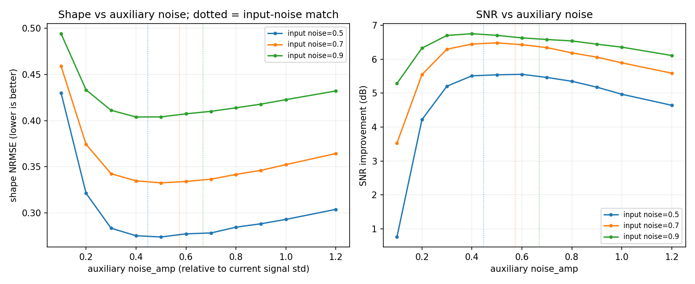
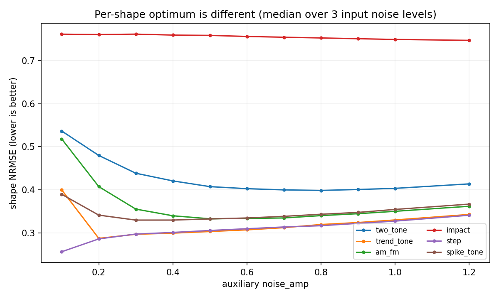

# 高噪声下的“加噪幅度匹配”专项报告

- 日期：2026-10-17
- 环境：Python 3.10.11 · numpy 2.2.6 · scipy 1.15.3 · matplotlib 3.10.9
- 方法：`NoisyEnvelopeMeanIteration`，固定 `K=2, M=32`，扫描 `noise_amp`
- 代码：`explore/denoise/{run_noise_amp.py, analyze_noise_amp.py, make_noise_amp_figures.py}`
- 原始结果：`explore/denoise/results/high_noise_noise_amp.json`
- 汇总：`explore/denoise/results/{high_noise_noise_amp_summary.csv, high_noise_noise_amp_ranking.csv, high_noise_noise_amp_summary.json}`

> 这是对“加噪幅度与输入噪声同大小/略大时是否更好”的直接实验。
> 评估口径仍是**高噪声主形态提取**：主指标为 shape NRMSE（先做最佳仿射
> `a*y+b`，允许整体幅度衰减），SNR 只作辅助。低噪声不在范围内。
> 高噪声形态对比（形态学/SG/Butter）见
> [High_Noise_Morphology_Report.md](High_Noise_Morphology_Report.md)；
> K×M×amp 联合网格与每形态 oracle 的调参代价见
> [Joint_Grid_and_Oracle_Report.md](Joint_Grid_and_Oracle_Report.md)。

## 1. 结论

**你的直觉大体成立，但准确的规律是：**

1. **整体最优在“接近输入噪声、略高一点”附近，而不是固定 0.2。**
   扫描 0.1-1.2：
   - `noise_amp=0.2`：shape **0.388**，SNR **+5.75 dB**，mean rank **7.52**；
   - `noise_amp=0.5`：shape **0.353**，SNR **+6.46 dB**，mean rank **6.12**；
   - `noise_amp=0.6`：shape **0.354**（与 0.5 基本并列最佳），SNR +6.30，mean rank 6.21；
   - 再往上（0.8/1.0/1.2）shape 和 SNR 都变差。
   对应的辅助/输入噪声比约 **0.87-1.05**，即“与输入噪声同量级、略高一点”。
2. **但不是“越大越好”，也不是所有形态都同一条最优线。**
   - 双音：最佳 `amp=0.8`（shape 0.480→0.399）；
   - AM-FM：最佳 `amp=0.5`（0.407→0.333）；
   - 趋势：最佳 `amp=0.2`（0.287，增大无益）；
   - 阶跃：最佳 `amp=0.1`（0.286→0.256，增大反而变差）；
   - 尖峰：最佳 `amp=0.3`（0.341→0.330，增益很小）；
   - 冲击：最佳 `amp=1.2` 也只有 0.747（0.761→0.747），仍然失败。
3. **输入噪声越高，最佳辅助噪声不一定要“超过”输入噪声。**
   输入噪声 0.5 时最佳 `amp=0.5-0.6`（辅助/输入≈1.1-1.3，0.5/0.6 基本并列）；
   0.7 时最佳 `amp=0.5`（≈0.87）；
   0.9 时最佳 `amp=0.4`（≈0.59）。
   到了 0.9，输入本身已经提供足够密的极值，再加大辅助噪声只会增加方差，
   所以“>= 输入噪声”不是绝对规则。
4. **对平滑/窄带主形态，匹配或略超输入噪声确实比固定 0.2 好。**
   在双音/AM 上分别提升 shape 0.081/0.075；趋势不变；阶跃反而应降低。
   所以“按形态选 amp”比“一个固定值”更合理；如果只能选一个通用值，
   **0.5-0.6** 比 0.2 更好。

## 2. 辅助/输入噪声比的定义

方法的 `noise_amp` 是乘在**当前信号 std** 上的：

```text
aux_std = noise_amp * std(noisy)
input_noise_std = noise_level * std(clean)
ratio = aux_std / input_noise_std
      = noise_amp * std(noisy) / (noise_level * std(clean))
```

对高斯噪声，`std(noisy) ≈ std(clean)*sqrt(1+level^2)`，因此：

- 与输入噪声**完全匹配**：`noise_amp = level / sqrt(1+level^2)`；
  - level=0.5 → 0.45
  - level=0.7 → 0.57
  - level=0.9 → 0.67
- 若直接取 `noise_amp = level`（0.5/0.7/0.9），辅助噪声比输入噪声大
  1.12/1.22/1.35 倍，属于“略超”。

## 3. 结果

### 3.1 全局扫描（6 个形态 × 3 个噪声档 × 5 次 = 90 个观测）

| `noise_amp` | 辅助/输入噪声中位比 | shape NRMSE | SNR imp. (dB) | edge max | mean rank |
|---:|---:|---:|---:|---:|---:|
| 0.1 | 0.17 | 0.468 | 4.09 | 2.115 | 11.32 |
| 0.2 | 0.35 | 0.388 | 5.75 | 1.852 | 7.52 |
| 0.3 | 0.52 | 0.366 | 6.30 | 1.907 | 6.92 |
| 0.4 | 0.70 | 0.364 | **6.45** | 2.125 | 6.52 |
| **0.5** | **0.87** | **0.353** | **6.46** | 2.020 | **6.12** |
| **0.6** | **1.05** | **0.354** | 6.30 | 1.957 | 6.21 |
| 0.7 | 1.22 | 0.357 | 6.15 | 1.997 | 6.47 |
| 0.8 | 1.39 | 0.361 | 5.99 | 1.983 | 7.08 |
| 0.9 | 1.57 | 0.367 | 5.84 | 2.027 | 8.01 |
| 1.0 | 1.74 | 0.373 | 5.61 | 2.108 | 8.96 |
| 1.2 | 2.09 | 0.385 | 5.26 | 2.123 | 10.21 |

- shape 最优在 **0.5-0.6**（0.353/0.354），比 0.2 提升约 **9%**；
- SNR 最优在 **0.5**（6.46），比 0.2 高 **0.71 dB**；
- mean rank 最优在 **0.5**（6.12），比 0.2 的 7.52 好 1.4 名；
- `amp >= 1.0` 后 SNR 明显下降，shape 也回升；辅助噪声过大会把输出推向
  “含噪原信号”，而不是主形态。



### 3.2 按输入噪声档

| 输入噪声 | 匹配 amp（网格） | shape @0.2 | shape @匹配 | shape @amp=level | 最佳 amp | 最佳 shape |
|---:|---:|---:|---:|---:|---:|---:|
| 0.5 | 0.45（0.4） | 0.324 | 0.277 | 0.273 | 0.6 | 0.272 |
| 0.7 | 0.57（0.6） | 0.382 | 0.334 | 0.337 | 0.5 | 0.333 |
| 0.9 | 0.67（0.7） | 0.440 | 0.413 | 0.420 | 0.4 | 0.404 |

- 0.5/0.7：把 amp 从 0.2 提到“匹配/略超”附近，shape 改善 **0.04-0.05**；
- 0.9：最佳 amp 反而降到 0.4（辅助/输入≈0.59），过大的辅助噪声会伤 SNR；
- 所以“匹配输入噪声”是 0.5-0.7 档的好规则，但在 0.9 档应略保守。

### 3.3 按形态

| 形态 | shape @0.2 | 最佳 amp | 最佳 shape | 相对 0.2 的增益 |
|---|---:|---:|---:|---:|
| two_tone | 0.480 | **0.8** | 0.399 | 0.081 |
| trend_tone | 0.287 | **0.2** | 0.287 | 0.000 |
| am_fm | 0.407 | **0.5** | 0.333 | 0.075 |
| impact | 0.761 | 1.2 | 0.747 | 0.014 |
| step | 0.286 | **0.1** | 0.256 | 0.030 |
| spike_tone | 0.341 | **0.3** | 0.330 | 0.012 |

- **双音/AM**：需要较大的辅助噪声（0.5-0.8），让噪声把极值点铺满整个频带，
  包络均值才近似保留主振荡；0.2 太小，会滑向局部均值归零。
- **趋势**：输入本身已有强低频结构，0.2 足够；增大只是增加方差。
- **阶跃**：最佳是 0.1；辅助噪声越大，边沿/平台越差。
- **尖峰**：0.3 左右，增益很小；尖峰不是靠加噪能“平均掉”的。
- **冲击**：任何 amp 都救不了（0.747-0.761）；不要用它处理冲击包络。



### 3.4 辅助/输入噪声比分箱（描述性）

| 辅助/输入比 | shape NRMSE | SNR imp. | n |
|---|---:|---:|---:|
| [0, 0.5) | 0.416 | 5.12 | 42 |
| [0.5, 1) | 0.373 | **6.60** | 48 |
| [1, 1.5) | 0.387 | 6.29 | 52 |
| [1.5, 2) | 0.349 | 5.89 | 32 |
| [2, 3) | 0.321 | 4.98 | 24 |

这个分箱混合了不同形态/噪声档，不能直接当作因果结论；它只说明：

- **SNR 最优**在 ratio **0.5-1.0**（约等于/略低于输入噪声）；
- ratio 很大时 shape 数字看似更低，但 SNR 明显下降，且主要是双音/AM 在
  “近似恒等”区域的贡献，不能理解为“主形态更好”。

## 4. 为什么“匹配输入噪声”有效

1. **辅助噪声太小时**：极值点稀疏，`(U+L)/2` 退化为局部均值，信号被抹平；
   这就是 amp=0.1 时 shape 0.463、SNR 4.11 的原因。
2. **辅助噪声与输入噪声同量级时**：噪声把极值点铺到与输入噪声相近的尺度，
   上下样条既能跨过输入噪声，又不会完全跟随噪声，`(U+L)/2` 接近“主形态 +
   被平均掉的细节”；这是 0.5-0.6 的甜点。
3. **辅助噪声远大于输入噪声时**：包络被辅助噪声主导，输出趋向“含噪原信号”
   或高频抖动，SNR 下降；在已经 0.9 的高噪声输入上尤其明显。
4. **形态决定“够不够”**：双音/AM 需要更密的极值（较大 amp）；趋势/阶跃
   本身已有低频结构，小 amp 就够；冲击需要高频细节，任何 amp 都会把它平滑掉。

## 5. 建议

| 场景 | 建议 |
|---|---|
| 高噪声、平滑/窄带主形态（通用） | `noise_amp=0.5-0.6`，`K=2, M=32/64` |
| 输入噪声 0.5 档 | `amp≈0.5-0.6`（辅助/输入≈1.1-1.3） |
| 输入噪声 0.7 档 | `amp≈0.5-0.6`（≈0.9-1.0） |
| 输入噪声 0.9 档 | `amp≈0.4-0.7`；不要盲目加到 1.0+ |
| 双音/AM 主形态 | `amp≈0.5-0.8` |
| 趋势 | `amp≈0.2`，不必增大 |
| 阶跃 | `amp≈0.1`，增大反而伤边沿 |
| 冲击/包络 | 不要用；选 Butter250/带通+Hilbert 或 EEMD 类 |

**一句话回答你的问题：**
> 没有试过“固定等于输入噪声”的版本；这次扫了 0.1-1.2。结果是：
> **在 0.5-0.7 输入噪声档，把 aux 提到与输入噪声同量级/略高（amp 0.5-0.6）
> 确实比固定 0.2 好；但在 0.9 档最佳反而低于输入噪声，且不同形态的最佳 amp
> 不同（双音 0.8、趋势 0.2、阶跃 0.1）。所以“>= 输入噪声”是部分成立的经验，
> 不是统一规律；通用默认取 0.5-0.6 更稳。**

## 6. 复现

```powershell
.venv\Scripts\python.exe -B -m explore.denoise.run_noise_amp --reps 5
.venv\Scripts\python.exe -B -m explore.denoise.analyze_noise_amp --markdown
.venv\Scripts\python.exe -B -m explore.denoise.make_noise_amp_figures
```

产物：

- `explore/denoise/results/high_noise_noise_amp.json`（1350 条）
- `explore/denoise/results/high_noise_noise_amp_summary.csv`
- `explore/denoise/results/high_noise_noise_amp_ranking.csv`
- `docs/explore/denoise/figures/noise_amp_shape_snr.png`
- `docs/explore/denoise/figures/noise_amp_per_case.png`

## 7. 局限

- 固定 `K=2, M=32` 扫描 amp；`M=64` 在固定 amp=0.2 时略好（见高噪声报告），
  但本轮没有对每个 amp 重跑 M=64。amp 的最优区间预计相近，绝对值可能略移。
- 只用白高斯噪声；有色噪声/真实机械数据未测。
- shape NRMSE 经过仿射校准，对“过度平滑但形状偏对”的输出偏宽容；应结合
  SNR、edge max 和特征指标看。
- 5 次重复，中位数；没有置信区间/显著性检验。
