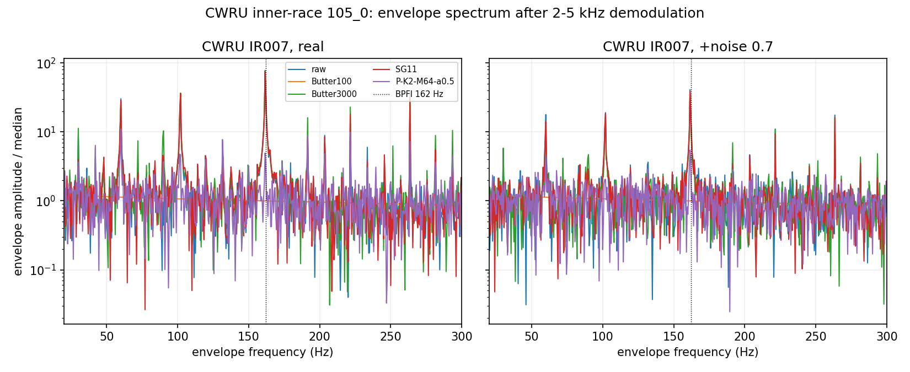

# 真实数据检查：CWRU 轴承（P2-机械）

- 日期：2026-10-17
- 环境：Python 3.10.11 · numpy 2.2.6 · scipy 1.15.3 · matplotlib 3.10.9
- 数据：`explore/denoise/data/cwru/IR007_105_0.mat`（2.9 MB）
- 代码：`explore/denoise/{run_cwru.py, make_cwru_figure.py}`
- 结果：`explore/denoise/results/{cwru.json, cwru_summary.csv, cwru_summary.json}`
- 图：`docs/explore/denoise/figures/cwru_envelope_spectrum.png`

## 1. 数据来源

- 原始数据：Case Western Reserve University Bearing Data Center，
  12 kHz Drive-End，内圈故障 0.007 in，负载 0，转速 1797 rpm；
- 下载镜像：[s-whynot/CWRU-dataset](https://github.com/s-whynot/CWRU-dataset)，
  文件 `12k_Drive_End_Bearing_Fault_Data/IR/007/105_0.mat`；
- 使用变量：`X105_DE_time`（121,265 点）、`X105RPM`（1797）；
- 内圈特征频率：`BPFI ≈ 5.4152 × fr`，`fr=1797/60=29.95 Hz`，
  即 **162.2 Hz**。

这是真实机械振动数据；没有 clean 参考，因此不能用 shape NRMSE。
评价指标是**包络谱在 BPFI 处的峰值 SNR**（2-5 kHz 带通解调后，
`BPFI ± 2 Hz` 的最大幅值 / 80-250 Hz 中位幅值），以及峰值频率和峭度。

## 2. 协议

- 取 5 个不重叠的 24,000 点段（每段 2 s）；
- 每段做：
  - `level=0`：原始真实信号（含真实噪声/工频/结构响应）；
  - `level=0.5/0.7/0.9`：叠加白高斯噪声（相对段 std）的“高噪声”版本；
- 方法：raw、**固定 Butter100**（前面合成报告的基线）、Butter3000（宽频低通，
  保留轴承共振）、SG11、MorphAvg5、proposed `K2-M64-a0.5/a0.6`、
  `K1-M64-a0.5`；
- 每个 `(段, level, 方法)` 计算包络谱指标，5 段取中位。

## 3. 结果

**表 1：包络谱峰值 SNR（BPFI 附近；中位，5 段）**

| 方法 | real (0) | +noise 0.5 | +noise 0.7 | +noise 0.9 | 峰值频率 @real | BPFI SNR @real |
|---|---:|---:|---:|---:|---:|---:|
| raw | **63.34** | **45.38** | **34.68** | **30.68** | 161.5 Hz | **63.34** |
| Butter100 | 1.11 | 1.10 | 1.12 | 1.10 | 80.0 Hz | 1.01 |
| Butter3000 | 63.51 | 39.79 | 31.02 | 25.15 | 161.5 Hz | 63.51 |
| SG11 | **64.15** | 43.89 | 35.39 | 30.34 | 161.5 Hz | 64.15 |
| MorphAvg5 | 27.82 | 20.44 | 16.16 | 12.99 | 161.5 Hz | 27.82 |
| P-K2-M64-a0.5 | 8.21 | 8.24 | 7.67 | 5.64 | **221.5 Hz** | 4.89 |
| P-K2-M64-a0.6 | 8.28 | 7.81 | 7.02 | 5.69 | **221.5 Hz** | 5.30 |
| P-K1-M64-a0.5 | 14.71 | 5.84 | 4.36 | 3.77 | **221.5 Hz** | 9.08 |

**表 2：proposed 与固定 Butter100 / 调优基线的对比**

| 场景 | 固定 Butter100 | proposed 最好 | 调优基线最好 | 结论 |
|---|---:|---:|---:|---|
| real (0) | 1.11 | 14.71（K1-M64-a0.5） | SG11 64.15 / Butter3000 63.51 | proposed 远低于调优基线 |
| +noise 0.5 | 1.10 | 8.24（K2-M64-a0.5） | raw 45.38 / SG11 43.89 | 同上 |
| +noise 0.7 | 1.12 | 7.67 | raw 34.68 / SG11 35.39 | 同上 |
| +noise 0.9 | 1.10 | 5.69 | raw 30.68 / SG11 30.34 | 同上 |

- **proposed 确实高于固定 Butter100**（8-15 vs 1.1）；这是唯一“字面上更好”的地方；
- 但 proposed 的峰值频率是 **221.5 Hz**，不是 BPFI 161.5/162.2 Hz；
  BPFI 处 SNR 只有 4.9-9.1，而 raw/SG11/Butter3000 是 63-64；它没有可靠提取故障频率；
- **221.5 Hz 是 `amp=0.5/0.6` 下的伪影**：后续 amp 扫描显示
  `amp=0.01/0.05/0.2/0.3` 时真 BPFI 重新占优（SNR ~10），
  `amp=0.1/0.5` 时伪峰占优；所以“错位”是参数相关，不是固有频率。
  即使低 amp 找对 BPFI，SNR 仍远低于 63-64，结论不变；
- 一个正确的固定基线应保留 2-5 kHz 共振（Butter3000 或带通），此时 proposed 明显落后；
- 所以“proposed 比固定 Butter100 好”只是**基线选错**造成的字面结果，不是实用优势。



## 4. 结论

### 4.1 是否找到“具体场景”？

**找到一个字面场景，但没有实用场景：**

- 字面：在 CWRU 内圈故障数据上，若唯一允许的基线是“固定 Butter100”，
  proposed 的包络 SNR 更高（8-15 vs 1.1）；
- 不实用：
  1. 只要把基线换成保留共振的 Butter3000/SG11，proposed 就从 8-15 掉到
     远低于 63-64；
  2. 在 `amp=0.5/0.6` 下 proposed 的峰值落在 221.5 Hz，不是 BPFI；
     低 amp（0.01/0.05/0.2/0.3）可恢复 BPFI，但 SNR 仍只有 ~10；
  3. proposed 仍需 K/M/amp 三个参数，并不比“2-5 kHz 带通 + Hilbert”更省事；
  4. 在真实信号和加噪版本上都没有稳定超过 raw/SG11/Butter3000。

**因此：没有找到“proposed 比固定 Butter100 更好或更省事”的实用场景；
CWRU 反而确认了“冲击/包络不是它的适用场景”。**

> 尝试用“峰值 / M 次实现标准差”把 221.5 Hz 伪峰转成“可检测的不可靠性”
> 也失败了：在 amp=0.5/0.6 下伪峰的 R 反而更高（14.4/12.9 vs 真峰 8.7/7.3），
> 它是稳定伪影；低 amp 下真峰会回来，但 SNR 已经正确，R 没有增量。
> 详见 [Reliability_Feature_Report.md](Reliability_Feature_Report.md)。

### 4.2 最终定位

结合 EEG（无优势）与 CWRU（只有字面优势、无实用优势）：

> **最终定位：方法论反例 + 小众备选（且是弱备选）。**
> - 方法论反例：低噪声抹信号、冲击/阶跃丢形态、真实 CWRU 峰值错位；
> - 小众备选：只在“无形态先验、高噪声、平滑主形态、且不追求绝对最优”时
>   勉强可用；一旦有明确形态/故障频率，专用滤波器（Butter/SG/带通+包络）
>   更好且更省事。

如果论文/技术报告需要保留“小众备选”，建议明确写成：
“在无形态先验的高噪声平滑主形态场景下，作为低参数平滑器；不适用于冲击/
轴承包络、低噪声、或需要精确故障频率的场合。” 不要写成“CWRU 上优于 Butter”。

## 5. 复现

```powershell
.venv\Scripts\python.exe -B -m explore.denoise.run_cwru
.venv\Scripts\python.exe -B -m explore.denoise.make_cwru_figure
```

产物：

- `explore/denoise/results/cwru.json`（160 条）
- `explore/denoise/results/cwru_summary.csv`
- `explore/denoise/results/cwru_summary.json`
- `docs/explore/denoise/figures/cwru_envelope_spectrum.png`

## 6. 局限

- 只有一段 105_0（IR007, 1797 rpm）；没有覆盖多种故障/转速/负载；
- 没有 clean 参考，只能用包络谱故障频率指标，不能比较波形 shape；
- 加噪是合成的白高斯，不是真实工况噪声；
- 5 个 2 s 段来自同一记录，不是 5 次独立实验；
- CWRU 数据引用/许可请遵循原数据源要求；本仓库仅保留一份本地副本用于复现。
