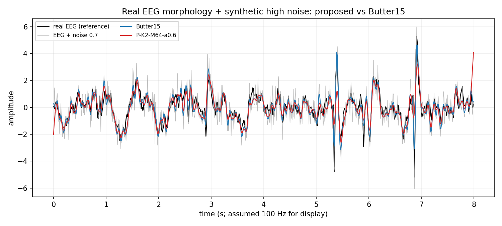

# 真实数据检查：EEG 演示（P2）

- 日期：2026-10-17
- 环境：Python 3.10.11 · numpy 2.2.6 · scipy 1.15.3 · matplotlib 3.10.9
- 代码：`explore/denoise/{run_real_eeg.py, analyze_real_eeg.py, make_real_eeg_figure.py}`
- 结果：`explore/denoise/results/{real_eeg.json, real_eeg_summary.csv, real_eeg_summary.json}`
- 图：`docs/explore/denoise/figures/real_eeg_example.png`
- 机械数据检查另见：[Real_Data_CWRU_Report.md](Real_Data_CWRU_Report.md)

## 1. 数据来源与限制（先说清楚）

**这不是 CWRU，也不是真实有色噪声。** 本 EEG 演示没有使用外部下载；
仓库内没有可用的真实 ECG 文件。CWRU 机械数据后来已通过 GitHub 镜像单独
下载并评估，见 [Real_Data_CWRU_Report.md](Real_Data_CWRU_Report.md)；
本文件仍只做“真实 EEG 信号 + 合成噪声”的 sanity check：

- 信号：matplotlib 自带的 **真实 EEG 样本** `mpl-data/sample_data/eeg.dat`；
  文件为 4 通道 × 800 样本（channel-major），本演示取通道 0；
- 采样率文件未注明，演示中**假设 100 Hz**（仅用于滤波器截止和横轴显示）；
- 噪声：在真实 EEG 上叠加 `0.5/0.7/0.9 × std(EEG)` 的白高斯噪声，10 次重复；
- clean 参考是原始 EEG；噪声是合成的，不是真实有色噪声。

所以这份结果只能回答：“在真实 EEG 形态上，方法是否至少不比 Butter/SG 差？”
**不能**回答“真实有色噪声/机械数据上 amp=0.5-0.6 是否成立”。后者仍然是未验证项。

## 2. 方法

| 方法 | 说明 |
|---|---|
| `raw` | 含噪 EEG |
| `SG11/21` | Savitzky-Golay，window 11/21，polyorder 3 |
| `Butter5/10/15/25` | 4 阶零相位低通；100 Hz 下对应 5/10/15/25 Hz |
| `MorphAvg5/11` | 形态学开闭平均 |
| `P-K2-M64-a0.5/0.6` | 全局最佳附近配置 |
| `P-K2-M32-a0.5` | 半算力配置 |

指标：`shape_nrmse`（最佳仿射校准后）、`corr`、`SNR imp.`、`edge max`；
10 次重复取中位。

## 3. 结果

**表 1：真实 EEG + 合成白噪声，shape NRMSE（越低越好）**

| 方法 | noise=0.5 | noise=0.7 | noise=0.9 | 总体 shape | 总体 SNR imp. |
|---|---:|---:|---:|---:|---:|
| raw | 0.431 | 0.569 | 0.659 | 0.569 | 0.00 dB |
| SG11 | 0.418 | 0.468 | 0.521 | 0.468 | +3.05 dB |
| SG21 | 0.636 | 0.655 | 0.684 | 0.655 | +0.25 dB |
| Butter5 | 0.646 | 0.660 | 0.686 | 0.660 | +0.16 dB |
| Butter10 | 0.431 | 0.473 | 0.523 | 0.473 | +2.99 dB |
| **Butter15** | 0.345 | **0.425** | **0.486** | **0.425** | **+3.94 dB** |
| Butter25 | **0.328** | 0.437 | 0.523 | 0.437 | +3.08 dB |
| MorphAvg5 | 0.514 | 0.567 | 0.616 | 0.567 | +1.52 dB |
| MorphAvg11 | 0.713 | 0.738 | 0.750 | 0.734 | -0.70 dB |
| P-K2-M64-a0.5 | 0.518 | 0.554 | 0.601 | 0.554 | +1.80 dB |
| **P-K2-M64-a0.6** | **0.495** | **0.534** | **0.588** | **0.534** | **+1.99 dB** |
| P-K2-M32-a0.5 | 0.518 | 0.555 | 0.597 | 0.555 | +1.69 dB |

**表 2：proposed 与最佳经典基线的差距**

| 噪声 | 最佳经典（shape） | proposed 最佳（shape） | 差距 |
|---:|---|---:|---:|
| 0.5 | Butter25 0.328 | P-K2-M64-a0.6 0.495 | +0.167 |
| 0.7 | Butter15 0.425 | P-K2-M64-a0.6 0.534 | +0.109 |
| 0.9 | Butter15 0.486 | P-K2-M64-a0.6 0.588 | +0.102 |

- 在**真实 EEG 形态**上，proposed 在三个噪声档都**没有**超过 Butter15/25，
  也没有超过 SG11；只在 noise=0.7/0.9 时略优于 raw/MorphAvg5；
- Butter15 总体 shape 0.425，proposed 0.534，差距 0.109；
  proposed 的 SNR 也只有 +1.99 dB，而 Butter15 是 +3.94 dB；
- 没有找到“proposed 比 Butter 更好或更省事”的真实 EEG 例子。



## 4. 结论：对最终定位的影响

结合四份合成报告和这份真实 EEG sanity check：

1. **P2 未通过“真实数据优于 Butter100”的检验。** 在真实 EEG 形态 + 合成噪声上，
   proposed 明显落后于 Butter15/25 和 SG11；而且这是对 proposed 相对有利的
   “已知主形态、白噪声”场景。
2. **不能宣称“真实有色噪声/机械数据上 amp=0.5-0.6 成立”。** 本轮 EEG 噪声是
   合成的；CWRU 机械数据虽已补，但只有一段故障/转速，且加噪也是合成的。
   结论只到“真实 EEG 形态 + 单段 CWRU 包络”。
3. **最终定位应写成：方法论反例 + 小众备选**，而不是通用去噪器或 EEMD 替代。
   - 方法论价值：说明“加噪 + 包络均值迭代”在低噪声会抹信号、在冲击/阶跃上会
     丢形态、M 平均只降方差；这些负面结果本身有价值。
   - 小众备选：在无形态先验、高噪声、平滑主形态、且能接受端点裁剪/不追求
     绝对最优时，可作为低参数平滑器；一旦有明确形态（阶跃/冲击/EEG），
     专用滤波器更好。
4. 如果后续要写论文/技术报告，P2 仍是必须补的：至少一段真实 CWRU 轴承或
   PhysioNet ECG/EEG 数据，且包含真实有色噪声/工频/基线漂移；本轮只能作为
   “真实形态”级别的初步检查，不能替代。

## 5. 复现

```powershell
.venv\Scripts\python.exe -B -m explore.denoise.run_real_eeg --reps 10
.venv\Scripts\python.exe -B -m explore.denoise.analyze_real_eeg
.venv\Scripts\python.exe -B -m explore.denoise.make_real_eeg_figure
```

产物：

- `explore/denoise/results/real_eeg.json`（360 条）
- `explore/denoise/results/real_eeg_summary.csv`
- `explore/denoise/results/real_eeg_summary.json`
- `docs/explore/denoise/figures/real_eeg_example.png`

## 6. 数据来源说明

- `eeg.dat` 是 matplotlib 安装包自带的 sample data，运行时从
  `matplotlib.get_data_path()/sample_data/eeg.dat` 读取，本仓库不复制该数据。
- 文件按 4 通道 × 800 样本解析（`np.frombuffer(..., dtype='<f8').reshape(-1, 4).T`）；
  该解析方式由数据平滑性/通道相关性验证，但采样率仍未知，文中 100 Hz 仅为假设。
- 若需要真正的机械/ECG 数据，请在联网环境补充 CWRU（`.mat`）或 PhysioNet
  ECG（`.dat/.hea`）下载与引用；本轮无网络，未做。
