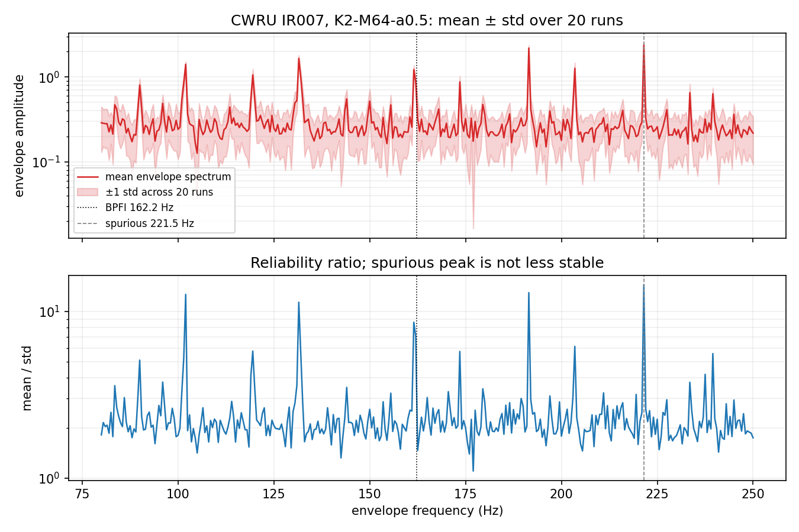
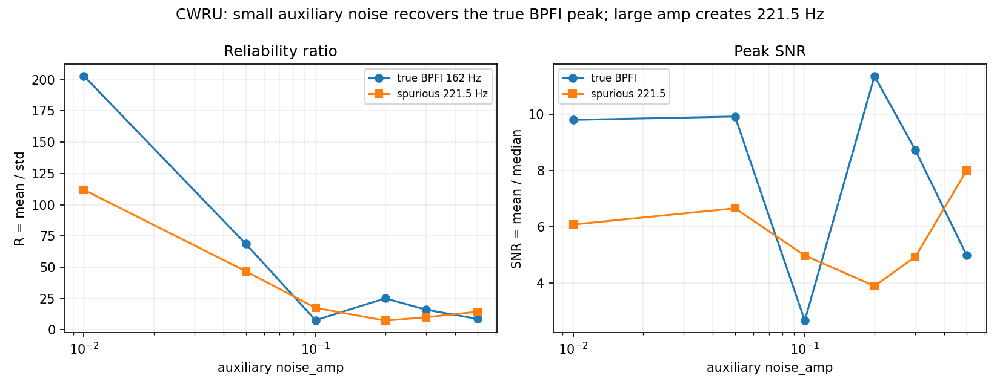

# 可靠性特征实验：`包络峰 / M 次实现标准差`

- 日期：2026-10-17
- 环境：Python 3.10.11 · numpy 2.2.6 · scipy 1.15.3 · matplotlib 3.10.9
- 代码：`explore/denoise/{run_reliability.py, analyze_reliability.py, make_reliability_figure.py}`
- 结果：`explore/denoise/results/{reliability.json, reliability_summary.csv, reliability_summary.json}`
- 图：`fig/explore/denoise/reliability_cwru.png`

## 1. 假设与定义

你的假设：

> CWRU 上 proposed 的 221.5 Hz 伪峰，其 M 次实现方差应该显著大于
> 161.5 Hz 真峰；因此 `峰值 / 该峰值的 M 次实现标准差` 可以当置信度，
> 把“峰值错位”变成“可检测的不可靠性”。

本实验定义：

```text
对 R 次独立方法运行，得到 R 条包络谱 S_r(f)
mean(f) = mean_r S_r(f)
std(f)  = std_r S_r(f)
SNR(f)  = mean(f) / median_f mean(f)
R(f)    = mean(f) / std(f)          # 可靠性比
```

- CWRU：5 个 2 s 段；R=20；true = BPFI≈162.2 Hz，spurious = 221.5 Hz；
- 合成 impact：3 个噪声档 × 3 个观测；R=20；true = 12 Hz，
  spurious = 最强的非 12 Hz 峰；
- 配置：CWRU 用 `K2-M64-a0.5`、`K2-M64-a0.6`、`K2-M16-a0.3`、
  `K3-M64-a0.5`；合成 impact 用前三个。

## 2. CWRU 结果

**表 1：CWRU，true BPFI vs spurious 221.5 Hz（5 段中位）**

| 配置 | true R | spur R | true SNR | spur SNR | R 正确段数 | SNR 正确段数 | SNR 错但 R 对 | 两者都错 |
|---|---:|---:|---:|---:|---:|---:|---:|---:|
| K2-M16-a0.3 | 11.74 | 4.31 | 7.64 | 3.07 | 5/5 | 5/5 | 0 | 0 |
| **K2-M64-a0.5** | **8.69** | **14.43** | **4.98** | **8.00** | **0/5** | **0/5** | **0** | **5** |
| **K2-M64-a0.6** | **7.34** | **12.92** | **4.85** | **8.24** | **0/5** | **0/5** | **0** | **5** |
| K3-M64-a0.5 | 6.48 | 6.07 | 3.92 | 4.67 | 2/5 | 0/5 | 2 | 3 |

关键点：

- 在真正产生 221.5 Hz 伪峰的配置 `K2-M64-a0.5/a0.6` 上，
  **伪峰 R 反而更高**（14.4/12.9 vs 8.7/7.3），SNR 也更高；
  R 和 SNR 都在 5/5 段选错；
- 绝对标准差也没有“伪峰显著更大”：
  - K2-M64-a0.5：true std **0.144**，spur std **0.154**；
  - K2-M64-a0.6：true std **0.204**，spur std **0.199**；
  基本同级，不是“方差显著大于”；
- 唯一 R 正确的 `K2-M16-a0.3`，SNR 也 5/5 正确，**可靠性没有提供增量**；
- `K3-M64-a0.5` 有 2/5 段出现“SNR 错但 R 对”，但另外 3/5 两者都错，
  中位 R 也只差 0.41（6.48 vs 6.07），不能算可靠。

**结论：CWRU 上假设不成立。** 221.5 Hz 伪峰是一个**稳定伪影**，不是随机
方差大的伪峰；`mean/std` 会给出“高置信度”，但置信的是错误频率。



## 3. 合成 impact 结果

**表 2：合成 impact，true 12 Hz vs 最强非 12 Hz 峰（9 个观测中位）**

| 配置 | true R | spur R | true SNR | spur SNR | R 正确 | SNR 正确 | SNR 错但 R 对 | 两者都错 |
|---|---:|---:|---:|---:|---:|---:|---:|---:|
| K2-M16-a0.3 | 3.35 | 4.27 | 1.83 | 1.94 | 3/9 | 3/9 | 0 | 6 |
| K2-M64-a0.5 | 5.28 | 5.57 | 1.74 | 2.19 | 3/9 | 3/9 | 0 | 6 |
| K2-M64-a0.6 | 4.57 | 4.97 | 1.87 | 2.01 | 3/9 | 3/9 | 0 | 6 |

- R 与 SNR 的正确/错误模式**完全一致**：3/9 都对，6/9 都错；
- 没有出现“SNR 错但 R 对”的样本；
- 合成 impact 上也没有增量信息。

## 3.5 关键补充：辅助噪声幅度是不是选大了？

你的质疑是对的：上一节主实验用的是 `amp=0.5/0.6`，而低噪声下 221.5 Hz
可能不是主导。补扫 `amp=0.01/0.05/0.1/0.2/0.3/0.5`，K2-M64，5 段，R=20：

| `noise_amp` | true R | spur R | true SNR | spur SNR | true std | spur std | R 正确段数 | SNR 正确段数 | SNR 错但 R 对 |
|---:|---:|---:|---:|---:|---:|---:|---:|---:|---:|
| 0.01 | 202.93 | 111.93 | 9.80 | 6.08 | 0.002 | 0.003 | 5/5 | 5/5 | 0 |
| 0.05 | 68.68 | 46.77 | 9.92 | 6.65 | 0.006 | 0.006 | 4/5 | 5/5 | 0 |
| 0.1 | 7.63 | 17.54 | 2.66 | 4.98 | 0.018 | 0.017 | 0/5 | 0/5 | 0 |
| 0.2 | 25.14 | 7.31 | 11.36 | 3.89 | 0.056 | 0.053 | 5/5 | 5/5 | 0 |
| 0.3 | 16.04 | 10.01 | 8.73 | 4.93 | 0.088 | 0.086 | 5/5 | 5/5 | 0 |
| 0.5 | 8.69 | 14.43 | 4.98 | 8.00 | 0.154 | 0.144 | 0/5 | 0/5 | 0 |

- **0.01/0.05 确实把真峰找回来了**：true SNR 9.8/9.9 > spur 6.1/6.7，
  true R 也远高于 spur；
- 但**不是单调**：0.1 又回到伪峰主导（SNR 2.7 vs 5.0），0.2/0.3 又正确，
  0.5 再回到伪峰；
- 因此 221.5 Hz 是**幅度相关的伪影**，不是这个方法的固有频率；
  这也说明 CWRU 报告里的“峰值错位”应加限定：在 `amp=0.5/0.6` 下成立，
  低 `amp` 下可恢复 BPFI；
- **但可靠性比仍然没有增量**：所有 amp 下 `SNR 错但 R 对 = 0`；
  只要 R 正确，SNR 也正确；0.05 甚至 R 4/5 而 SNR 5/5。
  低 aux 让“峰值正确”，但不需要 R 来纠正 SNR。



## 4. 总体结论

**这个可靠性特征没有通过验证；但“221.5 Hz 错位”本身是幅度相关的，不是固有频率。**

- 在 `amp=0.1/0.5` 这种伪峰主导的区间，伪峰 221.5 Hz 的方差并不显著大于
  真峰；它的均值更大，导致 `mean/std` 反而更高；
- 在 `amp=0.01/0.05/0.2/0.3`，低/中等 aux 会把真峰找回来（true SNR >
  spur SNR），但此时 **SNR 已经正确，R 没有增量**；
- 所有测试 amp 下 `SNR 错但 R 对 = 0`；合成 impact 上 R 与 SNR 也完全同步；
- **因此 `峰值 / M 次实现标准差` 不能把“错位”转化为“可检测的不可靠性”。**
  这不是一个可用的诊断置信度；
- 但 CWRU 报告的“峰值错位”应加限定：在 `amp=0.5/0.6` 下成立，
  低 `amp` 下可恢复 BPFI；这是调参问题，不是方法固有频率。

## 5. 如果还要做置信度，应该换什么

不是“同一配置的随机实现方差”，而是**跨配置/跨方法/跨物理约束的一致性**：

1. **跨参数稳定性**：K/M/amp 网格里峰频率是否稳定在同一个频率；
2. **跨方法一致性**：Butter/SG/Morph/带通包络是否都指向同一频率；
3. **物理约束**：BPFI/BPFO/BSF/FTF 及谐波关系、转速比；
4. **跨传感器一致性**：多通道包络峰是否一致；
5. **峰值频率的 bootstrap/相位随机化稳定性**，而不是峰值幅值的实现方差。

这些都比 `mean/std` 更可能识别“稳定伪影”。本实验说明：
**稳定伪影可以用“跨配置是否一致”来查，而不能用“同一配置的方差”来查。**

## 6. 对最终定位的影响

- 这是目前唯一一个试图把负面结果转成正面工具的路径，**验证失败**；
- 但 `noise_amp` 需要修正：CWRU 上用 0.5/0.6 会制造 221.5 Hz 伪峰，
  低/中 aux（0.01/0.05/0.2/0.3）可恢复 BPFI；这说明主报告的
  “峰值错位”是参数相关，而不是方法必然错位；
- 即使如此，proposed 的 BPFI 包络 SNR 仍只有 ~10，远低于 raw/SG11/
  Butter3000 的 63-64；最终定位仍是**方法论反例 + 弱小众备选**；
- 不建议在论文/技术报告里把 `峰值/M次实现标准差` 写成置信度指标；
  如果必须写，应写成“已测试但不成立”的负面结果。

## 7. 复现

```powershell
.venv\Scripts\python.exe -B -m explore.denoise.run_reliability
.venv\Scripts\python.exe -B -m explore.denoise.analyze_reliability
.venv\Scripts\python.exe -B -m explore.denoise.make_reliability_figure

# amp sweep
.venv\Scripts\python.exe -B -m explore.denoise.run_reliability_amp
.venv\Scripts\python.exe -B -m explore.denoise.analyze_reliability_amp
.venv\Scripts\python.exe -B -m explore.denoise.make_reliability_amp_figure
```

产物：

- `explore/denoise/results/reliability.json`（47 条）
- `explore/denoise/results/reliability_amp.json`（30 条）
- `explore/denoise/results/reliability_summary.csv`
- `explore/denoise/results/reliability_amp_summary.csv`
- `fig/explore/denoise/reliability_cwru.png`
- `fig/explore/denoise/reliability_amp.png`

## 8. 局限

- CWRU 只用了一段 IR007/1797 rpm 的 5 个 2 s 段，不是多故障/多转速；
- R=20 次实现，未做更大规模 bootstrap；
- 只测了一个伪峰（221.5 Hz）和一个真峰（BPFI）；其他伪峰/故障频率未覆盖；
- 合成 impact 的“最强非 12 Hz 峰”定义较粗糙；
- 结论只针对 `mean/std` 这个具体可靠性比，不否定其他置信度设计。
