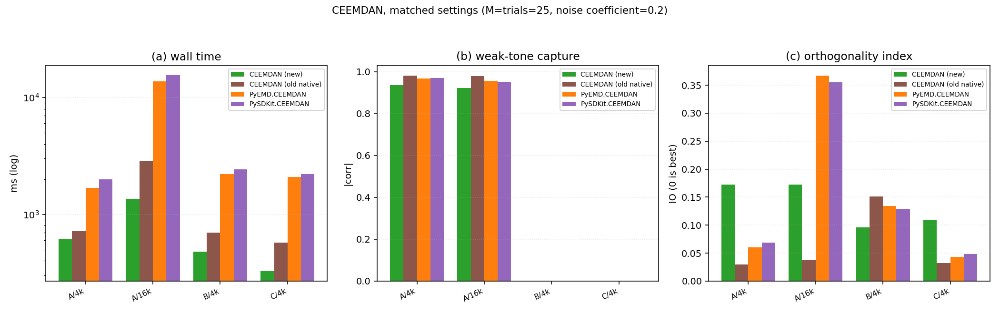
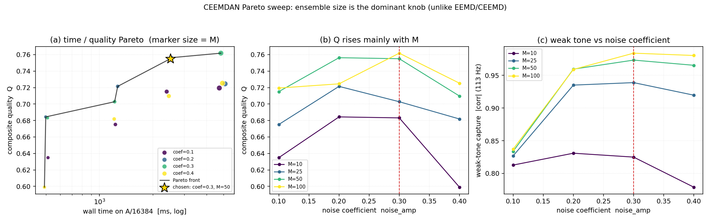

# CEEMDAN（原生引擎）验证与调参报告

> 同族报告：[EMD](./EMD_Native_Engine_Report.md) · [EEMD](./EEMD_Native_Engine_Report.md) · [CEEMD](./CEEMD_Native_Engine_Report.md) · [CEEMDAN](./CEEMDAN_Native_Engine_Report.md) · [ICEEMDAN](./ICEEMDAN_Native_Engine_Report.md) · [RPSEMD](./RPSEMD_Native_Engine_Report.md)
>
> 对象：`src/Modal_Decomposition/CEEMDAN.py` —— 库内原生「自适应噪声完备集总经验模态分解」
> （CEEMDAN）引擎（本轮由 `CEEMDAN_NEW.py` 转正）。旧 595 行实现在工作区跑不起来（见 §2），
> 源码可在提交 `dd547f2` 取回。全文简称 **CEEMDAN（原生）** 或 **新 CEEMDAN**。
>
> 报告覆盖面：旧 CEEMDAN 为什么跑不起来、本轮补齐的 10 项修复与并行分支、四方等口径对比、
> `valid` 偏低的成因、Pareto 扫描与默认值选择（**主导旋钮与 EEMD/CEEMD 相反**）、架构与参数、
> 并行性能实测、已知取舍与同族一致性、复现方式。

---

## 1. 环境与口径

| 项 | 值 |
|---|---|
| Python | 3.10.11 |
| numpy | 2.2.6 |
| scipy | 1.15.3 |
| PyEMD | 1.9.0 |
| pysdkit | 0.5.0 |
| numba / psutil | 0.67.0 / 7.2.2 |
| 操作系统 | Windows-10-10.0.26200-SP0 |
| CPU | Intel64 Family 6 Model 183 Stepping 1，32 逻辑核 |

**计时口径**

- 全部**同进程、同一脚本**内测量；输入数组在整轮中复用同一个对象。
- 实验 1（四方等口径对比，§5）为**单次计时**；实验 2（Pareto 扫描，§7）同样是单次计时，
  成本轴固定取 **A/16384 的单次实测墙钟**，质量网格为 A/4096、A/16384、B/4096、C/4096。
- 跨日 / 跨脚本的绝对毫秒数不可比，本报告只做同表内比较。
- 质量指标全部来自仓库自带的 `tests/comparison/quality.py`。

**指标定义（读表前置）**

| 指标 | 含义 |
|---|---|
| `k` | IMF 行数（**不含**残差行） |
| `valid` | 满足 `\|zc − ext\| ≤ 1` 的 **IMF 行** 数；过零用 PyEMD `indzer` 口径，极值用库内 `Utils.Peaks` 规则。**CEEMDAN 这一列天然极低，见 §6** |
| `mode1` / `mode2` | case A = 37 Hz / 113 Hz 音调的最佳单行 \|corr\|；case B = AM-FM / 89 Hz 音调的最佳单行 \|corr\| |
| `IO` | 正交性指数 `2·Σ_{i<j}⟨c_i,c_j⟩ / Σ‖c_i‖²`，越接近 0 越好 |
| `leak` | `‖Res‖ / ‖S‖`，残差相对能量。**case B 的残差含真实二次趋势，不能当噪声读**；更关键的是**各家的残差契约不同，`leak` 不可横比**（见 §5.2） |
| `recon` | `max\|ΣIMFs + Res − S\|`，即重建恒等式的最大偏离 |

**测试信号**（`tests/comparison/signals.py`）

| 代号 | 构成 |
|---|---|
| A | `sin(2π·37t) + 0.5·sin(2π·113t) + 0.1·N(0,1)`（种子 20260906） |
| B | AM-FM + 89 Hz 音调 + 二次趋势 |
| C | 白噪声（种子 771） |

---

## 2. 背景与本次重构

### 2.1 旧 CEEMDAN 跑不起来

旧 `CEEMDAN.py`（595 行，内容与 `dd547f2` 及更早的提交一致；转正后工作区已被新引擎取代，
需 `git show dd547f2:src/Modal_Decomposition/CEEMDAN.py` 取回）在当前代码树上有 **7 处**直接故障：

| # | 位置 | 失败原因 |
|---|---|---|
| 1 | `from .Base import Config, Decomposer, DecompositionResult` | `Config` 已搬到 `.Define`，`Base` 不再导出 → `ImportError: cannot import name 'Config'` |
| 2 | `from ._Registry import register_class`（+ `@register_class("CEEMDAN")`） | `_Registry.py` 已删除 → `ModuleNotFoundError` |
| 3 | `from .Utils import ... is_monotonic ...` | `Utils` 已无此函数 → 导入期 `ImportError` |
| 4 | `from .Utils import ... resolve_seed ...` | 同上（已被 `Base.Seed` 取代） |
| 5 | `Check_Time_and_Signal(...)` 按三元组解包 | 现在只有传 `need_T=True` 才返回三元组，默认返回二元组 → `ValueError` |
| 6 | `_engine()` 透传旧 EMD 参数名 `max_imf` / `sd_thr` / `max_iter` / `spline_kind` / `find_peaks_mod`，并引用已从 `EMD` 删除的 `_PEAKS_MODS` | `EMD` 现在的参数是 `num_imf` / `internal_delta` / `internal_iter` / `mirror_mod` / `peaks_backend` → `TypeError` / `AttributeError` |
| 7 | 类体 | 缺 `param_check` / `config_generate` 两个抽象方法 → `TypeError: Can't instantiate abstract class CEEMDAN with abstract methods config_generate, param_check` |

**重建方式**：`.scratch/eemd_new/legacy_ceemdan.py` 用**动态模块 + `exec` 打过补丁的源码**
造出可运行的旧版（不往仓库写任何文件），补丁内容就是上表 1–7 的等价替换。

### 2.2 现在的状态

`src/Modal_Decomposition/CEEMDAN.py` 现为 **561 行**：

- 类成员：`['__init__', 'param_check', 'config_generate', 'decompose', 'parallel_decompose']`
- 模块级函数：`f_CEEMDAN`（与 `f_EEMD` / `f_CEEMD` 对齐）

本轮之前它是**半成品**，见 §3。

---

## 3. 本轮补齐与修复

### 3.1 修掉的 10 处错误（按严重度）

| # | 问题 | 后果 | 修法 |
|---|---|---|---|
| 1 | `result.IMFS` 拼写错 | `AttributeError` | 改 `result.IMFs` |
| 2 | `self.num_imf = min_rows` 写在 `decompose` 里 | 分解会**改写实例状态**，第二次调用行为漂移 | 改局部变量 |
| 3 | `S -= row_imf` 就地写 | **改写调用方数组** | 改 `S_work = S_work - imf_row` |
| 4 | `num_imf == -1` 分支**从不 append 到 `self.imfs`** | 永远返回空 IMF 集 | 补齐 append |
| 5 | `self.res` 在某些 `break` 路径下是 `None` | 返回 `Res=None` | 统一在出口赋 `self.res = S_work` |
| 6 | **`S_work(1-D) - row_imf(1,N)` 被广播成 2-D** | 随后 `monotonic` 对 2-D 返回 `True` → 阶段循环第 1 阶就 break，**`k` 恒为 1**（最隐蔽的一处） | 压成一维后再相减 |
| 7 | `num_imf=1` 时 `emd_pre_decompose_num_imf = 0` | `EMD(num_imf=0)` 构造即报错 | 改 `max(1, num_imf - 1)` |
| 8 | `pre_decompose_EMD` 只在 `pre_decompose_noise=True` 时构造 | 并行路径也要用它 → `AttributeError` | 无条件构造 |
| 9 | `imfs` 里存 `(1,N)` 行向量 | 最终 `asarray` 变成 `(k,1,N)` | 存 `(N,)` |
| 10 | 阶段循环没有终止保护 | `num_imf=-1` 时没有停止出口 | 与 `EMD` 的 `-1` 同义：**不设人为阶段上限**，由内层 EMD 剥不出 IMF / 残差单调 / 能量耗尽 / `faster=False` 极值门终止；显式 `num_imf` 到点即停 |

### 3.2 补齐的三处注释位

1. **`unknown` 白名单**：原来写成 `set(kwargs) - ...`（`Ellipsis`），任何 kwargs 都被拒 →
   补 14 个 `emd_*` + `dtype`。
2. **两处 `...  # 按照 EMD 中 IMF 的严格判定来`**：改成用 **EMD 内层真正掐断分解的那条守卫**
   —— 残差必须还剩 **≥2 极大 + ≥2 极小**。
   **不用窄带门 `|zc−ext| ≤ 1`**：实测集平均后的阶段 IMF 在含噪信号上该指标是
   **73 / 17 / 20 / 6 / 19**，窄带门永远过不去，会把「严格档」变成「只出 1 阶」
   （本轮第一版就是这样，`k` 恒为 1）。
3. **并行部分**（原来完全没有，且 `return` 写在 `if not self.parallel:` 里面）。
   CEEMDAN 的相邻阶是**串行依赖**（第 k 阶要第 k−1 阶的**全局平均**残差），不能像
   EEMD/CEEMD 那样把整条分解丢给一个 worker。结构与 EEMD/CEEMD 保持同形：`decompose`
   里 `if not self.parallel:` 与 `else:` 是**两个平级分支**，各自带一条完整的阶循环、
   各自写回 `self.imfs` / `self.res`；并行分支**每一阶 spawn 一批 worker**，收齐本阶
   部分和后求平均。`parallel=True` 时自动预分解噪声（spawn 出来的进程无状态）。详见 §9。

### 3.3 与 EEMD / CEEMD 同源的修复

两处与 EEMD、CEEMD 那两轮同源，此处只提一句：

- **退化输入守卫**：信号本身极大或极小 < 2 时直接返回空 IMF 集（判据用极值而非 `monotonic`，
  因为 `x²` 的 `monotonic` 为 `False`）。
- **`dtype` 按输入精度生成噪声**：`np.random.normal(...)` 是 float64，不处理会让 `S + w`
  把 float32 工作数组升格。

---

## 4. 验证结果（实测）

| 项 | 结果 |
|---|---|
| 串行 vs CEEMDAN 定义**手算** | `\|差\| = 0.000e+00`（M=5, k=4） |
| `pre_decompose_noise=True` vs `False` | `\|差\| = 0.000e+00` —— 两条数学路径等价 |
| 重构恒等式（`num_imf = -1 / 1 / 3 / 6`） | `k = 8 / 1 / 3 / 6`，误差 **≤ 4.44e-16** |
| 退化输入（常量 / 全零 / ramp / x²） | 全部 **`k=0`** |
| 输入是否被改写 | **否**（修复 #3 后） |
| `dtype=float32` | 全程 float32 |
| 状态重置 | 同实例两次逐位相同、`num_imf` 未被改写（修复 #2 后） |
| 并行 vs 串行 | 差 **4.718e-16**（求和顺序差异）、`k` 一致、重构 2.22e-16 |
| 并行 `M=5 / w=3` | 切分正确、`num_workers > M` 被 clamp |
| 并行可复现性 | 同种子逐位相同 |
| **并行 worker 崩溃（注入桩）** | **0.50 s 内抛 `RuntimeError`**（错误记录 + 存活检查），**无残留子进程** |

---

## 5. 四方等口径对比



### 5.1 条件

**`M = trials = 25`，噪声系数 = 0.2**。四家的噪声都是「系数 × `N(0, std(S))`」
（旧原生 docstring 明确 `noise_width ≈ epsilon`，PyEMD / PySDKit 用 `epsilon`），
所以这一组是**真正等口径**的。

| case/n | 实现 | t_ms | k | valid | mode1 | mode2 | IO | leak | recon |
|---|---|---:|---:|---:|---:|---:|---:|---:|---:|
| A/4096 | **CEEMDAN(新)** | 614.9 | 10 | 1/10 | 0.9930 | 0.9350 | 0.1724 | 0.007 | 6.66e-16 |
| A/4096 | CEEMDAN(旧原生) | 717.2 | 9 | 3/9 | 0.9948 | 0.9807 | 0.0294 | 0.004 | 4.34e-19 |
| A/4096 | PyEMD.CEEMDAN | 1680.9 | 10 | 4/10 | 0.9787 | 0.9688 | 0.0607 | ~0 | 0.00e+00 |
| A/4096 | PySDKit.CEEMDAN | 1988.5 | 9 | 2/9 | 0.9846 | 0.9695 | 0.0688 | ~0 | 2.22e-16 |
| A/16384 | **CEEMDAN(新)** | 1354.5 | 11 | 2/11 | 0.9912 | 0.9228 | 0.1725 | 0.005 | 6.66e-16 |
| A/16384 | CEEMDAN(旧原生) | 2849.7 | 11 | 2/11 | 0.9972 | 0.9803 | 0.0381 | 0.006 | 8.67e-19 |
| A/16384 | PyEMD.CEEMDAN | 13729.2 | 12 | 4/12 | **0.8747** | 0.9555 | 0.3669 | ~0 | 0.00e+00 |
| A/16384 | PySDKit.CEEMDAN | 15440.8 | 13 | 6/13 | **0.8983** | 0.9524 | 0.3553 | ~0 | 2.22e-16 |
| B/4096 | **CEEMDAN(新)** | 481.6 | 9 | 1/9 | 0.9840 | 0.9793 | 0.0958 | 0.258 | 6.66e-16 |
| B/4096 | CEEMDAN(旧原生) | 699.1 | 8 | 1/8 | 0.9473 | 0.9873 | 0.1509 | 0.257 | 5.55e-17 |
| B/4096 | PyEMD.CEEMDAN | 2203.0 | 9 | 3/9 | 0.9989 | 0.9539 | 0.1346 | ~0 | 0.00e+00 |
| B/4096 | PySDKit.CEEMDAN | 2422.6 | 9 | 2/9 | 0.9973 | 0.9444 | 0.1289 | ~0 | 2.22e-16 |
| C/4096 | **CEEMDAN(新)** | 325.7 | 9 | 2/9 | — | — | 0.1088 | 0.022 | 8.88e-16 |
| C/4096 | CEEMDAN(旧原生) | 575.0 | 9 | 3/9 | — | — | 0.0322 | 0.005 | 8.67e-19 |
| C/4096 | PyEMD.CEEMDAN | 2090.2 | 11 | 5/11 | — | — | 0.0433 | ~0 | 0.00e+00 |
| C/4096 | PySDKit.CEEMDAN | 2201.1 | 11 | 4/11 | — | — | 0.0486 | ~0 | 4.44e-16 |

> `leak` 列里标 `~0` 的两家，实测为 **1.7e-16 – 2.2e-16**（8 个格子）。

### 5.2 ⚠️ 横比限制：`leak` / `k` / `IO` 三家之间**不可直接比**

这一条必须先读，否则整张表都会误读。

- **PyEMD / PySDKit 的 `Res ≈ 0`**（实测 `‖Res‖/‖S‖` 在 1.7e-16 – 2.2e-16），
  因为它们把**趋势也吸进了 IMF**；
- **新 / 旧原生把趋势留在 `Res`**（B/4096 上 `leak` 0.258 / 0.257，那正是 B 的二次趋势本身）。

所以两组的 `Res` 语义不同 → `leak`、`k`（IMFs 里含不含趋势直接改变阶数）、`IO` 都**不可横比**。
**只有 `mode1` / `mode2`（单行最佳相关）是真正可比的**，因为它们是"某一行像不像某个音调"，
与阶数、残差怎么分无关。这不是适配器写错了，是各家的残差契约不同。

### 5.3 速度与质量

**速度**（新实现为基准，倍率 = 对方 / 新）：

| case/n | 新 (ms) | vs 旧原生 | vs PyEMD | vs PySDKit |
|---|---:|---:|---:|---:|
| A/4096 | 614.9 | 1.17× | 2.73× | 3.23× |
| A/16384 | 1354.5 | 2.10× | **10.14×** | **11.40×** |
| B/4096 | 481.6 | 1.45× | 4.57× | 5.03× |
| C/4096 | 325.7 | 1.77× | 6.42× | 6.76× |

即「比旧原生快 **1.2–2.1×**、比 PyEMD 快 **2.7–10.1×**、比 PySDKit 快 **3.2–11.4×**」，
**A/16384 差距最大、C/4096 最小**。

**质量**：

- **长信号上外部实现明显塌方**：A/16384 的 `mode1` 是 PyEMD **0.8747** / PySDKit **0.8983**，
  而新实现 **0.9912**、旧原生 0.9972。
- 其余格子上四家的 `mode1` 都在 0.95–0.999，`mode2` 在 0.92–0.99 —— 新实现不算最好但也不塌。
- `IO` 上新实现偏大（0.0958–0.1725），旧原生最好（0.0294–0.1509）。但按 §5.2，这一列不可横比。

---

## 6. 为什么 `valid` 四家都极低

`valid`（`|zc−ext| ≤ 1` 的 IMF 行数）在四家都是 1–5 行（分母 9–13），这一列**不要**当成
"实现有问题"来读。

原因在算法本身：**CEEMDAN 每一阶只做一次 `E_1`（`EMD(num_imf=1)`）再集平均**，得到的阶段
IMF 是从"当前残差 + 噪声"里剥出来的**一段宽带分量**，它天然不满足经典 IMF 的窄带必要条件。
`EEMD`/`CEEMD` 的每一阶是完整 sift 到收敛，所以 `valid` 会高一些；CEEMDAN 换掉了那个前提。

所以对这一族来说，`valid` 更像"这一行有多像经典 IMF"，而不是"实现对不对"。判断质量请看
`mode1` / `mode2` 与 `recon`。

---

## 7. Pareto 扫描与默认值



### 7.1 扫描面与质量指标

- `M ∈ {10, 25, 50, 100}` × `eps ∈ {0.1, 0.2, 0.3, 0.4}`（`eps` 就是噪声幅值系数 `noise_amp`），
  共 **16 组**。
- `Q = (q_A + q_C + q_B) / 3`，与 EMD / EEMD / CEEMD 同定义：
  `q_A` = A/4096 与 A/16384 上 `0.5·(c37 + c113)` 的均值；`q_C` = C/4096 的 IMF 行级合规率；
  `q_B` = B/4096 的 `0.5·(amfm + c89)`。
- 成本 = A/16384 单次实测墙钟；约束 `leak ≤ 5%`。

### 7.2 完整结果（16 组）

| eps | M | Q | q_A | q_C | q_B | t_ms | k(A/4096) | mode2 | leak |
|---:|---:|---:|---:|---:|---:|---:|---:|---:|---:|
| 0.1 | 10 | 0.6349 | 0.7900 | 0.2222 | 0.8924 | 512.7 | 10 | 0.8128 | 0.009 |
| 0.1 | 25 | 0.6752 | 0.8355 | 0.2222 | 0.9678 | 1228.5 | 10 | 0.8269 | 0.004 |
| 0.1 | 50 | 0.7151 | 0.8584 | 0.3000 | 0.9869 | 2389.6 | 10 | 0.8338 | 0.010 |
| 0.1 | 100 | 0.7195 | 0.8659 | 0.3000 | 0.9925 | 4727.8 | 10 | 0.8372 | 0.011 |
| 0.2 | 10 | 0.6844 | 0.8850 | 0.3000 | 0.8681 | 497.9 | 10 | 0.8309 | 0.007 |
| 0.2 | 25 | 0.7215 | 0.9605 | 0.2222 | 0.9816 | 1265.6 | 10 | 0.9350 | 0.007 |
| 0.2 | 50 | 0.7563 | 0.9750 | 0.3000 | 0.9939 | 2529.5 | 10 | 0.9595 | 0.005 |
| 0.2 | 100 | 0.7245 | 0.9770 | 0.2000 | 0.9967 | 5097.3 | 10 | 0.9590 | 0.003 |
| 0.3 | 10 | 0.6832 | 0.8583 | 0.3000 | 0.8913 | 509.5 | 10 | 0.8249 | 0.013 |
| 0.3 | 25 | 0.7028 | 0.9631 | 0.2222 | 0.9231 | 1216.3 | 10 | 0.9388 | 0.008 |
| **0.3** | **50** | **0.7551** | **0.9852** | **0.3000** | **0.9800** | **2506.3** | 10 | **0.9733** | **0.006** |
| 0.3 | 100 | 0.7618 | 0.9912 | 0.3000 | 0.9942 | 4823.2 | 10 | 0.9839 | 0.001 |
| 0.4 | 10 | 0.5990 | 0.7960 | 0.1000 | 0.9010 | 489.4 | 10 | 0.7789 | 0.027 |
| 0.4 | 25 | 0.6818 | 0.9498 | 0.2000 | 0.8958 | 1209.6 | 10 | 0.9196 | 0.012 |
| 0.4 | 50 | 0.7097 | 0.9805 | 0.2000 | 0.9487 | 2457.4 | 10 | 0.9653 | 0.007 |
| 0.4 | 100 | 0.7253 | 0.9894 | 0.2000 | 0.9865 | 4923.7 | 10 | 0.9803 | 0.003 |

### 7.3 关键发现：主导旋钮是 `M`，不是噪声系数

**这一条与 EEMD / CEEMD 相反。** 那两个引擎的 `Q` 基本只由噪声系数决定、对 `M` 几乎不敏感；
CEEMDAN 反过来：

**固定 `eps = 0.3`，看 `Q` 随 `M`：**

| M | 10 | 25 | 50 | 100 |
|---|---:|---:|---:|---:|
| `Q` | 0.6832 | 0.7028 | 0.7551 | **0.7618** |
| `mode2` | 0.8249 | 0.9388 | 0.9733 | **0.9839** |
| `t_ms` | 509.5 | 1216.3 | 2506.3 | 4823.2 |

**固定 `M = 50`，看 `Q` 随 `eps`：**

| eps | 0.1 | 0.2 | 0.3 | 0.4 |
|---|---:|---:|---:|---:|
| `Q` | 0.7151 | **0.7563** | 0.7551 | 0.7097 |

即 `M` 从 10 到 100 让 `Q` 涨 **+0.079**，而噪声系数在 0.1–0.4 之间换只动 **0.047**
（且非单调）。**`M` 才是那个值得加钱的旋钮。**

### 7.4 前沿与选点规则

**Pareto 前沿 7 点**（按耗时升序）：

| # | eps | M | t_ms | Q | mode2 | leak |
|---:|---:|---:|---:|---:|---:|---:|
| 0 | 0.4 | 10 | 489.4 | 0.5990 | 0.7789 | 0.027 |
| 1 | 0.2 | 10 | 497.9 | 0.6844 | 0.8309 | 0.007 |
| 2 | 0.3 | 25 | 1216.3 | 0.7028 | 0.9388 | 0.008 |
| 3 | 0.2 | 25 | 1265.6 | 0.7215 | 0.9350 | 0.007 |
| 4 | 0.3 | 50 | 2506.3 | 0.7551 | 0.9733 | 0.006 |
| 5 | 0.2 | 50 | 2529.5 | 0.7563 | 0.9595 | 0.005 |
| 6 | 0.3 | 100 | 4823.2 | 0.7618 | 0.9839 | 0.001 |

**不能用「取最大 `Q`」**：`Q` 随 `M` 单调上升且在 `M = 100` 仍未饱和，直接取最大必然落到
网格最贵点（4823.2 ms），而它只比次优点高 0.88%。

**选点规则**：**可行域（`leak ≤ 5%`）内，`Q` 达到最优 99% 的最省点。**

- 最优 `Q = 0.7618`（`(0.3, 100)`），99% 阈值 = **0.75418**；
- 带宽内候选：`(0.2, 50) 0.7563 @2529.5`、`(0.3, 50) 0.7551 @2506.3`、`(0.3, 100) 0.7618 @4823.2`；
- 三者 `leak` 都 ≤ 5%，取最省的 **`(0.30, 50)`（2506.3 ms）**。

**为什么选 0.3 而不是 0.2**：两者 `Q` 几乎相同（0.7551 vs 0.7563，差 0.0012），但
**`mode2` 是 0.9733 vs 0.9595（+1.4%）** —— 弱音调明显更好，而代价只多 23 ms。

**最终默认值**：`noise_amp = 0.3`、`M = 50`（原为 `0.1` / `25`）。

**弦距拐点不采纳**：弦距法会给出 `(0.2, 10)`（`Q = 0.6844` @ 497.9 ms），但它的 `mode2`
只有 **0.8309** —— 属于"便宜但画不出弱音调"的角落解。这条也再次说明：**弦距法在
`Q` 由单一参数主导或单调上升的前沿上不可靠**（EEMD 报告 §7.5 有同源讨论）。

---

## 8. 架构与参数

### 8.1 参数表

| 参数 | 默认 | 说明 |
|---|---|---|
| `num_imf` | `-1` | 目标阶数；`-1` = 与 `EMD` 同义，**不设上限**，由停止判据决定阶数 |
| `noise_amp` | **`0.3`** | **噪声幅值系数**（无量纲）；实际 `σ̂ = noise_amp · std(S)` |
| `res_energy` | `1e-6` | 残差能量门限（相对 `‖S₀‖²`） |
| `M` | **`50`** | 噪声实现数；一次分解 = **`M × k` 次 `EMD(num_imf=1)`** |
| `pre_decompose_noise` | `False` | 是否预分解噪声；`True` 与 `False` 数学等价（实测差 0） |
| `parallel` | `False` | 走并行分支（**每阶 spawn 一批进程**，见 §9） |
| `num_workers` | `1` | `int` = 进程数 / `float` = 比例 / `-1` = 全部 |
| `faster` | `True` | 传给内层 EMD 的档位开关 |
| `emd_*`（14 个） | — | 原样透传给内层 `EMD`（`emd_nbsym=4`、`emd_internal_delta=0.2`、`emd_internal_iter=50` 等） |
| `dtype` | `None` | `None` = 保持输入精度 |
| `copy` | `True` | 是否让 `Check_Time_and_Signal` 交回信号副本。`True` 时残差直接原地 `S -= imf`；传 `False` 省一份 `N` 长数组，但**会原地覆盖调用方的输入数组** |
| `peaks_backend` | `"numpy"` | **本类自身** `find_peaks`（退化守卫、阶段停止判据）的后端，`Check.validate_mod(..., PEAKS_BACKEND)` 校验；`numpy` / `scipy` 实测结果逐位相同、非法值 `ValueError`。**内层 EMD 仍用 `emd_peaks_backend`**，两者独立（本轮补齐，见 `ICEEMDAN_Native_Engine_Report.md` §8.3） |

### 8.2 `decompose` 流程

```
输入 S → Check_Time_and_Signal(need_T=False) → 工作精度归一
  → 重置状态；noise_amp 系数 → noise_std = noise_amp · std(S)
  → 退化守卫：极值 < 2 → 返回空 IMF 集 (k=0)
  → 生成 M 条噪声实现 (M, N)
  → 阶段循环 k = 1, 2, ...（`num_imf=-1` 时没有次数上限，由下面的停止判据决定）:
        对 M 条噪声实现各做一次 E_1 = EMD(S_work + noise[m], num_imf=1)
        取全局平均 → 得到第 k 阶 IMF；S_work ← S_work − 该阶
        停止: 显式 num_imf 到点 / 内层 EMD 一阶都剥不出(row_imf is None)
              / 残差单调或能量耗尽 / (严格档) 残差还剩 ≥2 极大 + ≥2 极小
  → self.imfs = 各阶堆成 (k, N) ；self.res = S_work
  → config_generate() + info + DecompositionResult
```

### 8.3 返回契约

| 字段 | 内容 |
|---|---|
| `IMFs` | `(k, N)`，`dtype` 随输入 |
| `Res` | `(N,)`；**`Res = S − ΣIMFs` 成立**（实测 `recon` ≤ 8.88e-16） |
| `info["noise_std"]` | 本次实际注入的**绝对**噪声标准差 `= noise_amp · std(S)` |
| `info["emd info"]` | 各阶主 EMD 的 `info` 列表 |
| `info["noise emd info"]` | 噪声预分解的 `info` 列表 |
| `info["rows"]` | 各阶的行数记录 |
| `config` | `CEEMDANConfig`（含嵌套 `EMDConfig`） |

> **注意**：CEEMDAN 的 `info` **没有 `noise_amp` 键**（只有 `noise_std`），
> 与 EEMD / CEEMD 不同 —— 见 §10.2。

---

## 9. 并行实现与性能实测

### 9.1 设计：每阶 spawn 一批 worker

CEEMDAN 的相邻阶是**串行依赖**的（第 k 阶要用第 k−1 阶的**全局平均**残差），所以不能像
EEMD / CEEMD 那样「把整条分解丢给一个 worker 跑完」。但**父子结构仍与 EEMD/CEEMD 同形** ——
`decompose` 里两个平级分支，各一条完整阶循环：

```python
if not self.parallel:
    [可选] 预分解噪声
    while n_stage < max_imf:
        在本进程内对 M 条噪声实现各做一次 EMD(S_work + 噪声) → 求和 → 平均
        S_work -= 该阶 IMF；判停止
    self.imfs, self.res = …            # 分支自己收尾

else:
    预分解噪声（必须：spawn 出来的进程不带状态）
    while n_stage < max_imf:
        把 M 条噪声实现按 divmod 切成 num_workers 段
        为本阶 spawn num_workers 个进程 → 各算本段部分和 → 轮询收 → join/close
        汇总部分和 → 平均 → 该阶 IMF；S_work -= 该阶 IMF；判停止
    self.imfs, self.res = …            # 分支自己收尾
```

- worker 签名与 EEMD/CEEMD 一致：`parallel_decompose(S, noise_block, pointer, task)`，
  只算本段部分和并 `pointer.put((index, acc, n_ok, infos))`，**平均由父进程统一做**。
- 没有 `try/finally`、没有常驻进程、没有 job 队列握手：每阶的进程随阶生随阶灭，
  异常路径与 EEMD/CEEMD 的 `else:` 分支逐行同源。
- 错误处理同源：worker 崩溃时先 `pointer.put(("error", ...))` 再 `raise`；父进程轮询 +
  存活检查，**崩溃即抛错、清理其余进程**，不设截止时间。实测崩溃注入 **0.50 s** 抛
  `RuntimeError`，无残留子进程。

### 9.2 性能实测：**并行没有收益**

同噪声、同阶数（`num_imf=6`）下串行 vs 并行的实测：

| N | M | workers | 串行 (ms) | 并行 (ms) | 并行/串行 | 与串行最大差 |
|---:|---:|---:|---:|---:|---:|---:|
| 512 | 5 | 3 | 331.2 | 6248.1 | **0.05×** | 4.72e-16 |
| 2048 | 10 | 4 | 85.2 | 7721.5 | **0.01×** | 5.55e-16 |
| 8192 | 10 | 4 | 163.8 | 7850.9 | **0.02×** | 6.66e-16 |

**原因**：Windows 用 `spawn`，每个子进程都要重新导入 scipy + 本包（约 200–400 ms）。
「每阶一批」意味着 **`k` 轮**启动，k=6 就是 **~7.8 s 的纯启动开销**；而 CEEMDAN 每阶
真正的工作量只有 `M` 次**极轻**的 `EMD(num_imf=1)`（单次仅 1 阶 sift），完全摊不平。
并行耗时**几乎与 N 无关**（6248 / 7721 / 7851 ms）正是这个固定开销的特征。

**结论**：并行分支**正确、可复现、崩溃可捕获，但当前规模下比串行慢 19–92×**，
默认保持 `parallel=False`。只有在 `M × k` 很大（例如 `M=100` 且 `k` 数十阶）时才可能回本。

---

## 10. 已知取舍与未解问题

### 10.1 已接受的取舍

| 取舍 | 影响 | 理由 |
|---|---|---|
| `valid` 天然极低（1–5 行） | 窄带指标不好看 | CEEMDAN 每阶只做一次 `E_1`，阶段 IMF 本就偏宽带（§6） |
| `IO` 比旧原生大（0.0958–0.1725 vs 0.0294–0.1509） | 正交性指标不如旧版 | 但两组残差契约不同，这一列不可横比（§5.2） |
| 并行无收益 | `parallel=True` 反而慢 19–92× | `spawn` 固定开销 × `k` 轮 vs 极轻的单阶工作量（§9.2） |
| 长信号上 `k` 偏少（A/16384 是 11，PySDKit 13） | 低频分量并入残差 | 阶段循环的停止判据较保守 |
| 已转正 | `CEEMDAN_NEW.py` → `CEEMDAN.py` | 与 `EMD` / `EEMD` / `CEEMD` 同一做法；旧 595 行实现在提交 `dd547f2` 可取 |

### 10.2 同族一致性（跨 `EMD` / `EEMD` / `CEEMD` / `CEEMDAN` / `ICEEMDAN` / `RPSEMD`）

六个引擎由不同轮次演进而来，以下是**已知的跨类不一致**，调用方需要注意：

| # | 不一致项 | 现状 |
|---|---|---|
| 1 | **噪声参数口径** | `EMD` 无噪声参数；**`EEMD` / `CEEMD` / `CEEMDAN` / `ICEEMDAN` 的 `noise_amp` 都是「幅值系数」**（`σ = noise_amp · std(S)`），默认分别是 **0.3 / 0.3 / 0.3 / 0.2**。`ICEEMDAN` 的 `noise_amp` 就是 `β_k` 里的 ε₀：第 1 阶注入幅值同为 `noise_amp · std(S)`，之后按 `std(r_{k−1})` 自适应。旧基线与 PyEMD / PySDKit 用 `noise_width`（**峰峰值**口径 `noise_width · \|max−min\|`），跨库对比前必须换算 |
| 2 | **`num_imf` 是否必填** | `EMD` / `EEMD` / `CEEMDAN` / `ICEEMDAN` 默认 `-1`；**`CEEMD` 必填**，不传直接 `TypeError` |
| 3 | **`info` 键名** | `EMD`：无噪声键（有 `final_sd`）；`EEMD` / `CEEMD`：`noise_amp`（系数）**+** `noise_std`（绝对标准差）；**`CEEMDAN` / `ICEEMDAN`：只有 `noise_std`，没有 `noise_amp`**。另外 `ICEEMDAN` 的 `info["emd info"]` **恒为空列表**（内层局部均值 EMD 的 info 未收集） |
| 4 | **注册机制** | 六个类都未 `register_class`；`_Registry.py` 已删除，还有 15 个兄弟模块在引用它 |
| 5 | **并行能力** | 只有 `EEMD` / `CEEMD` / `CEEMDAN` / `ICEEMDAN` 有 `parallel`；且 **CEEMDAN / ICEEMDAN 的并行当前无收益**（§9.2 与 `ICEEMDAN_Native_Engine_Report.md` §4.3），`EMD` / `RPSEMD` 无多进程路径 |
| 6 | **`RPSEMD` 的三处空缺** | **噪声口径：无噪声参数**（辅助的是确定频率的正弦，幅值来自簇的平均瞬时幅值，没有 `noise_amp` / `noise_width`）；**`info` 键名：无 `noise_std`**（只有 `cluster_infos` / `each_center_amp` / `each_center_freq` / `rows`）；**并行能力：无 `parallel` / `num_workers`**，与 `EMD` 一致。另外它默认 `num_imf=10`（本族唯一默认给正整数阶数的类），且**尚未转正**（`RPSEMD_NEW.py`，473 行；同名 `RPSEMD.py` 仍是 149 行旧实现） |

**已经一致的部分**（供核对）：

- **`dtype` 默认值**：六个类都是 `None`（保持输入精度），`float32` 输入全程 `float32`。
- **残差语义**：六者都满足 `Res = S − ΣIMFs`，重建恒等式成立。
- **内层 EMD 透传**：`EEMD` / `CEEMD` / `CEEMDAN` / `ICEEMDAN` 都用同一套 `emd_*` 参数。
- **`peaks_backend`**：`EEMD` / `CEEMD` / `CEEMDAN` / `ICEEMDAN` 现在都有顶层 `peaks_backend`
  （默认 `"numpy"`，`Check.validate_mod(..., PEAKS_BACKEND)` 校验），内层 EMD 仍用
  `emd_peaks_backend`；`EMD` 只有 `peaks_backend` 一个（它就是内层）。

---

## 11. 复现方式与数据位置

### 11.1 位置

| 内容 | 位置 |
|---|---|
| 基准脚本（四方等口径对比） | `.scratch/eemd_new/ceemdan_bench.py` |
| Pareto 扫描 | `.scratch/eemd_new/pareto.py`（CEEMDAN 分支） |
| 出图脚本 | `.scratch/eemd_new/fig_ceemdan.py` |
| 旧 CEEMDAN 可运行副本构建器 | `.scratch/eemd_new/legacy_ceemdan.py` |
| 正确性验证 | `.scratch/eemd_new/test_ceemdan.py` |
| 并行验证 / 性能 | `.scratch/eemd_new/test_ceemdan_parallel.py`、`test_ceemdan_speed.py` |
| 原始数据 | `tests/comparison/results/ceemdan_new/{compare,pareto_sweep}.json` |
| 图片 | `fig/ceemdan_compare.png`、`fig/ceemdan_pareto.png` |

### 11.2 旧 CEEMDAN 基线是怎么造出来的

`.scratch/eemd_new/legacy_ceemdan.py` 读取工作区里的 `src/Modal_Decomposition/CEEMDAN.py`
（595 行，与 `dd547f2` 及更早提交一致），按 §2.1 的 7 条做等价补丁，然后把补丁后的源码
`exec` 进一个**动态模块**。**不往仓库写任何文件。**

### 11.3 运行方式

```powershell
# 四方等口径对比（覆盖 compare.json）
.\.venv\Scripts\python.exe -X utf8 -u .scratch\eemd_new\ceemdan_bench.py

# Pareto 扫描（覆盖 pareto_sweep.json）
.\.venv\Scripts\python.exe -X utf8 -u .scratch\eemd_new\pareto.py

# 正确性（串行/并行、手算对比、崩溃注入；需能创建命名管道）
.\.venv\Scripts\python.exe -X utf8 -u .scratch\eemd_new\test_ceemdan.py
.\.venv\Scripts\python.exe -X utf8 -u .scratch\eemd_new\test_ceemdan_parallel.py

# 并行/串行速度对比
.\.venv\Scripts\python.exe -X utf8 -u .scratch\eemd_new\test_ceemdan_speed.py

# 只重画图（读 JSON，不重跑基准）
.\.venv\Scripts\python.exe -X utf8 -u .scratch\eemd_new\fig_ceemdan.py
```

**运行前提**

- 上述脚本依赖 `.scratch/emd_new/` 里的 `bootstrap.py`（stub 包）与 `legacy.py`（0.3.0
  wheel 重建），二者同时负责**修复本机 scipy 1.15.3 的 `_codata.py`**。
- 并行路径需要能创建命名管道；受限沙箱下会 `WinError 5`。
