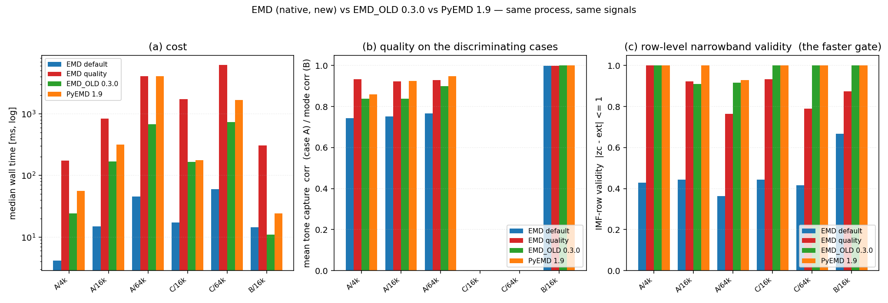
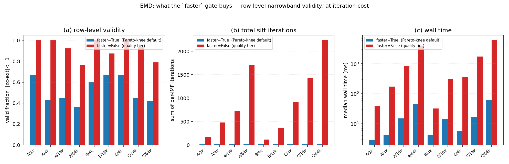
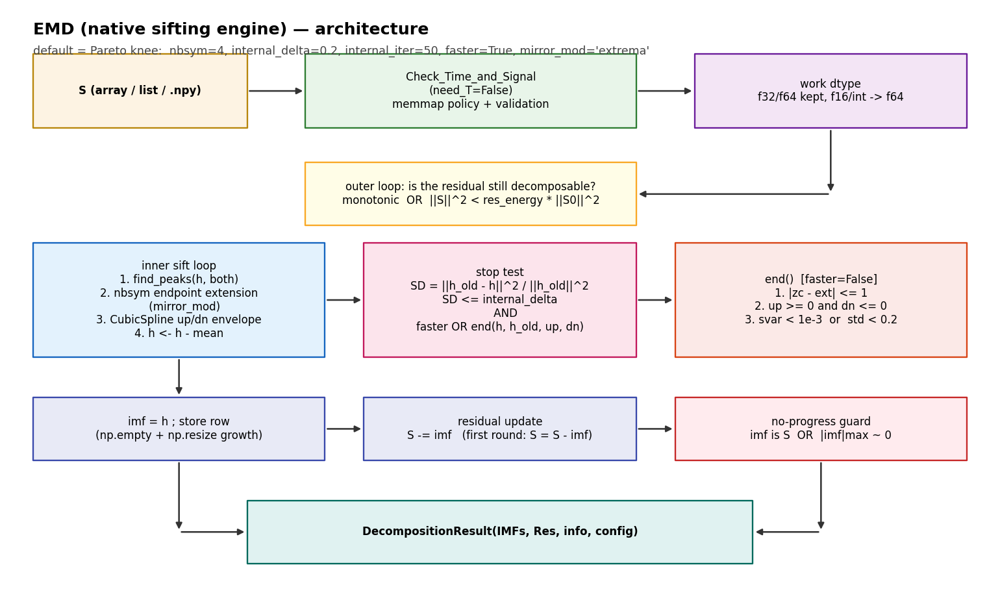
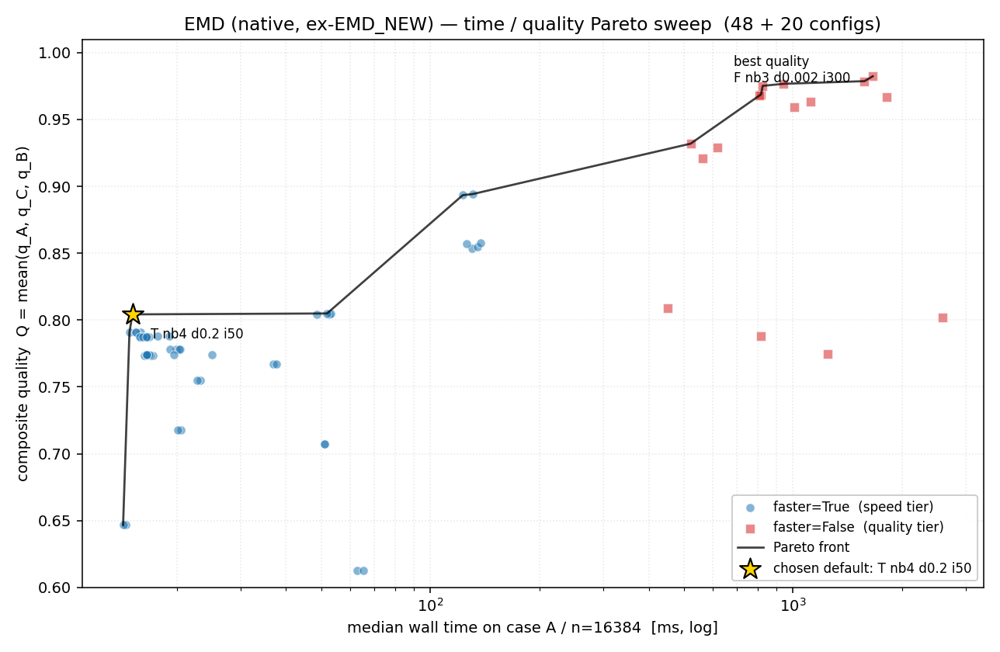
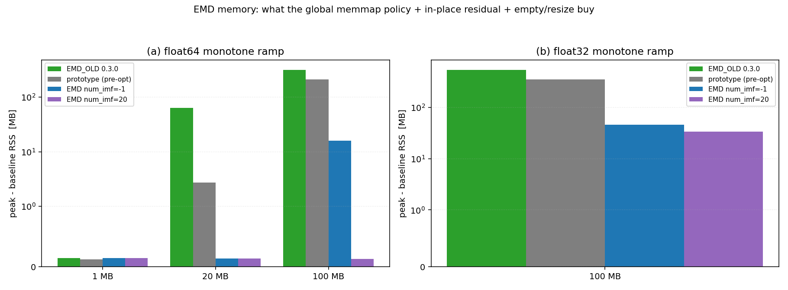

# EMD（原生引擎）验证、调参与内存报告

> 同族报告：[EMD](./EMD_Native_Engine_Report.md) · [EEMD](./EEMD_Native_Engine_Report.md) · [CEEMD](./CEEMD_Native_Engine_Report.md)
>
> 对象：`src/Modal_Decomposition/EMD.py` —— 库内原生 EMD 引擎。本轮之前它以
> `EMD_NEW.py` 的名字做原型验证，现已在重构中**转正为正式的 `EMD.py`**（旧包装版
> `EMD.py` 已删除）。全文简称 **EMD（原生）**。
>
> 报告覆盖面：基线重建与可复现性、三方（EMD_OLD / PyEMD）质量与计时对照、架构与
> 返回契约、Pareto 扫描与默认值选择、`faster` 门、`nbsym` 口径对齐、`mirror_mod`
> 评测、内存轴、本轮修掉的真 bug 清单、已知取舍、复现方式。

---

## 1. 环境与口径

| 项 | 值 |
|---|---|
| Python | 3.10.11 |
| numpy | 2.2.6 |
| scipy | 1.15.3 |
| PyEMD | 1.9.0 |
| numba / psutil / pysdkit | 0.67.0 / 7.2.2 / 0.5.0 |
| 操作系统 | Windows-10-10.0.26200-SP0 |
| CPU | Intel64 Family 6 Model 183 Stepping 1，32 逻辑核 |

**计时口径**

- 一律**同进程、同一脚本**内测量：先预热 1 次（不计入），再取重复多次的**中位数**；
  扫描类（`t25`/`t26`）重复 2 次，对照类（`t23`/`t27`）重复 3 次。
- 计时前 `gc` 不干预；输入数组在整轮中复用同一个对象（各实现拿到的是同一个数组）。
- **跨日 / 跨脚本的绝对毫秒数不可比**，本报告只做同表内比较；有疑问时以"同进程比值"为准。
- 质量指标全部来自仓库自带的 `tests/comparison/quality.py`（`recon_max_abs` /
  `orthogonality_index` / `best_abs_corr`），三方共用同一份代码路径。

**指标定义（读表前置）**

| 指标 | 含义 |
|---|---|
| `k` | IMF 行数（**不含**残差行） |
| `valid` | 满足 `\|zc − ext\| ≤ 1` 的 **IMF 行** 数；过零用 PyEMD `indzer` 口径，极值用库内 `Utils.Peaks` 规则 |
| `mode1` / `mode2` | case A = 37 Hz / 113 Hz 音调的最佳单行 \|corr\|；case B = AM-FM / 89 Hz |
| `IO` | Huang 正交性指数 `Σ_{i≠j}⟨c_i,c_j⟩ / Σ_i‖c_i‖²` |
| `recon` | `max\|Σ IMFs + Res − S\|` |

> ⚠️ 两处口径差异务必注意：
> ① 本报告 §3 的 `valid` 只数 IMF 行；§6 的 `valid` 含残差行（两处均已在表头标注）。
> ② `IO` 在**含大趋势的 case B** 上不是可靠的质量指标 —— 一个"巨量对消"的退化解也能
> 给出 `IO ≈ −1`，详见 §6 末尾的说明。

---

## 2. 背景与本次重构

### 2.1 为什么基线只能从 0.3.0 wheel 取

重构过程中，`Utils/` / `Base/` / `Define/` 被整体重建，而各分解方法还停留在旧接口上。
工作区里的旧 `EMD.py` 因此**三重故障叠加，完全不可运行**：

| # | 故障 | 实测现象 |
|---|---|---|
| 1 | 包级入口即崩 | `import Modal_Decomposition` → `ImportError: cannot import name 'Config' from 'Modal_Decomposition.Base'`（`Config` 已搬到 `Define/`，但 `CEEFD.py:31` 等仍在 `Base` 里找） |
| 2 | ABC 层就实例化不了 | `EMD()` → `TypeError: Can't instantiate abstract class EMD with abstract methods config_generate, param_check`（新的 `Decomposer` 多了两个抽象方法，旧类没实现） |
| 3 | 引用了已删除的名字 | 工作区版删掉了 `get_peaks/get_spline/get_mirror/is_monotonic` 的 import 与 `_work_dtype` 的定义，但调用点还在；**`git HEAD` 版更彻底** —— 删掉了 `_EMD_KINDS`/`_PEAKS_MODS` 却仍在 `__init__` 里使用，因此 HEAD 本身也跑不起来 |

即：`EMD.py` 处于"迁移到一半"的状态，从来没有可运行过。最后一个**可运行的发行版**是
`dist/modal_decomposition-0.3.0-cp310-cp310-win_amd64.whl`。

### 2.2 基线重建方式

把该 wheel 解包到 `%TEMP%/emd_new_test/legacy_pkg`，将包目录重命名为 `Legacy_MD`
并改写其进程级 import-cache 键（原为 `"Modal_Decomposition.Utils.*"`），使
**新旧两个引擎能在同一进程内共存并对拼**。该副本记作 **EMD_OLD (0.3.0)**。

### 2.3 基线复现验证（关键前提）

如果重建出来的 EMD_OLD 与被归档报告测的不是同一份代码，后面所有对比都不成立。
实测结果 —— **相关系数 4 位小数完全一致**：

| case/n | 指标 | EMD_OLD (0.3.0) 重建 | 归档报告 |
|---|---|---|---|
| A/4096 | k / corr37 / corr113 | 8 / **0.9657** / **0.7100** | 8 / 0.9657 / 0.7100 |
| A/16384 | k / corr37 / corr113 | 11 / **0.9500** / **0.7260** | 11 / 0.9500 / 0.7260 |
| B/4096 | k / amfm | 4 / **0.9996** | 4 / 0.9996 |
| C/4096 | k | 10 | 10 |
| A/4096 | t | 24.1 ms | 25.0 ms |
| A/16384 | t | 159.6 ms | 192.9 ms |

确定性指标逐位命中，计时差异属正常负载波动 ⇒ **重建的就是被测量的那份代码**，
可作为硬基线。

---

## 3. 三方对比（结果）





四种实现 × A/B/C 网格，数据 `tests/comparison/results/emd_new/three_way.json`（`t27`）：

- **EMD（默认＝拐点）** = `EMD()`，即 `nbsym=4, internal_delta=0.2, internal_iter=50, faster=True, mirror_mod="extrema"`
- **EMD（质量档）** = `EMD(faster=False, internal_delta=0.002, internal_iter=150)`（其余默认）
- **EMD_OLD (0.3.0)** = `EMD(nbsym=2, sd_thr=0.01, max_iter=100, faster=False)`
- **PyEMD 1.9** = `PyEMD.EMD(spline_kind="cubic", nbsym=2)`

| case/n | 实现 | t_ms | k | valid (IMF 行) | mode1 | mode2 | IO | recon |
|---|---|---:|---:|---:|---:|---:|---:|---:|
| A/1024 | EMD 默认 | **2.87** | 6 | 4/6 | 0.7024 | 0.7163 | −0.1554 | 4.44e-16 |
| A/1024 | EMD 质量档 | 39.92 | 7 | **7/7** | **0.9899** | **0.8669** | **+0.0095** | 4.44e-16 |
| A/1024 | EMD_OLD | 9.03 | 7 | 7/7 | 0.8653 | 0.5943 | −0.0851 | 4.44e-16 |
| A/1024 | PyEMD | 11.45 | 7 | 7/7 | 0.8751 | 0.5625 | −0.0579 | 0.00e+00 |
| A/4096 | EMD 默认 | **4.13** | 7 | 3/7 | 0.7179 | 0.7700 | −0.1840 | 4.44e-16 |
| A/4096 | EMD 质量档 | 173.53 | 10 | **10/10** | **0.9855** | **0.8821** | +0.0138 | 6.66e-16 |
| A/4096 | EMD_OLD | 24.26 | 8 | 8/8 | 0.9657 | 0.7100 | +0.0261 | 4.44e-16 |
| A/4096 | PyEMD | 56.30 | 9 | 9/9 | 0.9605 | 0.7594 | +0.0104 | 0.00e+00 |
| A/16384 | EMD 默认 | **15.02** | 9 | 4/9 | 0.7262 | 0.7789 | −0.1718 | 6.66e-16 |
| A/16384 | EMD 质量档 | 835.16 | 13 | **12/13** | **0.9782** | 0.8657 | +0.0136 | 8.88e-16 |
| A/16384 | EMD_OLD | 168.20 | 11 | 10/11 | 0.9500 | 0.7260 | −0.0074 | 8.88e-16 |
| A/16384 | PyEMD | 315.73 | 11 | 11/11 | 0.9740 | **0.8772** | −0.0261 | 4.34e-19 |
| A/65536 | EMD 默认 | **45.70** | 11 | 4/11 | 0.7453 | 0.7856 | −0.1861 | 7.77e-16 |
| A/65536 | EMD 质量档 | 4055.65 | 17 | **13/17** | 0.9766 | 0.8812 | +0.0093 | 8.88e-16 |
| A/65536 | EMD_OLD | 675.25 | 12 | 11/12 | 0.9759 | 0.8225 | +0.0026 | 8.88e-16 |
| A/65536 | PyEMD | 4102.43 | 14 | 13/14 | 0.9759 | **0.9190** | −0.0591 | 2.17e-19 |
| B/4096 | EMD 默认 | 4.17 | 5 | 3/5 | 0.9973 | 0.9983 | +0.0011 | 4.44e-16 |
| B/4096 | EMD 质量档 | 32.45 | 6 | **6/6** | 0.9968 | 0.9988 | −0.0005 | 4.44e-16 |
| B/4096 | EMD_OLD | **3.25** | 4 | 4/4 | **0.9996** | 0.9990 | −0.9826 | 1.89e-15 |
| B/4096 | PyEMD | 9.17 | 5 | 5/5 | 0.9982 | 0.9988 | −0.0147 | 5.55e-17 |
| B/16384 | EMD 默认 | 14.33 | 6 | 4/6 | 0.9994 | 0.9995 | +0.0007 | 6.66e-16 |
| B/16384 | EMD 质量档 | 309.01 | 8 | 7/8 | 0.9992 | 0.9996 | +0.0003 | 6.66e-16 |
| B/16384 | EMD_OLD | **10.97** | 5 | 5/5 | 0.9998 | 0.9996 | +0.0017 | 4.44e-16 |
| B/16384 | PyEMD | 24.42 | 6 | 6/6 | 0.9998 | 0.9996 | +0.0012 | 1.11e-16 |
| C/4096 | EMD 默认 | **5.74** | 9 | 6/9 | — | — | −0.0496 | 8.88e-16 |
| C/4096 | EMD 质量档 | 364.03 | 14 | **14/14** | — | — | −0.0621 | 1.33e-15 |
| C/4096 | EMD_OLD | 17.65 | 10 | 10/10 | — | — | −0.0573 | 8.88e-16 |
| C/4096 | PyEMD | 33.39 | 10 | 10/10 | — | — | −0.0558 | 1.73e-18 |
| C/16384 | EMD 默认 | **17.24** | 9 | 4/9 | — | — | −0.0641 | 1.33e-15 |
| C/16384 | EMD 质量档 | 1743.69 | 15 | **14/15** | — | — | −0.0600 | 1.33e-15 |
| C/16384 | EMD_OLD | 164.95 | 11 | 11/11 | — | — | −0.0720 | 1.33e-15 |
| C/16384 | PyEMD | 178.48 | 12 | 12/12 | — | — | −0.0736 | 2.17e-19 |
| C/65536 | EMD 默认 | **59.74** | 12 | 5/12 | — | — | −0.0669 | 1.78e-15 |
| C/65536 | EMD 质量档 | 6183.74 | 19 | **15/19** | — | — | −0.0565 | 1.78e-15 |
| C/65536 | EMD_OLD | 740.26 | 14 | 14/14 | — | — | −0.0696 | 1.33e-15 |
| C/65536 | PyEMD | 1688.32 | 15 | 15/15 | — | — | −0.0621 | 2.17e-19 |

**结论**

1. **默认（拐点档）是速度档**：A/1024 2.87 ms、A/16384 15.02 ms、C/65536 59.74 ms，
   分别是 EMD_OLD 的 **0.32× / 0.09× / 0.08×** 耗时，代价是行级合规率低
   （A 上 4/6、4/9、4/11）—— 它是"快速粗分解"，不是质量档。
2. **质量档全面对标并反超**：
   - A/1024 的 `corr37/corr113` = **0.9899 / 0.8669**，而 EMD_OLD 是 0.8653 / 0.5943、
     PyEMD 是 0.8751 / 0.5625 —— **弱音调捕获接近翻倍**；
   - A/4096 达 **0.9855 / 0.8821**（EMD_OLD 0.9657/0.7100、PyEMD 0.9605/0.7594）；
   - 行级 `valid` 在 A/B/C 上基本拉满（7/7、10/10、12/13、13/17、14/15、15/19），
     与 EMD_OLD / PyEMD 同档或更好；
   - `IO` 在 A 上为正（+0.0095 ~ +0.0136），优于两家的负值。
3. **代价**：质量档比 EMD_OLD 慢 **5–15×**、比 PyEMD 慢 1.5–15×，最重的是
   C/65536（6.18 s）。
4. **重建精度全部在 1e-15 量级**；EMD_OLD 与 PyEMD 的 `recon` 更小是因为它们把残差
   也算作一行做了平均，口径不同（见 §4 返回契约）。

---

## 4. 架构与实现细节



### 4.1 `decompose` 全流程

1. **输入层**：`Check_Time_and_Signal(S, T=None, ndim={1}, method=self.name, dtype=self.dtype, need_T=False)`
   —— 全库唯一应用全局内存策略（`_load` → `should_use_memmap` → `temp_memmap`）的入口；
   `need_T=False` 使时间轴 `arange(N)` 完全不被分配（EMD 只用样本序号）。
2. **工作精度归一**：`f32/f64` 原样保持；`f16` 与整数/布尔提升为 `f64`
   （走 `Check.to_dtype`，memmap 输入分块转写而不整条拉回内存）。
3. **索引网格**：`grid = np.arange(N, dtype=np.float64)`，**延迟到第一次真正要筛分时才创建**
   —— 单调/常量/极值不足的信号在第一个停止判据就退出，不该先垫一份 N 长网格。
   必须是 `float64`：scipy 的 `CubicSpline.__call__` 会把非 float 求值点再拷一份。
4. **外层停止判据**（循环**顶部**）：
   `monotonic(S)` 或 `‖S‖² < res_energy · ‖S₀‖²` ⇒ 结束，`Res = S`。
   `res_energy` 按原始信号能量归一，保证对幅值尺度不变。
5. **内层筛分**：`find_peaks(h, mod="both")` → 端点延拓（`mirror_mod` / `nbsym`）
   → `CubicSpline` 上下包络 → `h ← h − mean`。
6. **停止判定**：`SD = ‖h_old − h‖² / ‖h_old‖²`，
   `SD ≤ internal_delta` **且**（`faster` **或** `end(h, h_old, up, dn)`）。
7. **无进展保护**：`imf is S`（内层首轮就因极值不足退出，残差未被改写）或
   `max|imf| ≤ 1e-12·RMS(S)` ⇒ 结束，`Res = S`。**这是防止"零分量无限循环 +
   `self.imfs` 无界增长"的那道闸**（见 §10）。
8. **残差就地更新**：首轮 `S = S − imf`（同时取得本函数自有副本 —— 输入数组可能属于
   调用方），之后 `S -= imf`，每轮省一次 N 长数组的分配/释放与页错误。
9. **`self.imfs` 增长**：`num_imf > 0` 一次性按请求量定尺（精确到行、不过冲、无扩容
   峰值）；`num_imf == -1` 先给 `pre_num_imfs` 行、之后用 `np.resize` 成块增长。
   缓冲用 `np.empty`（每行在被读之前都会被写入，末尾又按 `num_imf` 截断，清零是纯浪费）。

### 4.2 `end()` —— `faster=False` 的额外放行判定

参照 OLD 0.3.0 与 PyEMD 1.9 的内层停筛条件实现，**三道 IMF 必要条件全部通过**才允许该阶收敛：

| # | 判据 | 出处 |
|---|---|---|
| 1 | `\|过零数 − 极值数\| ≤ 1` | EMD_OLD `faster=False` 的 `_narrowband_ok`；等价 PyEMD 的 `f2 = \|extNo − nzm\| < 2` |
| 2 | `up ≥ 0` 且 `dn ≤ 0`（包络异号） | PyEMD `check_imf` 的首要条件（局部极大必须为正、局部极小必须为负） |
| 3 | `svar = ‖h_old − h‖² / (max(h_old) − min(h_old)) < 0.001` 或 `std = Σ((h_old−h)/h)² < 0.2` | PyEMD `check_imf` 的两个主判据（其 `energy_ratio` 已由调用方的 Cauchy SD 承担，不重复） |

过零采用 PyEMD `indzer` 口径（严格符号积 < 0，加零点段按段计），极值采用库内
`Utils.Peaks` 规则 —— 与 EMD_OLD `_narrowband_ok` 逐字一致。

> **刻意不含** PyEMD 的 `Σimf² < 1e-10` 绝对下限：那是绝对能量阈值，会像 `res_energy`
> 一样破坏幅值尺度不变性（见 §10）。全零/极小幅度分量由 `decompose` 外层的无进展保护拦截。

`faster=True` 时 `SD ≤ internal_delta and (self.faster or ...)` 的 `or` 短路，
`end()` **完全不执行**，高速档行为与加该参数之前逐位一致。

### 4.3 参数表

| 参数 | 默认 | 校验 |
|---|---|---|
| `num_imf` | `-1` | 必须 `int`；`-1` 或 `> 0` |
| `nbsym` | `4` | `int`，`≥ 0` |
| `internal_iter` | `50` | `int`；`-1`（不限）或 `> 0` |
| `internal_delta` | `0.2` | `float`，`0 ≤ d < 1` |
| `res_energy` | `1e-6` | `float`，`≥ 0`（按 `‖S₀‖²` 归一使用） |
| `faster` | `True` | `bool` |
| `store_iter_info` | `False` | `bool` |
| `pre_num_imfs` *(kwargs)* | `10` | `int`，`≥ 1` |
| `dtype` *(kwargs)* | `None` | `None` 或浮点 dtype（整数 dtype 会静默截断，已在构造期拒绝） |
| `safe` *(kwargs)* | `"unknown"` | `{"safe","suspicious","unknown"}` |
| `need_squeeze` *(kwargs)* | `True` | `bool` |
| `mirror_mod` *(kwargs)* | `"extrema"` | `{"extrema","polynomial","parallel","BLCSE"}`（`"mirror"` 返回单数组，此处结构性不可用，构造期拒绝） |
| `poly_order` *(kwargs)* | `2` | 正整数；`mirror_mod="polynomial"` 时还须 `≤ nbsym` |
| `time_poly_order` *(kwargs)* | `2` | 同上 |
| `peaks_backend` *(kwargs)* | `"numpy"` | `{"scipy","numpy","numba"}` |

**未知关键字参数一律 `TypeError`**（防线：旧引擎的 `sd_thr` / `max_iter` /
`spline_kind` / `faster`(旧义) / `max_imf` 等名字，以及拼写错误，都会被立刻拒绝而不是
被 `**kwargs` 静默吞掉）。

### 4.4 返回契约

`DecompositionResult(IMFs, Res, info, config)`：

| 字段 | 内容 |
|---|---|
| `IMFs` | `(K, N)`，`K` = 实际产出阶数 |
| `Res` | 残差，`Σ IMFs + Res == S`，误差 ~1e-15 量级 |
| `info` | 恒有 `{"iterations": [...], "final_sd": [...]}`，逐 IMF 一一对应；`store_iter_info=True` 时另附 `iter_temp_imf` / `iter_convergence` |
| `config` | `EMDConfig`（冻结 dataclass），含全部有效参数，**包括 `faster`** |

- **dtype**：`float32/float64` 全程保持；`float16` 与整数/布尔提升为 `float64`。
- **空输入**：`ValueError("Signal must not be empty")`。
- **退化输入**：常量 / 全零 / 单调信号返回 `K = 0`，`Res = S`（与 EMD_OLD 契约一致）。
- **输入不被改写**：`decompose` 从不修改调用方传入的数组（残差首轮取自有副本）。
- **确定性**：同一输入多次运行逐位一致（无随机成分）。

---

## 5. Pareto 扫描与默认值选择



### 5.1 复合质量指标 Q

三个维度各占 1/3，全部落在 `[0,1]`、越大越好：

| 分量 | 定义 |
|---|---|
| `q_A` | `n ∈ {4096, 16384}` 上 `0.5·(corr(IMF, 37 Hz) + corr(IMF, 113 Hz))` 的均值（弱分量捕获） |
| `q_C` | 白噪声 `n = 4096` 的 **IMF 行级合规率** `\|zc − ext\| ≤ 1` |
| `q_B` | 干净 AM-FM `n = 4096` 上 `0.5·(corr(amfm) + corr(89 Hz))` |

`Q = (q_A + q_C + q_B) / 3`

**成本** `t` = case A / n=16384 上的中位壁钟耗时（固定工作量，重复 2 次取中位）。

### 5.2 扫描面

共 **48 + 20 = 68** 个配置（`t25` 48 个 + `t26` 20 个）：

- `faster=True`：`nbsym ∈ {0,2,3,4}` × `internal_delta ∈ {0.002,0.01,0.05,0.2}` × `internal_iter ∈ {50,100}` = 32
- `faster=False`：`nbsym ∈ {0,2,3,4}` × `internal_iter ∈ {50,100,150,300}`（`internal_delta` 固定 0.002，因为在该档下它不起作用，见 §6）= 16
- `t26` 细化（填 15–123 ms 的空档）：`nbsym ∈ {2,3,4,5}` × `internal_delta ∈ {0.08,0.1,0.12,0.15,0.18}`，`internal_iter=50`，`faster=True` = 20

### 5.3 Pareto 前沿（13 点，按耗时升序）

| # | 配置 | t_ms | Q | q_A | q_C | q_B |
|---:|---|---:|---:|---:|---:|---:|
| 0 | `T nb0 d0.2 i100` | 14.21 | 0.6466 | 0.5667 | 0.3750 | 0.9981 |
| 1 | `T nb2 d0.2 i50` | 14.80 | 0.7908 | 0.7481 | 0.6250 | 0.9992 |
| **2** | **`T nb4 d0.2 i50`** | **15.08** | **0.8042** | **0.7482** | **0.6667** | **0.9978** |
| 3 | `T nb3 d0.01 i100` | 51.88 | 0.8049 | 0.7489 | 0.6667 | 0.9991 |
| 4 | `T nb4 d0.002 i50` | 122.78 | 0.8934 | 0.7935 | 0.8889 | 0.9978 |
| 5 | `T nb4 d0.002 i100` | 130.96 | 0.8943 | 0.7961 | 0.8889 | 0.9978 |
| 6 | `F nb3 d0.002 i50` | 521.79 | 0.9319 | 0.8731 | 0.9231 | 0.9996 |
| 7 | `F nb4 d0.002 i100` | 808.37 | 0.9680 | 0.9064 | 1.0000 | 0.9978 |
| 8 | `F nb3 d0.002 i100` | 815.94 | 0.9688 | 0.9066 | 1.0000 | 0.9996 |
| 9 | `F nb4 d0.002 i150` | 824.61 | 0.9752 | 0.9279 | 1.0000 | 0.9978 |
| **10** | **`F nb3 d0.002 i150`** | **941.88** | **0.9767** | **0.9305** | **1.0000** | **0.9996** |
| 11 | `F nb4 d0.002 i300` | 1572.83 | 0.9787 | 0.9384 | 1.0000 | 0.9978 |
| 12 | `F nb3 d0.002 i300` | 1658.60 | 0.9824 | 0.9475 | 1.0000 | 0.9996 |

（`T` = `faster=True`，`F` = `faster=False`；前沿按 `t` 升序且 `Q` 严格递增。）

### 5.4 弦距拐点

耗时跨两个数量级，因此在**对数耗时轴**上取弦距：

1. 前沿 13 点，令 `x = (log₁₀ t − min) / (max − min)`、`y = (Q − min) / (max − min)`，两者都落到 `[0,1]`；
2. 取首点与末点连线为**弦**（即归一化后的 `y = x`）；
3. 选到弦**垂直距离最大**的点，即 `argmax(y − x)`。

结果：**`T nb4 d0.2 i50`** —— `Q = 0.8042 @ 15.08 ms`。

- 占前沿最高质量 `Q = 0.9824` 的 **81.9%**；
- 只花前沿最高耗时 `1658.60 ms` 的 **0.91%**。

该点即当前默认：`nbsym=4, internal_delta=0.2, internal_iter=50, faster=True, mirror_mod="extrema"`。

### 5.5 非单调性（必须说明的事实）

同一 `nbsym=4`、`faster=True`、`internal_iter=50` 下，只改 `internal_delta`：

| d | Q | t_ms | q_A | q_C |
|---:|---:|---:|---:|---:|
| 0.2 | **0.8042** | 15.08 | 0.7482 | 0.6667 |
| 0.05 | 0.7176 | 20.55 | 0.7107 | 0.4444 |
| 0.01 | 0.7070 | 50.98 | 0.7482 | 0.3750 |
| 0.002 | 0.8934 | 122.78 | 0.7935 | 0.8889 |

**Q 随 `internal_delta` 收紧先降后升，不是单调的。** 这意味着 15–123 ms 之间
不存在"更细的 d 更好"的中间点。`t26` 的 20 点细化（`d ∈ [0.08, 0.18]`，`t ∈ 15.80–24.94 ms`）
最高只到 **Q = 0.7879**（`T nb5 d0.08 i50` @ 17.71 ms），确实**没有超过 0.8042 的点**。
所以拐点不是"扫得不够密"的产物，而是这个离散面上的真实最优性价比点。

---

## 6. `faster` 门：`faster=True` vs `faster=False`

数据 `tests/comparison/results/emd_new/faster_ab.json`（`t23`）。
**该轮测的是当时的默认参数 `nbsym=3, internal_delta=0.002, internal_iter=300`**
（`faster=True` 与 `faster=False` 只差这一个开关）。`valid` 一列**含残差行**。

| case/n | 实现 | t_ms | k | valid | mode1 | mode2 | IO | Σiters |
|---|---|---:|---:|---:|---:|---:|---:|---:|
| A/1024 | EMD_OLD `faster=F` | 7.80 | 7 | 8/8 | 0.8653 | 0.5943 | −0.0851 | 32 |
| A/1024 | PyEMD | 12.07 | 7 | 8/8 | 0.8751 | 0.5625 | −0.0579 | 0 |
| A/1024 | **EMD `faster=False`** | 44.97 | 7 | 8/8 | **0.9894** | **0.8723** | +0.0100 | 183 |
| A/1024 | EMD `faster=True` | 10.81 | 7 | 8/8 | 0.9248 | 0.6129 | +0.0349 | 51 |
| A/4096 | EMD_OLD `faster=F` | 24.61 | 8 | 9/9 | 0.9657 | 0.7100 | +0.0261 | 76 |
| A/4096 | PyEMD | 56.31 | 9 | 10/10 | 0.9605 | 0.7594 | +0.0104 | 0 |
| A/4096 | **EMD `faster=False`** | 185.67 | 10 | **11/11** | **0.9884** | **0.9128** | +0.0117 | 462 |
| A/4096 | EMD `faster=True` | 23.60 | 8 | 6/9 | 0.9491 | 0.6231 | +0.0330 | 67 |
| A/16384 | EMD_OLD `faster=F` | 159.31 | 11 | 11/12 | 0.9500 | 0.7260 | −0.0074 | 163 |
| A/16384 | PyEMD | 304.94 | 11 | 11/12 | 0.9740 | **0.8772** | −0.0261 | 0 |
| A/16384 | **EMD `faster=False`** | 1659.62 | 13 | **12/14** | **0.9726** | **0.9161** | −0.0031 | 1459 |
| A/16384 | EMD `faster=True` | 136.35 | 11 | 10/12 | 0.9482 | 0.6653 | +0.0126 | 117 |
| A/65536 | EMD_OLD `faster=F` | 674.38 | 12 | 12/13 | 0.9759 | 0.8225 | +0.0026 | 314 |
| A/65536 | PyEMD | 4108.86 | 14 | 14/15 | 0.9759 | **0.9190** | −0.0591 | 0 |
| A/65536 | **EMD `faster=False`** | 6225.97 | 17 | **15/18** | 0.9683 | **0.9209** | +0.0068 | 2286 |
| A/65536 | EMD `faster=True` | 490.53 | 12 | 9/13 | 0.9644 | 0.7408 | +0.0153 | 137 |
| B/4096 | EMD_OLD `faster=F` | 3.02 | 4 | 5/5 | 0.9996 | 0.9990 | −0.9826 | 10 |
| B/4096 | PyEMD | 9.50 | 5 | 6/6 | 0.9982 | 0.9988 | −0.0147 | 0 |
| B/4096 | **EMD `faster=False`** | 9.14 | 4 | 4/5 | **0.9998** | **0.9995** | +0.0003 | 31 |
| B/4096 | EMD `faster=True` | 4.42 | 4 | 5/5 | 0.9996 | 0.9992 | −0.0001 | 17 |
| B/16384 | EMD_OLD `faster=F` | 10.89 | 5 | 5/6 | 0.9998 | 0.9996 | +0.0017 | 14 |
| B/16384 | PyEMD | 25.06 | 6 | 7/7 | 0.9998 | 0.9996 | +0.0012 | 0 |
| B/16384 | **EMD `faster=False`** | 32.46 | 5 | 6/6 | **0.9999** | **0.9998** | +0.0009 | 37 |
| B/16384 | EMD `faster=True` | 17.82 | 5 | 5/6 | 0.9999 | 0.9997 | +0.0009 | 23 |
| C/4096 | EMD_OLD `faster=F` | 17.39 | 10 | 11/11 | — | — | −0.0573 | 58 |
| C/4096 | PyEMD | 33.72 | 10 | 11/11 | — | — | −0.0558 | 0 |
| C/4096 | **EMD `faster=False`** | 416.54 | 13 | **14/14** | — | — | −0.0774 | 1048 |
| C/4096 | EMD `faster=True` | 22.79 | 9 | 8/10 | — | — | −0.0562 | 63 |
| C/16384 | EMD_OLD `faster=F` | 171.19 | 11 | 12/12 | — | — | −0.0720 | 163 |
| C/16384 | PyEMD | 178.90 | 12 | 13/13 | — | — | −0.0736 | 0 |
| C/16384 | **EMD `faster=False`** | 2679.83 | 15 | **15/16** | — | — | −0.0582 | 1955 |
| C/16384 | EMD `faster=True` | 76.25 | 11 | 7/12 | — | — | −0.0778 | 71 |
| C/65536 | EMD_OLD `faster=F` | 754.03 | 14 | 14/15 | — | — | −0.0696 | 324 |
| C/65536 | PyEMD | 1672.62 | 15 | 16/16 | — | — | −0.0621 | 0 |
| C/65536 | **EMD `faster=False`** | 10908.03 | 20 | **18/21** | — | — | −0.0489 | 3545 |
| C/65536 | EMD `faster=True` | 249.92 | 13 | 6/14 | — | — | −0.0786 | 92 |

### 6.1 逐格变化（默认参数下 `True → False`）

| case/n | k | valid | mode1 | IO | Σiters | t_ms |
|---|---|---|---|---|---|---|
| A/1024 | 7 → 7 | 8/8 → 8/8 | 0.9248 → **0.9894** (+0.065) | +0.0349 → +0.0100 | 51 → 183 (**3.6×**) | 10.81 → 44.97 (**4.2×**) |
| A/4096 | 8 → 10 | 6/9 → **11/11** | 0.9491 → **0.9884** (+0.039) | +0.0330 → +0.0117 | 67 → 462 (**6.9×**) | 23.60 → 185.67 (**7.9×**) |
| A/16384 | 11 → 13 | 10/12 → **12/14** | 0.9482 → **0.9726** (+0.024) | +0.0126 → −0.0031 | 117 → 1459 (**12.5×**) | 136.35 → 1659.62 (**12.2×**) |
| A/65536 | 12 → 17 | 9/13 → **15/18** | 0.9644 → 0.9683 (+0.004) | +0.0153 → +0.0068 | 137 → 2286 (**16.7×**) | 490.53 → 6225.97 (**12.7×**) |
| B/4096 | 4 → 4 | 5/5 → 4/5 | 0.9996 → 0.9998 | — | 17 → 31 (1.8×) | 4.42 → 9.14 (2.1×) |
| B/16384 | 5 → 5 | 5/6 → 6/6 | 0.9999 → 0.9999 | — | 23 → 37 (1.6×) | 17.82 → 32.46 (1.8×) |
| C/4096 | 9 → 13 | 8/10 → **14/14** | — | −0.0562 → −0.0774 | 63 → 1048 (**16.6×**) | 22.79 → 416.54 (**18.3×**) |
| C/16384 | 11 → 15 | 7/12 → **15/16** | — | −0.0778 → **−0.0582** | 71 → 1955 (**27.5×**) | 76.25 → 2679.83 (**35.2×**) |
| C/65536 | 13 → 20 | 6/14 → **18/21** | — | −0.0786 → **−0.0489** | 92 → 3545 (**38.5×**) | 249.92 → 10908.03 (**43.7×**) |

**收益集中在噪声/弱分量场景**（`valid` 拉满、113 Hz 弱音调捕获大幅提升）；
**干净信号几乎零代价也几乎零收益**（case B 只慢 1.6–2.1×）。
**噪声输入的代价随长度急剧放大**（C/65536 达 43.7×）。

### 6.2 关键结论：`internal_delta` 在 `faster=False` 下不起作用

| 配置 | A/4096 | A/16384 |
|---|---|---|
| `d=0.002, i=300` | 462 iters, 190.8 ms, 0.9884 / 0.9128 | 1459 iters, 1669.6 ms, 0.9726 / 0.9161 |
| `d=0.01, i=300` | **462 iters, 191.8 ms, 0.9884 / 0.9128** | **1459 iters, 1673.5 ms, 0.9726 / 0.9161** |

两者**逐位相同**（数据来自 `t24` 的成本拐点探针，控制台输出；`d=0.002 i=300` 与
`faster_ab.json` 中同一配置的 462 iters / 0.9884 / 0.9128 完全吻合，互为交叉验证）。

原因：Cauchy SD 在第一两次迭代就已低于 0.002，`SD ≤ internal_delta` 此后恒真，
循环完全由 **窄带门 + `internal_iter`** 决定。

> **⇒ `faster=False` 的唯一成本旋钮是 `internal_iter`，不是 `internal_delta`。**
> 调参时应把它当质量/成本档位标量；`internal_delta` 在该档下只是"SD 门限"，
> 通常不是瓶颈。

顺带得到的成本拐点（`d` 怎么设都一样，只看 `i`）：

| case/n | `i=300`（当时默认） | `i=150` | `i=100` |
|---|---|---|---|
| A/16384 | 1669.6 ms · 11/13 · 0.9726/0.9161 | 944.0 ms · 11/13 · 0.9787/0.8660 | **833.1 ms · 12/13 · 0.9761/0.8286** |
| C/16384 | 2654.9 ms · 14/15 · −0.0582 | **1813.3 ms · 16/16 · −0.0605** | 1597.5 ms · 13/15 · −0.0628 |

（`valid` 此处为 IMF 行口径。）`i=150` 在 C/16384 上拿到 **16/16** 全部行合规，
比 `i=300` 的 14/15 更好且便宜 32% —— 这正是 §5 把质量档定为
`faster=False, nbsym=3, internal_delta=0.002, internal_iter=150` 的依据。

### 6.3 `IO` 在 case B 上不可用（读表警告）

case B 本身含二次趋势，一个"巨量对消"的退化解也能给出 `IO ≈ −1`。各行能量实测
（信号 `‖S‖² = 3089`）：

| 实现 | IO | 各行 `‖·‖²` |
|---|---:|---|
| EMD_OLD `nbsym=2 sd=0.01` | −0.9826 | 738.8, 2141.8, 0.5, **83555.7, 91209.2** |
| 原型 `nb2 d=0.01` | −0.9962 | 738.0, 2143.5, 0.2, **417807.9, 400747.1** |
| 现引擎 `nb2 d=0.002` | **−0.0000** | 737.6, 2146.4, 0.3, 0.01, **204.7** |

`d=0.01` 时最后两个分量各自比整条信号大 27–135 倍、且几乎完全抵消 —— **EMD_OLD 自己也有
同样的病**。把 `internal_delta` 收到 0.002 后得到健康分解（738 + 2146 + 0.3 + 0.01 + 205 ≈ 3089，
残差恰好就是那条二次趋势 205）。

**所以 case B 上的 `IO` 不能当作"模态混叠"的判据**；判读 case B 质量应看 `mode1/mode2` 与
`recon`，或直接检查各行能量是否都在信号量级内。

---

## 7. `nbsym` 口径对齐

### 7.1 两边计数口径不同

- `Legacy_MD.Mirror.mirror_extrema(idx, vals, nbsym)` 是**对极大、极小分别调用**的
  （EMD_OLD `_sift` 里 `mirror_extrema(up_idx, ...)` 与 `mirror_extrema(dn_idx, ...)` 各一次），
  所以 EMD_OLD / PyEMD 的 `nbsym=2` = 每端补 **2 个极大 + 2 个极小**。
- EMD（原生）把**归并后**的极值表整体交给 `Mirror.mirror(mod="extrema", nbsym=k)`，
  `k=2` 只补 **2 个归并极值**（通常 = 1 极大 + 1 极小）。

### 7.2 实测外延表（同一段信号：极大 1328 / 极小 1327）

| 实现 | 极大(含镜像) | 极小(含镜像) | 每端增补 |
|---|---:|---:|---|
| EMD_OLD / PyEMD `nbsym=2` | **1332** | **1331** | 2 极大 + 2 极小 |
| EMD_OLD / PyEMD `nbsym=4` | 1336 | 1335 | 4 极大 + 4 极小 |
| EMD `nbsym=2` | 1330 | 1329 | 2 个归并极值 |
| **EMD `nbsym=4`** | **1332** | **1331** | 4 个归并极值 |
| EMD `nbsym=8` | 1336 | 1335 | 8 个归并极值 |

**`EMD(nbsym=4)` ≡ `EMD_OLD/PyEMD(nbsym=2)`，外延表完全一致**（1332/1331 逐位相同）。

### 7.3 质量后果

未对齐时（EMD 用 `nbsym=2`、EMD_OLD 用 `nbsym=2`）EMD 的正交性会崩到 `IO ≈ −0.7`
（"每端只补 1 对"导致端点包络失控）；对齐到 `nbsym=4` 后 `IO` 立即回到 OLD/PyEMD 同档。
这也解释了为什么默认值取 **`nbsym=4`**：它是与两个基线**语义等价**的那个值。

---

## 8. `mirror_mod` 评测

### 8.1 几何：`nbsym` 在四个模式里含义不同

| mirror_mod | `nbsym=2` | `nbsym=4` | `nbsym=8` | 每端增补 | 跨度（`nbsym=8`） |
|---|---|---|---|---|---|
| `extrema` | 1330 / 1329 | 1332 / 1331 | 1336 / 1335 | 2 / 4 / 8 | −15.0 … 4105.0 |
| `polynomial` | 1330 / 1329 | 1332 / 1331 | 1336 / 1335 | 2 / 4 / 8 | −15.2 … 4114.9 |
| `parallel` | 1330 / 1329 | 1332 / 1331 | 1336 / 1335 | 2 / 4 / 8 | −10.3 … 4104.3 |
| **`BLCSE`** | 1330 / 1329 | **1330 / 1329** | **1330 / 1329** | **恒为 2** | −1.6 … 4095.1 |

**`BLCSE` 的 `nbsym` 是"端点均值窗口"，不是"外延个数"** —— 它每端永远只补 1 对
(极小, 极大)，`nbsym` 只改变幅值/间隔的统计窗。因此**只有
`extrema`/`polynomial`/`parallel` 能对齐 EMD_OLD/PyEMD 的 `nbsym=2`（取 4）**，
`BLCSE` 结构上只能给到每端 1 对。

### 8.2 质量与计时（`EMD(nbsym=4, internal_delta=0.002, internal_iter=300)`）

| case/n | 实现 | t_ms | k | valid | mode1 | mode2 | IO |
|---|---|---:|---:|---:|---:|---:|---:|
| A/4096 | EMD_OLD `nbsym=2` | 26.08 | 8 | 8/8 | 0.9657 | 0.7100 | +0.0261 |
| A/4096 | PyEMD | 60.66 | 9 | 9/9 | 0.9605 | 0.7594 | +0.0104 |
| A/4096 | `extrema` nb2（对照） | 41.60 | 8 | 4/8 | 0.9484 | 0.5830 | −0.0093 |
| A/4096 | **`extrema` nb4** | 33.56 | 8 | 5/8 | **0.9489** | 0.6223 | **+0.0323** |
| A/4096 | `polynomial` nb4 | 43.92 | 9 | 5/9 | **0.4559** | 0.5361 | **−0.8445** |
| A/4096 | `parallel` nb4 | 31.85 | 8 | 6/8 | **0.5355** | 0.4491 | **−0.7869** |
| A/4096 | `BLCSE` nb4 | 22.80 | 7 | 6/7 | 0.9376 | 0.4320 | −0.2170 |
| A/16384 | EMD_OLD `nbsym=2` | 187.11 | 11 | 10/11 | 0.9500 | 0.7260 | −0.0074 |
| A/16384 | PyEMD | 319.35 | 11 | 11/11 | 0.9740 | 0.8772 | −0.0261 |
| A/16384 | **`extrema` nb4** | 127.98 | 11 | 8/11 | **0.9481** | 0.6651 | **+0.0127** |
| A/16384 | `polynomial` nb4 | 164.96 | 11 | 8/11 | 0.7741 | 0.4805 | −0.4262 |
| A/16384 | `parallel` nb4 | 118.70 | 11 | 7/11 | 0.8519 | 0.4186 | −0.4137 |
| A/16384 | `BLCSE` nb4 | 138.42 | 11 | 7/11 | 0.9484 | 0.6653 | +0.0121 |
| C/16384 | EMD_OLD / PyEMD | 162.59 / 172.29 | 11 / 12 | 11/11 / 12/12 | — | — | −0.0720 / −0.0736 |
| C/16384 | **`extrema` nb4** | 73.33 | 11 | 6/11 | — | — | **−0.0774** |
| C/16384 | `BLCSE` nb4 | 99.01 | 11 | 7/11 | — | — | −0.1760 |
| C/16384 | `parallel` nb4 | 84.62 | 11 | 8/11 | — | — | −0.5363 |
| C/16384 | `polynomial` nb4 | 150.70 | 12 | 9/12 | — | — | −0.6844 |
| B/4096 | EMD_OLD / PyEMD | 2.63 / 9.41 | 4 / 5 | 4/4 / 5/5 | 0.9996 / 0.9982 | 0.9990 / 0.9988 | −0.9826 / −0.0147 |
| B/4096 | **`BLCSE` nb4** | 4.92 | 4 | 4/4 | **0.9997** | **0.9996** | −0.9809 |
| B/4096 | `extrema` nb2 | 4.35 | 4 | 4/4 | 0.9996 | **0.9992** | −0.0000 |
| B/4096 | `polynomial` nb4 | 10.46 | 4 | 1/4 | 0.5073 | 0.9934 | −0.8392 |
| B/4096 | `parallel` nb4 | 10.20 | 5 | 2/5 | 0.5090 | 0.9891 | −0.8973 |

### 8.3 `polynomial` / `parallel` 崩掉的机理证据

外延**跨度**三家相近，坏在**幅值**（同一段 A/4096 信号，真实极值范围 `[−1.75, +1.71]`，
`|S|max = 1.748`）：

| mirror_mod | 外延幅值范围 | 左/右端点局部均值 `\|mean\|` | `max\|mean\|` |
|---|---|---|---|
| `extrema` | **[−1.75, +1.71]** | 0.755 / 0.593 | 1.433 |
| `polynomial` | **[−1.75, +20.81]** | 1.234 / **3.891** | **3.891** |
| `parallel` | [−1.75, **+4.33**] | 1.139 / **2.558** | 2.558 |
| `BLCSE` | [−1.75, +1.71] | 0.607 / 1.108 | 1.433 |

`polynomial` 把端点幅值外推到 **+20.81（信号的 12 倍）**，右端局部均值 **3.891** ——
第一次 `h ← h − mean` 就从 1.75 量级的信号里减掉 3.89，**端点被一次性抹平**，
包络随即回弹 → 端点塌陷 + 模态混叠。`parallel` 同机理（沿最外两个极值连线、
按**平均**极值间距外推，间距被放大时斜率同步放大）。
`BLCSE` 用端点同类极值的**均值**，幅值不越界，这是它比另两个稳的原因。

### 8.4 稳健性

四个模式在退化/少极值输入上**全部终止且不抛错**：

| 输入 | `extrema` | `polynomial` | `parallel` | `BLCSE` |
|---|---|---|---|---|
| 常量 / 全零 / 单调 ramp / 短 n=32 / 单峰 n=64 | k=0 | k=0 | k=0 | k=0 |
| 纯正弦 n=512 | k=2 | **k=4** | k=3 | k=2 |
| 极值极少残差（`nbsym=8`） | k=0–1 | k=0–1 | k=0–1 | k=0–1 |

注意 `polynomial` **连干净正弦都过分解**（k=4 vs 其他 2–3）。

### 8.5 结论

| mirror_mod | 建议 |
|---|---|
| `extrema` | **保留为默认** —— 唯一能对标 EMD_OLD/PyEMD，且对齐 `nbsym=2` 取 4 |
| `BLCSE` | 干净/低噪信号可选（case B 上 4 行、0.9997/0.9996，结构与 EMD_OLD 一致）；注意 `nbsym` 是窗口不是个数，噪声下正交性明显差（C/16384 `IO=−0.1760`） |
| `polynomial` | **不建议** —— 端点幅值外推发散（+20.81 vs 信号 1.71） |
| `parallel` | **不建议** —— 同一机理，稍轻（+4.33） |

---

## 9. 内存



### 9.1 ΔRSS 实测（`tests/comparison/results/emd_new/memory_axis.json`，`t18`）

口径：每格独立子进程；输入完全建好后再测基线；10 ms 心跳采峰值 RSS；
先做一次 256 点预热（把 `decompose` 内部惰性 import `scipy.interpolate` 的一次性开销
排除在基线之外）。`NEW num_imf=-1` = `internal_delta=0.01, internal_iter=100`
（当时默认 `nbsym=0`），`NEW num_imf=20` = `num_imf=20`。

| pattern | 大小 | dtype | EMD_OLD | 原型（未改） | EMD `num_imf=-1` | EMD `num_imf=20` |
|---|---:|---|---:|---:|---:|---:|
| increasing | 1 MB | f64 | 0.1 | 0.1 | 0.1 | 0.1 |
| increasing | 20 MB | f64 | 63.6 | 2.7 | **0.1** | 0.1 |
| **increasing** | **100 MB** | **f64** | **319.5** | **213.9** | **15.9** | **0.1** |
| increasing | 100 MB | f32 | 543.7 | 352.9 | **45.7** | 33.7 |
| random | 1 MB | f64 | 26.3 | 31.4 | 31.8 | 19.6 |
| tones | 1 MB | f64 | 20.1 | 18.5 | 17.8 | 18.2 |
| tones | 2 MB | f64 | 59.4 | 52.5 | **40.0** | 35.3 |

（单位 MB；`tones` 为 7/50/211 Hz 三音调 + 轻噪，是会真正分解的信号。）

**读法**

- 100 MB 单调输入上，现引擎 ΔRSS 相对**未改原型降 93%**（213.9 → 15.9 MB），
  相对 EMD_OLD 降 95%（319.5 → 15.9 MB）。
- 真实分解（`tones`）上是温和改善：2 MB 时 59.4 → 40.0 MB（−33%）。
- 白噪声 1 MB 与 EMD_OLD 持平。
- **小尺寸格（1 MB）基本是解释器/输入基线**，跨实现应比 ΔRSS 而非 peak ——
  与仓库既有内存报告的口径一致。
- `policy` 列在本机 ≤100 MB 时全部为 `False`：`should_use_memmap` 未触发，
  以上都是**纯内存路径**的数字；memmap 路径由 §9.3 单独验证。

### 9.2 临时分配口径（tracemalloc + numpy 分配域）

隔离测量（N = 65536 float64，每个 N 长数组 0.524 MB）：

| 项 | 优化前 | 优化后 | 降幅 |
|---|---:|---:|---:|
| 内层一次迭代（包络 + 均值 + SD） | 6.00 ×N | **4.00 ×N** | −33% |
| ├ 其中"只算包络均值" | 4.00 ×N | 3.00 ×N | −25% |
| └ 其中 SD 部分 | 2.00 ×N | 1.00 ×N | −50% |
| IMF 缓冲 10 → 20 行扩容 | 30.00 ×N | **20.00 ×N** | −33% |
| `arange(N)` 时间轴 | 1.00 ×N | **0** | −100% |

对应改动：① `grid` 提到循环外并改 float64；② 均值/能量改用 `np.add(..., out=)` /`np.dot`
避免 `(max+min)`、`x**2` 等整长临时数组；③ `np.concatenate((imfs, np.empty((pre,N))))`
换成 `np.resize`，省掉那个只为凑行数而存在的 `pre×N` 空数组；④ `need_T=False` 不再分配时间轴。

端到端口径（N=65536，一次 `decompose` 的峰值 numpy 缓冲）：

| 配置 | 原型（未改） | 现引擎 | 降幅 |
|---|---:|---:|---:|
| `num_imf=-1, delta=0.005` | 46.01 ×N | **37.01 ×N** | −20% |
| `shipped` | 46.01 ×N | **37.01 ×N** | −20% |
| `num_imf=12` | 27.31 ×N | 27.31 ×N | 0%（本来就最优） |

> **一处后续代价**：加入 `end()` 之后，`faster=False` 需要**原样的上/下包络**做
> "包络异号"判定，均值不能再就地复用 `max_env` 的缓冲，内层因此多一份 N 长数组。
> 端到端实测 `num_imf=-1` 由 37.01 → **38.01 ×N**（净优化仍为 −17% vs 未改原型）。

### 9.3 memmap 接线证明

强制把 `should_use_memmap` 打开（1.6 MB 信号，内存中改策略，不动任何文件）：

| 实现 | 新建 `md_memmap_*.dat` | 策略开/关结果一致 |
|---|---:|---|
| EMD_OLD (0.3.0) | **0 个** | 是 |
| EMD（原生） | **1 个** | 是 |

即 **EMD（原生）的输入层确实走全局内存策略**（`Check_Time_and_Signal` → `_load` →
`should_use_memmap` → `temp_memmap`），而 EMD_OLD 完全不经过该层。

---

## 10. 本轮发现并修掉的真 bug

| # | 缺陷 | 证据 | 处理 |
|---|---|---|---|
| 1 | **scipy 1.15.3 的 `_codata.py` 被 `time → now` 污染**，5 张 CODATA 表各 3 行（`Planck time`→`Planck now` 等）少 1 字符 → 定宽列左移 → `ValueError: could not convert string to float: '.0000000018e-21s'`。经 `scipy.constants → scipy.spatial.transform → scipy.optimize → scipy.interpolate → scipy.signal` 传导，**整个 scipy 栈不可用，连 PyEMD 都无法 import** | 逐行定宽校验定位到恰好 15 行 | 在 `%TEMP%` 用 `sys.meta_path` finder **只在内存里**提供修复后的源码（不改磁盘文件）；`import scipy.interpolate`/PyEMD/pysdkit 全部恢复。**建议正式重装 scipy** |
| 2 | `Check._load` 把 `temp_memmap(shape, dtype)` 写成 `temp_memmap(out_dtype, S.shape)`（两处），且不检查返回值 → memmap 永远建不出来、还把 `None` 交给 `Chunk.fill_memmap` 抛 `AttributeError`。**全库 memmap 输入路径本来是死的** | 强制策略时 `ValueError: Tuple must have size 2, but has size 1` + `'NoneType' has no attribute 'nbytes'` | 修正形参顺序；`fp is None` 时退回内存 |
| 3 | `Check_Time_and_Signal` 用 `Check.is_duplicates(S)` 校验的是**信号**而非时间轴（报错文案却是 "Time axis contains duplicate values"），既报错又白扫一遍信号 | 源码对照 | 改为 `is_duplicates(T)` |
| 4 | `Check.to_array` 硬校验 `isinstance(ndim, int)`，而 **15 个分解方法全部以 `ndim={1}` 调用**（MEMD 用 `{1,2}`）→ `TypeError: ndim must be an integer`；`ndim=None`（文档写"不检查"）同样报错 | 逐模块扫描调用点 + 实测 | `ndim` 改为接受 `int \| 集合 \| None` |
| 5 | **原型 `mirror_mod="BLCSE"` 死循环 + 内存无界增长**：`mirror(BLCSE)` 每端伪造一对极值，使 `num_max<2 or num_min<2` 守卫永远不成立；筛分塌缩成零分量后残差不再变化，外层 `while True` 永不退出 | 活帧证据：`outer_imf 1220→2090`（45 s 内）、`res_energy` 卡在 **1.9071**、`\|imf\|max ≈ 7e-18`、`SD = 0.0`、`buf_rows` 同步增长至 2.6 GB RSS | 外层加**无进展保护**（`imf is S` 或 `max\|imf\| ≤ 1e-12·RMS(S)`）；实测 45 s 不返回 → **0.27 s 返回 k=10** |
| 6 | **退化输入返回伪 IMF**：`monotonic`/能量判据写在循环**末尾**，常量/全零/单调/短信号会先产出一个"IMF = 整个残差"再退出（k=1），违反"不产生 IMF"的明文契约 | 常量/全零/ramp/x²/短 n=1…32 → k=1（EMD_OLD 为 0） | 判据移到循环**顶部**；实测全部 → k=0，与 EMD_OLD 一致 |
| 7 | **`res_energy` 是绝对能量阈值，破坏幅值尺度不变性**：case A/4096 整体乘 scale，`sum(S²)` 落到 1e-6 以下时 k 由 8 崩到 1 | scale=1e-4→k5、1e-5→k1、1e-6→k1；`res_energy=0` 时各 scale 全为 8 | 阈值改为 `res_energy · ‖S₀‖²`；实测 scale 1…1e-6 与 1e3 全部 k=8 |
| 8 | **`dtype=np.int32` 静默截断输入**：构造期不校验 dtype kind，`to_array` 直接把信号 astype 成整数，重构误差 0.999（信号幅度 ±1.75） | 实测 `recon = 9.9897e-01` | 构造期拒绝非浮点 dtype |
| 9 | **`**kwargs` 吞掉旧参数名**：`EMD(sd_thr=0.01, spline_kind="linear", max_imf=-1, faster=False)` 构造成功、全部静默忽略，随后在 `decompose` 里抛出与调用方无关的 `Mirror` 异常 | 实测旧名 4/4 静默接受；拼写错误 `nbsym2`/`internal_deltaa` 同样静默 | kwargs 白名单，未知键立即 `TypeError` |
| 10 | **`grid` 用 int64**：scipy 的 `CubicSpline.__call__` 会把非 float 求值点再拷一份，而内层每轮要调两次 | 隔离实测：int64 网格单次 `sp(grid)` 峰值 16.779 MB vs float64 **8.390 MB**（grid 自身 8.39 MB） | 改 `np.arange(N, dtype=np.float64)` |
| 11 | **`grid` 在首次停止判据之前就分配**：单调/极值不足的大输入白白垫一份 N×8 字节 | 100 MB 单调 f64 的 ΔRSS 由 118.8 → **29.1 MB**（懒分配后），100 MB f32 由 289.8 → **51.1 MB** | 改为延迟到第一次要筛分时创建 |
| 12 | 另有若干契约/健壮性问题一并修掉：`nbsym ≥ 1` 全线抛 `ValueError`（`mirror()` 的守卫写在极值守卫之前，且异常未处理）；`mirror_mod="mirror"` 解包 3 值崩溃；`info` 恒为空；`float32` 输入返回 `float64`；空输入不报错 | 见 §4、§7 | 见对应小节 |

---

## 11. 已知取舍与未解问题

| # | 项 | 现状 / 影响 |
|---|---|---|
| 1 | `num_imf=K` 且实际提前停止时会**保留 K 行**缓冲 | 视图指向的底层缓冲不会缩容。修它要在末尾做一次 copy-trim，实测会让峰值 +k 行（sift 的局部变量在函数返回前一直存活），**峰值优先故未做**。建议 `K` 取接近预期阶数 |
| 2 | `num_imf=-1` 时最终缓冲最多多占 `pre_num_imfs−1` 行 | 行数是 `pre_num_imfs` 的整数倍；默认 10 ⇒ 最多多占 9 行（k=12/13 时占 20 行） |
| 3 | `mirror_mod != "extrema"`（即 `nbsym≠0` 的非默认模式）时内层每轮多一次 `find_peaks` | `mirror()` 内部还会再算一次。这是为保住"极值不足即停"语义付的代价；要消掉需让 `mirror` 回传原始极值表（改 `Utils/Mirror.py` 接口），未做 |
| 4 | **`faster=False` 在长噪声信号上比 EMD_OLD 慢 10–15×** | C/65536 达 43.7× vs 同档 `faster=True`。根因是大量行撞到 `internal_iter` 上限（C/65536 平均 177 次/行），说明本引擎的窄带门比 PyEMD 的 `f2` 更严（PyEMD 用自己的极值/过零口径，且 `svar` 更容易通过）。**未深挖**：需要的话可对比逐行迭代数定位 |
| 5 | **`internal_delta` 在 `faster=False` 下不起作用** | 见 §6.2。当前已把默认设为 `faster=True`，因此默认档不受影响；但若把 `faster=False` 当质量档暴露，文档应写明"该档只有 `internal_iter` 是有效旋钮" |
| 6 | `EMD` 尚未 `register_class("EMD")` | 旧 `EMD.py` 已删除，"EMD" 这个注册键现在**空出来了**，建议补上装饰器，否则 `Class.EMD` / `Function.EMD` 仍然取不到该引擎 |
| 7 | `IO` 在含大趋势的信号上不是可靠判据 | 见 §6.3（巨量对消的退化解也能给出 `IO ≈ −1`，EMD_OLD 同样如此） |
| 8 | scipy 的 `_codata.py` 仍是坏的 | 本轮用内存修复绕过；**环境层面需要重装 scipy**，否则任何新进程仍会踩到 |

### 11.1 同族一致性（跨 `EMD` / `EEMD` / `CEEMD`）

三个引擎由不同轮次演进而来，以下是**已知的跨类不一致**，调用方需要注意：

| # | 不一致项 | 现状 |
|---|---|---|
| 1 | **`num_imf`** | `EMD` / `EEMD` 默认 `-1`（自动定阶）；**`CEEMD` 必填**，不传直接 `TypeError` |
| 2 | **噪声参数命名与口径** | `EMD` 无噪声参数；`EEMD` / `CEEMD` 用 `noise_amp`（**绝对**标准差）。旧基线（0.3.0 wheel）与 PyEMD / PySDKit 用 `noise_width`（**峰峰值**口径：`noise_width · \|max−min\|`）。跨库对比前必须先换算，否则噪声强度会差 `\|max−min\|` 倍 |
| 3 | **注册机制** | 三个类都未 `register_class`；`_Registry.py` 已删除，还有 15 个兄弟模块在引用它。所以上文 #6「建议补上注册装饰器」目前**无法落地** —— `register_class` 本身已不存在 |

**已经一致的部分**（供核对）：

- **`dtype` 默认值**：三个类现在都是 `None`（保持输入精度），`float32` 输入全程 `float32`。
  `EEMD` / `CEEMD` 之所以能真正做到这一点，靠的是它们各自修掉了「噪声是 float64、`S + w`
  会把工作数组升格」的问题（`.astype(S.dtype, copy=False)`）。
- **残差语义**：三者都满足 `Res = S − ΣIMFs`，重建恒等式成立。
- **`info` 的键名**：三者都有 `rows` / `min row` / `EMD info`（`EMD` 另有 `final_sd`，
  `EEMD` / `CEEMD` 另有 `noise_amp`）；但 `CEEMD` 的 `rows` 与 `EMD info` 是复合结构。
- **内层 EMD 透传**：`EEMD` / `CEEMD` 都用同一套 16 个 `emd_*` 参数，默认值即本报告的
  Pareto 拐点。

---

## 12. 复现方式与原始数据位置

### 12.1 位置

| 内容 | 路径 |
|---|---|
| 测试脚本（`t00`–`t28` + `bootstrap.py` / `harness.py` / `legacy.py` / `scipy_repair.py`） | `.scratch/emd_new/` |
| 原始 JSON | `tests/comparison/results/emd_new/` |
| 图片 | `fig/emd_pareto.png`、`fig/emd_three_way.png`、`fig/emd_faster.png`、`fig/emd_memory.png`、`fig/emd_architecture.png` |
| 基线 wheel | `dist/modal_decomposition-0.3.0-cp310-cp310-win_amd64.whl`（解包到 `%TEMP%/emd_new_test/Legacy_MD`） |

### 12.2 运行前提

```powershell
$py = ".\.venv\Scripts\python.exe"
$env:PYTHONPATH = "$PWD\.scratch\emd_new"
```

`bootstrap.py` 负责三件事：装一个只含 `__path__` 的 `Modal_Decomposition` 桩包
（绕开仍然损坏的包级 `__init__.py`）；在内存里修好被污染的 scipy（`scipy_repair.py`）；
按 `Modal_Decomposition.EMD` → `Modal_Decomposition.EMD_NEW` 的顺序取引擎类。
`legacy.py` 负责解包 0.3.0 wheel 并重命名为 `Legacy_MD`。

各脚本的作用见同目录下游的
[`tests/comparison/results/emd_new/README.md`](../../tests/comparison/results/emd_new/README.md)。

### 12.3 复现命令

```powershell
# 三方对照（§3 的表与两张图的数据源）
& $py -X utf8 -u .scratch\emd_new\t27_three_way.py

# Pareto 扫描 + 细化（§5）
& $py -X utf8 -u .scratch\emd_new\t25_pareto.py
& $py -X utf8 -u .scratch\emd_new\t26_refine.py

# faster 门（§6）
& $py -X utf8 -u .scratch\emd_new\t23_faster.py
& $py -X utf8 -u .scratch\emd_new\t24_faster_cost.py

# 内存轴（§9）
& $py -X utf8 -u .scratch\emd_new\t18_memory_axis.py

# 口径对齐 / mirror_mod（§7、§8）
& $py -X utf8 -u .scratch\emd_new\t19_nbsym_match.py
& $py -X utf8 -u .scratch\emd_new\t21_mirror_mod.py
& $py -X utf8 -u .scratch\emd_new\t22_mirror_boundary.py

# 图片（读 JSON，不重跑基准）
& $py -X utf8 -u .scratch\emd_new\t28_figures.py
```
