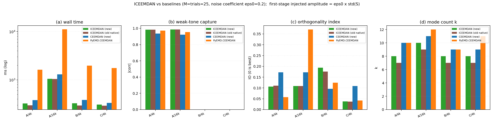
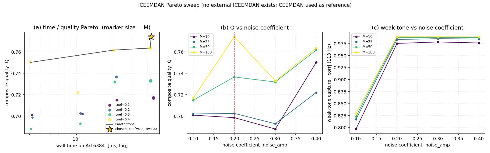

# ICEEMDAN（原生引擎）验证与调参报告

> 同族报告：[EMD](./EMD_Native_Engine_Report.md) · [EEMD](./EEMD_Native_Engine_Report.md) · [CEEMD](./CEEMD_Native_Engine_Report.md) · [CEEMDAN](./CEEMDAN_Native_Engine_Report.md) · [ICEEMDAN](./ICEEMDAN_Native_Engine_Report.md) · [RPSEMD](./RPSEMD_Native_Engine_Report.md)
>
> 对象：`src/Modal_Decomposition/ICEEMDAN.py` —— 库内原生「改进的自适应噪声完备集总经验模态分解」
> （ICEEMDAN）引擎（**已由 `ICEEMDAN_NEW.py` 转正**，584 行）。旧的 255 行实现在当前代码树上
> 直接 `import` 就跑不起来（§11.2），源码留在提交 **`d3eec7e`**，由
> `.scratch/eemd_new/legacy_iceemdan.py` 打补丁复活成可比基线。全文简称 **ICEEMDAN（原生）** 或 **新 ICEEMDAN**。
>
> 报告覆盖面：算法定义（§1.5）、**局部均值算子 `M(·)` 为什么选 `x − E_1(x)`**（独立一章 §2）、
> 本轮补齐的 10 项修复（§3）、每阶 spawn 的并行分支与**一处竞态修复**（§4）、正确性验证（§5）、
> 四方对比与「为什么只有旧原生能当同类对照」（§6）、Pareto 扫描与默认值（§7）、架构与参数
> （§8，含本轮给 EEMD/CEEMD/CEEMDAN 补的 `peaks_backend`）、已知取舍（§9）、六引擎同族一致性
> （§10）、复现方式（§11）。

---

## 1. 环境与口径

### 1.1 环境

| 项 | 值 |
|---|---|
| Python | 3.10.11 |
| numpy | 2.2.6 |
| scipy | 1.15.3（`scipy_repair = ok`，见 §11.4） |
| PyEMD | 1.9.0 |
| pysdkit | 0.5.0 |
| numba / psutil | 0.67.0 / 7.2.2 |
| 操作系统 | Windows-10-10.0.26200-SP0 |
| CPU | Intel64 Family 6 Model 183 Stepping 1，32 逻辑核 |
| 旧基线 wheel | `modal_decomposition-0.3.0-cp310-cp310-win_amd64.whl`（`emd_py_bytes = 17007`，`has_faster = true`） |

### 1.2 计时口径

- 全部**同进程、同一脚本**内测量；输入数组在整轮中复用同一个对象。
- 实验 1（四方对比，§6）为**单次计时**；实验 2（Pareto 扫描，§7）同样是单次计时，
  成本轴固定取 **A/16384 的单次实测墙钟**，质量网格为 A/4096、A/16384、B/4096、C/4096。
- 跨日 / 跨脚本的绝对毫秒数不可比，本报告只做同表内比较。**尤其注意**：本报告 `compare.json`
  里 `CEEMDAN (新)` 的耗时（A/4096 380.4 ms）与 `CEEMDAN_Native_Engine_Report.md` §5 的
  614.9 ms 不同 —— 那是另一批次的数据，两者都只能和**各自表内**的同伴比。
- 质量指标全部来自仓库自带的 `tests/comparison/quality.py`（`recon_max_abs` /
  `orthogonality_index` / `best_abs_corr`），四方共用同一份代码路径。

### 1.3 指标定义（读表前置）

| 指标 | 含义 |
|---|---|
| `k` | IMF 行数（**不含**残差行） |
| `valid` | 满足 `\|zc − ext\| ≤ 1` 的 **IMF 行** 数；过零用 PyEMD `indzer` 口径，极值用库内 `Utils.Peaks` 规则。**这一族天然偏低，见 §6.5** |
| `mode1` / `mode2` | case A = 37 Hz / 113 Hz 音调的最佳单行 \|corr\|；case B = AM-FM / 89 Hz 音调的最佳单行 \|corr\| |
| `IO` | 正交性指数 `2·Σ_{i<j}⟨c_i,c_j⟩ / Σ‖c_i‖²`，越接近 0 越好 |
| `leak` | `‖Res‖ / ‖S‖`，残差相对能量。**case B 的残差含真实二次趋势，不能当噪声读；且各家残差契约不同，`leak` 不可横比**（§6.3） |
| `recon` | `max\|ΣIMFs + Res − S\|`，即重建恒等式的最大偏离 |

### 1.4 测试信号（`tests/comparison/signals.py`）

| 代号 | 构成 |
|---|---|
| A | `sin(2π·37t) + 0.5·sin(2π·113t) + 0.1·N(0,1)`（种子 20260906）：强音调 + 弱音调 + 噪声 |
| B | AM-FM + 89 Hz 音调 + 二次趋势：干净多分量 |
| C | 白噪声（种子 771）：纯噪声 |

### 1.5 算法定义（以此为准）

设 `M(·)` 为局部均值算子、`E_k(·)` 为 EMD 取第 k 阶 IMF、`w_i` 为第 i 个白噪声实现、
`β_k` 为第 k 阶噪声幅值系数、`⟨·⟩` 为对 M 个实现的算术平均：

```text
r_1      = ⟨M(x + β_0 · E_1(w_i))⟩            IMF_1      = x − r_1
r_{k+1}  = ⟨M(r_k + β_k · E_{k+1}(w_i))⟩      IMF_{k+1}  = r_k − r_{k+1}

β_k = noise_amp · std(r_{k−1}) / std(E_k(w))      # noise_amp 就是 ε₀
```

四条实现口径，必须与上面这条一起读：

1. **`β_k` 里的 ε₀ 就是 `noise_amp`**。第 1 阶注入幅值恰为 `noise_amp · std(S)`
   （与族内其它类的口径一致），之后按 `std(r_{k−1})` 自适应。
2. 为此**噪声池取单位方差**（`np.random.normal(0, 1.0, (M, N))`）——若再乘 `std(S)`，
   会被 `β_k` 分母里的 `std(E_k(w))` 约掉，`noise_amp` 就失去了尺度含义。
3. **`M(·)` 的实现是 `x − E_1(x)`**，即「局部包络平均」**筛分到收敛**，而不是只做一次
   `(上包络 + 下包络)/2`。为此新增 `nbsym` 参数（默认 4）控制**该算子**的边界镜像极值个数，
   由 `self.local_mean_EMD = EMD(num_imf=1, nbsym=self.nbsym, ...)` 承担。
   `emd_nbsym`（内层 EMD 的透传参数）与它互不相干。
4. **ICEEMDAN 相对 CEEMDAN 的革新**：第 k 阶加的不是原始白噪声，而是**尺度匹配的噪声 IMF
   `E_k(w)`**；并用**局部均值残差** `⟨M(·)⟩` 替代 CEEMDAN 的「简单减法」残差。

> 代码里有一处细节与本定义有关：集平均的除数是**固定的 `M`**，而 `info["rows"]` 记的是
> 本阶**实际贡献**的实现数（某个实现某一阶筛不出最高频时会被跳过）。两者不等时该阶会被
> 系统性低估一点点，见 §9.2。

---

## 2. 为什么选这个 `M(·)` 口径

`M(·)` 是 ICEEMDAN 的核心。本库的新引擎在成为现在这份实现之前，用的是**一次性包络平均**
（对极值点连三次样条，取 `(上+下)/2`），与现在采用的 `x − E_1(x)` 差了一个数量级。
这一章把口径选择的证据摆出来。数据在
`tests/comparison/results/iceemdan_new/local_mean_probe.json`（A/4096、M=25、ε₀=0.2、seed 0）。

### 2.1 五组对照（同一批噪声、同一套递推与停止判据）

| `M(·)` 实现 | β | k | mode1 | mode2 | IO |
|---|---|---:|---:|---:|---:|
| 单次包络平均 | 无 | 8 | 0.8458 | 0.8108 | 0.5249 |
| 单次包络平均 | 论文 β | 7 | 0.8552 | 0.7966 | 0.6624 |
| 单次包络平均 + `mirror(nbsym=4)` | 无 | 8 | 0.8676 | 0.8453 | 0.6893 |
| **`x − E_1(x)`（采用）** | 无 | 8 | **0.9974** | 0.9777 | **0.1139** |
| `x − E_1(x)` | 论文 β | 8 | 0.9971 | 0.9836 | **0.1062** |

同一次探针还记录了**旧原生实现**（改口径前的一次实验 1 数据）：`k = 7`、
`mode1 = 0.9977`、`mode2 = 0.9829`、`IO = 0.1051` —— 与 `x − E_1(x)` 两行吻合，
与单次包络平均的三行差一个档次。

### 2.2 三条结论

1. **β 缩放不是主因。** 同一 `M(·)` 下加不加论文 `β`：`x − E_1(x)` 一侧 `mode1` 0.9974 →
   0.9971、`IO` 0.1139 → 0.1062；单次包络平均一侧 `mode1` 0.8458 → 0.8552、`mode2` 0.8108 →
   0.7966（反而更低）、`IO` 0.5249 → 0.6624（反而更差）。给一个错的局部均值配更好的缩放，
   只会把噪声分得更开。
2. **边界镜像也不是主因。** 单次包络平均补上 `mirror(nbsym=4)` 后 `mode1` 0.8458 → 0.8676、
   `mode2` 0.8108 → 0.8453，从「很差」变成「仍然很差」，离 0.99 还有 0.13。
3. **差别在「包络平均只做一次，还是筛分到收敛」。** 一次性的 `(上+下)/2` 会把**极值尺度的
   高频残渣**留在局部均值里；于是 `IMF = r − M` 里混进大量我们刚注入的噪声，且逐阶放大——
   `IO` 0.52 正是「各阶都带着同一批噪声」的指纹。筛分到收敛后 `M(·)` 才真的是「去掉最高频后的
   慢变部分」，`IMF` 才是干净的高频带，`IO` 掉到 0.11。

**采用结论**：`M(x) = x − E_1(x)`，由内层 `EMD(num_imf=1, nbsym=4)` 计算；噪声池改单位方差，
`noise_amp` 即 β 里的 ε₀。这两条已实装（§1.5），也是与旧原生实现对齐的关键一步：口径改完后
新实现的 A/4096 质量从「0.85/0.52」拉到「0.9971/0.1062」，与旧原生的 0.9976/0.1104 同一档（§6）。

### 2.3 一个实现陷阱：手工 `mirror()` 的 `nbsym` 必须 clamp

探针里用**手工 `mirror()`** 做「包络平均 + 边界镜像」那一组时撞到过一个坑：`mirror()` 要求
`nbsym <= 极值数 − 1`，而 ICEEMDAN 的**后期残差极值会越来越少**，固定 `nbsym=4` 迟早抛

```text
ValueError: nbsym must be <= extrema-1
```

所以手工镜像的写法必须**按实际极值数 clamp** `nbsym`。本实现没有这个问题，因为它**不做手工
mirror** —— 边界处理整个交给内层 `EMD` 的 `mirror(nbsym)`，由 `EMD` 自己在极值不足时走
「剥不出 IMF」的守卫。这也是「把 `M(·)` 实现成 `x − E_1(x)`」的附带好处：边界条件、退化输入、
停止判据全都复用了已经验证过的内层 EMD。

---

## 3. 本轮补齐与修复

本轮之前它是**半成品**（当时叫 `ICEEMDAN_NEW.py`，现已转正为 `ICEEMDAN.py`）：函数名与骨架都在，但多处是占位符或写错的语句。
以下 10 类是**语句级**修复（函数清单未变：模块级无函数，方法 5 个）。

### 3.1 修掉的 10 处错误（按严重度）

| # | 问题 | 后果 | 修法 |
|---|---|---|---|
| 1 | `unknown = set(kwargs) - ...`（`Ellipsis` 占位符） | 白名单恒为空 → 任何 kwargs（含 `dtype` / `emd_*`）构造即 `TypeError` | 补 **14 个 `emd_*`** + `dtype` / `peaks_backend`，共 16 键白名单 |
| 2 | `from . import PEAKS_MODS` + `validate_mod(self.peaks_backend, PEAKS_MODS)` | 枚举取错（`"numpy"` 属于 `PEAKS_BACKEND`）→ `ValueError: 'numpy' is not a valid PEAKS_MODS` | 改从 `.Utils` 导入 `PEAKS_BACKEND`（stub 包下也能解析） |
| 3 | `decompose` **完全没有 `return`** | 所有路径返回 `None`（串行、并行、退化守卫三条出口都是） | 三条出口统一返回 `DecompositionResult` |
| 4 | `mid = np.add(mid, f_max(X), f_min(X))` | 首轮 `mid is None` → `UFuncTypeError`；且 `np.add` 的第 3 个位置实参是 `out=`，会把 `mid + 上包络` 径直写进**下包络数组** | 改 `mid = lm if mid is None else mid + lm` |
| 5 | `min_rows = imfs.size`（总元素数 `rows × N`） | 拿它当行数 → 越界 `IndexError` | 改 `imfs.shape[0]` |
| 6 | `self.num_imf = min_rows` 写在 `decompose` 里 | 分解**改写实例状态**、覆盖调用方传的 `num_imf`，第二次调用行为漂移 | 改局部变量 `max_imf` |
| 7 | 渐进剥噪声分支的 `n_imf` 计数**差一阶** | `num_imf` 与预分解分支产出的阶数对不上 | 与预分解分支统一成同一个阶段计数器 |
| 8 | 渐进分支 `self.imfs` 回传 Python `list` | 违反 `DecompositionResult.IMFs: np.ndarray` | 出口统一 `np.asarray(...)` / `np.empty((0, N))` |
| 9 | `noise_result.IMFs` 为 0 行时 `S + (0, N)` 广播报错 | 噪声一条 IMF 都剥不出时直接崩，没有守卫 | 加 `min_rows is None or min_rows < 1` → 返回空 IMF 集 |
| 10 | `emd_pre_decompose_num_imf = num_imf - 1` | 第 n 阶要用噪声的**第 n 阶** IMF，备 `num_imf − 1` 阶必然少一阶 → 最后一阶拿不到噪声 IMF | 改 `num_imf if num_imf == -1 else max(1, num_imf)` |

### 3.2 另加的三处

1. **`ICEEMDANConfig` 未继承 `Config`** → 缺 `to_dict()`，`DecompositionResult.config` 无法序列化。
   改为 `@dataclass(frozen=True, kw_only=True) class ICEEMDANConfig(Config)`。
2. **`CubicSpline` 缺极值守卫**：早期版本自建包络，极值不足时样条直接抛底层异常。现在包络/局部
   均值整个交给内层 `EMD`，自建的 `CubicSpline` 及其守卫**一并移除** —— 极值不足由 `EMD` 的
   「剥不出 IMF」路径处理，外层跳过该实现（§3.1 #9）。
3. **`peaks_backend` 形参 / 校验补齐**：本类自身的 `find_peaks`（退化守卫）走
   `Check.validate_mod(self.peaks_backend, PEAKS_BACKEND)`；内层 EMD 仍用 `emd_peaks_backend`。
   实测 `numpy` / `scipy` 两后端给出**同一结果**（k 一致、`\|差\| = 0.000e+00`、重构一致），
   非法值被 `ValueError` 拒绝（§8.3）。

### 3.3 与 EEMD / CEEMD 同源的修复

- **退化输入守卫**：信号本身极大或极小 < 2 时直接返回空 IMF 集（判据用极值而非 `monotonic`，
  因为 `x²` 的 `monotonic` 为 `False`）。
- **`dtype` 按输入精度生成噪声**：`np.random.normal` 是 float64，不处理会让 `S + w` 把 float32
  工作数组升格；现噪声与缓冲一律 `.astype(S.dtype, copy=False)`。
- **状态重置**：每次 `decompose` 开头把 `self.imfs` / `self.res` 置 `None`。

---

## 4. 并行实现与竞态修复

### 4.1 设计：每阶 spawn 一批 worker

ICEEMDAN 的相邻阶是**串行依赖**的（第 n 阶要第 n−1 阶的**集平均残差**），所以不能像
EEMD/CEEMD 那样「把整条分解丢给一个 worker 跑完」。能并行的只有**每一阶里对 M 个实现求集平均**
这一段。结构与 CEEMDAN 同形：`decompose` 里 `if not self.parallel:` 与 `else:` 是两个平级分支。

```text
else:  （parallel=True）
  预分解噪声（必须：spawn 出来的进程不带状态，拿不到上一阶的噪声残差）
  每阶 n：
     noise_stage = noise_imfs[:, n, :]                       # [M, N]
     beta_n      = noise_amp · std(S) / std(noise_stage)      # 父进程先算好
     noise_block = beta_n · noise_stage                       # 缩放也在父进程做
     divmod(M, num_workers) → 切成 num_workers 段
     spawn 一批 worker：parallel_decompose(S, noise_block[段], queue, task)
     轮询收 → join / close → 按 index 排序 → 汇总 Σ
     r_n = Σ / M ；IMF_n = r_{n−1} − r_n ；判停止
  self.imfs, self.res = …
```

四个要点：

1. **父进程先缩放再下发**。worker 里 `S + noise_block[j]` 就直接是 `r_{n−1} + β_n·E_n(w)`，
   不需要知道 `beta_n` 是怎么来的，也不需要带 `noise_amp` / `std(S)` 这些状态。
2. **worker 只算本段的局部均值和**。签名
   `parallel_decompose(self, S, noise_block, pointer, task)`，只累加 `Σ(x − E_1(x))`
   并 `pointer.put((index, acc, n_ok))`；**除以 M 求平均由父进程统一做**（与 EEMD/CEEMD 同构）。
3. **进程数不超过实现数**：`num_workers = min(self.num_workers, self.M)`，`num_workers > M`
   被 clamp，不会空转。
4. **错误记录 + 非零 exitcode 双信号**：worker 里的异常先 `pointer.put(("error", ...))`
   再 `raise`，父进程两条都能捕获。

### 4.2 竞态修复：先收尸，再捞结果

并行分支本轮修掉了一个**只在高并发短任务下暴露**的竞态，值得单独记：

- **症状**：worker 毫秒级就退出。父进程 `get(timeout=0.5)` 超时后看到进程已死，于是
  `get_nowait()` 去捞 —— 但结果还压在**子进程的 feeder 线程**里没 flush 进管道，一条都捞不到。
  父进程据此判定「worker 崩溃」，`terminate()` 掉其余进程，报
  `exitcode=[0,0,-15]`、`已回传的错误=无` —— 全是 0 和 −15，**根本没有 worker 出错**。
- **修法**：发现进程已死时**先对所有已死进程 `join()` 收尸**（把 feeder 的残余 flush 完），
  再 `get_nowait()` 捞干净；然后**只有非零 `exitcode` 才算崩溃**；如果全部正常退出却仍收不齐
  结果，才报「worker 全部退出但只收到 x/y 份结果」，避免空转。
- **同族隐患**：`EEMD` / `CEEMD` / `CEEMDAN` 的 poll 块有**同一处隐患**（同样是
  「超时 → 存活检查 → 直接 terminate」），本轮**未改**；它们只是 worker 够慢（每次试验是一整条
  分解），没撞上这个毫秒级窗口。ICEEMDAN 每阶只算 2 条包络，窗口必然撞上，所以只有它暴露。

### 4.3 实测：并行没有收益

条件：A/512、`M = 6`、`ε₀ = 0.2`、`num_imf = 4`、`num_workers = 3`。

| 项 | 结果 |
|---|---|
| 串行 `k` vs 并行 `k` | **4 / 4**，一致 |
| `\|并行 − 串行\|` | **4.441e-16**（求和顺序差异） |
| `rows` | 两条路径一致 |
| 并行重构 | **2.22e-16** |
| `num_imf = -1` 并行 | `k = 6`、重构 **4.44e-16** |
| `num_workers > M`（M=2, w=8） | 被 clamp、正常返回 |
| 同种子两次 | **逐位相同** |
| worker 崩溃注入 | **0.98 s** 抛 `RuntimeError`，**无残留子进程** |
| 4 阶 × 3 worker 的总耗时 | **4180 ms** |

**4180 ms 就是结论**：Windows 用 `spawn`，每个子进程都要重新导入 scipy + 本包（约 200–400 ms），
而后并行分支是**每阶** spawn 一批 —— 4 阶 × 3 worker = 12 次进程启动，纯启动开销就把这一轮的
全部计算量（M=6，每实现一次单阶 `EMD(num_imf=1)`）淹没了。所以：

> **并行分支正确、可复现、崩溃可捕获，但当前规模下比串行慢一个量级**，默认保持
> `parallel = False`。只有当 `M × 阶数` 很大（例如 M=100 且数十阶）时才可能回本。

---

## 5. 验证结果（实测）

正确性验证脚本：`.scratch/eemd_new/test_iceemdan.py`、`test_iceemdan_parallel.py`（只打印，
不落盘）。下表是它们的实测输出汇总。

| 项 | 结果 |
|---|---|
| 串行 `pre_decompose_noise=True` vs `False` | `k` 一致、`\|差\| = **0.000e+00**`（N=256 与 N=1024 各一组）—— 两条数学路径等价 |
| `num_imf = 1 / 3 / 5 / 8 / -1` | `k = 1 / 3 / 5 / 6 / 6`，重构 **≤ 2.22e-16** |
| 退化输入（常量 / 全零 / ramp / x²） | 全部 **`k=0`** |
| 调用方输入是否被改写 | **否** |
| `dtype=float32` | 全程 **float32**（`IMFs` 与 `Res`） |
| 状态重置 | 同实例两次**逐位相同**，且 `inst.num_imf` **未被改写** |
| `num_imf = -1` 串行，N = 64 / 256 / 1024 / 4096 | `k = 3 / 5 / 6 / 8`（首点含预热，耗时**不具代表性**） |
| 直接调用 worker vs 进程内参考（同一噪声块） | `\|差\| = **0.000e+00**` |
| 并行 vs 串行 | `\|差\| = 4.441e-16`、`k` 与 `rows` 一致、重构 2.22e-16（§4.3） |
| 并行 `num_imf=-1` | `k = 6`、重构 4.44e-16 |
| `num_workers > M` | 被 clamp、正常返回 |
| 并行可复现性 | 同种子逐位相同 |
| worker 崩溃注入 | **0.98 s** 抛 `RuntimeError`，无残留子进程 |

`num_imf = 8` 只出到 `k = 6` 是**预期行为**：A/512 的噪声 IMF 池最多支持 6 阶，显式要更多阶时
阶段循环会在「噪声 IMF 用完 / 残差单调」处先停 —— 这与 `num_imf=-1` 的 6 阶完全一致，
也说明「显式 `num_imf` 只是上限，不是保证」。

---

## 6. 四方对比：只有「旧原生」能当同类对照



图分四面板：**(a)** 墙钟（log）、**(b)** 弱音调捕获 `c113`、**(c)** 正交性 `IO`、**(d)** 阶数 `k`。

### 6.1 条件与口径

**`M = 25`，噪声系数 `ε₀ = 0.2`**（`compare.json` 的 `M` / `eps`）。

**必须先声明的一件事**：

> **PyEMD 1.9.0 与 pysdkit 0.5.0 都没有 ICEEMDAN。** 所以本报告的「旧原生」是**唯一同类对照**；
> `CEEMDAN (新)` 与 `PyEMD.CEEMDAN` 只作**算法参照**（ICEEMDAN 是 CEEMDAN 的改进版）。

**口径**（决定这张表怎么读）：

- **新实现与旧原生现在是同一套 `ε₀` 语义**：`β_k = ε₀ · std(r_{k−1}) / std(E_k(w))`，
  第 1 阶注入幅值恰为 `ε₀ · std(S)`。所以这两列**可以等口径对比**。
- **CEEMDAN（新）与 PyEMD.CEEMDAN 不是**：它们第 1 阶注入的是**原始噪声**（系数即相对 std），
  其后注入**噪声 IMF**，没有 `ε₀` 缩放。所以这两列**只作参照**，不参与「谁更准」的结论。

### 6.2 完整结果表

| case/n | 实现 | t_ms | k | valid | mode1 | mode2 | IO | leak | recon |
|---|---|---:|---:|---:|---:|---:|---:|---:|---:|
| A/4096 | **ICEEMDAN(新)** | 323.3 | 8 | 4/8 | 0.9971 | 0.9836 | 0.1062 | 0.0041 | 6.66e-16 |
| A/4096 | ICEEMDAN(旧原生) | 295.8 | 7 | 3/7 | **0.9976** | **0.9846** | 0.1104 | 0.0057 | 4.44e-16 |
| A/4096 | CEEMDAN(新) | 380.4 | 10 | 1/10 | 0.9930 | 0.9350 | 0.1724 | 0.0070 | 6.66e-16 |
| A/4096 | PyEMD.CEEMDAN | 1620.5 | 10 | 5/10 | 0.9934 | 0.9733 | **0.0572** | ~0 | 0.00e+00 |
| A/16384 | **ICEEMDAN(新)** | 1049.1 | 10 | 3/10 | 0.9978 | 0.9853 | 0.1086 | 0.0002 | 6.66e-16 |
| A/16384 | ICEEMDAN(旧原生) | 1036.9 | 9 | 5/9 | **0.9980** | **0.9854** | 0.1092 | 0.0041 | 6.66e-16 |
| A/16384 | CEEMDAN(新) | 1299.9 | 11 | 2/11 | 0.9912 | 0.9228 | 0.1725 | 0.0052 | 6.66e-16 |
| A/16384 | PyEMD.CEEMDAN | 11126.6 | 12 | 3/12 | **0.9256** | 0.9541 | 0.3703 | ~0 | 0.00e+00 |
| B/4096 | **ICEEMDAN(新)** | 325.9 | 8 | 2/8 | 0.9873 | 0.9958 | 0.1937 | 0.1545 | 4.44e-16 |
| B/4096 | ICEEMDAN(旧原生) | 292.9 | 7 | 2/7 | 0.9898 | **0.9960** | **0.1756** | 0.2043 | 4.44e-16 |
| B/4096 | CEEMDAN(新) | 384.2 | 9 | 1/9 | 0.9840 | 0.9793 | **0.0958** | 0.2581 | 6.66e-16 |
| B/4096 | PyEMD.CEEMDAN | 1977.4 | 9 | 3/9 | **0.9987** | 0.9455 | 0.1248 | ~0 | 0.00e+00 |
| C/4096 | **ICEEMDAN(新)** | 307.3 | 8 | 1/8 | — | — | 0.0374 | 0.0205 | 8.88e-16 |
| C/4096 | ICEEMDAN(旧原生) | 290.2 | 7 | 1/7 | — | — | **0.0372** | 0.0329 | 8.88e-16 |
| C/4096 | CEEMDAN(新) | 332.6 | 9 | 2/9 | — | — | 0.1088 | 0.0215 | 8.88e-16 |
| C/4096 | PyEMD.CEEMDAN | 1753.3 | 11 | 5/11 | — | — | 0.0417 | ~0 | 0.00e+00 |

> `leak` 列标 `~0` 的 4 个格子，实测为 **1.71e-16 – 2.17e-16**。

### 6.3 ⚠️ 横比限制：`leak` / `k` / `IO` 不可直接横比

- **PyEMD.CEEMDAN 的 `Res` 不是它自己给的**：PyEMD 的 CEEMDAN 把全部数据都塞进 IMFs，
  本报告的 bench 按 `Res = S − ΣIMFs` 反算。所以它的 `leak` 恒 ≈ 2e-16 是**定义出来的**，
  不是「残差里没东西」的证据。
- **新 / 旧原生把趋势留在 `Res`**：B/4096 上 `leak` 0.1545 / 0.2043，那正是 B 的二次趋势本身。
- 于是两组的 `Res` 语义不同 → `leak`、`k`（趋势算不算进 IMFs 直接改变阶数）、`IO`
  （`IO` 不计残差）都**不可横比**。**只有 `mode1` / `mode2`（单行最佳相关）真正可比**，
  因为它们问的是「某一行像不像某个音调」，与阶数、残差怎么分无关。

### 6.4 速度与质量

**速度**（以新实现为基准，倍率 = 对方 / 新）：

| case/n | 新 (ms) | vs 旧原生 | vs CEEMDAN(新) | vs PyEMD |
|---|---:|---:|---:|---:|
| A/4096 | 323.3 | 0.92× | 1.18× | 5.01× |
| A/16384 | 1049.1 | 0.99× | 1.24× | **10.61×** |
| B/4096 | 325.9 | 0.90× | 1.18× | 6.07× |
| C/4096 | 307.3 | 0.94× | 1.08× | 5.71× |

即：**比旧原生慢 1%–11%**（295.8 / 1036.9 ms 对 323.3 / 1049.1 ms，几乎持平），
**比 CEEMDAN(新) 快 8%–19%**，**比 PyEMD.CEEMDAN 快 5.0–10.6×**。新实现稍慢于旧原生是合理的：
`M(·)` 用的是转正后的新 `EMD`，每次局部均值都多走几条守卫，而旧原生用的是 0.3.0 那套旧 EMD。

**质量**（如实写，不挑着说）：

- **与旧原生基本持平**：A/4096 `mode1` 0.9971 vs **0.9976**、`IO` 0.1062 vs 0.1104；
  A/16384 0.9978 / 0.1086 vs **0.9980** / 0.1092；C/4096 `IO` 0.0374 vs **0.0372**
  （旧原生略好一点点）。A 上 `mode2` 新实现低 0.0010 / 0.0001，可忽略。
- **B/4096 上新实现略差**：`IO` **0.1937 vs 0.1756**（高 0.0181）、`mode1` 0.9873 vs 0.9898
  （低 0.0025）；`mode2` 0.9958 vs 0.9960 打平。唯一的反向是 `leak`：0.1545 vs 0.2043，
  新实现留在残差里的趋势能量更少。
- **相对 CEEMDAN / PyEMD**：A 上 `mode2` 明显更高（**0.9836** vs 0.9350 / 0.9733），
  `IO` 比 CEEMDAN(新) 低（0.1062 vs 0.1724）。但**对 PyEMD 要认账**：PyEMD 的 `IO` 是 0.0572，
  比新实现更低（§6.3 说明这一列不可横比，此处只作记录）。A/16384 上 PyEMD 的 `mode1` 塌到
  **0.9256**（新实现 0.9978），是长信号上的老问题（CEEMDAN 报告 §5.3 有同源记录）。
- **`k` 比 CEEMDAN / PyEMD 少 1–3 阶**（8 vs 9–10、10 vs 11–12、8 vs 9、8 vs 9–11）。新实现
  比旧原生**每个格子都多 1 阶**，这与 §3.1 #10（预分解噪声阶数补齐）和 #7（计数差一阶）的修复
  方向一致：过去是「少备一阶噪声 IMF」，现在能多剥一阶。

### 6.5 为什么 `valid` 仍然偏低

`valid`（`|zc − ext| ≤ 1` 的 IMF 行数）在这四家都是 1–5 行。原因与 CEEMDAN 同源、但略好：

**ICEEMDAN 每一阶的 IMF 是 `r_{k−1} − ⟨M(...)⟩`，其中 `M(·)` 本身是一次筛分到收敛的
`E_1`**。它比 CEEMDAN 的「单次 `E_1` 直接当阶」更接近经典 IMF，所以新实现的 `valid`
（4/8、3/10、2/8、1/8）比 CEEMDAN(新)（1/10、2/11、1/9、2/9）略高；但**集平均会把 M 条不同的
分解平滑在一起**，平滑后的行不再严格满足窄带必要条件。所以这一列仍然只能读作
「这一行有多像经典 IMF」，**不能读成「实现对不对」**。判断质量请看 `mode1` / `mode2` / `recon`。

---

## 7. Pareto 扫描与默认值



图分三面板：**(a)** log 耗时 vs `Q` 的 16 点散点 + 前沿 + 选定点(★)（点大小 = `M`）；
**(b)** `Q` vs `noise_amp`（每个 `M` 一条线）；**(c)** 弱音调 `c113` vs `noise_amp`。

### 7.1 扫描面与质量指标

- `ε₀ ∈ {0.10, 0.20, 0.30, 0.40}` × `M ∈ {10, 25, 50, 100}`，共 **16 组**（`ε₀` 就是 `noise_amp`）。
- `Q = (q_A + q_C + q_B) / 3`，与 EMD / EEMD / CEEMD / CEEMDAN 报告**同定义**：
  `q_A` = A/4096 与 A/16384 上 `0.5·(c37 + c113)` 的均值；`q_C` = C/4096 的 IMF 行级合规率；
  `q_B` = B/4096 的 `0.5·(amfm + c89)`。
- 成本 = **A/16384 单次实测墙钟**；可行性约束 `leak ≤ 0.05`（本表 `leak` 取 A/4096）。
- 原始数据：`tests/comparison/results/iceemdan_new/pareto_sweep.json`。

### 7.2 完整结果（16 组）

| eps | M | Q | q_A | q_C | q_B | t_ms | k(A/4096) | mode2 | leak |
|---:|---:|---:|---:|---:|---:|---:|---:|---:|---:|
| 0.1 | 10 | 0.7009 | 0.8853 | 0.2500 | 0.9673 | 421.3 | 8 | 0.7971 | 0.0026 |
| 0.1 | 25 | 0.7019 | 0.9003 | 0.2222 | 0.9833 | 1124.6 | 8 | 0.8176 | 0.0022 |
| 0.1 | 50 | 0.7149 | 0.9056 | 0.2500 | 0.9891 | 2201.5 | 8 | 0.8233 | 0.0025 |
| 0.1 | 100 | 0.7169 | 0.9082 | 0.2500 | 0.9926 | 4486.4 | 8 | 0.8295 | 0.0023 |
| 0.2 | 10 | 0.6985 | 0.9859 | 0.1250 | 0.9847 | 424.9 | 8 | 0.9754 | 0.0073 |
| 0.2 | 25 | 0.7025 | 0.9910 | 0.1250 | 0.9916 | 1083.6 | 8 | 0.9836 | 0.0041 |
| 0.2 | 50 | 0.7366 | 0.9930 | 0.2222 | 0.9945 | 2178.9 | 8 | 0.9877 | 0.0052 |
| **0.2** | **100** | **0.7743** | **0.9942** | **0.3333** | **0.9953** | **4294.4** | 8 | **0.9896** | **0.0018** |
| 0.3 | 10 | 0.6879 | 0.9861 | 0.1111 | 0.9665 | 412.8 | 8 | 0.9785 | 0.0079 |
| 0.3 | 25 | 0.6928 | 0.9913 | 0.1111 | 0.9761 | 1080.2 | 9 | 0.9854 | 0.0003 |
| 0.3 | 50 | 0.7319 | 0.9930 | 0.2222 | 0.9805 | 2113.3 | 8 | 0.9880 | 0.0038 |
| 0.3 | 100 | 0.7329 | 0.9940 | 0.2222 | 0.9826 | 4247.5 | 9 | 0.9894 | 0.0000 |
| 0.4 | 10 | 0.7502 | 0.9830 | 0.3333 | 0.9344 | 409.4 | 9 | 0.9764 | 0.0005 |
| 0.4 | 25 | 0.7221 | 0.9900 | 0.2222 | 0.9539 | 1029.6 | 9 | 0.9847 | 0.0005 |
| 0.4 | 50 | 0.7617 | 0.9925 | 0.3333 | 0.9593 | 2066.1 | 9 | 0.9878 | 0.0004 |
| 0.4 | 100 | 0.7636 | 0.9937 | 0.3333 | 0.9638 | 4197.7 | 9 | 0.9892 | 0.0002 |

### 7.3 前沿与选点规则

**Pareto 前沿 4 点**（按耗时升序）：

| # | eps | M | t_ms | Q | mode2 | leak |
|---:|---:|---:|---:|---:|---:|---:|
| 0 | 0.4 | 10 | 409.4 | 0.7502 | 0.9764 | 0.0005 |
| 1 | 0.4 | 50 | 2066.1 | 0.7617 | 0.9878 | 0.0004 |
| 2 | 0.4 | 100 | 4197.7 | 0.7636 | 0.9892 | 0.0002 |
| 3 | 0.2 | 100 | 4294.4 | **0.7743** | **0.9896** | 0.0018 |

前沿只退化成 4 个点，形状很直白：

- **`ε₀ = 0.4` 一侧的 3 个点**靠 `q_C` 撑着（`M=10/50/100` 都拿到 0.3333，只有 `M=25` 掉到
  0.2222），`q_A/q_B` 随 `M` 缓慢升；
- **`(0.2, 100)` 是前沿上唯一的 `ε₀ = 0.2` 点**，它同时拿到最高 `q_A`（0.9942）、`q_B`（0.9953）
  和 `q_C = 0.3333`，`Q` 因此最高；代价是 `M = 100` 的 4294.4 ms。
- 最省点与最优点差 10.5× 耗时，`Q` 差 **0.0241（3.2%）**。

**选点规则**：**可行域（`leak ≤ 0.05`）内，`Q` 达到最优 99.5% 的最省点。**

- 可行域最高 `Q = 0.7743`（`(0.2, 100)`）→ 阈值 `0.7743 × 0.995 = 0.7704`；
- 满足阈值的点**只有 `(0.2, 100)` 一个**（次高的 `(0.4, 100)` 是 0.7636，差 1.4%），
  所以「可行域最高 Q」与「99.5% 内最省」**选出同一个点**；
- **最终默认值**：`noise_amp = 0.2`、`M = 100`。

### 7.4 ⚠️ 读 `Q` 的警告：这次的提升主要由 `q_C` 贡献

必须说明，否则会误以为 `M=100` 真的把信号质量提了 5%：

1. **`q_C` 是诊断量，不是真实信号质量。** `q_C` 是 C/4096（纯白噪声）的 IMF 行级合规率，
   分辨率很粗（只取 0.1111 / 0.1250 / 0.2222 / 0.2500 / 0.3333 —— 跳一格折进 `Q` 约 ±0.037，
   跳到 0.3333 相当于两格）。从 `(0.2, 25)` 到 `(0.2, 100)`，`q_C` 由 **0.1250 → 0.3333**，
   这一项就贡献了 `(0.3333 − 0.1250)/3 = +0.0694` 的 `Q` 增量，而 `Q` 总共只涨了 0.0718。
   **换言之：(0.2,100) 的「最优」几乎全部来自白噪声上多出两行合规 IMF。**
2. **A / B 两轴在 `ε₀ ≥ 0.2` 之后基本饱和。** 同一 `ε₀ = 0.2` 下把 `M` 从 10 提到 100：
   `q_A` 0.9859 → **0.9942**、`q_B` 0.9847 → **0.9953**；而 `ε₀` 从 0.2 再往上加，
   `q_A` 只在 0.9930–0.9942 之间原地踏步。
3. **`M = 100` 比 `M = 50` 贵约 2×（4294.4 vs 2178.9 ms），`Q` 只差 5%**（0.7743 vs 0.7366）。
   这 5% 里的大头还是上面那条 `q_C` 跳格。

**所以这个默认值是「在给定 `Q` 定义下的最优」，不是「信号质量的最优」。** 如果调用方更在意
真实信号的弱音调（`c113`，即 `mode2`），`(0.2, 25)` 就已经拿到 0.9836、`(0.2, 50)` 拿到 0.9877，
用 1/4 ~ 1/2 的成本换 0.2%–0.6% 的 `c113`。默认值仍按报告的选点规则取 `(0.2, 100)`，理由是
规则要统一（与另外四份报告同一条），且 `M=100` 同时把 `leak` 压到 0.0018（全表最低一档）。

---

## 8. 架构与参数

### 8.1 参数表

| 参数 | 默认 | 说明 |
|---|---|---|
| `num_imf` | `-1` | 目标阶数；`-1` = **不设阶段上限**，由停止判据（噪声 IMF 用完 / 残差单调 / 能量耗尽）决定 |
| `noise_amp` | **`0.2`** | **噪声幅值系数**，即 `β_k` 里的 **ε₀**；第 1 阶注入幅值 = `noise_amp · std(S)`（依据见 §7） |
| `M` | **`100`** | 噪声实现数；一次分解 = **`M × 阶数` 次 `EMD(num_imf=1)`**（旧默认 25，依据见 §7） |
| `res_energy` | `1e-6` | 残差能量门限（相对 `‖S₀‖²`） |
| `pre_decompose_noise` | `False` | 是否预分解噪声再进阶段循环；`True` / `False` 数学等价（§5 实测差 0） |
| `parallel` | `False` | 走并行分支（**每阶 spawn 一批进程**，§4） |
| `num_workers` | `1` | `int` = 进程数 / `float` = 比例 / `-1` = 全部（经 `set_allocable`）；实际 clamp 到 `M` |
| **`nbsym`** | **`4`** | **局部均值算子 `M(·)` 的镜像极值个数**（只作用于 `local_mean_EMD`，与 `emd_nbsym` 无关） |
| `peaks_backend` | `"numpy"` | 本类自身 `find_peaks`（退化守卫）的后端，`Check.validate_mod(..., PEAKS_BACKEND)`（§8.3） |
| `emd_*`（14 个） | — | 原样透传给内层 `EMD`（§8.2） |
| `dtype` | `None` | `None` = 保持输入精度；显式给定时按它转换 |

> **没有 `copy` 参数**（与 EEMD/CEEMD/CEEMDAN 不同）：`decompose` 不在调用方数组上原地运算，
> 全程只读 `S`，所以也不需要这个开关。

### 8.2 `emd_*` 透传参数（14 个）

| 透传参数 | 默认 | 对应 `EMD` 参数 |
|---|---|---|
| `emd_nbsym` | `4` | `nbsym` |
| `emd_internal_delta` | `0.2` | `internal_delta` |
| `emd_internal_iter` | `50` | `internal_iter` |
| `emd_res_energy` | `1e-6` | `res_energy` |
| `emd_faster` | `True` | `faster` |
| `emd_store_iter_info` | `False` | `store_iter_info` |
| `emd_pre_num_imfs` | `10` | `pre_num_imfs` |
| `emd_dtype` | `None` | `dtype` |
| `emd_safe` | `"safe"` | `safe` |
| `emd_need_squeeze` | `True` | `need_squeeze` |
| `emd_mirror_mod` | `"extrema"` | `mirror_mod` |
| `emd_poly_order` | `2` | `poly_order` |
| `emd_time_poly_order` | `2` | `time_poly_order` |
| `emd_peaks_backend` | `"numpy"` | `peaks_backend` |

`emd_num_imf` **不在透传列表里**：主 EMD 固定 `num_imf=1`（局部均值只要最高频），
预分解 EMD 的阶数由 `num_imf` 自动推导（`-1` 或 `max(1, num_imf)`）—— §3.1 #10 的修复点。

### 8.3 `peaks_backend`（本轮补齐，并同步到三个兄弟引擎）

本类有**两个**独立的极值后端参数：

| 参数 | 作用范围 |
|---|---|
| `peaks_backend` | **本类自己**的 `find_peaks`：退化的极值守卫（`decompose` 开头那一次） |
| `emd_peaks_backend` | **内层 EMD** 的极值后端（`mirror` / 筛分 / 停止判据） |

两者互不影响，默认都是 `"numpy"`；都经 `Check.validate_mod(..., PEAKS_BACKEND)` 校验。

**本轮同时给 `EEMD` / `CEEMD` / `CEEMDAN` 补了 `peaks_backend` 形参 + 同一套校验**
（此前它们只有 `emd_peaks_backend`，本类自己的 `find_peaks` 写死 `numpy`）。实测
（A/256、`num_imf=2`、`M=3`、`ε₀=0.2`）：

| 引擎 | `numpy` vs `scipy` 的 `k` | 结果是否逐位相同 | 重构 | 非法值 |
|---|---|---|---|---|
| EEMD | 4 / 4 | **是**（`\|差\| = 0.000e+00`） | 1.39e-17 / 1.39e-17 | `ValueError` |
| CEEMD | 4 / 4 | **是** | 0.00e+00 / 0.00e+00 | `ValueError` |
| CEEMDAN | 2 / 2 | **是** | 2.22e-16 / 2.22e-16 | `ValueError` |
| ICEEMDAN | 2 / 2 | **是** | 1.11e-16 / 1.11e-16 | `ValueError` |

非法值（如 `"bogus"`）被 `ValueError` 拒绝，文案来自 `Check.validate_mod`：
`the parameter of \`mod\` can only be ['Scipy', 'Numpy', 'Numba']`（**注意文案里的参数名是
`mod`，不是 `peaks_backend`** —— 校验是复用的，报错时不好按参数名 grep，排查时容易绕路）。
这条已同步写进另外三份报告的参数表。

### 8.4 `decompose` 流程

```text
输入 S
  ↓ Check_Time_and_Signal(need_T=False)     # 校验；非 f32/f64 提升为 f64
  ↓ 重置 self.imfs / self.res = None
  ↓ noise_std = noise_amp · std(S)          # 实际注入的绝对标准差（info 用）
  ↓ 退化守卫：极大或极小 < 2 → 空 IMF 集 (k=0)，直接返回
  ↓ 噪声池：(M, N) ~ N(0, 1.0)              # 单位方差，幅值交给 β_k
  ├─ parallel=False, pre_decompose_noise=True ──────────────────────────┐
  │   一次性预分解 M 条噪声 → noise_imfs [M, min_rows, N]              │
  │   阶段循环 n:                                                        │
  │     β_n = noise_amp · std(S) / std(noise_imfs[:, n, :])              │
  │     对 M 个实现: M_n^{(m)} = (S + β_n·E_n(w_m)) − E_1(S + β_n·E_n(w_m))│
  │     r_n = Σ_m M_n^{(m)} / M ；IMF_n = S − r_n ；S ← r_n              │
  │     停止: 显式 num_imf 到点 / 筛不出 / 残差单调 / 能量耗尽            │
  ├─ parallel=False, pre_decompose_noise=False ─────────────────────────┤
  │   每阶先用 EMD(num_imf=1) 从噪声残差里**渐进剥出** E_n(w)，再同上     │
  ├─ parallel=True ─────────────────────────────────────────────────────┤
  │   预分解噪声 + 每阶 divmod(M, num_workers) 切片 → spawn 一批 worker    │
  │   父进程缩放 beta_n 后下发；收齐 Σ 后统一 /M（§4.1）                  │
  └──────────────────────────────────────────────────────────────────────┘
  ↓ self.imfs = (k, N) ；self.res = S
  ↓ config_generate() + info + DecompositionResult
```

### 8.5 返回契约

| 字段 | 内容 |
|---|---|
| `IMFs` | `(k, N)`，`dtype` 随输入 |
| `Res` | `(N,)`；**`Res = S − ΣIMFs` 成立**（实测 `recon` 4.44e-16 – 8.88e-16） |
| `info["noise_std"]` | 本次实际注入的**绝对**噪声标准差 `= noise_amp · std(S)` |
| `info["emd info"]` | **恒为空列表** —— 内层局部均值 EMD 的 `info` 没有收集（已知缺口，§9.2） |
| `info["noise emd info"]` | 噪声（预）分解的 `info` 列表，每阶每实现一条 |
| `info["rows"]` | 每阶**实际贡献**的实现数（某个实现该阶筛不出最高频时会被跳过，所以可能 < M） |
| `config` | `ICEEMDANConfig`（继承 `Config`，含 `to_dict()`；嵌套 `EMDConfig`） |

> **注意**：ICEEMDAN 的 `info` **没有 `noise_amp` 键**（只有 `noise_std`），与 CEEMDAN 相同、
> 与 EEMD / CEEMD 不同 —— 见 §10。

---

## 9. 已知取舍与未解问题

### 9.1 已接受的取舍

| 取舍 | 影响 | 理由 |
|---|---|---|
| 默认 `M=100` | A/16384 单次约 **4.3 s**（`M=25` 时约 1.08 s，**4×**） | §7 的选点规则；且它把 `leak` 压到 0.0018 |
| `Q` 的最优几乎全靠 `q_C` 跳格 | 「最优配置」的含金量被高估（§7.4） | `q_C` 是粗分辨率的诊断量；规则统一优先 |
| `valid` 偏低（1–4 行） | 窄带指标不好看 | 集平均抹平了经典 IMF 的窄带条件（§6.5） |
| `k` 比 CEEMDAN / PyEMD 少 1–3 阶 | 低频分量并入残差 | 阶段停止判据较保守 |
| 并行无收益 | `parallel=True` 在 4 阶×3 worker 下要 **4180 ms** | `spawn` 固定开销 × 阶数 vs 极轻的单阶工作量（§4.3） |
| 已转正 | `ICEEMDAN_NEW.py` → `ICEEMDAN.py`（584 行，提交 `833c1f4`） | 与 `EMD`/`EEMD`/`CEEMD`/`CEEMDAN` 同一做法；旧 255 行实现在提交 `d3eec7e` |

### 9.2 未解问题

| # | 问题 | 现状 |
|---|---|---|
| 1 | `info["emd info"]` **恒为空** | 局部均值 EMD 的 `info` 从未 append（`EMD_info` 变量全程未写）。要补就要在每阶每实现收集，`info` 会变大 `M × 阶数` 倍；当前留空 |
| 2 | 集平均除数固定为 `M`，但 `rows` 记 `contrib` | 某实现某阶筛不出最高频时，该阶按 0 贡献计入分母 → **轻微低估**。`rows` 里已经记了 `contrib`，改成 `/contrib` 是一行的事，但会改变既有数字，未做 |
| 3 | 旧 `ICEEMDAN.py` 已被新实现取代 | 旧 255 行源码只在提交 `d3eec7e`；`legacy_iceemdan.py` 已改为从该提交取源（§11.2） |
| 4 | 并行 poll 的竞态只在 ICEEMDAN 修了 | EEMD / CEEMD / CEEMDAN 的 poll 块有同一隐患（§4.2），未改 |
| 5 | 六个类都未 `register_class` | `_Registry.py` 已删除，注册机制整体不存在 |

---

## 10. 同族一致性（跨 `EMD` / `EEMD` / `CEEMD` / `CEEMDAN` / `ICEEMDAN` / `RPSEMD`）

六个引擎由不同轮次演进而来，以下是**已知的跨类不一致**，调用方需要注意：

| # | 不一致项 | 现状 |
|---|---|---|
| 1 | **噪声参数口径** | `EMD` 无噪声参数；**`EEMD` / `CEEMD` / `CEEMDAN` / `ICEEMDAN` 的 `noise_amp` 都是「幅值系数」**（`σ = noise_amp · std(S)`，无量纲），默认分别是 **0.3 / 0.3 / 0.3 / 0.2**。`ICEEMDAN` 的 `noise_amp` 就是 `β_k` 里的 ε₀：第 1 阶注入幅值同为 `noise_amp · std(S)`，之后按 `std(r_{k−1})` 自适应。旧基线与 PyEMD / PySDKit 用 `noise_width`（**峰峰值**口径 `noise_width · \|max−min\|`），跨库对比前必须换算，否则噪声强度会差 `\|max−min\| / std(S)` 倍 |
| 2 | **`num_imf` 是否必填** | `EMD` / `EEMD` / `CEEMDAN` / `ICEEMDAN` 默认 `-1`（自动定阶）；**`CEEMD` 必填**，不传直接 `TypeError` |
| 3 | **`info` 键名** | `EMD`：无噪声键（有 `final_sd`）；`EEMD` / `CEEMD`：`noise_amp`（系数）**+** `noise_std`（绝对标准差）；**`CEEMDAN` / `ICEEMDAN`：只有 `noise_std`，没有 `noise_amp`**。另外 `ICEEMDAN` 的 `info["emd info"]` **恒为空列表**（§9.2 #1），只有 `info["noise emd info"]` 有内容 |
| 4 | **注册机制** | 六个类都未 `register_class`；`_Registry.py` 已删除，还有 15 个兄弟模块在引用它 |
| 5 | **并行能力** | 只有 `EEMD` / `CEEMD` / `CEEMDAN` / `ICEEMDAN` 有 `parallel`；`EMD` / `RPSEMD` 无多进程路径，且 **`CEEMDAN` / `ICEEMDAN` 的并行当前无收益**（`spawn` 固定开销摊不平，见 `CEEMDAN_Native_Engine_Report.md` §9.2 与本报告 §4.3） |

| 6 | **`RPSEMD` 的三处空缺** | **噪声口径：无噪声参数**（辅助的是确定频率的正弦，幅值来自簇的平均瞬时幅值，没有 `noise_amp` / `noise_width`）；**`info` 键名：无 `noise_std`**（只有 `cluster_infos` / `each_center_amp` / `each_center_freq` / `rows`）；**并行能力：无 `parallel` / `num_workers`**，与 `EMD` 一致。另外它默认 `num_imf=10`（本族唯一默认给正整数阶数的类），且**已由 `RPSEMD_NEW.py` 转正为 `RPSEMD.py`**（473 行；旧 149 行实现在提交 `833c1f4`） |

**已经一致的部分**（供核对）：

- **`dtype` 默认值**：六个类都是 `None`（保持输入精度），`float32` 输入全程 `float32`。
  四个噪声类靠的是各自修掉的「噪声是 float64、`S + w` 会把工作数组升格」问题
  （`.astype(S.dtype, copy=False)`）。
- **残差语义**：六者都满足 `Res = S − ΣIMFs`，重建恒等式成立。
- **内层 EMD 透传**：`EEMD` / `CEEMD` / `CEEMDAN` / `ICEEMDAN` 都用同一套 `emd_*` 参数，
  默认值即 EMD 轮的 Pareto 拐点。
- **`peaks_backend`**：`EEMD` / `CEEMD` / `CEEMDAN` / `ICEEMDAN` 现在都有顶层 `peaks_backend`
  （默认 `"numpy"`，`Check.validate_mod(..., PEAKS_BACKEND)` 校验），内层 EMD 仍用
  `emd_peaks_backend`；`EMD` 只有 `peaks_backend` 一个（它就是内层）。

---

## 11. 复现方式与数据位置

### 11.1 位置

| 内容 | 位置 |
|---|---|
| 四方对比 + Pareto 扫描（同一脚本） | `.scratch/eemd_new/iceemdan_bench.py` |
| 出图脚本（只读 JSON） | `.scratch/eemd_new/fig_iceemdan.py` |
| 正确性验证 | `.scratch/eemd_new/test_iceemdan.py` |
| 并行验证 / 性能 / 崩溃注入 | `.scratch/eemd_new/test_iceemdan_parallel.py` |
| 局部均值口径探针 | `.scratch/eemd_new/probe_local_mean.py`、`probe_mirror.py` |
| 旧 ICEEMDAN 可运行副本构建器 | `.scratch/eemd_new/legacy_iceemdan.py` |
| 原始数据 | `tests/comparison/results/iceemdan_new/{compare,pareto_sweep,local_mean_probe}.json` |
| 图片 | `fig/iceemdan_compare.png`、`fig/iceemdan_pareto.png` |

### 11.2 旧 ICEEMDAN 基线是怎么造出来的

旧 `src/Modal_Decomposition/ICEEMDAN.py`（**255 行**，转正前的实现；现需从提交 `d3eec7e` 取回）
在当前代码树上有 **7 类**直接故障：

| # | 位置 | 失败原因 |
|---|---|---|
| 1 | `from .Base import Config, Decomposer, DecompositionResult` | `Config` 已搬到 `.Define`，`Base` 不再导出 → `ImportError` |
| 2 | `from ._Registry import register_class`（+ `@register_class("ICEEMDAN")`） | `_Registry.py` 已删除 → `ModuleNotFoundError` |
| 3 | `from .Utils import ... is_monotonic / resolve_seed ...` | `Utils` 已无这两个函数 → 导入期 `ImportError` |
| 4 | `is_uniform(T)` 当模块级函数用 | 已改成 `Check.is_uniform` 类方法 |
| 5 | `Check_Time_and_Signal(...)` 按三元组解包 | 只有传 `need_T=True` 才返回三元组，默认二元组 → `ValueError` |
| 6 | 旧 EMD 参数名 `spline_kind` / `max_imf`，且 `EMD.decompose(S, T)` | 现 `EMD` 无 `spline_kind`、用 `num_imf`、`decompose(S)` → `TypeError` |
| 7 | 类体 | 缺 `param_check` / `config_generate` 两个抽象方法 → `TypeError: Can't instantiate abstract class ICEEMDAN` |

**重建方式**：`.scratch/eemd_new/legacy_iceemdan.py` 从提交 `d3eec7e` 取回这 255 行（工作区已是新实现，
脚本会自动回落到该提交），按上表做 **11 处文本替换**，把补丁后的源码 `exec` 进一个**动态模块** `Modal_Decomposition.ICEEMDAN_OLD`
（`exec(compile(src, path, "exec"), mod.__dict__)`），**不往仓库写任何文件**。
产出的旧类参数名是它自己的：`ensemble_size`（= M）、`epsilon_0`（= ε₀）、`max_imfs`、`nbsym`、`seed`。

值得记的一点：这份旧实现**本来就是对的** —— 它已经用 `M(x) = x − E_1(x)`、已经用
`β_k = ε₀·std(r_{k−1})/std(E_k(w))`、噪声池也是单位方差。本轮新引擎的口径其实就是回到它
（§2），所以 §6 里两列才可能这么接近。

### 11.3 运行方式

```powershell
# 四方对比 + Pareto 扫描（会覆盖 compare.json / pareto_sweep.json，约数分钟）
.\.venv\Scripts\python.exe -u .scratch\eemd_new\iceemdan_bench.py

# 只重画图（读 JSON，不重跑基准）
.\.venv\Scripts\python.exe -u .scratch\eemd_new\fig_iceemdan.py

# 正确性（串行/手算、pre=True/False、退化输入、dtype、状态复用）
.\.venv\Scripts\python.exe -u .scratch\eemd_new\test_iceemdan.py

# 并行验证（等价性 / num_imf=-1 / workers>M / 可复现 / 崩溃注入）
.\.venv\Scripts\python.exe -u .scratch\eemd_new\test_iceemdan_parallel.py

# 局部均值口径探针（打印到控制台，不落盘）
.\.venv\Scripts\python.exe -u .scratch\eemd_new\probe_local_mean.py

# 旧 ICEEMDAN 基线能否复活（打印构造与一次小分解）
.\.venv\Scripts\python.exe -u .scratch\eemd_new\legacy_iceemdan.py
```

### 11.4 运行前提

- 上述脚本依赖 `.scratch/emd_new/` 里的 `bootstrap.py`（stub 包）与 `legacy.py`（0.3.0 wheel
  重建），二者同时负责**修复本机 scipy 1.15.3 的 `_codata.py`**（该文件被 `time→now` 污染，
  导致 `scipy.interpolate` 不可用）。
- **并行路径需要能创建命名管道**（`mp.Queue` → `connection.Pipe` → `_winapi.CreateFile`）；
  受限沙箱下会 `PermissionError: [WinError 5] 拒绝访问`。这是环境限制，不是代码问题。
- **写 `tests/comparison/results/` 与 `fig/` 也需要写权限**；只读挂载下 `iceemdan_bench.py` 会在
  `json.dump` / `savefig` 处失败，此时可只跑 `test_iceemdan*.py`（纯打印）。
