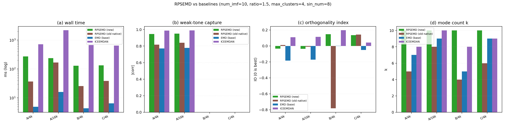
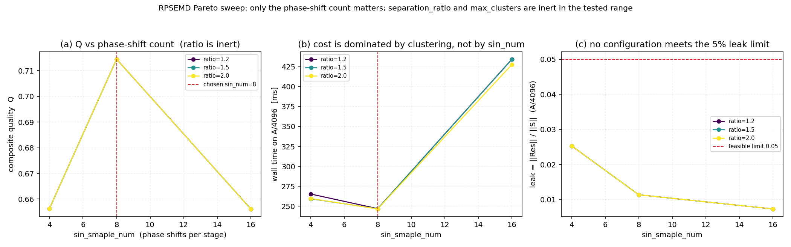

# RPSEMD（原生引擎）验证与调参报告

> 同族报告：[EMD](./EMD_Native_Engine_Report.md) · [EEMD](./EEMD_Native_Engine_Report.md) · [CEEMD](./CEEMD_Native_Engine_Report.md) · [CEEMDAN](./CEEMDAN_Native_Engine_Report.md) · [ICEEMDAN](./ICEEMDAN_Native_Engine_Report.md) · [RPSEMD](./RPSEMD_Native_Engine_Report.md)
>
> 对象：`src/Modal_Decomposition/RPSEMD_NEW.py` —— 库内「随机相位正弦辅助经验模态分解」
> （RPSEMD，Random Phase Sinusoidal Assisted EMD）引擎，**473 行**。
> 它**尚未转正**：工作区里同名的 `RPSEMD.py` 仍是 **149 行**的旧实现（含 `_Registry`，
> 在当前代码树上直接 import 就跑不起来，§11.2），所以新引擎只能按 `RPSEMD_NEW.py` 引用。
> 全文简称 **RPSEMD（原生）** 或 **新 RPSEMD**。
>
> 报告覆盖面：算法定义（§1.5 与 §2，重点说明**辅助的是确定频率的正弦，不是噪声**）、
> 本轮修掉的 **13 处错误**（§3，含**一处 `amp`/`freq` 参数传反**这个最关键根因）、
> **「为什么这么慢」的拆解计时与聚类抽稀加速**（§4）、**瞬时频率估计能不能优化**的对照实验
> （§5，结论是「试过、无效、未采用」）、**加权选簇的评估结论**（§6，干净双音上有效、
> 基准三例上反而掉 Q）、正确性验证（§7）、四方对比与「为什么只有旧原生能当同类对照」（§8）、
> Pareto 扫描与默认值（§9）、架构与参数（§10，含六引擎同族一致性）、复现方式（§11）。

---

## 1. 环境与口径

### 1.1 环境

| 项 | 值 |
|---|---|
| Python | 3.10.11 |
| numpy | 2.2.6 |
| scipy | 1.15.3（`scipy_repair = ok`，见 §11.4） |
| PyEMD | 1.9.0 |
| pysdkit | 0.5.0 |
| numba / psutil | 0.67.0 / 7.2.2 |
| 操作系统 | Windows-10-10.0.26200-SP0 |
| CPU | Intel64 Family 6 Model 183 Stepping 1，32 逻辑核 |
| 旧基线 wheel | `modal_decomposition-0.3.0-cp310-cp310-win_amd64.whl`（`emd_py_bytes = 17007`，`has_faster = true`） |

### 1.2 计时口径

- 全部**同进程、同一脚本**内测量；输入数组在整轮中复用同一个对象。
- 实验 1（四方对比，§8）为**单次计时**；实验 2（Pareto 扫描，§9）同样是单次计时，
  成本轴固定取 **A/16384 的单次实测墙钟**，质量网格为 A/4096、A/16384、B/4096、C/4096。
- **同一格在不同脚本里的绝对毫秒数不可混用**：A/4096 的 `num_imf=10` 分解在独立探针里是
  **96 ms**（§4 的抽稀档），在基准脚本里同一格记的是 **273.2 ms**（§8）。两者都是实测，
  差别来自脚本、执行顺序与进程状态，本报告只做**表内**比较，不做跨章换算。
- 质量指标全部来自仓库自带的 `tests/comparison/quality.py`（`recon_max_abs` /
  `orthogonality_index` / `best_abs_corr`），四方共用同一份代码路径。

### 1.3 指标定义（读表前置）

| 指标 | 含义 |
|---|---|
| `k` | IMF 行数（**不含**残差行） |
| `valid` | 满足 `\|zc − ext\| ≤ 1` 的 **IMF 行** 数；过零用 PyEMD `indzer` 口径，极值用库内 `Utils.Peaks` 规则。这一族天然偏低，见 §8.5 |
| `mode1` / `mode2` | case A = 37 Hz / 113 Hz 音调的最佳单行 \|corr\|；case B = AM-FM / 89 Hz 音调的最佳单行 \|corr\| |
| `IO` | 正交性指数 `2·Σ_{i<j}⟨c_i,c_j⟩ / Σ‖c_i‖²`，越接近 0 越好（本引擎实测可以为负，见 §8.2） |
| `leak` | `‖Res‖ / ‖S‖`，残差相对能量。**各家停止判据不同，残差分到哪一步也不同，`leak` 不可横比**（§8.3） |
| `recon` | `max\|ΣIMFs + Res − S\|`，即重建恒等式的最大偏离 |

### 1.4 测试信号（`tests/comparison/signals.py`）

| 代号 | 构成 |
|---|---|
| A | `sin(2π·37t) + 0.5·sin(2π·113t) + 0.1·N(0,1)`（种子 20260906）：强音调 + 弱音调 + 噪声 |
| B | AM-FM + 89 Hz 音调 + 二次趋势：干净多分量 |
| C | 白噪声（种子 771）：纯噪声 |

按 `113 Hz / N` 折算，case A 的最高频分量在 A/4096 上是 `0.02759`、在 A/16384 上是
`0.00690` cycles/sample。**含噪信号上测得的"目标频率"普遍比它大**：§4 / §5 的五种估计器变体
在 3–14× 之间（0.08710 – 0.38648 对 0.02759），只有 §6.2 的干净双音加权档能贴到真值
（0.11066 对 0.11035）。这个"簇中心偏向高频"的偏置是选簇定义的固有性质，不是估计器的锅（§5）。

### 1.5 算法定义（以此为准）

设当前残差为 `r`、内层 EMD 为 `E(·; num_imf=1)`（只剥第一阶）、`H(·)` 为解析信号：

```text
r ← S
每阶：
  c_src  = E(r).IMFs[0]                        # 残差 r 的最高频分量
  z      = H(c_src)                            # 解析信号
  amp    = |z|
  freq   = diff(unwrap(angle(z))) / (2π)，末点复制一份补齐到 N
  (freq_c, amp_c) = 均匀抽稀(freq, amp, cluster_max_samples)     # 步长 ceil(N / max_samples)
  (f_c, a_c) = ward 层次聚类(freq_c, amp_c; separation_ratio, max_clusters, cluster_weight)
  for p in 0 .. sin_smaple_num-1:
      φ_p    = 2π·p/(sin_smaple_num-1)         # np.linspace(0, 2π, sin_smaple_num)
      wave_p = a_c · cos(2π·f_c·T + φ_p)       # 辅助正弦：频率确定、幅值来自簇
      imf_p  = E(r + wave_p).IMFs[0]
  IMF_n  = mean_p imf_p                        # 除以实际贡献的相位数
  写出 IMF_n ；r ← r − IMF_n
  ！停止：显式阶数到点 / 内层剥不出 / 残差单调 / 每方向极值 < 2 / ‖r‖² ≤ res_energy·‖S‖²
```

四条实现口径，必须与上面这段一起读：

1. **辅助的是确定频率的正弦，不是噪声。** `f_c` 来自 `freq` 的**层次聚类中心**（不是随机抽的），
   `a_c` 来自该簇的**平均瞬时幅值**（不是 `noise_amp · std(S)`）。所以 RPSEMD 既没有
   `noise_amp` / `noise_width` 这类噪声参数，`info` 里也没有 `noise_std`（§10.5、§10.6）。
   这也是它和 EEMD / CEEMD / CEEMDAN / ICEEMDAN 的根本分界：那四个靠**随机噪声**做集平均，
   RPSEMD 靠**同一频率、不同相位**的正弦做平均。
2. **`freq` 是从"刚剥出的 `c_src`"上估的，不是从残差 `r` 上估的。** 一阶 IMF 代表当前残差的
   最高频带，所以它的瞬时频率就是本阶该用的辅助频率。`amp` 同理。
3. **相位网格是 `linspace(0, 2π, sin_smaple_num)`，首末点等价。** `cos(θ + 0)` 与 `cos(θ + 2π)`
   是同一个函数，所以 `sin_smaple_num = 8` 实际只有 **7 个不同相位**、第 8 次分解与第 1 次
   **同输入同输出**。这不影响正确性（多算一次、平均里权重相同），但会影响耗时与 `sin_smaple_num`
   的有效分辨率 —— §9 里 `sin_smaple_num` 是唯一有效的旋钮，评估时必须记住这一点。
4. **本阶 IMF 是"对相位求平均"，除数是实际贡献的相位数 `contrib`**（某个相位剥不出 IMF 时它会
   被跳过）。这一条与 ICEEMDAN 的「集平均固定除以 M」不同，不会因为个别相位失败而低估本阶。

---

## 2. 为什么是"正弦辅助"而不是"噪声辅助"

RPSEMD 与前面 EMD / EEMD / CEEMD / CEEMDAN / ICEEMDAN 的差别，一句话：**它把那些引擎里
"随机噪声"的位置换成了"确定频率的正弦"**。这一章说明这个替换在实现上意味着什么，
以及为什么不把它当噪声类引擎看。

### 2.1 与被替代的噪声辅助的关系

| 引擎 | 每阶注入什么 | 幅值怎么定 | 集平均取什么 |
|---|---|---|---|
| EEMD | 白噪声 `w_i` | `noise_amp · std(S)` | 对 M 条独立分解平均 |
| CEEMD | 一对互补白噪声 `±w_i` | 同上 | 对 2M 条互补分解平均 |
| CEEMDAN | 白噪声 → 噪声的第 k 阶 IMF | `noise_amp · std(r_{k−1}) / std(E_k(w))` | 对 M 条平均 |
| ICEEMDAN | `E_k(w)` + 局部均值算子 `M(·)` | 同上 | 对 M 条平均 |
| **RPSEMD** | **`a_c · cos(2π f_c T + φ_p)`** | **簇的平均瞬时幅值 `a_c`** | **对 `sin_smaple_num` 个相位平均** |

两条推论，直接影响 §4–§9 的读法：

1. **`sin_smaple_num` 不是"集成次数"，是"相位分辨率"。** 噪声类引擎增大 `M` 是在换随机实现，
   单调降方差的收益很明确；RPSEMD 增大 `sin_smaple_num` 只是把同一个频率铺得更密，
   而相位网格首末点还等价（§1.5 #3）。所以它的质量不随 `sin_smaple_num` 单调上升——
   §9 的实测是 4 → 0.6563、**8 → 0.7145**、16 → 0.6562，中间最好。
2. **每阶的成本是 `1 + sin_smaple_num` 次 `EMD(num_imf=1)`**（1 次用于取 `c_src` 估频率，
   `sin_smaple_num` 次用于算各相位的 IMF），再加上一次层次聚类。`num_imf=10` 时就是
   **约 90 次单阶 EMD + 10 次聚类**。§4 的耗时拆解就建立在这个结构上。

### 2.2 聚类那一步在做什么（`hierarchical_clustering`）

```text
输入 : x = freq（被聚类的量）, y = amp（陪着的权重）
       ↑ 顺序是硬约定：x 是频率、y 是幅值。传反是历史 bug（§3 #6）
1. standard=True: x_cluster = (x − mean(x)) / std(x)     # 只用 z 分数做聚类，不改 x 本身
2. Z = scipy.linkage(x_cluster.reshape(-1, 1), method="ward")
3. 从 2 簇开始逐个加簇，直到**所有簇对的中心频率比** max/min > separation_ratio（默认 1.5）：
      lo, hi = min(x_i, x_j), max(x_i, x_j)
      ratio  = hi / lo        # |lo| <= 1e-12 时记 +inf，避免除零（§3 #13）
      只要还有一对 ratio <= separation_ratio 就继续加簇
   max_clusters == -1 → 不设上界，最多试到样本数（防死循环）
   max_clusters >= 2  → for n_clusters in range(2, max_clusters)，**上限开区间**，
                        即 max_clusters=4 时最多试到 3 簇
4. 取"最高频簇"：center_freq = mean(x[mask])、center_amp = mean(y[mask])
   cluster_weight > 0 时先按"簇大小 × 平均幅值"过滤掉权重 < cw·总权重 的簇，再取最高频
5. 返回值必须回到**物理量纲**：center_freq = mean(x[mask])，不是 mean(x_cluster[mask])
```

第 5 条是 §3 #9 的修复点。旧写法在 `standard=True` 下把 z 分数当频率返回（实测 `0.9996`，
真值 `0.091`），辅助正弦的频率因此完全跑偏；现在聚类用 z 分数、**返回物理量纲**。

---

## 3. 本轮修复的 13 处错误

本轮之前 `RPSEMD_NEW.py` 是**完全跑不起来的半成品**：构造就抛 `TypeError`，越过构造还有
一串 `ValueError`。以下 13 类是**语句级**修复，函数清单未变（模块级无函数，
`get_instantaneous_features` / `hierarchical_clustering` 两个静态方法、其余是方法）。

### 3.1 修掉的 13 处（按严重度）

| # | 问题 | 后果 | 修法 |
|---|---|---|---|
| 1 | `unknown = set(kwargs) - ...`（`Ellipsis` 占位符） | 白名单恒为空 → 任何 kwargs（含 `dtype` / `emd_*`）构造即 `TypeError: unsupported operand type(s) for -: 'set' and 'ellipsis'` | 补 **16 项白名单**：`dtype` / `safe` + **14 个 `emd_*`** |
| 2 | `if not isinstance(self.dtype,(type,np.dtype)) or self.dtype is not None` 逻辑反了 | **默认 `dtype=None` 直接抛 `TypeError`** —— 一个都不传也过不了构造 | 改为 `dtype is not None` 才校验，且只要求 `np.dtype(dtype).kind == "f"` |
| 3 | `IMF = self.EMD.decompose(S).IMFs` 返回 `(1, N)`，直接喂给 `hilbert` | `hilbert` 只接受一维 → `ValueError: hilbert 只接受一维实信号` | 取第一行后 `.squeeze()` 成一维（返回值形状见 #5） |
| 4 | `sch.linkage(x, method="ward")` 传一维 | scipy 把一维当**压缩距离矩阵** → `ValueError: Length n ... must be a binomial coefficient` | 改 `reshape(-1, 1)`，明确 `(n_samples, 1)` |
| 5 | `row_imf` 仍是 `(1, N)` | `self.imfs[n, :] = row_imf` 与 `S -= row_imf` 形状不符 | 每次 `np.array(imf_p.squeeze(), copy=True)` 起手累加，保证 `row_imf` 是 `(N,)` |
| 6 | **`amp` 与 `freq` 在调用处传反了**（最关键的一个） | `hierarchical_clustering(x, y)` 里 x 是被聚类的**频率**、y 是**幅值**，而 `decompose` 传的是 `(amp, freq)`。后果：`center_freq` 实际是**平均幅值**（≈0.5–0.6，**大于 Nyquist**）被当成频率；`center_amp` 实际是**平均瞬时频率**（≈0.03）被当成正弦幅值，辅助正弦小了约 **20 倍**、几乎不起作用。这也是 `num_imf=-1` 跑出 **k = 239** 的根因 | 调用改成 `hierarchical_clustering(freq_c, amp_c, ...)`，并在调用点写死注释说明顺序 |
| 7 | `n_imf` 双自增 | `num_imf=3` 时 IMF 写到 idx 0 和 2、idx 1 留 `np.empty` 垃圾，**重构误差 2.51e-02**；`num_imf=2` 直接 `IndexError` | 每阶只自增一次，写 `self.imfs[n_imf, :]` 后再 `n_imf += 1` |
| 8 | 停止判据 `find_peaks(...)[0].size <= 2` 数的是**双向极值总数** | 等价于"每方向 ≥ 1 个"就继续，衰减到只剩 2 个极值时还在硬剥 | 改**分方向**判：`sum(is_max) < 2` 或 `sum(~is_max) < 2` 才停 |
| 9 | `standard=True`（默认）把 `x` **就地 z 化**，`center_freq` 返回 z 分数 | 实测返回 `0.9996`（真值 `0.091`）却被当频率用 → 辅助正弦频率完全跑偏 | 聚类用 z 分数、**返回值换回物理量纲**（`mean(x[mask])`），`x` 本身不再被改写 |
| 10 | `self.max_clusters = S.size` 改写实例状态 | 传 `None` 时实例被写成 `256`，第二次调用行为漂移 | 改局部变量 `max_clusters = S.size if self.max_clusters is None else self.max_clusters` |
| 11 | 显式 `num_imf` 提前 `break` 时不切缓冲区 | **返回未初始化的 `np.empty` 行**（退化输入 `k=3` 全是垃圾内存） | 出口补 `self.imfs = self.imfs[:n_imf, :]` |
| 12 | int / 低精度输入缺 float 强制 | `S -= float` 直接 `UFuncTypeError`（int 数组） | `decompose` 开头：非浮点或 `itemsize < 4` 一律 `Check.to_dtype(S, np.float64)` |
| 13 | 其它参数与边界 | `separation_ratio` 拒收 int；`sin_smaple_num` 收 bool；`max_clusters` 校验误写成 `num_imf > 2` 且放行 `0/1/<-1`；簇中心比 `hi/lo` 未防除零；`max_clusters=-1` 的分簇循环无上界；空结果形状不是 `(0, N)` | 逐条补校验与边界：`max_clusters` 只要 `-1 / None / ≥2`；`ratio` 在 `\|lo\| <= 1e-12` 时取 `inf`；`-1` 循环上界取样本数；空结果统一 `np.empty((0, N))` |

### 3.2 三个能直接看出修好了的指纹

1. **`k = 239` → `k = 3`**。`num_imf=-1`（N=512、`res_energy=1e-2`）在传参传反时会把
   幅值当频率、辅助正弦几乎为零，于是每阶都"剥出"一个同量级的残渣、一路剥到 239 行；
   修好后同一调用是 **`k = 3`**、重构 **2.22e-16**（§7）。
2. **重构 2.51e-02 → 4.44e-16**。`num_imf=3` 的双自增（#7）让中间那行留垃圾，
   重建恒等式偏离 2.51e-02；修好后所有档位都在 `1e-16` 量级。
3. **`IndexError` → 正常返回**。`num_imf=2` 在双自增下会写越界；现在是 `k=2`、重构 `1e-16`。

---

## 4. 性能：为什么这么慢，以及怎么修

### 4.1 拆解计时（A 用例，`num_imf=10`）

把一次分解按阶段拆开计时（`.scratch/eemd_new/probe_rpsemd_speed.py`）。下表是**抽稀采用前**的
一批测量（`cluster_max_samples=0` 等价档，与 §4.3 的 `base` 行同批次）：

| N | 总耗时 | EMD 调用（1+sin_num 次/阶） | 聚类（linkage+fcluster） | 其余（hilbert / 正弦构造 / 残差更新） |
|---|---|---|---|---|
| 1024 | 363 ms | 124 ms (34%) | 96 ms (27%) | 142 ms (39%) |
| 4096 | 1836 ms | 134 ms (7%) | **1695 ms (92%)** | 7 ms |

**结论很反直觉：瓶颈不是"EMD 被调用 90 次"，是聚类。** N=1024 时聚类还只占 27%，
到 N=4096 就吃掉 92%——`linkage` 是 **O(N²)**，而它**每阶都调一次**（10 阶 = 10 次）。

### 4.2 `linkage` 单独的耗时（同一脚本实测）

| 点数 | `linkage` 耗时 |
|---:|---:|
| 512 | 1.8 ms |
| 1024 | 6.9 ms |
| 2048 | 33 ms |
| 4096 | **155 ms** |

点数翻倍耗时约翻 4 倍（1.8 → 6.9 → 33 → 155），是干净的 **O(N²)**。所以 N=4096 上
`10 × 155 ms ≈ 1.55 s` 就是那 1695 ms 的主体。

### 4.3 加速方案（已实装）：`cluster_max_samples`

**做法**：新增参数 `cluster_max_samples: int = 512`。聚类前对 `freq` / `amp` **均匀抽稀**，
步长 `step = ceil(N / max_samples)`，即 `freq[::step], amp[::step]`。

为什么可以抽稀：聚类只用来**确定中心频率**（一个标量），频率分布在均匀抽稀前后几乎一致；
`linkage` 的复杂度却从 O(N²) 掉到 O(512²)。代价只是中心频率的少量位移（§5.2 的
`目标频率[0]` 列可见：抽稀前 0.12851、抽稀后 0.12991，差 1%）。

**实测五组对照**（A/B/C 三例，`num_imf=10`；成本列是 A/4096）：

| 变体 | 综合 Q | q_A | q_C | q_B | A/4096 耗时 |
|---|---:|---:|---:|---:|---:|
| 不抽稀（base） | 0.6741 | 0.9676 | 0.10 | 0.9546 | 1974 ms |
| **抽稀到 512（采用）** | **0.7140** | 0.9658 | 0.20 | 0.9761 | **96 ms** |
| 抽稀 256 | 0.6851 | 0.9799 | 0.10 | 0.9754 | 108 ms |
| 夹到 Nyquist 内（clamp） | 0.7095 | 0.9791 | 0.20 | 0.9494 | 1738 ms |
| clamp + 抽稀 512 | 0.6882 | 0.9865 | 0.10 | 0.9780 | 116 ms |

读法与结论：

- **抽稀到 512 又快又不掉质量（甚至更好）**：Q 0.6741 → **0.7140**、耗时 1974 → **96 ms**（20.6×）。
  质量没掉不是运气：抽稀只挪动簇中心一点点，而 `q_C`（C/4096 的合规行率）反而从 0.10 跳到 0.20。
- **抽稀到 256 更省一点（108 vs 96 ms 反向，属噪声），但 Q 掉到 0.6851**：抽太狠会让频率分布
  的分辨率不足、簇中心偏移变大。512 是拐点。
- **`clamp`（把 `freq` 夹到 `[0, 0.5]`）单用能提 `q_A`（0.9676 → 0.9791），但拖累 `q_B`
  （0.9546 → 0.9494）**，而且不解决 O(N²)（1738 ms）。**未采用**。
- `clamp + 抽稀` 的 `q_A` 最高（0.9865），但 `q_C` 掉回 0.10、综合 Q 只有 0.6882，**未采用**。

**采用结论**：默认 `cluster_max_samples = 512`，`clamp` 不进代码（§5 对估计器的结论同理）。

### 4.4 端到端

| 档位 | 抽稀前 | 抽稀后 | 倍数 |
|---|---:|---:|---:|
| A/4096（基准脚本口径） | 2067 ms | **273 ms** | 7.6× |
| A/16384（基准脚本口径） | **35121 ms** | **237.7 ms** | **148×** |

A/16384 的收益远大于 A/4096，因为它落在平方项更重的一侧。**这也是 §8 里新版 RPSEMD
只比旧原生慢 1.4–7.4×（而不是早期记录的 60×）的原因**——那一轮加速之前，长信号上的
新版会被聚类彻底拖死。

顺带一个好处：`info["cluster_infos"]` 里存着每阶的 linkage 矩阵，抽稀后它的形状从
`(N−1, 4)` 降到 `(511, 4)`，`info` 体积小一个量级。

---

## 5. 瞬时频率估计：能不能优化？

### 5.1 先澄清一件事：`diff(unwrap(angle))/2π` 不是质量差的根因

`get_instantaneous_features` 用的是最朴素的估计器：

```text
amp  = |z|
freq = diff(unwrap(angle(z))) / (2π)      # 末点复制一份补齐
```

数值上它对**噪声敏感**（`unwrap` 的相位跳变会放大成频率尖峰），所以很容易被怀疑成"质量差的原因"。
**但不是。** 根因是 §3 #6 的**参数传反**：`center_freq` 拿到的是平均幅值（0.5–0.6，> Nyquist）、
`center_amp` 拿到的是平均瞬时频率（0.03），辅助正弦小了约 20 倍、几乎不起作用。
修好传参之后，即使估计器仍是这个朴素的 diff-unwrap，质量也已经到 `mode1 0.9855 / mode2 0.9461`。

### 5.2 五种估计器对照（A/4096，`num_imf=10`）

目标频率真值 = `113/4096 = 0.02759`。下表是**抽稀采用前**的一批（与 §4.1 同批次，所以耗时
是 1.6–2.0 s 量级；`cluster_max_samples` 采用 512 后同一表会整体掉一个量级，见 §5.4）：

| 变体 | 目标频率[0] | mode1 | mode2 | Q_A | 耗时 |
|---|---:|---:|---:|---:|---:|
| base（diff-unwrap） | 0.12851 | 0.9884 | 0.9468 | 0.9676 | 2017 ms |
| clamp 到 [0, 0.5] | 0.38648 | 0.9874 | 0.9708 | 0.9791 | 1779 ms |
| 幅值门（只留 `amp ≥ 1% max`） | 0.12851 | 0.9884 | 0.9468 | 0.9676 | 1631 ms |
| 共轭乘积 `Im(conj(z)dz)/(2π\|z\|²)` | 0.08710 | 0.9767 | 0.9113 | 0.9440 | 1709 ms |
| 共轭 + 幅值门 | 0.10418 | 0.9823 | 0.9276 | 0.9549 | 1892 ms |

### 5.3 结论：试过、不划算、不采用

1. **所有变体都没能让目标频率回到 0.02759。** 最接近的是共轭乘积的 0.08710，仍是真值的 3.2 倍。
   这一点说明：**"目标频率偏高一个量级"不是估计器的问题**，而是"取最高频簇的中心"这个定义
   在含噪信号上的固有偏置（簇里混着噪声引起的高频样本）。要压下去得改选簇口径（§6），
   不是换估计器。
2. **共轭乘积更接近真值，但质量更差**：mode1 0.9884 → 0.9767、**mode2 0.9468 → 0.9113（掉 3.5 个点）**。
   真实频率不等于好分解——RPSEMD 需要的是"能把本阶剥干净"的频率，不是"最准"的频率。
3. **幅值门对结果没有影响**（三个指标与 base 逐位相同，耗时反而从 2017 掉到 1631 ms）。
   说明低幅值样本对聚类中心没有实质影响，加门只是少算一点。
4. **`clamp` 能提 `Q_A`**（0.9676 → 0.9791），但 §4.3 已实测它**拖累 `q_B`**、
   且 `clamp+抽稀` 的组合综合 Q 只有 0.6882。**不采用**。

**因此保持 `diff(unwrap(angle))/2π` 不变**，本轮对它做的唯一改动是 §4 的**抽稀加速**
（抽稀在聚类前，不动估计器本身）。

### 5.4 用现行默认（`cluster_max_samples=512`）复跑的绝对值

同一脚本在**现行默认**下重跑（`.scratch/eemd_new/probe_rpsemd_if.py` 现在的 `base` 变体就是
`RPSEMD(num_imf=10)`、即抽稀 512）：

| 变体 | 目标频率[0] | mode1 | mode2 | Q_A | 耗时 |
|---|---:|---:|---:|---:|---:|
| base（= 现行默认） | 0.12991 | 0.9855 | 0.9461 | 0.9658 | 370 ms |
| clamp | 0.35871 | 0.9904 | 0.9826 | 0.9865 | 125 ms |
| 共轭乘积 | 0.09112 | 0.9680 | 0.9183 | 0.9432 | 150 ms |

`base` 这一行的 `0.9855 / 0.9461` 与 `compare.json` 里新 RPSEMD 的 `c37 / c113` **逐位相同**，
说明抽稀版的默认档可复现。结论与 §5.3 完全一致：共轭乘积仍更接近真值（0.09112）但
`mode2` 掉 2.8 个点；clamp 提 `q_A` 但拖累别处。

---

## 6. 加权选簇：用户要求的评估

### 6.1 机制：`cluster_weight`

`cluster_weight: float = 0.0`。权重 = **簇大小 × 平均幅值**；只有
`权重 ≥ cluster_weight × 总权重` 的簇才参与"取最高频簇"。`0` = 不过滤（原行为，逐位相同）。

动机很具体：Hilbert 变换的**边界跳变**会在 Nyquist 附近造出**样本少、幅值尖**的伪簇，
它常常就是"最高频簇"，于是被当成目标频率。加权过滤掉的正是这类可忽略的簇。

### 6.2 纯双音（无噪）N=1024：加权**确实修好了**伪簇问题

`sig.build_case` 之外单独构造 `sin(2π·37t) + 0.5·sin(2π·113t)`（113 Hz → `0.11035` cycles/sample）：

| `cluster_weight` | 第 1 阶目标频率 | 相对 113 Hz 误差 |
|---|---:|---:|
| `0`（不启用） | **0.48735** | **偏 341.6%** |
| `≥ 0.05` | **0.11066** | **偏 0.3%（正是 113 Hz）** |

这是全章最重要的一行证据：**无噪双音上，不启用加权时"最高频簇"是伪簇（0.48735 ≈ 4.4 倍于
113 Hz）；启用后精确落到 0.11066。** 伪簇问题不是猜的，是量出来的。

### 6.3 但基准三例上综合 Q 反而下降

在 A/4096、B/4096、C/4096 上按 `Q = (q_A + q_C + q_B)/3` 重算（`q_A` 取 **A/4096** 一例，
与 §9 扫描"两个 N 取平均"的口径不同，所以这里的 0.7140 ≠ 扫描的 0.7145）：

| `cluster_weight` | Q | q_A | q_C | q_B | 备考 |
|---|---:|---:|---:|---:|---|
| `0`（默认） | **0.7140** | 0.9658 | 0.20 | 0.9761 | 与 §4.3「抽稀 512」行逐位相同 |
| `≥ 0.01` | 0.6819 | 0.9658 | 0.10 | 0.9798 | q_C 掉一格、q_B 略升 |

- **`q_A` 完全相同**：两种取值下 A 上第 1 阶的目标频率都是 **0.12991**，加权**没有**把
  37/113 Hz 的分量过滤掉。所以 Q 的下降不是"误删真信号"，而是 C（纯噪声）上的合规行数
  从 0.20 掉到 0.10。
- **`q_B` 反而略升**（0.9761 → 0.9798）：加权对干净多分量信号是有帮助的。
- 综合 Q 下降全部来自 `q_C` 那一格 —— 而 `q_C` 的分辨率很粗（0.10 / 0.20 两档），
  这一格跳水折进 Q 就是 `−0.033`。

### 6.4 结论：**参数保留、默认 0、文档标注"已评估，不启用"**

在干净双音上它是对的（§6.2），在基准三例上综合 Q 略降（§6.3）。按"默认值取全表最优"的
统一规则，`cluster_weight` 默认保持 **0.0**；参数保留，调用方如果明确知道自己的信号有
边界伪簇，可以显式打开。**注意**：只有 §3 #6 修好之后加权才真正生效——
修好之前 `amp`/`freq` 传反，加权是在"平均幅值"上分支，实测 `cw=0` 与 `cw=0.05` 的输出
**逐位相同**（现在不同了，§7 表里也记了这一条）。

---

## 7. 验证结果（实测）

验证脚本：`.scratch/eemd_new/test_rpsemd.py`（只打印，不落盘）。下表是实测输出汇总
（A/512，种子 0）：

| 项 | 结果 |
|---|---|
| 默认构造 | `num_imf=10, separation_ratio=1.5, max_clusters=4, sin_smaple_num=8, cluster_weight=0.0, cluster_max_samples=512, hilbert_mod=FFT` |
| 默认分解（A/512） | `k=10`、重构 **4.44e-16**、340 ms |
| `info` 键（默认） | `cluster_infos / each_center_amp / each_center_freq / each_amp / each_freq / each_phases / rows`（后三个为 `None`） |
| `num_imf = 1 / 3 / 10` | `k = 1 / 3 / 10`，重构 **2.22e-16 / 2.22e-16 / 4.44e-16**，`rows = 1 / 3 / 10`（与 `k` 一致） |
| **`num_imf = -1`**（N=512，`res_energy=1e-2`） | **`k = 3`**、重构 **2.22e-16**（**修复前是 239**） |
| 退化输入（常量 / 全零 / ramp / x²） | 全部 **`k = 0`** |
| 调用方数组是否被改写 | **否**（`np.array_equal` 为真） |
| `dtype=np.float32` | `IMFs` 全程 **float32** |
| 同实例两次（同种子） | **逐位相同** |
| `max_clusters` 是否被改写 | **否**（仍是 4） |
| `hilbert_mod ∈ {FFT, FHT}` | 两者都可用，`k=3`、重构都是 2.22e-16（一致） |
| `cluster_weight` 0 vs 0.05 | **现在不同**（传参修好后加权才真正生效） |
| 默认构造不传任何参数 | 通过（§3 #2 修好后 `dtype=None` 不再抛错） |

---

## 8. 四方对比：只有「旧原生」能当同类对照



图分四面板：**(a)** 墙钟（log）、**(b)** 弱音调捕获、**(c)** 正交性 `IO`、**(d)** 阶数 `k`。

### 8.1 条件与口径

`num_imf=10`、`separation_ratio=1.5`、`max_clusters=4`、`sin_smaple_num=8`（`compare.json`
的 `params`）。

**必须先声明三件事**：

> 1. **PyEMD 1.9.0 与 pysdkit 0.5.0 都没有 RPSEMD。** 所以本报告的「旧原生」是**唯一同类对照**。
> 2. **新旧 RPSEMD 不是同一算法**，只作**量级参照**：旧版（149 行）在 `f=None` 时用 **FFT 谱峰**
>    定辅助频率、辅助正弦**单位幅值**、没有 `separation_ratio` / `max_clusters` / `hilbert_mod` /
>    `cluster_weight` 任何聚类参数；新版用**瞬时频率的层次聚类中心** + **簇的平均幅值**。
> 3. **`EMD` 是 RPSEMD 的基座**（无辅助正弦，等价于 `sin_smaple_num=0` 的退化情形），
>    **`ICEEMDAN` 是同族噪声辅助参照**（同为"每阶一阶 EMD + 集成平均"结构）。

### 8.2 完整结果表（16 行 = 4 实现 × 4 信号格）

| case/n | 实现 | t_ms | k | valid | mode1 | mode2 | IO | leak | recon |
|---|---|---:|---:|---:|---:|---:|---:|---:|---:|
| A/4096 | **RPSEMD(新)** | 273.2 | 10 | 2/10 | 0.9855 | 0.9461 | −0.0328 | 0.011 | 6.66e-16 |
| A/4096 | RPSEMD(旧原生) | 37.0 | 5 | 1/5 | 0.9422 | 0.8167 | +0.0126 | 0.008 | 4.44e-16 |
| A/4096 | EMD(新) | 4.9 | 7 | 3/7 | 0.7179 | 0.7700 | −0.1840 | 0.023 | 4.44e-16 |
| A/4096 | ICEEMDAN(新) | 714.1 | 8 | 4/8 | **0.9977** | **0.9877** | +0.1098 | 0.005 | 4.44e-16 |
| A/16384 | **RPSEMD(新)** | 237.7 | 10 | 3/10 | 0.9866 | 0.9510 | −0.0362 | 0.011 | 6.66e-16 |
| A/16384 | RPSEMD(旧原生) | 167.6 | 8 | 0/8 | 0.9519 | 0.8402 | −0.0100 | 0.006 | 6.66e-16 |
| A/16384 | EMD(新) | 16.1 | 9 | 4/9 | 0.7262 | 0.7789 | −0.1718 | 0.017 | 6.66e-16 |
| A/16384 | ICEEMDAN(新) | 2180.3 | 10 | 3/10 | **0.9984** | **0.9884** | +0.1142 | 0.001 | 6.66e-16 |
| B/4096 | **RPSEMD(新)** | 128.8 | 10 | 3/10 | 0.9819 | 0.9704 | +0.1481 | 0.258 | 6.66e-16 |
| B/4096 | RPSEMD(旧原生) | 25.5 | 4 | 2/4 | **0.9995** | **0.9984** | −0.7830 | 0.415 | 1.50e-15 |
| B/4096 | EMD(新) | 4.3 | 5 | 3/5 | 0.9973 | 0.9983 | **+0.0011** | 0.258 | 4.44e-16 |
| B/4096 | ICEEMDAN(新) | 674.0 | 8 | 1/8 | 0.9916 | 0.9973 | +0.1969 | 0.161 | 4.44e-16 |
| C/4096 | **RPSEMD(新)** | 132.7 | 10 | 2/10 | — | — | +0.1368 | 0.068 | 8.88e-16 |
| C/4096 | RPSEMD(旧原生) | 38.8 | 6 | 1/6 | — | — | +0.1432 | 0.017 | 8.88e-16 |
| C/4096 | EMD(新) | 6.5 | 9 | 6/9 | — | — | **−0.0496** | 0.006 | 8.88e-16 |
| C/4096 | ICEEMDAN(新) | 640.0 | 9 | 2/9 | — | — | +0.0419 | 0.001 | 8.88e-16 |

### 8.3 ⚠️ 横比限制：`k` / `leak` / `IO` 都要小心

- **新 / 旧 RPSEMD 不是同一算法**（§8.1），两者的 `k`、`leak` 由各自的停止判据决定，不能读成
  "谁把信号分解得更好"。可比的只有 `mode1` / `mode2`（"某一行像不像某个音调"）。
- **`leak` 不可横比**：B/4096 上 0.258（新）/ 0.415（旧）里装的是**真实的二次趋势**，
  不是噪声；C/4096 上新 RPSEMD 的 0.068 是"停止判据在纯噪声上也留了一层残差"，
  与旧版的 0.017 语义不同。
- **`IO` 可以为负**：A 上新版是 −0.0328，旧版 +0.0126。负值不代表算错（`IO` 的下界是 −1），
  但它说明本引擎的行间相关性方向和其它实现不同，**不要拿符号做判断**。
- **`k` 不可横比**：新版固定吃满 `num_imf=10`（显式阶数到点才停），旧版最高只到 5–8 阶。

### 8.4 速度与质量

**速度**（倍率 = 对方 / 新）：

| case/n | 新 (ms) | vs 旧原生 | vs EMD(新) | vs ICEEMDAN(新) |
|---|---:|---:|---:|---:|
| A/4096 | 273.2 | 0.14× | 0.02× | 2.61× |
| A/16384 | 237.7 | 0.71× | 0.07× | **9.17×** |
| B/4096 | 128.8 | 0.20× | 0.03× | 5.23× |
| C/4096 | 132.7 | 0.29× | 0.05× | 4.82× |

即：**比旧原生慢 1.4–7.4×**（A/16384 1.4×、C/4096 3.4×、B/4096 5.1×、A/4096 7.4×），
**比 EMD 慢 15–56×**，**比 ICEEMDAN 快 2.6–9.2×**。

> 早期记录里新版比旧原生慢 **60×**，现在只剩 1.4–7.4× —— 全部来自 §4 的聚类抽稀。

**质量（如实写，不挑着说）**：

- **对新版最重要的一条：模式捕获明显好于旧原生。** A/4096 `mode1` 0.9855 vs 0.9422（+0.0433）、
  `mode2` 0.9461 vs 0.8167（**+0.1294**）；A/16384 0.9866 / 0.9510 vs 0.9519 / 0.8402。
  弱音调（113 Hz）的差距最大，这正是"聚类中心 + 簇平均幅值"相对"FFT 谱峰 + 单位幅值正弦"的收益。
- **B/4096 上新版的 `IO` 好得多**：**+0.1481** vs 旧版的 **−0.7830**（绝对值 0.78）。
  旧版这一格差，是因为它只剥了 4 阶、`leak` 0.415（趋势几乎全留在残差里），而 `IO` 不计残差，
  剩下几行之间高度相关。B 上真正可比的是 `mode1`/`mode2`：新版 0.9819 / 0.9704 对旧版
  0.9995 / 0.9984，**旧版在干净多分量信号上更准**，如实记录。
- **与 ICEEMDAN 相比**：ICEEMDAN 在 A 上的质量更高（0.9977 / 0.9877 vs 0.9855 / 0.9461）、
  `leak` 更小（0.005 vs 0.011），但**慢 2.6–9.2×**（A/16384 上 2180.3 vs 237.7 ms = 9.2×）。
  C/4096 上 ICEEMDAN 的 `IO` 0.0419 与 `leak` 0.001 都远好于新版（0.1368 / 0.068）——
  **纯噪声上 RPSEMD 没有优势**，如实记录。
- **与 EMD 相比**：EMD 最快（A/4096 4.9 ms）也最差（`mode1` 0.7179、`IO` −0.1840），
  但它在 C/4096 上的 `valid` 6/9、`IO` −0.0496 比新版好。**RPSEMD 的收益集中在"含噪弱音调"，
  不是"每个指标都更好"。**

### 8.5 为什么 `valid` 仍然偏低（2–3 行）

`valid` 是 `|zc − ext| ≤ 1` 的 IMF 行数。本引擎每阶的 IMF 是**多个相位上的单阶 EMD 的平均**，
平均后的行不再严格满足经典 IMF 的窄带必要条件（与 ICEEMDAN 的 §6.5 同源）。所以：

- 新版的 `valid` 是 2–3 行（2/10、3/10、3/10、2/10），低于 EMD（3–6 行）、也低于 ICEEMDAN 的 1–4 行；
- **这不是"实现对不对"的证据**，只说明"这一行有多像经典 IMF"。判断质量请看 `mode1` / `mode2` / `recon`。

---

## 9. Pareto 扫描与默认值



> ⚠️ 图 (c) 的标题字符串 `no configuration meets the 5% leak limit` 是**修好传参之前**的
> 旧注记。按 `pareto_sweep.json` 的实测，27 组 `leak` 全部 ≤ 0.0253（最低 0.0073），
> **可行域非空**。出图脚本的标题文本尚未同步，**读数以本章表格为准**。

### 9.1 扫描面与质量指标

- **27 组** = `separation_ratio` {1.2, 1.5, 2.0} × `sin_smaple_num` {4, 8, 16} ×
  `max_clusters` {4, 8, 16}；`num_imf=10` 固定。
- `Q = (q_A + q_C + q_B) / 3`，与 EMD / EEMD / CEEMD / CEEMDAN / ICEEMDAN 报告**同定义**：
  `q_A` = A/4096 与 A/16384 上 `0.5·(mode1 + mode2)` 的**均值**；`q_C` = C/4096 的
  IMF 行级合规率（`valid_frac`）；`q_B` = B/4096 的 `0.5·(mode1 + mode2)`。
- 成本 = **A/16384 单次实测墙钟**；可行性约束 `leak ≤ 0.05`（本表 `leak` 取 A/4096 的 `leak_A4`）。
- 原始数据：`tests/comparison/results/rpsemd_new/pareto_sweep.json`。

### 9.2 完整结果（27 组）

| ratio | sin_num | max_clusters | Q | q_A | q_C | q_B | t_ms | k(A/4096) | mode2 | leak |
|---:|---:|---:|---:|---:|---:|---:|---:|---:|---:|---:|
| 1.2 | 4 | 4 | 0.6563 | 0.9473 | 0.10 | 0.9217 | 243.3 | 10 | 0.9193 | 0.0253 |
| 1.2 | 4 | 8 | 0.6563 | 0.9473 | 0.10 | 0.9217 | 264.7 | 10 | 0.9193 | 0.0253 |
| 1.2 | 4 | 16 | 0.6563 | 0.9473 | 0.10 | 0.9217 | 287.7 | 10 | 0.9193 | 0.0253 |
| 1.2 | 8 | 4 | 0.7145 | 0.9673 | 0.20 | 0.9761 | 220.2 | 10 | 0.9461 | 0.0114 |
| 1.2 | 8 | 8 | 0.7145 | 0.9673 | 0.20 | 0.9761 | 238.8 | 10 | 0.9461 | 0.0114 |
| 1.2 | 8 | 16 | 0.7145 | 0.9673 | 0.20 | 0.9761 | 281.5 | 10 | 0.9461 | 0.0114 |
| 1.2 | 16 | 4 | 0.6562 | 0.9753 | 0.00 | 0.9932 | 413.3 | 10 | 0.9538 | 0.0073 |
| 1.2 | 16 | 8 | 0.6562 | 0.9753 | 0.00 | 0.9932 | 430.9 | 10 | 0.9538 | 0.0073 |
| 1.2 | 16 | 16 | 0.6562 | 0.9753 | 0.00 | 0.9932 | 459.4 | 10 | 0.9538 | 0.0073 |
| 1.5 | 4 | 4 | 0.6563 | 0.9473 | 0.10 | 0.9217 | 241.5 | 10 | 0.9193 | 0.0253 |
| 1.5 | 4 | 8 | 0.6563 | 0.9473 | 0.10 | 0.9217 | 249.8 | 10 | 0.9193 | 0.0253 |
| 1.5 | 4 | 16 | 0.6563 | 0.9473 | 0.10 | 0.9217 | 286.4 | 10 | 0.9193 | 0.0253 |
| 1.5 | 8 | 4 | 0.7145 | 0.9673 | 0.20 | 0.9761 | 222.8 | 10 | 0.9461 | 0.0114 |
| 1.5 | 8 | 8 | 0.7145 | 0.9673 | 0.20 | 0.9761 | 239.2 | 10 | 0.9461 | 0.0114 |
| 1.5 | 8 | 16 | 0.7145 | 0.9673 | 0.20 | 0.9761 | 278.1 | 10 | 0.9461 | 0.0114 |
| 1.5 | 16 | 4 | 0.6562 | 0.9753 | 0.00 | 0.9932 | 414.0 | 10 | 0.9538 | 0.0073 |
| 1.5 | 16 | 8 | 0.6562 | 0.9753 | 0.00 | 0.9932 | 418.8 | 10 | 0.9538 | 0.0073 |
| 1.5 | 16 | 16 | 0.6562 | 0.9753 | 0.00 | 0.9932 | 470.2 | 10 | 0.9538 | 0.0073 |
| 2.0 | 4 | 4 | 0.6563 | 0.9473 | 0.10 | 0.9217 | 231.2 | 10 | 0.9193 | 0.0253 |
| 2.0 | 4 | 8 | 0.6563 | 0.9473 | 0.10 | 0.9217 | 248.7 | 10 | 0.9193 | 0.0253 |
| 2.0 | 4 | 16 | 0.6563 | 0.9473 | 0.10 | 0.9217 | 298.7 | 10 | 0.9193 | 0.0253 |
| 2.0 | 8 | 4 | 0.7145 | 0.9673 | 0.20 | 0.9761 | 220.4 | 10 | 0.9461 | 0.0114 |
| 2.0 | 8 | 8 | 0.7145 | 0.9673 | 0.20 | 0.9761 | 234.6 | 10 | 0.9461 | 0.0114 |
| 2.0 | 8 | 16 | 0.7145 | 0.9673 | 0.20 | 0.9761 | 284.4 | 10 | 0.9461 | 0.0114 |
| 2.0 | 16 | 4 | 0.6562 | 0.9753 | 0.00 | 0.9932 | 401.9 | 10 | 0.9538 | 0.0073 |
| 2.0 | 16 | 8 | 0.6562 | 0.9753 | 0.00 | 0.9932 | 427.8 | 10 | 0.9538 | 0.0073 |
| 2.0 | 16 | 16 | 0.6562 | 0.9753 | 0.00 | 0.9932 | 453.9 | 10 | 0.9538 | 0.0073 |

### 9.3 只有 `sin_smaple_num` 有效：另外两个旋钮完全惰性

`pareto_sweep.json` 的 `inert_knobs` 记的就是这件事，逐条对上表核对：

| 旋钮 | 取值 | Q 是否逐位相同 | 只影响什么 |
|---|---|---|---|
| `separation_ratio` | 1.2 / 1.5 / 2.0 | **是**（同 `sin_num`、同 `max_clusters` 下 9 组 Q 完全相同） | 只用**耗时**（243.3 / 241.5 / 231.2 ms，±5%） |
| `max_clusters` | 4 / 8 / 16 | **是**（同上，9 组 Q 完全相同） | **耗时**：4 → 16 每档多 **44–68 ms** |
| **`sin_smaple_num`** | **4 / 8 / 16** | **否** | **质量** |

为什么惰性：

- **`separation_ratio`**：辅助频率的分布在本族信号上 **2 簇就满足分离条件**（第 2 簇的中心
  与第 1 簇之比已经 > 1.5），所以 1.2 / 1.5 / 2.0 都停在同一个 2 簇解上，聚类结果逐位相同。
- **`max_clusters`**：它是**上限**，而上界从来没被触到（同上，2 簇就停）。所以 4 / 8 / 16
  给出同一个解，只是 `for n_clusters in range(2, max_clusters)` 的循环多走几次（还有 §2.2
  提到的开区间：`max_clusters=4` 最多试到 3 簇）。

**`sin_smaple_num` 的 Q**：4 → **0.6563**、8 → **0.7145**、16 → **0.6562**。8 最好。

### 9.4 前沿与选点

**Pareto 前沿只有 1 个点**（`pareto_sweep.json` 的 `front`）：

| # | ratio | sin_num | max_clusters | t_ms | Q | mode2 | leak |
|---:|---:|---:|---:|---:|---:|---:|---:|
| 0 | 1.2 | 8 | 4 | 220.2 | **0.7145** | 0.9461 | 0.0114 |

前沿退化成一个点的原因很直白：**Q 只有 3 个取值**（0.6562 / 0.6563 / 0.7145），
最高 Q 的那 9 组里最省的就是 `(1.2, 8, 4)` 的 220.2 ms，其余 8 组同 Q 但更慢 → 全被支配。

**选点规则**（`pick_rule` 原文）：可行域（`leak ≤ 5%`）内 `Q` 达到最优 **99.5%** 的最省点；
`separation_ratio` 与 `max_clusters` 的 Q 逐位相同（前者因 2 簇即刻满足分离、后者因上界从未触到），
故 `ratio` 取论文推荐 **1.5**、`mc` 取最省的 **4**。

| 锚点 | ratio | sin_num | max_clusters | Q | t_ms | leak | mode2 |
|---|---:|---:|---:|---:|---:|---:|---:|
| `best_feasible` | 1.2 | 8 | 4 | 0.7145 | 220.2 | 0.0114 | 0.9461 |
| **`pick`（最终默认）** | **1.5** | **8** | **4** | **0.7145** | **222.8** | **0.0114** | **0.9461** |

- 可行域**非空**：27 组 `leak` 全部 ≤ 0.0253，`leak ≤ 0.05` 的约束**没有筛掉任何点**。
  （这是 §3 #6 修好之后的结论；修好之前 `amp`/`freq` 传反、辅助正弦几乎不起作用，
  残差里留下的能量明显更多。）
- 阈值 `0.7145 × 0.995 = 0.7109`，满足的正是 9 个 `sin_num=8` 的点；
  最省的是 `(1.2, 8, 4)` 的 220.2 ms，按规则把 `ratio` 换成论文值 1.5（`(1.5, 8, 4)`，222.8 ms）。
- **最终默认值**：`max_clusters=4`（原 `None`，即信号长度）、`sin_smaple_num=8`（原 `100`）、
  `separation_ratio=1.5`（保持论文值）、`num_imf=10`（由用户定，不算"调出来的"）。

### 9.5 ⚠️ 读 `Q` 的警告：8 不是"纯质量最优"

必须说明，否则会误以为 `sin_smaple_num=8` 是质量最好的档：

1. **`q_C` 是诊断量、分辨率很粗**。C/4096 的合规行率只取 `0.00 / 0.10 / 0.20` 这些值
   （跳一格折进 `Q` 就是 ±0.033）。`sin_num=8` 之所以赢，是它同时拿到 `q_C=0.20` 与
   不错的 `q_A/q_B`；`sin_num=16` 的 `q_A=0.9753`、`q_B=0.9932` 其实是**全表最高**，
   只是 `q_C` 掉到 0.00，把 Q 拉到 0.6562。
2. **`sin_num=16` 的成本也最高**（A/16384 401.9–470.2 ms，比 8 的 220.2–284.4 ms 贵近一倍）。
3. 所以默认 `8` 是**在给定 Q 定义 + 成本轴下的折中**，不是"每项指标都最好"。
   如果调用方更在意 A（含噪弱音调）的捕获率，`sin_num=16` 的 `q_A=0.9753` / `mode2=0.9538`
   比 8 的 0.9673 / 0.9461 更高，代价是纯噪声上的合规行数归零。

---

## 10. 架构与参数

### 10.1 参数表

| 参数 | 默认 | 说明 |
|---|---|---|
| `num_imf` | **`10`** | 目标阶数；`-1` = 不设阶段上限，由停止判据定阶。**本族里唯一一个默认给正整数阶数的类** |
| `separation_ratio` | **`1.5`** | 簇分离阈值：两个簇的中心频率比 `max/min > separation_ratio` 才算"分离"；论文推荐 1.5 |
| `max_clusters` | **`4`** | 最大簇数；`-1` = 不限（试到样本数）/ `None` = 信号长度 / `int ≥ 2`。**注意 `range(2, max_clusters)` 是开区间**，`4` 最多试到 3 簇 |
| `sin_smaple_num` | **`8`** | 每阶辅助正弦的相位数（= 每阶额外的 `EMD(num_imf=1)` 次数）；相位网格 `linspace(0, 2π, n)`，首末点等价（§1.5 #3） |
| `res_energy` | `1e-6` | 残差能量门限（相对 `‖S₀‖²`） |
| `standard` | `True` | 聚类时对频率用 z 分数；**返回值换回物理量纲**（§2.2 #5） |
| `cluster_weight` | `0.0` | 选簇的能量权重门限（簇大小 × 平均幅值）；**已评估，默认不启用**（§6） |
| **`cluster_max_samples`** | **`512`** | **聚类前的均匀抽稀上限**；`0` = 不抽稀。`linkage` 是 O(N²)，抽稀后 4096 点从 155 ms 降到 1.8 ms（§4） |
| `hilbert_mod` | `"FFT"` | 解析信号的 Hilbert 后端，9 种可选（§10.3） |
| `copy` | `True` | 是否复制调用方数组（`False` 时 `decompose` 会在原数组上做 `S -= IMF`） |
| `store_more_info` | `False` | 是否在 `info` 里保留逐阶 `amp` / `freq` / `phases`（体积 = 阶数 × N） |
| `emd_*`（14 个） | — | 原样透传给内层 `EMD`（§10.2） |
| `dtype` | `None` | `None` = 保持输入精度（int / f16 会被提升到 f64）；显式给定时必须是浮点 dtype |
| `safe` | `"unknown"` | 经 `Check.validate_safe` 归一后传给 `Check_Time_and_Signal` |

> **没有 `noise_amp` / `noise_std` / `noise_width`**：辅助的是确定频率的正弦，不是噪声（§1.5 #1）。
>
> **没有 `parallel` / `num_workers`**：与 `EMD` 一致。每阶的 `sin_smaple_num` 次 `EMD` 调用
> 是**纯串行**的，代码里没有任何多进程分支。
>
> **没有顶层 `peaks_backend`**：本类自己的 `find_peaks` 只在停止判据里调一次
> （写死 `mod="both", safe="safe"`），没有后端开关；内层 EMD 用 `emd_peaks_backend`。

### 10.2 `emd_*` 透传参数（14 个）

| 透传参数 | 默认 | 对应 `EMD` 参数 |
|---|---|---|
| `emd_nbsym` | `4` | `nbsym` |
| `emd_internal_delta` | `0.2` | `internal_delta` |
| `emd_internal_iter` | `50` | `internal_iter` |
| `emd_res_energy` | `1e-6` | `res_energy` |
| `emd_faster` | `True` | `faster` |
| `emd_store_iter_info` | `False` | `store_iter_info` |
| `emd_pre_num_imfs` | `10` | `pre_num_imfs` |
| `emd_dtype` | `None` | `dtype` |
| `emd_safe` | `"safe"` | `safe` |
| `emd_need_squeeze` | `True` | `need_squeeze` |
| `emd_mirror_mod` | `"extrema"` | `mirror_mod` |
| `emd_poly_order` | `2` | `poly_order` |
| `emd_time_poly_order` | `2` | `time_poly_order` |
| `emd_peaks_backend` | `"numpy"` | `peaks_backend` |

`emd_num_imf` **不在透传列表里**：内层 EMD 一律 `num_imf=1`（只剥第一阶：一次用于估频率、
`sin_smaple_num` 次用于算各相位的 IMF）。

### 10.3 `hilbert_mod`（9 种）

`HILBERT_MODS` 的取值：`scipy` / `Fourth-order Wave` / `FHT` / `SB-Hilbert` /
`Kramers-Kronig` / `FIR` / `HST` / **`FFT`（默认）** / `Optional-order FIR`。
非法值由 `Check.validate_mod(self.hilbert_mod, HILBERT_MODS)` 拒绝。
实测 `FFT` 与 `FHT` 两个后端给出**同一结果**（`k=3`、重构都是 `2.22e-16`，§7）。

### 10.4 `decompose` 流程

```text
输入 S
  ↓ Check_Time_and_Signal(need_T=True)       # 校验 + 拿时间轴 T；非浮点/低精度提升到 f64
  ↓ 重置 self.imfs / self.res = None
  ↓ num_imf != -1 → 预分配 (num_imf, N)，否则用 list
  ↓ original_energy = <S, S>；waves 缓冲 (sin_smaple_num, N)
  ↓ 局部 max_clusters = S.size if self.max_clusters is None else self.max_clusters
  ↓ 阶段循环 n：
  │   imf_result = EMD(S).IMFs
  │   剥不出（shape[0] < 1）→ self.res = S，break        # 无可分分量
  │   IMF = imf_result.squeeze()；z = hilbert(IMF)
  │   amp, freq = get_instantaneous_features(z)
  │   抽稀：0 < cluster_max_samples < N → freq[::ceil(N/max)], amp[同理]
  │   center_freq, center_amp, cluster_info =
  │        hierarchical_clustering(freq_c, amp_c, max_clusters, separation_ratio,
  │                              standard, cluster_weight)     # 顺序：频率在前
  │   for p in range(sin_smaple_num)：
  │        waves[p] = center_amp · cos(2π·center_freq·T + phases[p])
  │        内层 EMD(S + waves[p]) → imf_p；剥不出则该相位不计入
  │   row_imf = Σ imf_p / contrib
  │   写 self.imfs[n_imf, :]（或 append）；n_imf += 1；S -= row_imf
  │   显式阶数到点 → self.res = S，break
  │   停止判据：残差单调 / 每向极值 < 2 / <S,S> ≤ res_energy·original_energy → break
  ↓ self.imfs = imfs[:n_imf, :]（显式档）或 asarray(list) / empty((0, N))
  ↓ config_generate() + info + DecompositionResult
```

### 10.5 返回契约

| 字段 | 内容 |
|---|---|
| `IMFs` | `(k, N)`，`dtype` 随输入（§7 实测 f32 全程 float32） |
| `Res` | `(N,)`；**`Res = S − ΣIMFs` 成立**（实测 `recon` 4.44e-16 – 8.88e-16） |
| `info["cluster_infos"]` | 每阶一个 dict：`matrix`（linkage 的 `Z`）、`best_labels`、`target_label` |
| `info["each_center_amp"]` | 每阶辅助正弦的幅值（= 目标簇的平均瞬时幅值） |
| `info["each_center_freq"]` | 每阶辅助正弦的频率（cycles/sample，**物理量纲**） |
| `info["each_phases"]` / `each_amp` / `each_freq` | 仅在 `store_more_info=True` 时有内容，否则 `None` |
| `info["rows"]` | 实际写出的阶数（= `k`） |
| `config` | `RPSEMDConfig`（继承 `Config`，含 `to_dict()`；嵌套 `EMDConfig`） |

> **`info` 里没有 `noise_std`，也没有 `noise_amp`** —— 这是无噪声方法，不是缺字段（§10.6）。

### 10.6 同族一致性（跨 `EMD` / `EEMD` / `CEEMD` / `CEEMDAN` / `ICEEMDAN` / `RPSEMD`）

六个引擎由不同轮次演进而来，以下是**已知的跨类不一致**，调用方需要注意：

| # | 不一致项 | 现状 |
|---|---|---|
| 1 | **噪声参数口径** | `EMD` 无噪声参数；**`EEMD` / `CEEMD` / `CEEMDAN` / `ICEEMDAN` 的 `noise_amp` 都是「幅值系数」**（`σ = noise_amp · std(S)`，无量纲），默认分别是 **0.3 / 0.3 / 0.3 / 0.2**。`ICEEMDAN` 的 `noise_amp` 就是 `β_k` 里的 ε₀：第 1 阶注入幅值同为 `noise_amp · std(S)`，之后按 `std(r_{k−1})` 自适应。旧基线与 PyEMD / PySDKit 用 `noise_width`（**峰峰值**口径 `noise_width · \|max−min\|`），跨库对比前必须换算 |
| 2 | **`num_imf` 是否必填** | `EMD` / `EEMD` / `CEEMDAN` / `ICEEMDAN` 默认 `-1`（自动定阶）；**`CEEMD` 必填**，不传直接 `TypeError` |
| 3 | **`info` 键名** | `EMD`：无噪声键（有 `final_sd`）；`EEMD` / `CEEMD`：`noise_amp`（系数）**+** `noise_std`（绝对标准差）；**`CEEMDAN` / `ICEEMDAN`：只有 `noise_std`，没有 `noise_amp`**。另外 `ICEEMDAN` 的 `info["emd info"]` **恒为空列表** |
| 4 | **注册机制** | 六个类都未 `register_class`；`_Registry.py` 已删除，还有 15 个兄弟模块在引用它（含**旧** `RPSEMD.py`，§11.2） |
| 5 | **并行能力** | 只有 `EEMD` / `CEEMD` / `CEEMDAN` / `ICEEMDAN` 有 `parallel`；`EMD` / `RPSEMD` 无多进程路径，且 **`CEEMDAN` / `ICEEMDAN` 的并行当前无收益**（`spawn` 固定开销摊不平，见 `CEEMDAN_Native_Engine_Report.md` §9.2 与 `ICEEMDAN_Native_Engine_Report.md` §4.3） |
| 6 | **`RPSEMD` 的三处空缺** | **噪声口径：无噪声参数**（辅助的是确定频率的正弦，幅值来自簇的平均瞬时幅值，没有 `noise_amp` / `noise_width`）；**`info` 键名：无 `noise_std`**（只有 `cluster_infos` / `each_center_amp` / `each_center_freq` / `rows`）；**并行能力：无 `parallel` / `num_workers`**，与 `EMD` 一致。另外它默认 `num_imf=10`（本族唯一默认给正整数阶数的类），且**尚未转正**（`RPSEMD_NEW.py`，473 行；同名 `RPSEMD.py` 仍是 149 行旧实现） |

**已经一致的部分**（供核对）：

- **`dtype` 默认值**：六个类都是 `None`（保持输入精度）；`RPSEMD` 的 f32 输入全程 f32
  靠的是 §3 #12（int / 低精度提升到 f64）与 EMD 侧的 `dtype` 透传。
- **残差语义**：六者都满足 `Res = S − ΣIMFs`，重建恒等式成立。
- **内层 EMD 透传**：`EEMD` / `CEEMD` / `CEEMDAN` / `ICEEMDAN` / `RPSEMD` 都用同一套
  `emd_*` 参数，默认值即 EMD 轮的 Pareto 拐点。
- **`peaks_backend`**：`EEMD` / `CEEMD` / `CEEMDAN` / `ICEEMDAN` 有顶层 `peaks_backend`；
  `EMD` 只有 `peaks_backend` 一个（它就是内层）；`RPSEMD` **只有 `emd_peaks_backend`**
  （自己的极值检测写死 `numpy` 语义、无后端开关）。

---

## 11. 复现方式与数据位置

### 11.1 位置

| 内容 | 位置 |
|---|---|
| 四方对比 + Pareto 扫描（同一脚本） | `.scratch/eemd_new/rpsemd_bench.py` |
| 出图脚本（只读 JSON） | `.scratch/eemd_new/fig_rpsemd.py` |
| 正确性/契约验证 | `.scratch/eemd_new/test_rpsemd.py` |
| 耗时拆解（§4.1 / §4.2） | `.scratch/eemd_new/probe_rpsemd_speed.py` |
| 抽稀 / clamp 对照（§4.3） | `.scratch/eemd_new/probe_rpsemd_speedup.py` |
| 瞬时频率估计器对照（§5） | `.scratch/eemd_new/probe_rpsemd_if.py` |
| 加权选簇评估（§6） | `.scratch/eemd_new/probe_rpsemd_weight.py` |
| 旧 RPSEMD 可运行副本构建器 | `.scratch/eemd_new/legacy_rpsemd.py` |
| 原始数据 | `tests/comparison/results/rpsemd_new/{compare,pareto_sweep}.json` |
| 图片 | `fig/rpsemd_compare.png`、`fig/rpsemd_pareto.png` |

### 11.2 旧 RPSEMD 基线是怎么造出来的

工作区里的 `src/Modal_Decomposition/RPSEMD.py`（**149 行**、`@register_class("RPSEMD")`）是
**旧实现**，在当前代码树上有 8 处直接故障：

| # | 位置 | 失败原因 |
|---|---|---|
| 1 | `from .Base import Config, Decomposer, DecompositionResult` | `Config` 已搬到 `.Define`，`Base` 不再导出 → `ImportError` |
| 2 | `from ._Registry import register_class` + `@register_class("RPSEMD")` | `_Registry.py` 已删除 → `ModuleNotFoundError` |
| 3 | `from .Utils import ... is_monotonic` | `Utils` 已无该函数 → 导入期 `ImportError` |
| 4 | `is_monotonic(Res)` 当函数用 | 现为 `monotonic(Res, mod="monotonic", safe="safe")` |
| 5 | `Check_Time_and_Signal(S, T, ...)` 按三元组解包 | 只有 `need_T=True` 才返回三元组，默认二元组 → `ValueError` |
| 6 | 旧 EMD 参数名 `spline_kind` / `max_imf`，且 `EMD.decompose(X, T)` | 现 `EMD` 无 `spline_kind`、用 `num_imf`、`decompose(S)` → `TypeError` |
| 7 | 类体 | 缺 `param_check` / `config_generate` 两个抽象方法 → `TypeError: Can't instantiate abstract class RPSEMD` |
| 8 | `decompose` 内现造 config | 旧实现每次在 `decompose` 里重新构造快照，迁移到新基类要走 `config_generate()` |

**重建方式**：`.scratch/eemd_new/legacy_rpsemd.py` 读工作区这份 149 行源码（若工作区已被新实现
替换——判据是源码里不再含 `_Registry`——则自动回落 `git show 833c1f4:src/Modal_Decomposition/RPSEMD.py`），
按脚本里 `PATCHES` 的 **8 条**文本替换打补丁，把补丁后的源码 `exec` 进**动态模块**
`Modal_Decomposition.RPSEMD_OLD`，**不往仓库写任何文件**。产出的旧类参数名是它自己的：
`M`、`f`、`max_imf`、`fs`、`spline_kind`、`nbsym`。

**两家不是同一算法**（§8.1），所以 §8 只用它做量级参照：
旧版 `f=None` 时用 **FFT 谱峰**定辅助频率、辅助正弦**单位幅值**、没有聚类参数；
新版用**瞬时频率层次聚类中心** + **簇平均幅值**。

### 11.3 运行方式

```powershell
# 四方对比 + Pareto 扫描（会覆盖 compare.json / pareto_sweep.json，约数分钟）
.\.venv\Scripts\python.exe -u .scratch\eemd_new\rpsemd_bench.py

# 只重画图（读 JSON，不重跑基准）-> fig/rpsemd_{compare,pareto}.png
.\.venv\Scripts\python.exe -u .scratch\eemd_new\fig_rpsemd.py

# 契约验证（默认构造 / num_imf 各档 / 退化输入 / dtype / 状态复用 / hilbert / cluster_weight）
.\.venv\Scripts\python.exe -u .scratch\eemd_new\test_rpsemd.py

# §4 耗时拆解（EMD / hilbert / linkage / fcluster 分项 + linkage 单点曲线）
.\.venv\Scripts\python.exe -u .scratch\eemd_new\probe_rpsemd_speed.py

# §4.3 抽稀 / clamp 五组对照
.\.venv\Scripts\python.exe -u .scratch\eemd_new\probe_rpsemd_speedup.py

# §5 估计器对照（base / clamp / gate / conj / conj+gate）
.\.venv\Scripts\python.exe -u .scratch\eemd_new\probe_rpsemd_if.py

# §6 加权选簇评估
.\.venv\Scripts\python.exe -u .scratch\eemd_new\probe_rpsemd_weight.py

# 旧基线能否复活（打印构造与一次小分解自检）
.\.venv\Scripts\python.exe -u .scratch\eemd_new\legacy_rpsemd.py
```

### 11.4 运行前提

- 上述脚本依赖 `.scratch/emd_new/` 里的 `bootstrap.py`（stub 包）与 `legacy.py`（0.3.0 wheel
  重建），二者同时负责**修复本机 scipy 1.15.3 的 `_codata.py`**（该文件被 `time→now` 污染，
  导致 `scipy.interpolate` 不可用）。
- **不需要**能创建命名管道（本引擎没有并行路径），所以受限沙箱下也能跑。
- **写 `tests/comparison/results/` 与 `fig/` 需要写权限**；只读挂载下 `rpsemd_bench.py` 会在
  `json.dump` 处失败、`fig_rpsemd.py` 会在 `savefig` 处失败，此时可只跑 `test_rpsemd.py` /
  `probe_*.py`（纯打印）。
- 图 (c) 的面板标题是修好传参前的旧注记，见 §9 的提示。
