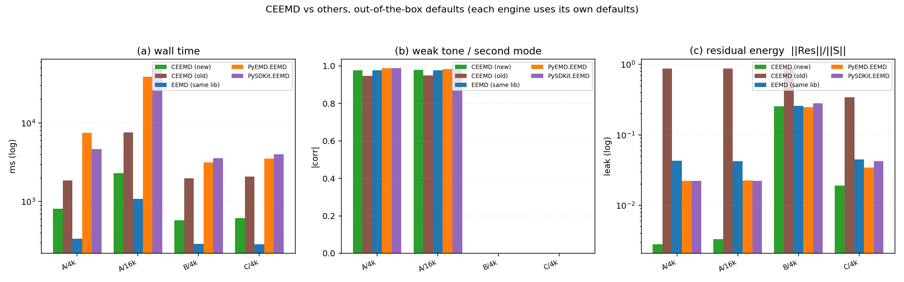
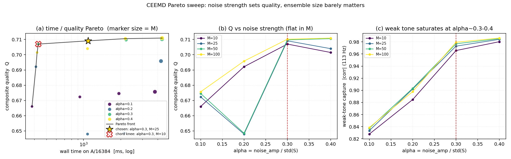

# CEEMD（原生引擎）验证与调参报告

> 同族报告：[EMD](./EMD_Native_Engine_Report.md) · [EEMD](./EEMD_Native_Engine_Report.md) · [CEEMD](./CEEMD_Native_Engine_Report.md) · [CEEMDAN](./CEEMDAN_Native_Engine_Report.md) · [ICEEMDAN](./ICEEMDAN_Native_Engine_Report.md) · [RPSEMD](./RPSEMD_Native_Engine_Report.md)
>
> 对象：`src/Modal_Decomposition/CEEMD.py` —— 库内原生互补集总经验模态分解（CEEMD）引擎。
> 本轮之前它以 `CEEMD_NEW.py` 的名字做原型验证，现已在重构中**转正为正式的 `CEEMD.py`**
> （旧的原生 `CEEMD.py` 被覆盖；它最后停留在提交 **`dd547f2`**（149 行、含 `_Registry`），
> 只能从 `git show dd547f2:src/Modal_Decomposition/CEEMD.py` 取回 —— **现行 HEAD 里已经是
> 新引擎**）。全文简称 **CEEMD（原生）** 或 **新 CEEMD**。
>
> 报告覆盖面：旧 CEEMD 为什么跑不起来、本轮补齐的并行实现与修复、新旧 CEEMD 的**算法差异**
> （二者不是同一件东西）、开箱默认对比、互补性收益、Pareto 扫描与默认值选择、架构与参数、
> 并行实现、已知取舍与同族一致性、复现方式。

---

## 1. 环境与口径

| 项 | 值 |
|---|---|
| Python | 3.10.11 |
| numpy | 2.2.6 |
| scipy | 1.15.3 |
| PyEMD | 1.9.0 |
| pysdkit | 0.5.0 |
| numba / psutil | 0.67.0 / 7.2.2 |
| 操作系统 | Windows-10-10.0.26200-SP0 |
| CPU | Intel64 Family 6 Model 183 Stepping 1，32 逻辑核 |

**计时口径**

- 全部**同进程、同一脚本**内测量；输入数组在整轮中复用同一个对象（各实现拿到同一份数据）。
- 实验 1（开箱默认对比，§5）与实验 2（Pareto 扫描，§7）均为**单次计时**，无重复取中位。
  原因是 CEEMD 一次分解要跑 `2M` 次内层 EMD，重复计时成本过高。
- 实验 2 的成本轴固定取 **A/16384 的单次实测墙钟**；质量网格为 A/4096、A/16384、
  B/4096、C/4096。
- 跨日 / 跨脚本的绝对毫秒数不可比，本报告只做同表内比较。
- 质量指标全部来自仓库自带的 `tests/comparison/quality.py`（`recon_max_abs` /
  `orthogonality_index` / `best_abs_corr`），各方共用同一份代码路径。

**指标定义（读表前置）**

| 指标 | 含义 |
|---|---|
| `k` | IMF 行数（**不含**残差行） |
| `valid` | 满足 `\|zc − ext\| ≤ 1` 的 **IMF 行** 数；过零用 PyEMD `indzer` 口径，极值用库内 `Utils.Peaks` 规则 |
| `mode1` / `mode2` | case A = 37 Hz / 113 Hz 音调的最佳单行 \|corr\|；case B = AM-FM / 89 Hz 音调的最佳单行 \|corr\| |
| `IO` | 正交性指数 `2·Σ_{i<j}⟨c_i,c_j⟩ / Σ‖c_i‖²`，越接近 0 越好 |
| `leak` | `‖Res‖ / ‖S‖`，残差相对能量。**只有在「真实残差≈0」的信号上才能当噪声残留读** —— case B 的残差含真实的二次趋势，四家实现都落在 0.25–0.28，那个数不能当噪声读 |
| `sigma` | 该实现**实际注入**的高斯噪声标准差（各家口径不同，见 §5 表注） |
| `recon` | `max\|ΣIMFs + Res − S\|`，即重建恒等式的最大偏离 |

**测试信号**（`tests/comparison/signals.py`）

| 代号 | 构成 |
|---|---|
| A | `sin(2π·37t) + 0.5·sin(2π·113t) + 0.1·N(0,1)`（种子 20260906）：强音调 + 弱音调 + 噪声 |
| B | AM-FM + 89 Hz 音调 + 二次趋势：干净多分量 |
| C | 白噪声（种子 771）：纯噪声 |

---

## 2. 背景与本次重构

### 2.1 旧 CEEMD 跑不起来，而且它是**另一套算法**

旧 `CEEMD.py`（提交 `dd547f2` 里的版本，4297 B / 149 行）在当前代码树上**完全无法运行**，
共有 5 处运行期/导入期故障加 1 处接口缺失：

| # | 位置 | 失败原因 |
|---|---|---|
| 1 | `@register_class("CEEMD")` | `register_class` 未导入 → **导入期** `NameError` |
| 2 | `resolve_seed(...)` | 重构后 `Utils` 已无此函数 → **运行期** `NameError` |
| 3 | `EMD(max_imf=1)` | 现在该参数叫 `num_imf` → `TypeError: unexpected keyword argument` |
| 4 | `EMD(...).decompose(S_plus, T)` | 现在的 `EMD.decompose` 只接受 `S` → `TypeError` |
| 5 | `S, T, N = Check_Time_and_Signal(...)` | 只有传 `need_T=True` 才返回三元组，否则返回二元组 → 解包 `ValueError` |
| 6 | 类体 | 缺 `param_check` / `config_generate` → `TypeError: Can't instantiate abstract class CEEMD with abstract methods config_generate, param_check` |

**重建方式**：`.scratch/eemd_new/legacy_ceemd.py` 用**动态模块 + `exec` 打过补丁的源码**
造出一个可运行的旧版（不往仓库写任何文件），补丁内容就是上表 1–6 的等价替换。

> 注意：旧 CEEMD 的 `leak` 高得离谱（A/4096 为 **0.873**）**不是重建错误** —— 它的
> `recon` 是 6.66e-16，重建恒等式成立。真正的原因是它**每阶只从残差里剥掉一个高频模态**
> （`EMD(num_imf=1)`），主体能量一直留在残差里。详见 §4。

### 2.2 现在的状态

`src/Modal_Decomposition/CEEMD.py` 现为 **353 行**（原型阶段叫 `CEEMD_NEW.py`，346 行）：

- 类成员：`['__init__', 'param_check', 'config_generate', 'decompose', 'parallel_decompose']`
- 模块级函数：`f_CEEMD`（函数式入口，与 `EMD` / `EEMD` 的 `f_*` 一致）

本轮之前它只有串行分支，且 `decompose` 在串行循环结束后**直接结束**（既没有 `config`/`info`
构造，也没有 `return`）。本轮补齐的正是后半段。

---

## 3. 本轮补齐与修复

### 3.1 补齐清单

| # | 位置 | 内容 |
|---|---|---|
| 1 | `decompose` 的 `else:` 分支 | **并行路径**：`num_workers = min(num_workers, M)`、`divmod` 均分 `M`、父进程派生 `trial_seeds`、`mp.Queue` 回传、**轮询 + 存活检查的崩溃检测**、按 index 排序后跨进程取 `min_row`、累加后 `/ M` |
| 2 | 新增方法 `parallel_decompose(self, S, noise_amp, pointer, task)` | 单个工作进程跑自己那段试验；**每次试验生成一个 `w`、正负共用**（互补性的前提），分解 `S+w` 与 `S−w` 后逐阶平均；累积求和后 `queue.put`；异常先回传 `("error", ...)` 再 `raise` |
| 3 | `decompose` 收尾 | `config_generate()`、`info = {rows, min row, noise_amp, EMD info}`、`return DecompositionResult(...)` |

`parallel_decompose` 作为**类方法**保留，与 `EEMD` 完全同构。

### 3.2 本轮修复的两个问题（EEMD 同样存在，已一并修）

**问题 1：退化输入返回伪 IMF。** 常量 / 全零 / `ramp` / `x²` / 过短信号原本会返回 3–5 阶
"IMF" —— 因为内层 EMD 拿到的 `S+w` 是纯噪声，它把**我们加进去的噪声**分解了，互补对消后
剩下的恰好是噪声响应。

判据用「**信号本身极大或极小 < 2 个**」，与 EMD 内层 sift 的守卫一致。**`monotonic` 不够**：

| 输入 | 极大 / 极小 | `monotonic` | 极值判据 |
|---|---|---|---|
| 常量 / 全零 / `ramp` | 0 / 0 | `True` | 拦得住 |
| **`x²`** | **0 / 1** | **`False`** | **只有它拦得住** |

**问题 2：`dtype` 参数不生效。** `np.random.normal(...)` 返回 float64，`S(float32) + w(float64)`
把整个工作数组升格成 float64（内存翻倍），也让 `dtype=float32` 看起来没生效。修法是每个类
**两处**（串行分支 + `parallel_decompose`）加 `.astype(S.dtype, copy=False)`。

### 3.3 验证（实测）

| 项 | 结果 |
|---|---|
| 串行 = 「互补对平均 → 按 `M` 算术平均」 | `\|手工 − 实测\| = 0.000e+00` |
| 并行 `M=3 / w=3` = 手工（父进程派生种子逐位复现） | `\|手工 − 实测\| = 0.000e+00` |
| 并行不均匀切分 `M=5 / w=3` | `rows=[(5,6,5),(5,5,5),(6,5,5),(6,5,5),(6,5,5)]`、`min row=5`、`EMD info` 5 条、重构 `0.00e+00` |
| 可复现性 | 串行同种子两次逐位相同；并行同种子两次逐位相同 |
| `num_workers > M` | 被 clamp 到 `M`，正常返回 |
| **worker 崩溃（注入桩）** | **0.30 s 内抛 `RuntimeError`**，消息含 `exitcode=[1,1]` 与两条错误记录；**不挂死** |
| 失败后残留子进程 | **0** |
| 退化输入 5 种（常量/全零/ramp/x²/短 n=16） | CEEMD 与 EEMD **全部 `k=0`** |
| `dtype` 端到端（f32 输入） | `IMFs float32`、`Res float32`、`config.dtype = None` |
| 串行路径的异常传播 | 照常抛给调用方（`RuntimeError`） |

---

## 4. 算法差异：新旧 CEEMD 不是同一件东西

这一点必须单列，否则会误读 §5 的对照表。

| 维度 | 旧 `CEEMD.py`（`dd547f2`） | 新 `CEEMD.py` |
|---|---|---|
| 分解对象 | **逐阶**：每次只从当前残差里取 **1 个** IMF（`EMD(num_imf=1)`） | **整个信号**：对 `S+w` 与 `S−w` 各做一次完整 EMD |
| 噪声强度 | `beta` 相对**当前残差**的 std | `noise_amp` 是**幅值系数**（`σ̂ = noise_amp · std(S)`，相对整信号） |
| 集总方式 | 每阶 `N_whitenoise` 次实现的平均 | `M` 对互补信号的逐阶平均 |
| 计算量 | 约 `N_imf × N_whitenoise` 次"单阶"EMD | `2M` 次完整 EMD |
| 残差语义 | 主体能量留在残差（`leak` 0.87–0.89） | `Res = S − ΣIMFs`，能量主要落进 IMFs（`leak` 0.003） |

所以 §5 里旧 CEEMD 那几列的 `k`（14–16）与 `leak`（0.87–0.89）**不是新版的退化版本，
而是另一个算法**。这也解释了为什么它的成本无法与新 CEEMD 一一对齐，§5 因此统一采用
"各家用自己的默认参数"、不做成本匹配。

---

## 5. 开箱默认对比（各家使用它自己的默认参数）



| case/n | 实现 | t_ms | k | valid | mode1 | mode2 | IO | leak | sigma | recon |
|---|---|---:|---:|---:|---:|---:|---:|---:|---:|---:|
| A/4096 | **CEEMD(新)** | 807.7 | 7 | 2/7 | 0.9981 | 0.9768 | 0.1967 | **0.003** | 0.2386 | 0 |
| A/4096 | CEEMD(旧) | 1855.8 | 14 | 2/14 | 0.9960 | 0.9463 | 0.2328 | 0.873 | 0.1591 | 6.66e-16 |
| A/4096 | EEMD(同库) | 339.5 | 7 | 2/7 | 0.9977 | 0.9762 | 0.1763 | 0.043 | 0.2386 | 6.94e-18 |
| A/4096 | PyEMD.EEMD | 7467.7 | 11 | 6/11 | 0.9975 | 0.9877 | 0.0948 | 0.022 | 0.1731 | 3.47e-18 |
| A/4096 | PySDKit.EEMD | 4626.7 | 11 | 5/11 | 0.9977 | 0.9875 | 0.0966 | 0.022 | 0.1731 | 3.47e-18 |
| A/16384 | **CEEMD(新)** | 2289.0 | 8 | 2/8 | 0.9988 | 0.9796 | 0.1879 | **0.003** | 0.2388 | 0 |
| A/16384 | CEEMD(旧) | 7590.3 | 16 | 3/16 | 0.9972 | 0.9494 | 0.2497 | 0.867 | 0.1592 | 1.11e-15 |
| A/16384 | EEMD(同库) | 1083.0 | 8 | 3/8 | 0.9985 | 0.9778 | 0.1744 | 0.042 | 0.2388 | 6.94e-18 |
| A/16384 | PyEMD.EEMD | 38324.8 | 13 | 4/13 | 0.9933 | 0.9850 | 0.3241 | 0.023 | 0.1777 | 3.47e-18 |
| A/16384 | PySDKit.EEMD | 49891.4 | 13 | 4/13 | 0.9927 | 0.9845 | 0.3370 | 0.022 | 0.1777 | 6.94e-18 |
| B/4096 | **CEEMD(新)** | 576.8 | 6 | 2/6 | 0.9977 | 0.9984 | 0.0885 | 0.255 | 0.2557 | 5.55e-17 |
| B/4096 | CEEMD(旧) | 1981.4 | 14 | 1/14 | 0.9544 | 0.9156 | 0.2358 | 0.893 | 0.1705 | 8.88e-16 |
| B/4096 | EEMD(同库) | 291.1 | 6 | 2/6 | 0.9968 | 0.9971 | 0.0772 | 0.257 | 0.2557 | 5.55e-17 |
| B/4096 | PyEMD.EEMD | 3133.4 | 10 | 4/10 | 0.9871 | 0.9979 | 0.3265 | 0.246 | 0.2060 | 2.78e-17 |
| B/4096 | PySDKit.EEMD | 3574.4 | 10 | 3/10 | 0.9851 | 0.9980 | 0.2846 | 0.280 | 0.2060 | 5.55e-17 |
| C/4096 | **CEEMD(新)** | 617.9 | 7 | 1/7 | — | — | 0.0957 | 0.019 | 0.3036 | 3.47e-18 |
| C/4096 | CEEMD(旧) | 2067.3 | 14 | 0/14 | — | — | 0.0831 | 0.341 | 0.2024 | 1.33e-15 |
| C/4096 | EEMD(同库) | 285.3 | 7 | 1/7 | — | — | 0.0863 | 0.045 | 0.3036 | 1.39e-17 |
| C/4096 | PyEMD.EEMD | 3523.6 | 12 | 4/12 | — | — | 0.1542 | 0.034 | 0.3297 | 1.39e-17 |
| C/4096 | PySDKit.EEMD | 3992.8 | 12 | 4/12 | — | — | 0.1584 | 0.042 | 0.3297 | 1.39e-17 |

> **表注**：`sigma` 列是各实现**实际注入**的噪声标准差，不是名义参数。新 CEEMD 的
> `noise_amp` 是**幅值系数**（实际 `σ̂ = noise_amp · std(S)`，默认系数 0.3）；旧 CEEMD /
> PyEMD / PySDKit 的名义参数是**峰峰值口径**
> （`noise_width · |max(S) − min(S)|`）。所以这几家的 `sigma` 不同，本表**不是等口径对照**，
> 这也是本轮统一采用"各家用自己的默认"的原因。

**要点**

1. **新 CEEMD 相对同库 EEMD 只慢 2.1–2.4×**（A/4096 807.7 vs 339.5 ms = 2.4×；
   A/16384 2289.0 vs 1083.0 ms = 2.1×），换来的收益是 **`leak` 从 0.043 降到 0.003（约 14×）**，弱音调
   `mode2` 0.9762 → 0.9768、case B 的 `mode1` 0.9968 → 0.9977 —— 都是小幅但同向的改善。
2. **旧 CEEMD 全面最差**：`k` 偏多（A/4096 14 vs 7）、case B 的 `mode1` 只有 0.9544、
   `leak` 0.873–0.893。再强调一次：这是**算法不同**（§4），不是重建出错。
3. **外部两家（PyEMD / PySDKit 的 EEMD）在弱音调上仍略高**：A/4096 `mode2` 0.9877 / 0.9875
   vs 新 CEEMD 0.9768（相对低 **1.1%**）；但它们的成本是新 CEEMD 的 **5.7× / 9.2×**
   （A/4096），A/16384 更是 **16.7× / 21.8×**。
4. **`IO` 上外部两家在 case A 更好**（0.0948 / 0.0966 vs 0.1967），但在 case B / C 上新
   CEEMD 更好（B: 0.0885 vs 0.3265 / 0.2846；C: 0.0957 vs 0.1542 / 0.1584）。
5. **重建恒等式**：新 CEEMD 是 **0**（精确），其余各家都在 1e-17…1e-15 的浮点舍入量级，
   没有发现类似 0.3.0 wheel 包装那种"丢最后一阶 IMF"的缺陷。

---

## 6. 互补性收益：CEEMD 与 EEMD 的残差对比

CEEMD 的设计意图是**让同一份噪声的正负两次分解互相对消**，从而在同一 `M` 下比 EEMD 更干净。
实测（A/2048，同 `M`、同 `alpha=0.3`，来自 `test_ceemd.py` 第 7 项）：

| M | EEMD `leak` | CEEMD `leak` | 比值 |
|---:|---:|---:|---:|
| 5 | 0.1315 | 0.0114 | **0.09** |
| 10 | 0.0944 | 0.0120 | **0.13** |

即 **CEEMD 的残差能量比同 `M` 的 EEMD 低 7–11 倍**（比值 0.09–0.13）。

理论上互补对只能带来 `√2` 的改善，实测远好于 `√2` —— 说明在这个信号上，互补对消掉的
主要不是"随机平均后的剩余噪声"，而是**两个方向完全对称的那部分噪声响应**。

上表也能解释为什么 `M` 对 CEEMD 的影响很小：`M=5 → 10` 时 `leak` 从 0.0114 只降到 0.0120
（**基本不变**，甚至在噪声水平内）。互补对已经把这个量压到很低，加 `M` 收益有限 ——
这与 §7 的扫描结论一致。

> 读表提醒：`leak` 只在真实残差≈0 的信号上有"噪声残留"的意义；case B 含真实二次趋势，
> 那里 `leak` 0.25+ 是趋势本身，不能用来看互补性。

---

## 7. Pareto 扫描与默认值



### 7.1 扫描面与质量指标

- `M ∈ {10, 25, 50, 100}` × `alpha = noise_amp`（**幅值系数**，等价于 `σ̂/std(S)`）`∈ {0.1, 0.2, 0.3, 0.4}`，共 **16 组**。
- 质量指标与 EMD / EEMD 两轮同定义：`Q = (q_A + q_C + q_B) / 3`
  - `q_A` = A/4096 与 A/16384 上 `0.5·(c37 + c113)` 的均值
  - `q_C` = C/4096 的 IMF 行级窄带合规率
  - `q_B` = B/4096 的 `0.5·(amfm + c89)`
- 成本 = **A/16384 的单次实测墙钟**。
- 约束：`leak ≤ 5%`（`leak_max = 0.05`）。

### 7.2 完整结果（16 组）

| alpha | M | Q | q_A | q_C | q_B | t_ms | k(A/4096) | mode2 | leak |
|---:|---:|---:|---:|---:|---:|---:|---:|---:|---:|
| 0.1 | 10 | 0.6660 | 0.8823 | 0.1429 | 0.9729 | 382.4 | 7 | 0.8278 | 0.009 |
| 0.1 | 25 | 0.6723 | 0.8907 | 0.1429 | 0.9834 | 934.7 | 7 | 0.8335 | 0.007 |
| 0.1 | 50 | 0.6745 | 0.8932 | 0.1429 | 0.9875 | 1938.1 | 7 | 0.8373 | 0.008 |
| 0.1 | 100 | 0.6757 | 0.8946 | 0.1429 | 0.9895 | 3797.6 | 7 | 0.8386 | 0.007 |
| 0.2 | 10 | 0.6921 | 0.9382 | 0.1429 | 0.9954 | 411.6 | 7 | 0.8847 | 0.011 |
| 0.2 | 25 | 0.6479 | 0.9464 | 0.0000 | 0.9973 | 1079.2 | 7 | 0.9022 | 0.006 |
| 0.2 | 50 | 0.6485 | 0.9476 | 0.0000 | 0.9979 | 2139.1 | 7 | 0.9033 | 0.006 |
| 0.2 | 100 | 0.6958 | 0.9463 | 0.1429 | 0.9983 | 4253.0 | 7 | 0.8979 | 0.005 |
| 0.3 | 10 | 0.7070 | 0.9825 | 0.1429 | 0.9956 | 430.3 | 7 | 0.9657 | 0.007 |
| **0.3** | **25** | **0.7091** | **0.9871** | **0.1429** | **0.9974** | **1091.1** | 7 | **0.9729** | **0.004** |
| 0.3 | 50 | 0.7097 | 0.9883 | 0.1429 | 0.9980 | 2216.6 | 7 | 0.9768 | 0.003 |
| 0.3 | 100 | 0.7102 | 0.9893 | 0.1429 | 0.9984 | 4335.8 | 7 | 0.9794 | 0.003 |
| 0.4 | 10 | 0.7015 | 0.9876 | 0.1250 | 0.9918 | 420.6 | 7 | 0.9803 | 0.005 |
| 0.4 | 25 | 0.7040 | 0.9910 | 0.1250 | 0.9959 | 1078.5 | 7 | 0.9842 | 0.005 |
| 0.4 | 50 | 0.7106 | 0.9919 | 0.1429 | 0.9970 | 2187.5 | 7 | 0.9854 | 0.004 |
| 0.4 | 100 | 0.7109 | 0.9924 | 0.1429 | 0.9975 | 4340.0 | 7 | 0.9862 | 0.003 |

### 7.3 `q_C` 的粗分辨率（读表必看）

`q_C` 只可能是 `0/7`、`1/7` 这种分辨率（C/4096 上 `k=7`），所以它**只有 8 个可能取值**，
抖动一下就是 **0.1429 的跳变**，在 `Q` 里等于 **0.0476**。

直接后果是 `Q` 出现明显非单调，例如：

- `alpha=0.2 / M=25` 的 `Q=0.6479`，比 `alpha=0.1 / M=25` 的 `0.6723` **低 0.0244**；
- 但同组 `q_A` 是**上升**的（0.8907 → 0.9464）、`q_B` 也**上升**（0.9834 → 0.9973）；
- 差额几乎全部来自 `q_C` 从 0.1429 掉到 0.0000（`−0.0476`），
  加上 `q_A` 与 `q_B` 的增益（`+0.0186`、`+0.0046`）后恰好回到 0.6479。

**这不是算法退化，是度量分辨率不够。** 判断配置好坏时应优先看 `mode2` 与 `q_A`，`Q` 只作
排序参考。

### 7.4 前沿与选定

**Pareto 前沿 7 点**（按耗时升序）：

| # | alpha | M | t_ms | Q | mode2 | leak |
|---:|---:|---:|---:|---:|---:|---:|
| 0 | 0.1 | 10 | 382.4 | 0.6660 | 0.8278 | 0.009 |
| 1 | 0.2 | 10 | 411.6 | 0.6921 | 0.8847 | 0.011 |
| 2 | 0.4 | 10 | 420.6 | 0.7015 | 0.9803 | 0.005 |
| 3 | 0.3 | 10 | 430.3 | 0.7070 | 0.9657 | 0.007 |
| 4 | 0.3 | 25 | 1091.1 | 0.7091 | 0.9729 | 0.004 |
| 5 | 0.4 | 50 | 2187.5 | 0.7106 | 0.9854 | 0.004 |
| 6 | 0.4 | 100 | 4340.0 | 0.7109 | 0.9862 | 0.003 |

**选定：`alpha = 0.30, M = 25`**

| 对比 | 数值 |
|---|---|
| 本点 | Q = 0.7091，mode2 = 0.9729，leak = 0.0043，t = 1091.1 ms |
| 全局最优 (0.4, 100) | Q = 0.7109（**低 0.25%**），mode2 = 0.9862（**低 1.3%**），t = 4340.0 ms |
| 相对成本 | 选定点只花最优点的 **1/4**（1091.1 / 4340.0 = 0.251） |

**弦距拐点给出的是 `(0.30, 10)`**（Q = 0.7070 @ 430.3 ms，再省约 2.5×），但它的 `mode2`
掉到 0.9657（比最优低 **2.1%**）。这里把它列为"更省的替代"，**未采纳**：质量对 `M` 已经
饱和，省下的 2.5× 换不回弱音调的那 2.1%。

### 7.5 为什么默认值从 `M=50` 改成 `M=25`

原来的默认是 `M=50`。扫描显示 **`(alpha=0.3, M=50)` 被 `(alpha=0.4, M=50)` 支配**：

| 配置 | t_ms | Q |
|---|---:|---:|
| `(0.3, 50)` | 2216.6 | 0.7097 |
| **`(0.4, 50)`** | **2187.5** | **0.7106** |

后者**更便宜且质量更高**，所以 `(0.3, 50)` 不在前沿上。而 `(0.3, 25)` 用一半的成本拿到
几乎相同的 `Q`（0.7091 vs 0.7106），于是最终把默认定为 **`M = 25`**（噪声强度沿用
幅值系数 `0.3`，即 `σ̂ = 0.3·std(S)`）。

---

## 8. 架构与参数

### 8.1 参数表

| 参数 | 默认 | 说明 |
|---|---|---|
| `num_imf` | **必填** | 不传就报错（与 `EMD`/`EEMD` 的 `-1` 默认不同，见 §10.3） |
| `noise_amp` | `None` | **幅值系数**（无量纲）；实际噪声 `σ̂ = noise_amp · std(S)`。`None` → 自动取系数 **`0.3`**（尺度不变） |
| `M` | **25** | 互补对数；一次试验 = **2 次**内层 EMD，总计算量 `2M` 次 |
| `parallel` | `False` | 走进程池 |
| `num_workers` | `1` | `int` = 进程数；`float` = 比例；`-1` = 全部；经 `Base.set_allocable` 归一 |
| `dtype` | `None` | `None` = 保持输入精度（`float32` 全程 `float32`）；也可显式指定 float dtype |
| `copy` | `True` | 是否让 `Check_Time_and_Signal` 交回信号副本。CEEMD 全程不写入 `S`，故 `copy=False` 也安全（省一份 `N` 长数组并保留 memmap 支撑） |
| `peaks_backend` | `"numpy"` | **本类自身** `find_peaks`（退化守卫）的后端，`Check.validate_mod(..., PEAKS_BACKEND)` 校验；`numpy` / `scipy` 实测结果逐位相同、非法值 `ValueError`。**内层 EMD 仍用 `emd_peaks_backend`**，两者独立（本轮补齐，见 `ICEEMDAN_Native_Engine_Report.md` §8.3） |

另有一组 `emd_*` 透传参数（16 个），原样交给内层 `EMD`，默认值即 EMD 轮的 Pareto 拐点：
`emd_nbsym=4`、`emd_internal_delta=0.2`、`emd_internal_iter=50`、`emd_faster=True`、
`emd_mirror_mod="extrema"`。`num_imf` 与 `emd_num_imf` 的联动规则与 `EEMD` 相同
（`num_imf == -1` 时把内层也置 `-1`；否则内层取两者较大的那个）。

### 8.2 `decompose` 流程

```
Check_Time_and_Signal(need_T=False) → 工作精度归一 (int/bool/f16 → f64)
  → 重置 self.imfs / self.res
  → noise_amp = self.noise_amp 或 0.3            # 幅值系数
  → noise_std = noise_amp · std(S)               # 实际注入的绝对标准差
  → 退化守卫: 极值 < 2 → 直接返回空 IMF 集 (k=0)
  → 串行: for m in range(M):  w = N(0, noise_std)
                              IMFs = (EMD(S+w) + EMD(S−w)) / 2
                              累积求和, 逐次取 min_row
  → 并行: M/num_workers 均分 → 子进程各跑一段 → mp.Queue 回传累积和
                              → 父进程按 index 排序 → 取 min_row → 累加
  → self.imfs /= M ; self.res = S − ΣIMFs
  → config_generate() + info + DecompositionResult
```

### 8.3 返回契约

| 字段 | 内容 |
|---|---|
| `IMFs` | `(k, N)`，`k` 为各次试验平均后的行数 |
| `Res` | `(N,)`，**恒有 `Res = S − ΣIMFs`**（实测 `recon` 为 0，即逐位精确） |
| `info["rows"]` | 每次试验一项，**是三元组 `(k_plus, k_minus, k_avg)`** —— 与 `EEMD` 的标量不同 |
| `info["min row"]` | `min(r[2] for r in rows)`，即最终 `k` 的上限来源 |
| `info["noise_amp"]` | 本次使用的**幅值系数**（`None` 时即自动档的 0.3，便于追溯） |
| `info["noise_std"]` | 本次**实际注入的绝对噪声标准差** `= noise_amp · std(S)` |
| `info["EMD info"]` | 每次试验一项，**是 `(plus_info, minus_info)` 一对** —— 与 `EEMD` 的单个 `info` 不同 |
| `config` | `CEEMDConfig`，含嵌套 `EMDConfig` |

**dtype 规则**：`dtype=None`（默认）时 `float32`/`float64` 全程保持，`int`/`bool`/`float16`
提升为 `float64`；显式传 `dtype` 时按其转换。f32 端到端实测：`IMFs float32`、`Res float32`、
`config.dtype = None`。

---

## 9. 并行实现说明

与 `EEMD` **完全同构**，`parallel_decompose` 同样是类方法。差异只有一处：**一次试验要分解
互补对**，所以每个 worker 做 `2·(end−start)` 次内层 EMD，并且 `S+w` 与 `S−w` **共用同一个
`w`**（不共用就谈不上互补）。

### 9.1 设计

```python
num_workers = min(self.num_workers, self.M)              # 进程数不超过试验数
trial_seeds = np.random.randint(0, 2**31-1, size=self.M) # 父进程派生种子
base, extra = divmod(self.M, num_workers)                # M / num_workers 均分
task = {"index": p, "start": left, "end": right, "seeds": trial_seeds[left:right]}
mp.Process(target=self.parallel_decompose, args=(S, noise_std, queue, task))
queue.put((index, acc, n, rows, infos))                  # 子进程回传累积和
queue.put(("error", index, "类型: 描述"))                 # 出错时先回传原因再 raise
# 父进程: 轮询收 num_workers 条 → 崩溃即 raise → 按 index 排序 → 取 min_row → 累加 → /= M
```

### 9.2 worker 崩溃检测（不设截止时间）

与 `EEMD` 相同的方案，理由也相同：EEMD/CEEMD 的每次试验耗时随信号长度与内层迭代数变化，
**任何固定截止时间都可能误杀慢但正常的试验**。

1. **子进程**：整段试验循环包在 `try/except` 里，异常时先 `pointer.put(("error", index, ...))`
   回传原因，再 `raise` 让子进程以非零 `exitcode` 退出 —— 两条信号父进程都能捕获。
2. **父进程**：`queue.get(timeout=0.5)` 的 `0.5 s` **只是轮询间隔**；超时后只检查
   `p.is_alive()`，全部存活就继续等；一旦发现有进程退出 → 捞干净队列 → `terminate()` 其余
   进程 → `join()` → `raise RuntimeError`（消息带 `exitcode` 列表与已回传的错误）。
3. 正常收齐后仍检查 `exitcode`，非零一律 `raise`。

**注入测试**（`test_ceemd.py` 第 6 项）：全部 worker 崩溃时 **0.30 s 内抛 `RuntimeError`**，
消息为 `CEEMD: worker 报错, exitcode=[1, 1]; 错误=[('error', 0, 'RuntimeError: boom-in-worker'), ...]`；
失败后 `self.imfs = None`、`self.res = None`，无残留子进程。

**仍然存在的边界**：本方案只处理「崩溃」，不处理「死循环/永久卡住」。子进程若活着但永不
返回，父进程会一直等 —— 在不引入截止时间的前提下无法区分"卡住"和"很慢"，只能靠调用方的
外部看门狗。

### 9.3 环境限制

受限沙箱下 `mp.Queue` 不可用：它底层要 `connection.Pipe` → `_winapi.CreateFile` 开命名
管道，沙箱返回 `PermissionError: [WinError 5] 拒绝访问`。任何多进程 IPC（`Queue` /
`Manager` / `Pool`）都会被拦。**这是环境限制，不是代码问题**，本地 IDE 一般不受影响。

---

## 10. 已知取舍与未解问题

### 10.1 已接受的取舍

| 取舍 | 影响 | 理由 |
|---|---|---|
| 比同库 EEMD 慢 2.1–2.4× | A/4096 807.7 vs 339.5 ms；A/16384 2289.0 vs 1083.0 ms | 互补对要素 `2M` 次内层 EMD；换来 `leak` 低 14× |
| 弱音调 `mode2` 仍比 PyEMD/PySDKit 低 **1.1%**（A/4096 0.9768 vs 0.9877 / 0.9875） | 单行音调捕获略逊 | 对方慢 5.7–9.2×（A/4096）、16.7–21.8×（A/16384） |
| `k` 比 PyEMD 少 3–5 阶 | case A 的 `IO` 0.1967 vs 0.0948 | 低频分量并入残差，`IO` 不计残差 |
| `valid` 偏低（case A 2 行、C 1 行） | 单行窄带合规率不如 PyEMD | 内层 `emd_faster=True` **无**窄带门（与 EEMD 同档） |
| `info` 结构比 EEMD 深一层（`rows` 是三元组、`EMD info` 是一对） | 调用方处理更啰嗦 | 互补对必须保留正负两侧的原始阶数以便追溯 |
| 并行需放宽权限才能测 | 受限沙箱下无法验证并行 | 环境限制（§9.3） |

### 10.2 未解问题

| # | 问题 | 现状 |
|---|---|---|
| 1 | `q_C` 只有 0/7、1/7 的粗分辨率 | 使 `Q` 出现 0.0476 量级的跳变假象，非单调（§7.3）。要根治需把 C 网格加密或改用「合规行数/总行数」的池化口径 |
| 2 | `CEEMDConfig.dtype` **显式传 `dtype` 时**存的是 `np.float32` / `np.float64` **类对象**，而非 `np.dtype` 实例 | 此时 `config.to_dict()` 无法 JSON 序列化会抛 `TypeError`；默认 `dtype=None` 时不受影响 |
| 3 | 旧算法与现役 `CEEMD.py` **同名不同物** | 现役 `CEEMD.py` 已是新引擎，旧实现只能从 `git show dd547f2:src/Modal_Decomposition/CEEMD.py` 取回（**不是 HEAD**，HEAD 里已是新版），调用方若依赖旧算法语义需显式重建（§11.2） |
| 4 | 六个类都未 `register_class` | `_Registry.py` 已删除，注册机制整体不存在 |
| 5 | 15 个兄弟模块仍 `from ._Registry import register_class` **且** `from .Base import Config` | 按需 import 即失败（`ImportError: cannot import name 'Config'`），整包 `import Modal_Decomposition` 能过只是因为 `__init__` 不主动加载 |
| 6 | `LMD.py` 有语法错误 | `IndentationError: unexpected indent (line 412)` |

### 10.3 同族一致性（跨 `EMD` / `EEMD` / `CEEMD` / `CEEMDAN` / `ICEEMDAN` / `RPSEMD`）

六个引擎由不同轮次演进而来，以下是**已知的跨类不一致**，调用方需要注意：

| # | 不一致项 | 现状 |
|---|---|---|
| 1 | **噪声参数口径** | `EMD` 无噪声参数；**`EEMD` / `CEEMD` / `CEEMDAN` / `ICEEMDAN` 的 `noise_amp` 都是「幅值系数」**（`σ = noise_amp · std(S)`，无量纲），默认值分别是 **0.3 / 0.3 / 0.3 / 0.2**。`ICEEMDAN` 的 `noise_amp` 就是 `β_k` 里的 ε₀：第 1 阶注入幅值同为 `noise_amp · std(S)`，之后按 `std(r_{k−1})` 自适应。旧基线（0.3.0 wheel）与 PyEMD / PySDKit 用 `noise_width`（**峰峰值**口径 `noise_width · \|max−min\|`）。跨库对比前必须先换算，否则噪声强度会差 `\|max−min\| / std(S)` 倍 |
| 2 | **`num_imf` 是否必填** | `EMD` / `EEMD` / `CEEMDAN` / `ICEEMDAN` 默认 `-1`（自动定阶）；**`CEEMD` 必填**，不传直接 `TypeError` |
| 3 | **`info` 键名** | `EMD`：无噪声键（有 `final_sd`）；`EEMD` / `CEEMD`：`noise_amp`（系数）**+** `noise_std`（绝对标准差）；**`CEEMDAN` / `ICEEMDAN`：只有 `noise_std`，没有 `noise_amp`**。另外 `CEEMD` 的 `rows` 是三元组、`EMD info` 是一对（§8.3）；`ICEEMDAN` 的 `info["emd info"]` **恒为空列表**（内层局部均值 EMD 的 info 未收集） |
| 4 | **注册机制** | 六个类都未 `register_class`；`_Registry.py` 已删除，还有 15 个兄弟模块在引用它 |
| 5 | **并行能力** | 只有 `EEMD` / `CEEMD` / `CEEMDAN` / `ICEEMDAN` 有 `parallel`；`EMD` / `RPSEMD` 无多进程路径，且 **`CEEMDAN` / `ICEEMDAN` 的并行当前无收益**（`spawn` 固定开销摊不平，见 `CEEMDAN_Native_Engine_Report.md` §9.2 与 `ICEEMDAN_Native_Engine_Report.md` §4.3） |
| 6 | **`RPSEMD` 的三处空缺** | **噪声口径：无噪声参数**（辅助的是确定频率的正弦，幅值来自簇的平均瞬时幅值，没有 `noise_amp` / `noise_width`）；**`info` 键名：无 `noise_std`**（只有 `cluster_infos` / `each_center_amp` / `each_center_freq` / `rows`）；**并行能力：无 `parallel` / `num_workers`**，与 `EMD` 一致。另外它默认 `num_imf=10`（本族唯一默认给正整数阶数的类），且**已由 `RPSEMD_NEW.py` 转正为 `RPSEMD.py`**（473 行；旧 149 行实现在提交 `833c1f4`） |

**已经一致的部分**（供核对）：

- **`dtype` 默认值**：六个类都是 `None`（保持输入精度），`float32` 输入全程 `float32`。
  `EEMD` / `CEEMD` / `CEEMDAN` / `ICEEMDAN` 之所以能真正做到这一点，靠的是本轮修的 `.astype(S.dtype)` ——
  修复前 `np.random.normal(...)` 是 float64，`S + w` 会把工作数组整体升格。
- **残差语义**：六者都满足 `Res = S − ΣIMFs`，重建恒等式成立。
- **内层 EMD 透传**：`EEMD` / `CEEMD` / `CEEMDAN` / `ICEEMDAN` 都用同一套 `emd_*` 参数。
- **`peaks_backend`**：`EEMD` / `CEEMD` / `CEEMDAN` / `ICEEMDAN` 现在都有顶层 `peaks_backend`
  （默认 `"numpy"`，`Check.validate_mod(..., PEAKS_BACKEND)` 校验），内层 EMD 仍用
  `emd_peaks_backend`；`EMD` 只有 `peaks_backend` 一个（它就是内层）。

---

## 11. 复现方式与数据位置

### 11.1 位置

| 内容 | 位置 |
|---|---|
| 基准脚本（实验 1 开箱默认对比） | `.scratch/eemd_new/ceemd_bench.py` |
| Pareto 扫描脚本（实验 2） | `.scratch/eemd_new/pareto.py`（CEEMD 分支） |
| 出图脚本 | `.scratch/eemd_new/fig_ceemd.py` |
| 旧 CEEMD 可运行副本构建器 | `.scratch/eemd_new/legacy_ceemd.py` |
| 正确性/互补性验证 | `.scratch/eemd_new/test_ceemd.py` |
| 稳健性与契约验证 | `.scratch/eemd_new/test_ceemd_robust.py` |
| 原始数据 | `tests/comparison/results/ceemd_new/{compare,pareto_sweep}.json` |
| 图片 | `fig/methods/ceemd/ceemd_compare.png`、`fig/methods/ceemd/ceemd_pareto.png` |

### 11.2 旧 CEEMD 基线是怎么造出来的

`.scratch/eemd_new/legacy_ceemd.py` 按 §2.1 的 6 条做等价补丁（去掉 `register_class` 装饰器、
把 `resolve_seed` 换成等价实现、`max_imf` → `num_imf`、`decompose(S_plus, T)` →
`decompose(S_plus)`、`need_T=True`、补 `param_check` / `config_generate`），然后把补丁后的
源码 `exec` 进一个**动态模块**。**不往仓库写任何文件**。

> **取源注意**：旧实现必须从提交 **`dd547f2`** 取
> （`git show dd547f2:src/Modal_Decomposition/CEEMD.py`，149 行、含 `_Registry`）。
> 工作区与**现行 HEAD** 里的同名文件都已经是新引擎，直接读会拿到新代码、复现不出旧基线。
> 脚本目前读的是工作区路径，要复现旧基线需先按该提交取源。

### 11.3 运行方式

```powershell
# 实验 1：开箱默认对比（覆盖 compare.json）
.\.venv\Scripts\python.exe -X utf8 -u .scratch\eemd_new\ceemd_bench.py

# 实验 2：Pareto 扫描（覆盖 pareto_sweep.json）
.\.venv\Scripts\python.exe -X utf8 -u .scratch\eemd_new\pareto.py

# 正确性 / 互补性 / 崩溃检测（需能创建命名管道）
.\.venv\Scripts\python.exe -X utf8 -u .scratch\eemd_new\test_ceemd.py

# 稳健性与契约
.\.venv\Scripts\python.exe -X utf8 -u .scratch\eemd_new\test_ceemd_robust.py

# 只重画图（读 JSON，不重跑基准）
.\.venv\Scripts\python.exe -X utf8 -u .scratch\eemd_new\fig_ceemd.py
```

**运行前提**

- 上述脚本都依赖 `.scratch/emd_new/` 里的 `bootstrap.py`（stub 包）与 `legacy.py`（0.3.0
  wheel 重建），二者同时负责**修复本机 scipy 1.15.3 的 `_codata.py`**（该文件被 `time→now`
  污染，导致 `scipy.interpolate` 不可用）。
- 并行路径需要能创建命名管道；受限沙箱下会 `WinError 5`，见 §9.3。
