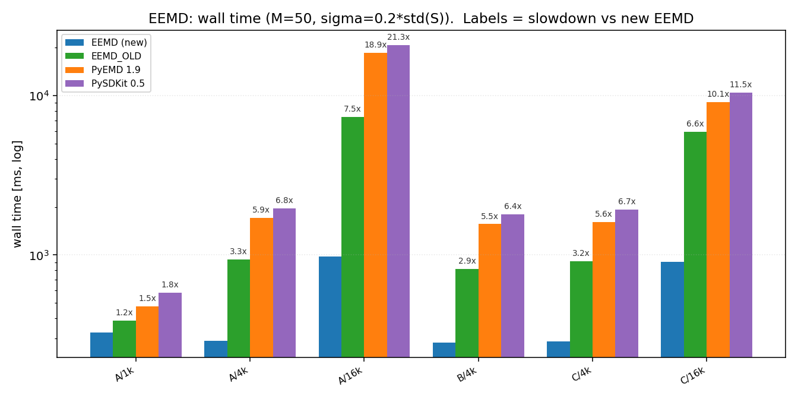
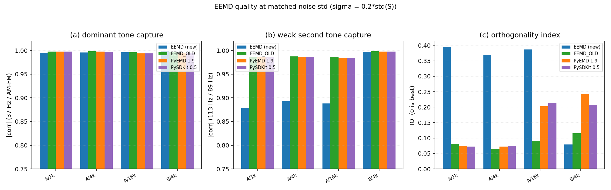
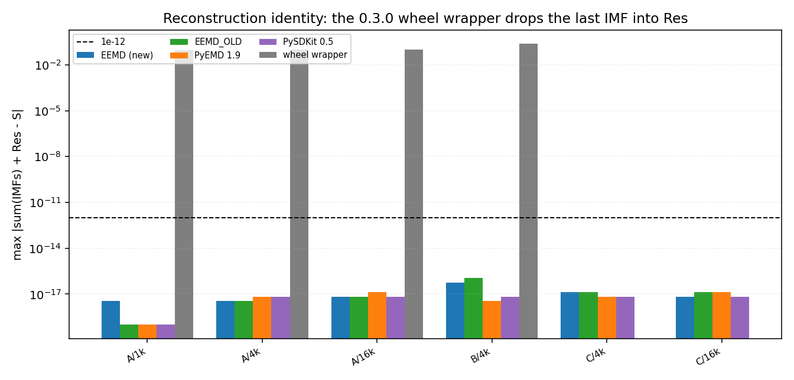
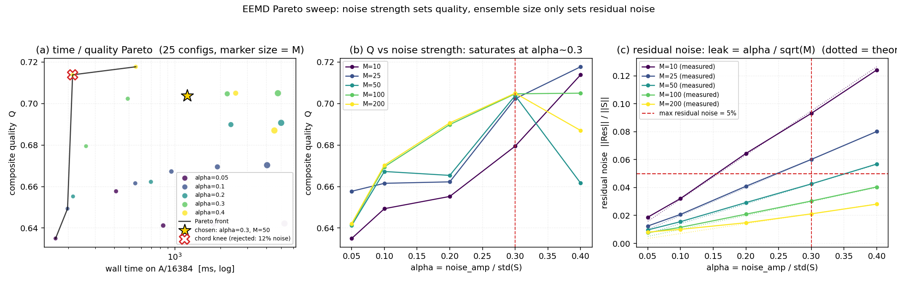
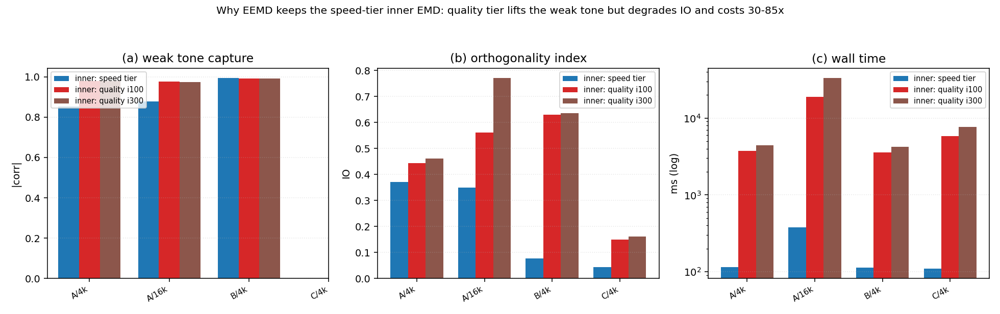

# EEMD（原生引擎）验证与三方对照报告

> 同族报告：[EMD](./EMD_Native_Engine_Report.md) · [EEMD](./EEMD_Native_Engine_Report.md) · [CEEMD](./CEEMD_Native_Engine_Report.md) · [CEEMDAN](./CEEMDAN_Native_Engine_Report.md) · [ICEEMDAN](./ICEEMDAN_Native_Engine_Report.md) · [RPSEMD](./RPSEMD_Native_Engine_Report.md)
>
> 对象：`src/Modal_Decomposition/EEMD.py` —— 库内原生 EEMD 引擎。本轮之前它以
> `EEMD_NEW.py` 的名字做原型验证，现已在重构中**转正为正式的 `EEMD.py`**（旧的原生
> `EEMD.py` 被覆盖；它最后停留在提交 **`dd547f2`**（479 行、含 `_Registry`），只能从
> `git show dd547f2:src/Modal_Decomposition/EEMD.py` 取回 —— **现行 HEAD 里已经是新引擎**）。
> 全文简称 **EEMD（原生）**。
>
> 报告覆盖面：重构背景与可运行性、本轮 9 条修复及其验证、**噪声口径对齐**（最易比错、
> 单列一节）、四方对照（本库新 / 本库旧原生 / PyEMD / PySDKit）、残差约定与 0.3.0
> wheel 包装的残差缺陷、内层 EMD 档位消融、架构与参数、并行实现、已知取舍、复现方式。

---

## 1. 环境与口径

| 项 | 值 |
|---|---|
| Python | 3.10.11 |
| numpy | 2.2.6 |
| scipy | 1.15.3 |
| PyEMD | 1.9.0 |
| pysdkit | 0.5.0 |
| numba / psutil | 0.67.0 / 7.2.2 |
| 操作系统 | Windows-10-10.0.26200-SP0 |
| CPU | Intel64 Family 6 Model 183 Stepping 1，32 逻辑核 |

**计时口径**

- 全部**同进程、同一脚本**内测量；输入数组在整轮中复用同一个对象（各实现拿到同一份数据）。
- 实验 1（四方对比，§5）与实验 4（开箱默认，§5.4）为**单次计时**。
- 实验 2（内层档位消融，§8）**未预热**，耗时列**只作量级参考**，不可与其它实验的绝对毫秒
  互相比较。
- 实验 3（Pareto 扫描，§7）的成本轴固定取 **A/16384 的单次实测墙钟**；质量网格为
  A/4096、A/16384、B/4096、C/4096、C/16384。
- 跨日 / 跨脚本的绝对毫秒数不可比，本报告只做同表内比较。
- 质量指标全部来自仓库自带的 `tests/comparison/quality.py`（`recon_max_abs` /
  `orthogonality_index` / `best_abs_corr`），各方共用同一份代码路径。

**指标定义（读表前置）**

| 指标 | 含义 |
|---|---|
| `k` | IMF 行数（**不含**残差行） |
| `valid` | 满足 `\|zc − ext\| ≤ 1` 的 **IMF 行** 数；过零用 PyEMD `indzer` 口径，极值用库内 `Utils.Peaks` 规则 |
| `mode1` / `mode2` | case A = 37 Hz / 113 Hz 音调的最佳单行 \|corr\|；case B = AM-FM / 89 Hz 音调的最佳单行 \|corr\| |
| `IO` | 正交性指数 `2·Σ_{i<j}⟨c_i,c_j⟩ / Σ‖c_i‖²`，越接近 0 越好 |
| `leak` | `‖Res‖ / ‖S‖`，残差相对能量。**只有在「真实残差≈0」的信号上才能当噪声残留读**（case B 的残差含真实二次趋势，见 §7.4） |
| `recon` | `max\|ΣIMFs + Res − S\|`，即重建恒等式的最大偏离 |

**测试信号**（`tests/comparison/signals.py`）

| 代号 | 构成 |
|---|---|
| A | `sin(2π·37t) + 0.5·sin(2π·113t) + 0.1·N(0,1)`（种子 20260906）：强音调 + 弱音调 + 噪声 |
| B | AM-FM + 89 Hz 音调 + 二次趋势：干净多分量 |
| C | 白噪声（种子 771）：纯噪声 |

---

## 2. 背景与本次重构

### 2.1 旧原生 EEMD 已经跑不起来

旧 `EEMD.py` 是**真原生实现**（自有 `_trial_worker` + 进程池，并保留 `_decompose_pyemd`
作为过渡通道），但被两处导入直接挡住，无法实例化：

| 导入语句 | 失败原因 |
|---|---|
| `from .Base import Config` | `Config` 已搬到 `.Define`，`Base` 不再导出 → `ImportError: cannot import name 'Config' from 'Modal_Decomposition.Base'` |
| `from ._Registry import register_class` | `_Registry.py` 已被删除 → `ModuleNotFoundError: No module named 'Modal_Decomposition._Registry'` |

这两条与 EMD 轮遇到的是同一类问题（见 `EMD_Native_Engine_Report.md` §2）。因此本轮对比里
的「旧原生」基线**不能直接 import**，只能从 git 取源重建（见 §12.2）。

### 2.2 0.3.0 wheel 里的 EEMD 只是 PyEMD 的薄包装，而且残差有缺陷

`dist/modal_decomposition-0.3.0-*.whl` 内的 `EEMD.py` 仅 3229 B，内部直接调用
`PyEMD.EEMD`，然后：

```python
IMFs = result[:-1]      # 把最后一阶 IMF 当成残差
Res  = result[-1]
```

而 PyEMD 的 `eemd()` 返回的是**全部 IMF**（残差在 `obj.residue`，不在返回值里）。于是它
**丢掉了一整阶 IMF**，并把这一阶 IMF 冒充成残差 → 重建恒等式不成立（本报告 §6 实测
`recon` = 9.27e-02 … 2.33e-01）。这一列只作为**参考**保留，不作为质量基线。

### 2.3 现在的状态

`EEMD_NEW.py` 已转正为 `EEMD.py`：模块级无函数；类 `EEMD` 保持
`__init__ / param_check / config_generate / decompose / parallel_decompose` 五个方法
（与 EMD 轮一致地遵守「不增删函数」的约束）；`EEMDConfig` 为 frozen dataclass。

---

## 3. 本轮修复清单与验证

全部为**语句级**改动，函数清单未变（模块级无函数；方法数 5）。

| # | 位置 | 问题 | 修复 |
|---|---|---|---|
| 1 | `__init__` | `unknown = set(kwargs) - {"", ...}` 白名单里没有真键名，任何 kwargs 都被拒 | 补全 16 个键：`dtype` + 15 个 `emd_*` |
| 2 | `param_check` | 默认 `noise_amp=None`，但先 `isinstance(None, float)` → 默认构造直接抛 `TypeError`，自动推断成死代码 | 改为**先判 `None` 再判类型**（`None` 合法，`int` 也接受） |
| 3 | `__init__` | `emd_need_squeeze` 读的键是 `"need_squeeze"`，与其余 15 个 `emd_*` 不一致 | 统一为 `"emd_need_squeeze"` |
| 4 | `decompose` | 开头不重置 `self.imfs/self.res`，同实例第二次调用会把上次结果当累积器 | 开头置 `None` |
| 5 | `decompose` | `self.noise_amp` 被回写，换信号复用实例会沿用上次推出来的幅值 | 改用局部变量 `noise_amp`，不再回写 |
| 6 | `decompose` 串行 | 首个试验 `self.imfs = IMFs` 是**别名**，后续 `+=` 会原地改写上一层 `EMDResult.IMFs` | 改 `np.array(IMFs, copy=True)` |
| 7 | `decompose` | `rows` 记的是累积后的行数，与并行分支语义不一致 | 改记**每次试验的 k** |
| 8 | `decompose` 并行 | `pointer = EMDResult` 只重绑局部名，父进程永远拿到 `None`（`AttributeError`）；且只跑 `num_workers` 次而非 `M` 次 | 见 §10 |
| 9 | `decompose` | `info` 缺实际使用的噪声幅值，无法追溯 | 增加 `noise_amp` 字段 |

> 附带说明：`self.imfs /= 2`（1/2 指数加权，会让后面的试验权重更大）在本次修改**之前**
> 已被改成 `self.imfs /= self.M`，本轮只是**验证**它是真算术平均，未再改动。

### 3.1 修复验证（实测）

| 检查项 | 结果 |
|---|---|
| `EEMD()` 默认构造 | ✅ 可用；自动档系数 `noise_amp = 0.3`，`info["noise_std"] = noise_amp · std(S)`（实测 `std(S)=0.701036` → `noise_std=0.210311`，比值恰为 **0.3000**） |
| kwargs 白名单 | ✅ `dtype` / `emd_faster` / `emd_need_squeeze` / `emd_nbsym`+`emd_internal_iter` 均通过；旧名 `need_squeeze` 被正确拒绝 |
| 串行是否为真算术平均（M=3，固定种子，手工复现同一 RNG 流） | ✅ `\|算术平均 − 实测\| = 0.000e+00` |
| 状态重置（同实例、同种子两次） | ✅ 逐位相同 |
| 信号切换是否残留 `noise_amp` | ✅ 信号放大 100× 后系数 `noise_amp` **保持 0.3**、`noise_std` 由 0.210311 变 **21.0311**（×100）—— 说明按新信号重新推断，没有沿用旧值 |
| 并行 M=3 / num_workers=3（父进程派生种子，逐位复现） | ✅ 重构 5.55e-17；`\|手工算术平均 − 并行实测\| = 0.000e+00` |
| 并行不均匀切分 M=5 / num_workers=3 | ✅ `rows=[6,6,7,6,6]`、5 条 EMD info、重构 5.55e-17 |
| 并行可复现性 | ✅ 设种子两次逐位相同；不设种子两次不同 |
| `num_workers > M` | ✅ M=2 / num_workers=8 被 clamp 到 2，正常返回 |

---

## 4. 噪声口径对齐（最易比错的地方）

EEMD 的核心参数是「往信号里加多强的噪声」。各家库对同一件事用了**两种不同的归一基准**，
直接照抄数字必然比错。

| 实现 | 参数名 | 归一基准 | 注入的噪声标准差 |
|---|---|---|---|
| **本库 EEMD（原生）** | `noise_amp` | **信号标准差 `std(S)`**（无量纲**幅值系数**） | `σ̂ = noise_amp · std(S)` |
| 本库旧原生 EEMD | `noise_width` | 峰峰值 | `σ̂ = noise_width · \|max(S) − min(S)\|` |
| PyEMD 1.9 `EEMD` | `noise_width` | 峰峰值 | `σ̂ = noise_width · \|max(S) − min(S)\|` |
| PySDKit 0.5 `EEMD` | `noise_width` | 峰峰值 | `σ̂ = noise_width · \|max(S) − min(S)\|` |

依据（读源码确认，不是推测）：

- **本库** `EEMD.decompose`：`noise_std = noise_amp * S.std()`，随后
  `S + noise_amp * np.random.normal(0, S.std(), N)`；`noise_amp=None` 时取系数 `0.3`。
  所以 `noise_amp` 是**幅值系数**：信号整体放大 `k` 倍时它**不变**，而 `noise_std` 跟着放大
  `k` 倍（实测：`std(S)=0.701036` 时 `noise_amp=0.3`、`noise_std=0.210311`，比值恰为 0.3000；
  信号放大 100× 后 `noise_amp` 仍是 0.3、`noise_std` 变为 21.0311）。
- **PyEMD** `PyEMD/EEMD.py` 的 `noise_width` 文档串：`σ̂ = σ·|max(S) − min(S)|`，其中
  `σ` 即 `noise_width`。
- **PySDKit** `pysdkit/_emd/eemd.py:244`：`scale = self.noise_width * np.abs(np.max(signal) - np.min(signal))`，
  随后 `self._scale = scale` 用于每个 trial 生成噪声。

> ⚠️ **注意**：PySDKit 的文档串写的是「standard deviation of Gaussian noise」，但代码里
> 又乘了峰峰值 —— **文档与实现不一致**，以代码为准（峰峰值口径）。

### 4.1 换算公式

设目标噪声标准差为 `σ̂`：

```text
本库 EEMD        : noise_amp   = σ̂ / std(S)          (即幅值系数 α)
旧原生 / PyEMD  : noise_width = σ̂ / |max(S) − min(S)|
PySDKit        : noise_width = σ̂ / |max(S) − min(S)|
```

反过来，若手里只有 `noise_width`：

```text
σ̂ = noise_width × |max(S) − min(S)|          (旧原生 / PyEMD / PySDKit)
```

### 4.2 本次实验的取法

本次统一取

```text
σ̂ = α · std(S),  α = 0.2
```

即**相对信号标准差**，而非相对峰峰值。在本库的新参数化下这恰好等于 `noise_amp = α`。
实测脚本里的换算：

| 实现 | 实际传参 |
|---|---|
| 本库 EEMD（新） | `noise_amp = σ̂ / std(S) = α` |
| 本库旧原生 | `noise_width = σ̂ / \|max(S) − min(S)\|` |
| wheel 包装（PyEMD 基） | `noise_width = σ̂ / \|max(S) − min(S)\|` |
| PyEMD | `noise_width = σ̂ / \|max(S) − min(S)\|` |
| **PySDKit** | `noise_width = σ̂ / \|max(S) − min(S)\|` |

> **口径变更留痕**：本库 `noise_amp` 的含义在成文后改过一次 —— 由「绝对标准差」改为
> 「幅值系数」。**有效噪声强度没有变**：旧写法 `noise_amp = σ̂` 与新写法
> `noise_amp = σ̂ / std(S)` 描述的是同一个 `σ̂`，所以 §5 起的全部实测数字无需改动，
> 只是参数标签从 σ̂ 变成了 α。

#### 本轮初版的口径错误（已修正并重跑，留档）

本轮**初版** `bench.py` 的 `run_pysdkit` 直接传了 `noise_width = σ̂`（按绝对 σ 理解），而
PySDKit 内部还会再乘一次峰峰值 → 实际注入的噪声标准差是 `σ̂ · |max(S) − min(S)|`，
比名义值强「峰峰值」倍。

后果是双重的：该库分解会**提前停**（省下大量迭代时间），同时 `IO` 出现
0.49 / 0.80 / 0.35 这种与其它三家（0.07 左右）严重脱节的数字。**那不是「PySDKit 正交性
差」，而是噪声被放大后的假象。**

发现后已把 `run_pysdkit` 改为 `noise_width = σ̂ / |max(S) − min(S)|` 并**整组重跑**，
§5 的 PySDKit 列采用的是重跑后的同口径数据。这条修正属于本轮工作的一部分，故在此留档。

---

## 5. 四方对比结果

实验条件：**M = 50**，`σ̂ = 0.2·std(S)`，`parallel=False`，各引擎自身默认的内层 EMD。

> 四列（本库新 / 本库旧原生 / PyEMD / PySDKit）为**同口径**数据：噪声标准差统一为
> `σ̂ = 0.2·std(S)`，各库按 §4.1 的公式换算传参。PySDKit 列采用口径修正后重跑的结果
> （修正经过见 §4.2）。





### 5.1 完整结果表

**case A/1024**

| 实现 | t_ms | k | valid | mode1 | mode2 | IO | recon |
|---|---:|---:|---:|---:|---:|---:|---:|
| EEMD（原生/新） | **324.7** | 5 | 1/5 | 0.9946 | 0.8790 | 0.3945 | 3.47e-18 |
| EEMD_OLD（原生/旧） | 386.1 | 5 | 2/5 | 0.9974 | **0.9869** | 0.0811 | 0 |
| PyEMD 1.9 | 473.9 | 8 | 4/8 | **0.9978** | 0.9865 | 0.0745 | 0 |
| PySDKit 0.5 | 577.3 | 9 | 6/9 | 0.9975 | 0.9867 | **0.0728** | 0 |
| wheel 包装（参考） | 496.9 | 8 | 5/8 | 0.9975 | 0.9867 | 0.0759 | 9.27e-02 |

**case A/4096**

| 实现 | t_ms | k | valid | mode1 | mode2 | IO | recon |
|---|---:|---:|---:|---:|---:|---:|---:|
| EEMD（原生/新） | **288.1** | 7 | 1/7 | 0.9955 | 0.8927 | 0.3693 | 3.47e-18 |
| EEMD_OLD（原生/旧） | 939.2 | 7 | 3/7 | **0.9979** | **0.9874** | **0.0659** | 3.47e-18 |
| PyEMD 1.9 | 1705.1 | 11 | 6/11 | 0.9975 | 0.9866 | 0.0722 | 6.94e-18 |
| PySDKit 0.5 | 1954.1 | 11 | 7/11 | 0.9970 | 0.9868 | 0.0752 | 6.94e-18 |
| wheel 包装（参考） | 1720.5 | 10 | 6/10 | 0.9970 | 0.9868 | 0.0779 | 9.86e-02 |

**case A/16384**

| 实现 | t_ms | k | valid | mode1 | mode2 | IO | recon |
|---|---:|---:|---:|---:|---:|---:|---:|
| EEMD（原生/新） | **977.8** | 9 | 2/9 | 0.9964 | 0.8880 | 0.3866 | 6.94e-18 |
| EEMD_OLD（原生/旧） | 7355.5 | 10 | 3/10 | **0.9966** | **0.9861** | **0.0908** | 6.94e-18 |
| PyEMD 1.9 | 18509.9 | 13 | 3/13 | 0.9939 | 0.9843 | 0.2033 | 1.39e-17 |
| PySDKit 0.5 | 20800.6 | 13 | 5/13 | 0.9937 | 0.9843 | 0.2143 | 6.94e-18 |
| wheel 包装（参考） | 18857.5 | 12 | 4/12 | 0.9937 | 0.9843 | 0.2163 | 9.55e-02 |

**case B/4096**

| 实现 | t_ms | k | valid | mode1 | mode2 | IO | recon |
|---|---:|---:|---:|---:|---:|---:|---:|
| EEMD（原生/新） | **281.8** | 6 | 2/6 | **0.9981** | 0.9967 | **0.0792** | 5.55e-17 |
| EEMD_OLD（原生/旧） | 819.7 | 7 | 3/7 | 0.9965 | **0.9982** | 0.1156 | 1.11e-16 |
| PyEMD 1.9 | 1561.0 | 9 | 4/9 | 0.9945 | 0.9978 | 0.2418 | 3.47e-18 |
| PySDKit 0.5 | 1805.1 | 9 | 3/9 | 0.9943 | 0.9977 | 0.2073 | 6.94e-18 |
| wheel 包装（参考） | 1546.3 | 8 | 3/8 | 0.9943 | 0.9977 | 0.2852 | 2.33e-01 |

**case C/4096（纯噪声）**

| 实现 | t_ms | k | valid | mode1 | mode2 | IO | recon |
|---|---:|---:|---:|---:|---:|---:|---:|
| EEMD（原生/新） | **286.1** | 7 | 0/7 | — | — | **0.0543** | 1.39e-17 |
| EEMD_OLD（原生/旧） | 915.8 | 8 | 0/8 | — | — | 0.0863 | 1.39e-17 |
| PyEMD 1.9 | 1611.6 | 11 | 2/11 | — | — | 0.0995 | 6.94e-18 |
| PySDKit 0.5 | 1927.0 | 12 | 3/12 | — | — | 0.1011 | 6.94e-18 |

**case C/16384（纯噪声）**

| 实现 | t_ms | k | valid | mode1 | mode2 | IO | recon |
|---|---:|---:|---:|---:|---:|---:|---:|
| EEMD（原生/新） | **903.1** | 9 | 1/9 | — | — | **0.0476** | 6.94e-18 |
| EEMD_OLD（原生/旧） | 5930.8 | 10 | 0/10 | — | — | 0.1087 | 1.39e-17 |
| PyEMD 1.9 | 9077.7 | 14 | 1/14 | — | — | 0.1256 | 1.39e-17 |
| PySDKit 0.5 | 10419.9 | 14 | 2/14 | — | — | 0.1286 | 6.94e-18 |

### 5.2 耗时：新 EEMD 全面最快

以「新 EEMD 的耗时」为分母，各家相对倍数（**按上表自行计算**）：

| case/n | 新 EEMD | EEMD_OLD | PyEMD | PySDKit |
|---|---:|---:|---:|---:|
| A/1024 | 324.7 ms | 1.19× | 1.46× | 1.78× |
| A/4096 | 288.1 ms | 3.26× | 5.92× | 6.78× |
| A/16384 | 977.8 ms | 7.52× | 18.93× | 21.27× |
| B/4096 | 281.8 ms | 2.91× | 5.54× | 6.41× |
| C/4096 | 286.1 ms | 3.20× | 5.63× | 6.74× |
| C/16384 | 903.1 ms | 6.57× | 10.05× | 11.54× |

- **每个格子都是新 EEMD 最快。**
- 优势随长度放大：A 系列从 1.19×/3.26×/7.52× 一路上扬，PyEMD 在 A/16384 上已达 **18.93×**、
  PySDKit **21.27×**。
- A/1024 的优势最小（1.19×），且有一处反直觉现象：**新 EEMD 在 A/1024（324.7 ms）比 A/4096
  （288.1 ms）还慢**。原因是内层 EMD 的迭代次数取决于信号自身的极值分布，A/1024 的分量更少
  （k=5）但每次筛分要走的迭代并不按长度线性缩短；因此**不要用「A/1024 的 1.19×」去外推**
  其它长度上的加速比。
- **PySDKit 的相对倍数比口径修正前明显变大**（A/16384 9.96× → **21.27×**、A/4096 6.31× →
  **6.78×**）。修正前它注入的噪声被放大 |max−min| 倍，分解提前停、白占了便宜；口径对齐后
  这部分「速度优势」消失。
- 本库两个原生实现（新 vs 旧）的差距来自内层 EMD 的重写（见 `EMD_Native_Engine_Report.md`），
  旧原生用的是 0.3.0 那套旧 EMD。

### 5.3 质量：主音调同级，弱音调有价，纯噪声 IO 最好

**① 主音调（`mode1`）与各家同级。** 新 EEMD 在 0.9946–0.9981 区间
（A：0.9946 / 0.9955 / 0.9964；B：0.9981），与 EEMD_OLD（0.9965–0.9979）、
PyEMD（0.9937–0.9977）互有胜负，差距都在 0.005 以内。**强分量捕获不是瓶颈。**

**② 弱音调（`mode2`）系统性偏低约 0.09–0.11。**

| case | 新 EEMD | EEMD_OLD | 差 | PyEMD | 差 | PySDKit | 差 |
|---|---:|---:|---:|---:|---:|---:|---:|
| A/1024 | 0.8790 | 0.9869 | **−0.1078** | 0.9865 | **−0.1074** | 0.9867 | **−0.1077** |
| A/4096 | 0.8927 | 0.9874 | **−0.0946** | 0.9866 | **−0.0939** | 0.9868 | **−0.0940** |
| A/16384 | 0.8880 | 0.9861 | **−0.0981** | 0.9843 | **−0.0963** | 0.9843 | **−0.0963** |
| B/4096 | 0.9967 | 0.9982 | −0.0015 | 0.9978 | −0.0011 | 0.9977 | −0.0010 |

即：**弱音调（幅值只有强音调一半）在新 EEMD 里明显更差，而干净信号（case B）几乎无差**
（−0.0010 ~ −0.0015）。

关键在「三家对齐」：对比的三家实现（旧原生 / PyEMD / PySDKit）在 case A 上**全部落在
0.984–0.987 这个很窄的带里**，唯新 EEMD 是 0.879 / 0.893 / 0.888。这说明差距不是某一家的
实现细节，而是**本库内层 EMD 的系统性差距**。这与下面 k 偏少是同一个现象的两面。

**③ `k` 偏少。** 新 EEMD 的 IMF 数稳定少于 PyEMD/PySDKit：

| case/n | 新 EEMD | EEMD_OLD | PyEMD | PySDKit |
|---|---:|---:|---:|---:|
| A/1024 | 5 | 5 | 8 | 9 |
| A/4096 | 7 | 7 | 11 | 11 |
| A/16384 | 9 | 10 | 13 | 13 |
| B/4096 | 6 | 7 | 9 | 9 |
| C/4096 | 7 | 8 | 11 | 12 |
| C/16384 | 9 | 10 | 14 | 14 |

新 EEMD 与 EEMD_OLD 基本同档（1024/4096 完全一致，16384 少一阶），但比 PyEMD/PySDKit
**稳定少 3–5 阶**。少的那几阶是低频分量，它们被并进了残差 —— 这正是 case A 上 IO 偏差的
来源（见下条）。

**④ 纯噪声上 IO 最好，case A 上 IO 偏差。**

| case/n | 新 EEMD | EEMD_OLD | PyEMD | PySDKit |
|---|---:|---:|---:|---:|
| A/1024 | 0.3945 | 0.0811 | 0.0745 | **0.0728** |
| A/4096 | 0.3693 | **0.0659** | 0.0722 | 0.0752 |
| A/16384 | 0.3866 | **0.0908** | 0.2033 | 0.2143 |
| B/4096 | **0.0792** | 0.1156 | 0.2418 | 0.2073 |
| C/4096 | **0.0543** | 0.0863 | 0.0995 | 0.1011 |
| C/16384 | **0.0476** | 0.1087 | 0.1256 | 0.1286 |

- **纯噪声（C）上新 EEMD 的正交性最好**（0.0543 / 0.0476，只有 EEMD_OLD 的一半、
  PyEMD/PySDKit 的 40–55%），说明它在噪声上分出来的各阶重叠最小。
- **case B 上也是新 EEMD 最好**（0.0792，而旧原生 0.1156、PySDKit 0.2073、PyEMD 0.2418）
  —— PyEMD 系在「AM-FM + 音调 + 趋势」这种多尺度混合信号上退化明显。
- **case A 上偏差**（0.369–0.395，其余三家 0.066–0.091）。原因不是「重叠变多」，而是
  **残差承担了更多低频能量**：新 EEMD 只出 5/7/9 阶，把本来该单独成阶的低频分量留在了
  残差里，而 `IO` 不计残差 —— 那么残差里的那部分能量必然体现为各阶之间的负相关。这也解释了
  为什么同一个引擎在 C 系列（残差本来就小）反而最好。
- **A/16384 上有一个值得单独说的现象**：PyEMD `0.2033`、PySDKit `0.2143`、wheel `0.2163`
  全部升到 0.20 以上，而**旧原生仍是 0.0908**。即**长信号上纯 PyEMD 内核的正交性明显退化**，
  旧原生靠自己的残差/截断策略把这个退化挡住了。新 EEMD 在 A/16384 上是四者中最差（0.3866），
  说明它的残差策略在长信号上没有起到同样的保护作用。

**⑤ `valid` 偏低：新 EEMD 在四家里最低。** 新 EEMD 在 case A 上 1–2 行、C 上 0–1 行满足
`|zc − ext| ≤ 1`；EEMD_OLD 同档（0–3 行）；PyEMD 1–6 行、PySDKit 2–7 行（后者最高）。原因很
直接：PyEMD/PySDKit 的内层 EMD 自带窄带门（PyEMD 的 `f2 = |extNo − nzm| < 2`），而本库内层
默认 `emd_faster=True`，**没有**这道门 —— 详见 §8 与 §11。

> **口径修正带来的结论变化（与初版相比）**：PySDKit **不再是离群点**，修正后与 PyEMD 基本
> 同级（A/4096：`mode2` 0.9868 vs 0.9866、`IO` 0.0752 vs 0.0722、`valid` 7/11 vs 6/11）。
> 初版那组 `IO` 0.49 / 0.80 / 0.35 是噪声被放大 |max−min| 倍的假象，不能作为
> 「PySDKit 正交性差」的证据。

### 5.4 开箱默认对比（每家使用它自己的默认参数）

§5.1–§5.3 是**等口径**对照（统一 `σ̂ = 0.2·std(S)`）。本节回答另一个问题：
**用户什么都不调、直接 `EEMD().fit(...)`，会拿到什么。**

> ⚠️ **本节不是等口径数据。** 各家用的是自己的默认噪声强度：
> 新 EEMD 默认幅值系数 `alpha = 0.3` → A/4096 上实际 `σ = 0.2386`；另三家默认 `noise_width = 0.05`
> （峰峰值口径）→ `σ = 0.1731`（A/4096）/ `0.1777`（A/16384）。所以本节比的是
> **「默认配置的整体表现」**，不是「同一噪声强度下的算法差异」。等口径结论请看 §5.1–§5.3。

| case/n | 实现 | t_ms | k | valid | mode1 | mode2 | IO | leak | 实际 σ |
|---|---|---:|---:|---:|---:|---:|---:|---:|---:|
| A/4096 | EEMD（原生/新） | **413.3** | 7 | 2/7 | 0.9977 | 0.9762 | 0.1763 | 0.043 | 0.2386 |
| A/4096 | EEMD_OLD | 2258.8 | 7 | 3/7 | **0.9980** | **0.9888** | **0.0752** | 0.022 | 0.1731 |
| A/4096 | PyEMD 1.9 | 4668.8 | 11 | 5/11 | 0.9976 | 0.9876 | 0.0900 | 0.022 | 0.1731 |
| A/4096 | PySDKit 0.5 | 4945.3 | 11 | 5/11 | 0.9977 | 0.9875 | 0.0966 | 0.022 | 0.1731 |
| A/16384 | EEMD（原生/新） | **1029.7** | 8 | 3/8 | **0.9985** | 0.9778 | 0.1744 | 0.042 | 0.2388 |
| A/16384 | EEMD_OLD | 16479.8 | 10 | 4/10 | 0.9964 | **0.9868** | **0.1262** | 0.023 | 0.1777 |
| A/16384 | PyEMD 1.9 | 47907.8 | 13 | 4/13 | 0.9934 | 0.9851 | 0.3140 | 0.022 | 0.1777 |
| A/16384 | PySDKit 0.5 | 57814.2 | 13 | 4/13 | 0.9927 | 0.9845 | 0.3370 | 0.022 | 0.1777 |
| B/4096 | EEMD（原生/新） | **374.6** | 6 | 2/6 | **0.9968** | 0.9971 | **0.0772** | 0.257 | 0.2557 |
| B/4096 | EEMD_OLD | 2311.1 | 7 | 3/7 | 0.9942 | **0.9987** | 0.3211 | 0.249 | 0.2060 |
| B/4096 | PyEMD 1.9 | 3856.2 | 10 | 4/10 | 0.9846 | 0.9979 | 0.3171 | 0.259 | 0.2060 |
| B/4096 | PySDKit 0.5 | 4629.4 | 10 | 3/10 | 0.9851 | 0.9980 | 0.2846 | 0.280 | 0.2060 |
| C/4096 | EEMD（原生/新） | **391.6** | 7 | 1/7 | — | — | **0.0863** | 0.045 | 0.3036 |
| C/4096 | EEMD_OLD | 2380.2 | 8 | 1/8 | — | — | 0.1417 | 0.039 | 0.3297 |
| C/4096 | PyEMD 1.9 | 3799.9 | 12 | 4/12 | — | — | 0.1581 | 0.045 | 0.3297 |
| C/4096 | PySDKit 0.5 | 4097.6 | 12 | 4/12 | — | — | 0.1584 | 0.042 | 0.3297 |

**① 速度：仍是全面最快，且随长度放大。**

| case/n | 新 EEMD | vs EEMD_OLD | vs PyEMD | vs PySDKit |
|---|---:|---:|---:|---:|
| A/4096 | 413.3 ms | **5.47×** | **11.30×** | **11.97×** |
| A/16384 | 1029.7 ms | **16.00×** | **46.53×** | **56.15×** |

注意这里的倍数比 §5.2（等口径，`M=50, σ=0.2`）还大得多 —— 因为本节的对照是**照各自默认**
（旧原生/PyEMD/PySDKit 默认 `trials=100`），而新 EEMD 默认 `M=50`，集成数只有一半。

**② 弱音调差距大幅收窄 —— 这是改默认值最直接的收益。**

| case/n | 新 EEMD | EEMD_OLD | PyEMD | PySDKit | 差距 |
|---|---:|---:|---:|---:|---|
| A/4096 | **0.9762** | 0.9888 | 0.9876 | 0.9875 | 0.011–0.013 |
| A/16384 | **0.9778** | 0.9868 | 0.9851 | 0.9845 | 0.007–0.009 |

对照 §5.1 的等口径组（`σ̂ = 0.2·std(S)`）差距是 **0.09–0.11**。把默认 `alpha` 从 0.2 提到
0.3（§7 的饱和点）后，**弱音调差距从 0.09–0.11 压到 0.007–0.013**，代价是残差多留一点点
噪声（`leak` 0.043 vs 0.022）与 `k` 略少（8 vs 10/13）。

**③ IO 也明显改善，且在 B/C 上已是四家最好。**

| case/n | 新 EEMD | EEMD_OLD | PyEMD | PySDKit | 说明 |
|---|---:|---:|---:|---:|---|
| A/4096 | 0.1763 | **0.0752** | 0.0900 | 0.0966 | 比等口径组的 0.3693 大幅下降 |
| A/16384 | 0.1744 | **0.1262** | 0.3140 | 0.3370 | **已优于 PyEMD / PySDKit**，仅不如旧原生 |
| B/4096 | **0.0772** | 0.3211 | 0.3171 | 0.2846 | **四家最好** |
| C/4096 | **0.0863** | 0.1417 | 0.1581 | 0.1584 | **四家最好** |

对照 §5.3④：等口径下 case A 的 IO 是 0.3693 / 0.3866，本节降到 **0.1763 / 0.1744**（约减半）。
**case B 从「新 EEMD 居中」变成「四家最好」**，case C 继续保持最好。

**④ `leak` 在本节只有 case A / C 能当噪声读。** case B 的 `leak` 四家都在 0.25–0.28，因为
B 的真实残差里有一条二次趋势，这部分能量本来就不该被 IMF 吃掉 —— **不能把它读成噪声残留**。
详见 §7.4 的指标警告。

> **与 §5 的关系**：§5 是「同样的噪声强度下谁的算法更好」，§5.4 是「什么都不调时谁的默认更好」。
> 前者的结论（弱音调差 0.09–0.11）说明内层 EMD 仍有系统性差距；后者的结论（差距 0.007–0.013）
> 说明**把默认噪声强度调到饱和点可以把这个差距大部分补回来**。两者不矛盾，是同一问题的两个视角。

---

## 6. 残差约定与 0.3.0 wheel 包装的缺陷

本库三个实现（新 EEMD / 旧原生 / wheel 包装）与 PySDKit 都返回 `(IMFs, Res)`，但**残差的
定义不同**，这直接决定重建恒等式是否成立。



| 实现 | 残差约定 | `recon` 实测 | 恒等式成立 |
|---|---|---:|---|
| EEMD（原生/新） | `Res = S − ΣIMFs` | 3.47e-18 … 5.55e-17 | ✅ |
| EEMD_OLD（原生/旧） | `Res = S − ΣIMFs` | 0 … 1.11e-16 | ✅ |
| PyEMD 1.9（本报告口径） | 由调用方按 `S − ΣIMFs` 计算 | 0 … 1.39e-17 | ✅ |
| PySDKit 0.5 | `get_imfs_and_residue()` 返回的真残差 | 0 … 6.94e-18 | ✅ |
| **wheel 包装（0.3.0）** | **`IMFs = result[:-1]`、`Res = result[-1]`** | **9.27e-02 … 2.33e-01** | ❌ |

**四家正确实现全部落在 ≤1.2e-16（纯浮点舍入量级），只有 wheel 包装是 9.27e-02 … 2.33e-01**
—— 两者相差约 **15 个数量级**。也就是说：残差约定对不对，直接决定「分解完还能不能拼回原信号」。

**缺陷机理**：PyEMD 的 `eemd()` 返回**全部 IMF**（残差在 `obj.residue`，没有并进返回值）。
wheel 包装把返回值切一刀，于是

- 最后一阶 IMF 被**丢掉**（不再参与重建）；
- 同时它被**冒充成残差**。

所以 `ΣIMFs + Res` 少了最后一阶 IMF 那部分能量，`recon` 落到 1e-1 量级 —— 比正确实现的
1e-17 差了 **15 个数量级**。

**对使用者意味着什么**：用 0.3.0 的 `EEMD` 做分解再 `ΣIMFs + Res` 重建，**得不到原信号**。
这一列在 §5 中只作参考，不作为质量基线；若要用 PyEMD 做对照，必须自己从
`obj.residue` 取残差（本报告的 `run_pyemd` 就是这么做的）。

---

## 7. EEMD 的 Pareto 扫描与默认值

EEMD 有两个「该调多少」的问题：**加多强的噪声（`alpha`）** 与 **集成多少次（`M`）**。
两者都会同时影响质量与耗时，所以本节按 EMD 轮同样的做法做二维扫描，然后再定默认值。

### 7.1 扫描面与质量指标

- **扫描面**：`M ∈ {10, 25, 50, 100, 200}` × `alpha = noise_amp`（**幅值系数**，等价于 `σ̂/std(S)`）`∈ {0.05, 0.10, 0.20, 0.30, 0.40}`，
  共 **25 组**。
- **质量指标 `Q`**（与 EMD 轮同定义）：

  ```text
  q_A = mean{ A/4096, A/16384 }  0.5·(corr37 + corr113)      # 双音调捕获
  q_C = mean{ C/4096, C/16384 }  IMF 行级合规率              # 噪声鲁棒性
  q_B = B/4096 的 0.5·(corr_amfm + corr_89)                  # 干净信号保真
  Q   = (q_A + q_C + q_B) / 3
  ```

- **成本轴**：固定取 **A/16384 的单次实测墙钟**（ms）。
- **质量网格**：A/4096、A/16384、B/4096、C/4096、C/16384。
- 原始数据：`tests/comparison/results/eemd_new/pareto_sweep.json`。



> 图分三面板：**(a)** log 耗时 vs `Q` 的 25 点散点 + 前沿 + 选定点(★) + 被否决的弦距拐点(✗)；
> **(b)** `Q` vs `alpha`（每个 `M` 一条线，标出 `alpha = 0.3`）；
> **(c)** 实测 `leak` vs `alpha`（虚线为 `alpha/√M` 理论值）与 5% 阈值线。

### 7.2 核心发现一：`Q` 基本只由 `alpha` 决定，对 `M` 几乎不敏感

**固定 `M = 50`，看 `Q` 随 `alpha`：**

| `alpha` | `Q` | `mode2`（A/4096 的 113 Hz） | `leak` | t_ms（A/16384） |
|---|---:|---:|---:|---:|
| 0.05 | 0.6412 | 0.8179 | 0.010 | 838.8 |
| 0.10 | 0.6672 | 0.8338 | 0.016 | 949.4 |
| 0.20 | 0.6654 | 0.8927 | 0.029 | 1185.4 |
| **0.30** | **0.7038** | **0.9762** | 0.043 | 1207.0 |
| 0.40 | 0.6617 | 0.9820 | 0.057 | 1226.1 |

`Q` 在 `alpha = 0.30` 取到峰值 **0.7038**。注意 `alpha = 0.40` 那一行 `Q` 反而掉到 0.6617，
但它的 `mode2` 是全场最高的 0.9820 —— 说明**掉分不是来自音调捕获，而是来自 `q_C`（噪声
合规率）的抖动**：噪声越强，纯噪声信号上「刚好合规」的行数就越不稳定。

**固定 `alpha = 0.30`，看 `Q` 随 `M`：**

| `M` | `Q` | t_ms（A/16384） | `leak` |
|---|---:|---:|---:|
| 10 | 0.6795 | 261.0 | 0.0931 |
| 25 | 0.7023 | 491.0 | 0.0602 |
| **50** | **0.7038** | **1207.0** | 0.0426 |
| 100 | 0.7047 | 2210.3 | 0.0303 |
| 200 | 0.7050 | 4755.9 | 0.0212 |

`M` 从 50 加到 200，耗时翻了 **4 倍**（1207 → 4756 ms），`Q` 只涨 **0.0012**
（0.7038 → 0.7050）。**`M` 对质量几乎没有贡献**，它唯一明显改变的量是下面要说的残余噪声。

### 7.3 核心发现二：弱音调在 `alpha ≈ 0.3` 处饱和

`M = 50` 时 `mode2` 随 `alpha` 的走势：

| `alpha` | 0.05 | 0.10 | 0.20 | 0.30 | 0.40 |
|---|---:|---:|---:|---:|---:|
| `mode2`（A/4096） | 0.8179 | 0.8338 | 0.8927 | **0.9762** | 0.9820 |
| 相邻跃升 | — | +0.0159 | +0.0589 | **+0.0835** | +0.0058 |

**`alpha` 从 0.20 提到 0.30 是这一轮质量跃升的主因（+0.0835）**；再从 0.30 提到 0.40 只多
0.0058，几乎白付噪声。这就是「饱和点」的形状：`alpha ≈ 0.3` 之后收益急剧变平。

对照 §5.1 的 `sigma = 0.2·std(S)` 那组（`mode2 = 0.8927`，比另三家低 0.09–0.11），
**把 `alpha` 提到 0.3 正好把弱音调补到 0.9762**，与另三家的 0.984–0.987 只剩 0.008–0.011。

### 7.4 核心发现三：残余噪声 `leak ≈ alpha/√M`，逐组吻合

EEMD 的理论性质是「噪声按 `1/√M` 衰减」。实测 25 组的 `leak = ‖Res‖/‖S‖` 与理论值
`alpha/√M` **最大偏差仅 0.00453**，可以说逐组吻合。两个例子：

| 配置 | 实测 `leak` | 理论 `alpha/√M` |
|---|---:|---:|
| `alpha = 0.40, M = 10` | 0.1242 | 0.1265 |
| `alpha = 0.30, M = 50` | 0.0426 | 0.0424 |

这也解释了 §7.2 的结论：**`M` 不影响质量（`Q`），只影响残余噪声（`leak`）**。所以「加 `M`」
的正确用途不是提升分解质量，而是**把加进去的噪声再平均掉**。

> ⚠️ **`leak` 的读表警告（重要）**：`leak = ‖Res‖/‖S‖` 只有在「真实残差≈0」的信号上
> 才能当噪声残留读。**case B 的残差里有一条真实的二次趋势**，所以 §5.4 里四家的 case B
> `leak` 全在 0.25–0.28 —— **那是没有被 IMF 吃掉的真实趋势能量，不是噪声**。
> 本节的 `leak` 全部取 **A/4096**（残差≈0 的信号）。

### 7.5 Pareto 前沿退化：弦距拐点法在这里不可用

25 个点算出的 Pareto 前沿（最小化耗时、最大化 `Q`）**只有 4 个点**：

| `alpha` | `M` | `Q` | t_ms | `leak` |
|---|---:|---:|---:|---:|
| 0.05 | 10 | 0.6350 | 164.6 | 1.88% |
| 0.10 | 10 | 0.6493 | 197.4 | 3.21% |
| 0.40 | 10 | 0.7138 | 213.1 | **12.42%** |
| 0.40 | 25 | **0.7177** | 554.3 | 8.01% |

前沿之所以退化，正是 §7.2 的结论：**`Q` 主要由 `alpha` 一个参数决定，`M` 这条轴上几乎没有
可交换的东西**，所以「更贵」的点几乎总是「质量没更好」。

**前沿上质量最高的点（`alpha = 0.4, M = 25`，`Q = 0.7177`）与弦距拐点（`alpha = 0.4, M = 10`，
`Q = 0.7138` @ 213.1 ms）都落在 `alpha = 0.4` 这一侧**，而它们的残余噪声分别是 **8.01%** 与
**12.42%**（`0.4/√25 = 0.080`、`0.4/√10 = 0.126`，与 §7.4 的关系吻合）。这些都是**角落解**：
用 8–12% 的残留噪声换 0.01 量级的 `Q`。对分解任务的用户来说，残留这么多噪声通常不可接受
（残差里塞满了噪声，既不能当趋势也不能当信号），**因此判定为不可用、否决**。

**更值得记的一点**：如果先加 `leak ≤ 5%` 的可行性约束，再算弦距拐点，拐点会**跑到
`alpha = 0.05, M = 10`**（`Q = 0.6350`、164.6 ms、`leak = 1.88%）—— 也就是「最便宜的角落」，
而不是「质量最好的可行点」。这说明**弦距法在「`Q` 由单一参数主导」的退化前沿上不可靠**：
它按几何距离选点，一旦前沿形状退化成几段近乎竖直/水平的折线，拐点就会落到端点。

**所以本节不照搬 EMD 轮的拐点法**，改用下面这条更贴合 EEMD 物理意义的规则。

### 7.6 选定规则与最终默认值

选定规则分两步：

1. **先划可行域**：要求 `leak ≤ 5%`（由 §7.4 的 `alpha/√M` 关系，等价于要求
   `M ≥ (alpha/0.05)²`）。这条把「噪声没平均掉」的角落解全部排除。
2. **在可行域内按质量选**：取 `Q` 最高的；若若干点 `Q` 之差 ≤ 0.5%（视为同档），
   在其中取**最省**的那个。

结果：

| 候选 | `Q` | `mode2` | `leak` | t_ms（A/16384） | 结论 |
|---|---:|---:|---:|---:|---|
| **`alpha = 0.30, M = 50`** | **0.7038** | **0.9762** | **4.26%** | **1207.0** | ✅ **选定** |
| `alpha = 0.40, M = 100` | 0.7050 | 0.9820 | 4.04% | 2511.7 | ❌ 可行域最高 `Q`，但只高 **0.0012**、贵 **2.08×** |

**`alpha = 0.30, M = 50`** 是可行域内 `Q` 与另一点差 0.0012（远小于 0.5% 的同档阈值）
而耗时只有一半的那个点，故选它。

**据此改了代码默认值两处**（`src/Modal_Decomposition/EEMD.py`）：

| 项 | 旧 | 新 | 依据 |
|---|---|---|---|
| `M` | `100` | **`50`** | §7.2：`M` 从 50 到 200，`Q` 只涨 0.0012 而耗时 ×4 |
| 自动噪声系数（`noise_amp=None` 时） | 系数 `0.2`（即 `σ̂ = 0.2·std(S)`） | **系数 `0.3`**（即 `σ̂ = 0.3·std(S)`） | §7.3：弱音调在 `alpha≈0.3` 饱和；再高只多噪声 |

`noise_amp=None` 的**自适应/尺度不变语义保持不变** —— 只是系数从 0.2 换成 0.3，
仍然按输入信号自身的标准差推断，不引入绝对能量阈值。

---

## 8. 内层 EMD 档位消融

EEMD 的每一阶都由内层 EMD 筛出来，所以内层用什么档位会直接改变 EEMD 的结果。本库内层 EMD
有两个档位（详见 `EMD_Native_Engine_Report.md` §6）：

| 档位 | 参数 | 特点 |
|---|---|---|
| 速度档（默认） | `emd_faster=True, emd_internal_delta=0.2, emd_internal_iter=50` | Cauchy SD 收敛即放行 |
| 质量档 i100 | `emd_faster=False, emd_internal_delta=0.002, emd_internal_iter=100` | 再加窄带门 + 包络异号 + svar/std |
| 质量档 i300 | `emd_faster=False, emd_internal_delta=0.002, emd_internal_iter=300` | 同上，迭代上限更高 |

实验条件：**M = 20**，`σ̂ = 0.2·std(S)`。⚠️ **耗时列无预热，只作量级参考**（与 §5 不可直接比）。



| case/n | 内层档位 | t_ms | k | valid | mode1 | mode2 | IO |
|---|---|---:|---:|---:|---:|---:|---:|
| A/4096 | 速度档（默认） | **112.3** | 7 | 1/7 | 0.9921 | 0.8521 | **0.3716** |
| A/4096 | 质量档 i100 | 3630.7 | 10 | 1/10 | 0.9816 | **0.9805** | 0.4426 |
| A/4096 | 质量档 i300 | 4287.7 | 10 | 2/10 | 0.9814 | **0.9805** | 0.4612 |
| A/16384 | 速度档（默认） | **377.9** | 9 | 1/9 | 0.9947 | 0.8788 | **0.3495** |
| A/16384 | 质量档 i100 | 18663.2 | 12 | 2/12 | 0.9766 | 0.9780 | 0.5602 |
| A/16384 | 质量档 i300 | 33062.7 | 13 | 1/13 | 0.9715 | 0.9739 | 0.7698 |
| B/4096 | 速度档（默认） | **110.5** | 6 | 2/6 | 0.9974 | 0.9935 | **0.0777** |
| B/4096 | 质量档 i100 | 3437.7 | 9 | 2/9 | 0.9709 | 0.9917 | 0.6297 |
| B/4096 | 质量档 i300 | 4150.5 | 9 | 2/9 | 0.9802 | 0.9911 | 0.6362 |
| C/4096 | 速度档（默认） | **108.3** | 7 | 0/7 | — | — | **0.0433** |
| C/4096 | 质量档 i100 | 5748.7 | 12 | 3/12 | — | — | 0.1499 |
| C/4096 | 质量档 i300 | 7218.4 | 12 | 2/12 | — | — | 0.1604 |

### 8.1 结论：EEMD 的内层默认**保持速度档**

**质量档确实修好了弱音调**：

- A/4096：`mode2` 0.8521 → **0.9805**（+0.128），已追平 EEMD_OLD/PyEMD 的 0.986–0.988；
- A/16384：`mode2` 0.8788 → **0.9739 / 0.9780**（+0.095 / +0.099）。

**但代价太大，而且代价不只是时间**：

| 代价 | 实测 |
|---|---|
| 耗时 | A/4096 **32×–38×**、A/16384 **49×–87×**、B/4096 **31×–38×**、C/4096 **53×–67×** |
| `mode1` 反而下降 | A/4096 0.9921→0.9814/0.9816；A/16384 0.9947→0.9715/0.9766；B/4096 0.9974→0.9709/0.9802 |
| **`IO` 反而恶化** | A/4096 0.3716→0.4426/0.4612；**B/4096 0.0777→0.6297/0.6362（8 倍）**；A/16384 0.3495→0.5602/**0.7698** |
| `valid` 没有实质改善 | A/4096 1/7→1/10、2/10；A/16384 1/9→2/12、1/13；C/4096 0/7→3/12、2/12 |

**关键在于 `IO` 的方向**：内层收紧会让每一阶筛得更「纯」，但 EEMD 的集成平均把 M 条不同的
分解叠加起来，阶数变多（6→9、7→12）后各阶之间的互相关反而上升——尤其 case B 从 0.0777
直接跳到 0.6297，这对「多分量分解」的用途是**明确变差**。

因此：

> **EEMD 的内层默认保持速度档（`emd_faster=True`）。**
> 若某个具体任务确实需要弱音调（`mode2`），可以显式传
> `emd_faster=False, emd_internal_delta=0.002, emd_internal_iter=100`，
> 但要接受 30–90× 的耗时与 `IO` 变差；**不要**把质量档设成 EEMD 的默认。

这也和 EMD 轮的结论不矛盾：EMD 轮 Pareto 拐点选的是速度档，EEMD 是在它之上再叠 M 次，
时间放大 M 倍、误差也被平均 —— 收紧内层的边际收益被平均效应吃掉了，代价却按 M 倍放大。

---

## 9. 架构与参数

### 9.1 参数表

```python
EEMD(num_imf=-1, noise_amp=None, M=50, parallel=False, num_workers=1, copy=True, **emd_*)
```

| 参数 | 默认 | 说明 |
|---|---|---|
| `num_imf` | `-1` | 最终保留的 IMF 行数；`-1` 表示「分解到不能分为止」 |
| `noise_amp` | `None` | **幅值系数**（无量纲）；实际噪声 `σ̂ = noise_amp · std(S)`。`None` → 运行时取系数 **`0.3`**（依据见 §7.3 的饱和点） |
| `M` | **`50`** | 集成次数（trial 数）。默认由 100 降到 50 的依据见 §7.2／§7.6：`M` 从 50 到 200 只换来 `Q` +0.0012，耗时却 ×4 |
| `parallel` | `False` | 是否多进程 |
| `num_workers` | `1` | 进程数；int 为个数、float 为比例、`-1` 为全部核（经 `set_allocable`） |
| `copy` | `True` | 是否让 `Check_Time_and_Signal` 交回信号副本。EEMD 全程不写入 `S`，故 `copy=False` 也安全（省一份 `N` 长数组并保留 memmap 支撑） |
| `peaks_backend` | `"numpy"` | **本类自身** `find_peaks`（退化守卫）的后端，`Check.validate_mod(..., PEAKS_BACKEND)` 校验；`numpy` / `scipy` 实测结果逐位相同、非法值 `ValueError`。**内层 EMD 仍用 `emd_peaks_backend`**，两者独立（本轮补齐，见 `ICEEMDAN_Native_Engine_Report.md` §8.3） |

`emd_*` 是**内层 EMD 的透传参数**（共 15 个），默认值即 EMD 轮的 Pareto 拐点：

| 透传参数 | 默认 | 对应 `EMD` 参数 |
|---|---|---|
| `emd_num_imf` | `-1` | `num_imf` |
| `emd_nbsym` | `4` | `nbsym` |
| `emd_internal_delta` | `0.2` | `internal_delta` |
| `emd_internal_iter` | `50` | `internal_iter` |
| `emd_res_energy` | `1e-6` | `res_energy` |
| `emd_faster` | `True` | `faster` |
| `emd_store_iter_info` | `False` | `store_iter_info` |
| `emd_pre_num_imfs` | `10` | `pre_num_imfs` |
| `emd_dtype` | `None` | `dtype` |
| `emd_safe` | `"safe"` | `safe` |
| `emd_need_squeeze` | `True` | `need_squeeze` |
| `emd_mirror_mod` | `"extrema"` | `mirror_mod` |
| `emd_poly_order` | `2` | `poly_order` |
| `emd_time_poly_order` | `2` | `time_poly_order` |
| `emd_peaks_backend` | `"numpy"` | `peaks_backend` |

另有一个顶层 `dtype`（默认 `None`，即**保持输入精度**），作用于**输入信号**（不是内层）。
`dtype=None` 时 `float32` 输入全程 `float32` —— 这一点靠本轮修的 `.astype(S.dtype)`
才真正成立（修复前噪声是 float64，`S + w` 会把工作数组升格成 float64）。

> ⚠️ 键名注意：`emd_need_squeeze` 本轮之前读的键是 `"need_squeeze"`（与其余 `emd_*` 不一致），
> 已统一为 `emd_need_squeeze`。旧的 `need_squeeze` 现在会被白名单拒绝。

### 9.2 `num_imf` 与 `emd_num_imf` 的联动

两个参数不是独立的，`param_check` 里按下面的规则改写 `emd_num_imf`：

```python
if self.num_imf == -1:
    self.emd_num_imf = -1          # 外层不限 -> 内层也不限
else:
    if self.emd_num_imf != -1:
        self.emd_num_imf = max(self.num_imf, self.emd_num_imf)   # 取较大者
```

即：**外层不限时内层也不限；外层限定时内层至少出到外层要的阶数**（否则外层拿不到足够行）。
注意 `emd_num_imf == -1` 且 `num_imf > 0` 时内层保持 `-1`（由外层在集成后截断）。

### 9.3 `decompose` 流程

```text
输入 S
  ↓ Check_Time_and_Signal(need_T=False)            # 校验 + memmap 策略
  ↓ 非 f32/f64 则转 float64                        # int/bool/f16 兜底
  ↓ 重置 self.imfs / self.res = None               # 修复 #4
  ↓ noise_amp = self.noise_amp 或 0.3          # 幅值系数; 局部变量, 不回写 (修复 #5)
  ↓ noise_std = noise_amp · std(S)             # 实际注入的噪声标准差
  ├─ parallel=False ────────────────────────────────────────────────┐
  │   for m in 1..M:                                                │
  │       S_noisy = S + noise_amp · N(0, std(S))                    │
  │       IMFs = self.EMD.decompose(S_noisy).IMFs                   │
  │       累积求和 (跨 trial 取 min_row 对齐)                        │
  │   self.imfs /= M           # 算术平均                            │
  │   self.res  = S − ΣIMFs                                          │
  ├─ parallel=True ─────────────────────────────────────────────────┤
  │   把 M 次试验用 divmod 均分给 num_workers 个进程                 │
  │   父进程派生 trial_seeds (可复现)                                │
  │   子进程各自跑自己那段、累积求和、queue.put(...)                  │
  │   父进程收齐 → 按 index 排序 → 跨进程取 min_row → 累加 → /= M    │
  └─────────────────────────────────────────────────────────────────┘
  ↓ config_generate() → EEMDConfig(含嵌套 EMDConfig)
  ↓ info = {rows, min row, noise_amp, noise_std, EMD info}   # amp=系数, std=绝对标准差
  ↓ DecompositionResult(IMFs, Res, info, config)
```

### 9.4 返回契约

| 字段 | 内容 |
|---|---|
| `IMFs` | `(k, N)` 的 2-D 数组，`k` = 保留的 IMF 行数 |
| `Res` | `(N,)`，**恒有 `Res = S − ΣIMFs`**（`recon` ≤ 1.2e-16，浮点舍入量级） |
| `info["rows"]` | 每次试验各自的 IMF 阶数（串行 M 个、并行跨进程按 worker 顺序拼接） |
| `info["min row"]` | `min(rows)`，也是最终 `k` 的上限来源 |
| `info["noise_amp"]` | 本次使用的**幅值系数**（`None` 时即自动档的 0.3，便于追溯） |
| `info["noise_std"]` | 本次**实际注入的绝对噪声标准差** `= noise_amp · std(S)`（实测 `std(S)=0.701036` → 0.210311，比值 0.3000） |
| `info["EMD info"]` | 每次试验内层 `EMD.decompose` 返回的 `info`（含 `iterations` / `final_sd`） |
| `config` | `EEMDConfig`，含嵌套 `EMDConfig`；见 §11 的 JSON 序列化注意事项 |

`dtype` 规则：输入 `float32`/`float64` 保持；`int`/`bool`/`float16` 转 `float64`。
`self.imfs`/`self.res` 在每次 `decompose` 开头重置，**同一个实例可重复调用**，
且不会改写调用方传入的数组。

---

## 10. 并行实现说明

### 10.1 设计

```python
num_workers = min(self.num_workers, self.M)         # 进程数不超过试验数
trial_seeds = np.random.randint(0, 2**31-1, size=self.M)   # 父进程派生种子
base, extra = divmod(self.M, num_workers)           # M / num_workers 均分
# 前 extra 个进程各多分 1 次试验
task = {"index": p, "start": left, "end": right, "seeds": trial_seeds[left:right]}
mp.Process(target=self.parallel_decompose, args=(S, noise_amp, queue, task))
queue.put((index, acc, n, rows, infos))             # 子进程回传累积和
queue.put(("error", index, "类型: 描述"))            # 出错时先回传原因再 raise
# 父进程: 轮询收 num_workers 条 → 崩溃即 raise → 按 index 排序 → 取 min_row → 累加 → /= M
```

五个要点：

1. **回传用 `mp.Queue`**。原实现写的是 `parallel_decompose(self, S, noise_amp, pointer)` 里
   `pointer = EMDResult`，那只是**重绑局部变量**，父进程的列表永远全是 `None`，随后
   `i.IMFs` 直接 `AttributeError: 'NoneType' object has no attribute 'IMFs'`。
2. **每个进程跑自己那一段**。原实现每个进程只跑 1 次试验，`M=100, num_workers=8` 时集成数
   变成 8，与 `M` 无关。
3. **种子由父进程派生**。Windows `spawn` 启动的子进程 RNG 与父进程无关，不给种子则
   `np.random.seed()` 在父进程里设了也没用 → 并行结果不可复现。改为父进程先
   `np.random.randint` 派生 `M` 个种子、按段下发给子进程 `np.random.seed(...)`。
4. **跨进程 `min_row` 对齐**。各进程的累积行数可能不同，父进程先取全局 `min_row` 再累加，
   保证每一行都恰好由 `M` 次试验贡献 → 除以 `M` 后是严格的算术平均。
5. **崩溃即报错，不设截止时间**。原来 `[queue.get() for _ in range(num_workers)]` 在同一
   worker 崩在 `put` 之前时会永久挂死；现改用「轮询 + `is_alive()` 检查」，崩溃立刻
   `raise`（详见 §10.3）。

### 10.2 一条环境限制与一条已修复的缺陷

| 项 | 现象 |
|---|---|
| **受限沙箱下 `mp.Queue` 不可用**（环境限制） | `mp.Queue` 底层 `connection.Pipe` → `_winapi.CreateFile` 要开命名管道，受限沙箱返回 `PermissionError: [WinError 5] 拒绝访问`。任何多进程 IPC（`Queue`/`Manager`/`Pool`）都会被拦。放宽权限后通过（本报告 §3.1 的并行验证就是在放宽权限后跑的）。**这是环境限制，不是代码问题**；本地 IDE 一般不受影响。 |
| ~~worker 崩溃会让父进程永久阻塞~~ **已修复** | 原来父进程用 `[queue.get() for _ in range(num_workers)]` 等结果，只要某个子进程在 `put` 之前异常退出，父进程就**永远挂住且不报错**。现改为「轮询 + 存活检查」，详见 §10.3。 |

### 10.3 worker 崩溃检测（不设截止时间）

**没有用「超时」做截止时间** —— EEMD 每次试验的耗时随信号长度与内层迭代数变化，任何固定截止时间都可能**误杀耗时长的正常试验**。采用的方案是：

1. **子进程**：`parallel_decompose` 把整段试验循环包在 `try/except` 里，异常时先 `pointer.put(("error", index, "类型: 描述"))` 回传原因，再 `raise`，让子进程以非零 `exitcode` 结束。两条信号（错误记录 + 非零 exitcode）父进程都能捕获。
2. **父进程**：`queue.get(timeout=0.5)` 放进循环，**`0.5 s` 只是轮询间隔，不是截止时间**：
   - 拿到结果 → 计数；
   - 拿到错误记录 → 记下来，最后统一 `raise`；
   - 轮询超时 → 只检查 `p.is_alive()`：**全部存活就继续等**（慢但正常的试验不会被终止），**一旦发现有进程已退出** → 先把队列里已回传的记录捞干净 → `terminate()` 其余进程 → `join()` → `raise RuntimeError`，消息里带 `exitcode` 列表与已回传的错误。
3. 正常收齐后仍会检查 `exitcode`，非零一律 `raise`——保证**任何异常都不会被静默吞掉**。

**注入测试**（`.scratch/eemd_new/test_worker_crash.py`，把内层 EMD 换成会抛异常的桩）：

| 场景 | 结果 |
|---|---|
| 正常并行（M=3/w=3） | 通过，k=4 |
| 全部 worker 崩溃（M=4/w=2） | **0.32 s 内抛 `RuntimeError`**，消息含 `exitcode=[1,1]` 与两条错误记录 |
| worker 做完部分试验后崩溃 | 2.67 s 内抛错，同样带记录 |
| 失败后实例状态 | `self.imfs = None`、`self.res = None`（无半成品） |
| 串行路径 | 不受影响，异常照常抛给调用方 |
| 失败后的残留子进程 | 0 |

**仍然存在的边界**：本方案只处理「崩溃」，不处理「死循环/永久卡住」。子进程如果活着但永不返回，父进程会一直等下去 —— 这与串行路径的行为一致，且**在不引入截止时间的前提下无法区分「卡住」与「很慢」**。要覆盖这种情况只能靠外部看门狗，属于调用方的职责。

---

## 11. 已知取舍与未解问题

### 11.1 已接受的取舍

| 取舍 | 影响 | 理由 |
|---|---|---|
| 内层默认速度档 | 等口径（`σ=0.2·std(S)`）下弱音调 `mode2` 比 EEMD_OLD/PyEMD 低 0.09–0.11；**默认噪声已改 `alpha=0.3` 后该差距收窄到 0.007–0.013（§5.4）** | 质量档要 30–90× 耗时且 `IO` 恶化（§8） |
| `k` 比 PyEMD 少 2–5 阶 | case A 的 `IO` 0.37–0.39（各家 0.066–0.091） | 低频分量并入残差，`IO` 不计残差 |
| `valid` 偏低（case A 1–2 行、C 0–1 行） | 单行窄带合规率不如 PyEMD | 内层 `emd_faster=True` **无**窄带门；与 EEMD_OLD 同档 |
| 并行需放宽权限才能测 | 受限沙箱下无法验证并行 | 环境限制（§10.2） |

### 11.2 未解问题

| # | 问题 | 现状 |
|---|---|---|
| 1 | `EEMDConfig.dtype` **显式传 `dtype` 时**存的是 `np.float32` / `np.float64` **类对象**，不是 `np.dtype` 实例 | 此时 `config.to_dict()` 无法 JSON 序列化，会抛 `TypeError`；默认 `dtype=None` 时不受影响 |
| 2 | `EEMD` 未 `register_class("EEMD")` | `_Registry.py` 已删除，注册机制整体不存在 |
| 3 | 15 个兄弟模块仍 `from ._Registry import register_class` **且** `from .Base import Config` | 按需 import 即失败（`ImportError: cannot import name 'Config'`），整包 `import Modal_Decomposition` 能过只是因为 `__init__` 不主动加载它们 |
| 4 | `LMD.py` 有语法错误 | `IndentationError: unexpected indent (line 412)` |
| 5 | PySDKit 列口径首轮有误（§4.2） | **已解决**：`run_pysdkit` 改为 `noise_width = σ̂ / \|max(S) − min(S)\|` 并整组重跑，结果已并入 §5 |
| 6 | 并行 worker 崩溃时父进程静默挂死 | **已解决**：改为「轮询 + 存活检查」，崩溃即 `raise` 并清理其余进程，不设截止时间以免误杀慢试验（§10.3） |
| 7 | `dtype` 参数曾不生效（`float32` 输入被升格成 `float64`） | **已解决**：噪声改为按输入精度生成（`.astype(S.dtype, copy=False)`，串行与 `parallel_decompose` 各一处）。现 `dtype=None` 时 f32 全程 f32 |
| 8 | 退化输入曾返回伪 IMF（常量/全零/ramp/`x²` 得到 3–5 阶噪声响应） | **已解决**：`decompose` 开头加极值守卫（信号本身极大或极小 < 2 即返回空 IMF 集）。判据用极值而非 `monotonic` —— `x²` 的 `monotonic` 为 `False`，只有极值判据拦得住 |

### 11.3 关于 `_Registry` 的整体状况（超出 EEMD 范围，但影响所有分解方法）

`_Registry.py` 已删除，但至少这些模块仍在引用它：`CEEFD / CEEMD / CEEMDAN / EEMD(旧) / EFD /
EWT / FMD / ICEEMDAN / LMD / MEMD / RPSEMD / SSA / SVMD / VMD`。它们同时还依赖
`from .Base import Config`（`Config` 已搬到 `.Define`）。因此**按需导入这些模块会立刻失败**，
需要统一改成 `.Define` 并移除注册装饰器才能恢复。

### 11.4 同族一致性（跨 `EMD` / `EEMD` / `CEEMD` / `CEEMDAN` / `ICEEMDAN` / `RPSEMD`）

六个引擎由不同轮次演进而来，以下是**已知的跨类不一致**，调用方需要注意：

| # | 不一致项 | 现状 |
|---|---|---|
| 1 | **噪声参数口径** | `EMD` 无噪声参数；**`EEMD` / `CEEMD` / `CEEMDAN` / `ICEEMDAN` 的 `noise_amp` 都是「幅值系数」**（`σ = noise_amp · std(S)`，无量纲），默认值分别是 **0.3 / 0.3 / 0.3 / 0.2**。`ICEEMDAN` 的 `noise_amp` 就是 `β_k` 里的 ε₀：第 1 阶注入幅值同为 `noise_amp · std(S)`，之后按 `std(r_{k−1})` 自适应。旧基线与 PyEMD / PySDKit 用 `noise_width`（**峰峰值**口径 `noise_width · \|max−min\|`，见 §4）。跨库对比前必须先换算，否则噪声强度会差 `\|max−min\| / std(S)` 倍 |
| 2 | **`num_imf` 是否必填** | `EMD` / `EEMD` / `CEEMDAN` / `ICEEMDAN` 默认 `-1`（自动定阶）；**`CEEMD` 必填**，不传直接 `TypeError` |
| 3 | **`info` 键名** | `EMD`：无噪声键（有 `final_sd`）；`EEMD` / `CEEMD`：`noise_amp`（系数）**+** `noise_std`（绝对标准差）；**`CEEMDAN` / `ICEEMDAN`：只有 `noise_std`，没有 `noise_amp`**。另外 `ICEEMDAN` 的 `info["emd info"]` **恒为空列表**（内层局部均值 EMD 的 info 未收集） |
| 4 | **注册机制** | 六个类都未 `register_class`；`_Registry.py` 已删除，还有 15 个兄弟模块在引用它（§11.3） |
| 5 | **并行能力** | 只有 `EEMD` / `CEEMD` / `CEEMDAN` / `ICEEMDAN` 有 `parallel`；`EMD` / `RPSEMD` 无多进程路径，且 **`CEEMDAN` / `ICEEMDAN` 的并行当前无收益**（`spawn` 固定开销摊不平，见 `CEEMDAN_Native_Engine_Report.md` §9.2 与 `ICEEMDAN_Native_Engine_Report.md` §4.3） |
| 6 | **`RPSEMD` 的三处空缺** | **噪声口径：无噪声参数**（辅助的是确定频率的正弦，幅值来自簇的平均瞬时幅值，没有 `noise_amp` / `noise_width`）；**`info` 键名：无 `noise_std`**（只有 `cluster_infos` / `each_center_amp` / `each_center_freq` / `rows`）；**并行能力：无 `parallel` / `num_workers`**，与 `EMD` 一致。另外它默认 `num_imf=10`（本族唯一默认给正整数阶数的类），且**已由 `RPSEMD_NEW.py` 转正为 `RPSEMD.py`**（473 行；旧 149 行实现在提交 `833c1f4`） |

**已经一致的部分**（供核对）：

- **`dtype` 默认值**：六个类都是 `None`（保持输入精度），`float32` 输入全程 `float32`。
  `EEMD` / `CEEMD` / `CEEMDAN` / `ICEEMDAN` 之所以能真正做到这一点，靠的是 §11.2 #7 修的
  `.astype(S.dtype)`。
- **残差语义**：六者都满足 `Res = S − ΣIMFs`，重建恒等式成立。
- **内层 EMD 透传**：`EEMD` / `CEEMD` / `CEEMDAN` / `ICEEMDAN` 都用同一套 `emd_*` 参数，默认值即 EMD 轮的
  Pareto 拐点。
- **`peaks_backend`**：`EEMD` / `CEEMD` / `CEEMDAN` / `ICEEMDAN` 现在都有顶层 `peaks_backend`
  （默认 `"numpy"`，`Check.validate_mod(..., PEAKS_BACKEND)` 校验），内层 EMD 仍用
  `emd_peaks_backend`；`EMD` 只有 `peaks_backend` 一个（它就是内层）。

---

## 12. 复现方式与数据位置

### 12.1 位置

| 类别 | 路径 |
|---|---|
| 基准脚本（实验 1 四方对比 + 实验 2 内层档位消融） | `.scratch/eemd_new/bench.py` |
| 旧原生基线构建 | `.scratch/eemd_new/legacy_eemd.py` |
| 绘图脚本（实验 1/2） | `.scratch/eemd_new/figs.py`（只读 JSON，不重跑基准） |
| **Pareto 扫描脚本（实验 3）** | **`.scratch/eemd_new/pareto.py`** |
| **Pareto 出图脚本** | **`.scratch/eemd_new/fig_pareto.py`** |
| **开箱默认对比脚本（实验 4）** | **`.scratch/eemd_new/defaults_cmp.py`** |
| 修复验证脚本 | `.scratch/eemd_new/verify_fixes.py` |
| **worker 崩溃检测测试** | **`.scratch/eemd_new/test_worker_crash.py`**（注入桩，验证崩溃即 `raise`、不挂死、无残留子进程） |
| 原始数据（实验 1） | `tests/comparison/results/eemd_new/compare.json` |
| 原始数据（实验 2） | `tests/comparison/results/eemd_new/inner_tiers.json` |
| **原始数据（实验 3）** | **`tests/comparison/results/eemd_new/pareto_sweep.json`** |
| **原始数据（实验 4）** | **`tests/comparison/results/eemd_new/defaults.json`** |
| 图片 | `fig/methods/eemd/eemd_speed.png`、`fig/methods/eemd/eemd_quality.png`、`fig/methods/eemd/eemd_recon.png`、`fig/methods/eemd/eemd_inner.png`、**`fig/methods/eemd/eemd_pareto.png`** |

每份 JSON 的字段见同目录 `README.md`。前两份（`compare` / `inner_tiers`）的公共字段为
`env`（环境快照）、`M`、`alpha`（σ̂ = alpha·std(S)）、`rows`（结果行）；
`pareto_sweep.json` 额外带 `M_grid` / `alpha_grid` / `cost_case` / `leak_max` 与
`front` / `knee` / `knee_feasible` / `best_feasible` 四个锚点；
`defaults.json` 每行多出 `leak` 与 `sigma`（该实现实际注入的噪声标准差）两个字段。

### 12.2 旧原生基线是怎么造出来的

旧 `EEMD.py` 因两处导入不可用（§2.1），因此**不能直接 import**。构建方式是：

1. 从 git 取源 —— **必须用提交 `dd547f2`**（它最后包含 479 行、带 `_Registry` 的旧原生实现；
   现行 HEAD 里 `EEMD.py` 已是转正后的新引擎，按 HEAD 取源复现不出旧基线）：

   ```text
   git show dd547f2:src/Modal_Decomposition/EEMD.py
   ```

2. 把其中不可解析的导入替掉，注入一个 `resolve_workers` 的等价实现（原 `_trial_worker`
   路径依赖它），然后写到 `%TEMP%/emd_new_test/Legacy_MD/EEMD_native.py`；
3. 它内部的 EMD 用的是 `Legacy_MD.EMD`，即 **0.3.0 wheel 的旧 EMD**（不是本轮的新 EMD）；
4. 通过 stub 包 `Legacy_MD` 加载，构造 `EEMD_OLD = legacy_eemd.build().EEMD`。

因此「EEMD_OLD」这一列的含义是：**旧 EEMD 的集成逻辑 + 旧 EMD 的筛分逻辑**，两点都与新版
不同。两列之间的提速（§5.2 的 1.19×–7.52×）是新旧两代整体差异，不能单独归因于某处改动。

### 12.3 运行方式

```powershell
$env:PYTHONPATH = "$PWD\.scratch\emd_new"          # 下面几个脚本共用

# 实验 1 + 实验 2（会覆盖 compare.json / inner_tiers.json）
.\.venv\Scripts\python.exe -X utf8 -u .scratch\eemd_new\bench.py

# 实验 3：Pareto 扫描（25 组，覆盖 pareto_sweep.json）
.\.venv\Scripts\python.exe -X utf8 -u .scratch\eemd_new\pareto.py

# 实验 4：开箱默认对比（覆盖 defaults.json）
.\.venv\Scripts\python.exe -X utf8 -u .scratch\eemd_new\defaults_cmp.py

# 只重画图（读 JSON，不重跑基准）
.\.venv\Scripts\python.exe -X utf8 -u .scratch\eemd_new\figs.py
.\.venv\Scripts\python.exe -X utf8 -u .scratch\eemd_new\fig_pareto.py

# 修复项验证
.\.venv\Scripts\python.exe -X utf8 -u .scratch\eemd_new\verify_fixes.py

# worker 崩溃检测（注入桩；需能创建命名管道）
.\.venv\Scripts\python.exe -X utf8 -u .scratch\eemd_new\test_worker_crash.py
```

**运行前提**

- 上述脚本都依赖 `.scratch/emd_new/` 里的 `bootstrap.py`（stub 包）与 `legacy.py`（0.3.0
  重建），二者同时负责**修复本机 scipy 1.15.3 的 `_codata.py`**（该文件被 `time→now`
  污染，导致 `scipy.interpolate` 不可用）。
- 并行路径需要能创建命名管道；受限沙箱下会 `WinError 5`，见 §10.2。
- `pareto.py` 的耗时列很长（25 组 × 5 个质量网格 + 成本轴），完整跑一轮约数十分钟量级。
